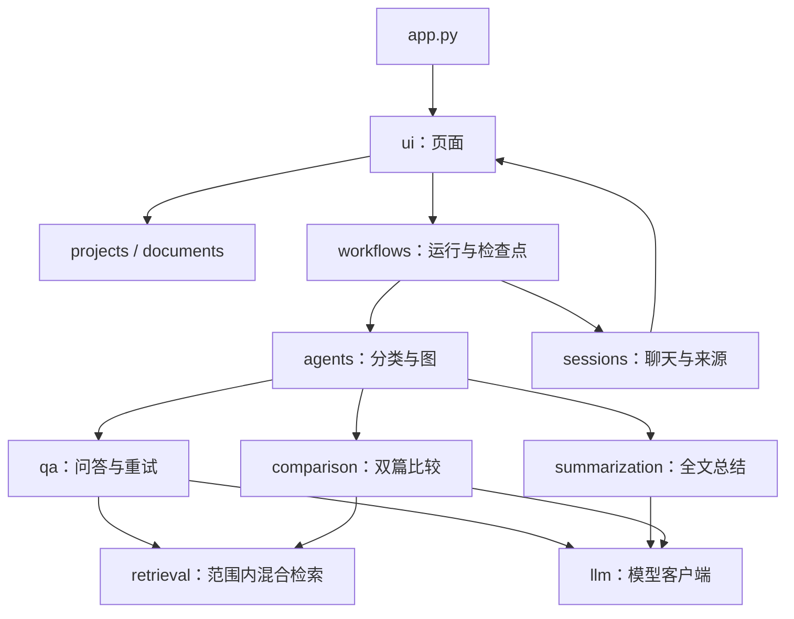

# Python 项目组织与当前架构

正式代码位于 `src/paper_sage/`，是一个可以安装的 Python 包。启动脚本、测试、示例、文档和数据分别管理。`src/` 是存放源码的目录，**导入时写 `paper_sage`，不写 `src.paper_sage`**。

## 包、模块与导入

原来 `from retriever import retrieve_dense` 依赖根目录恰好存在 `retriever.py`。现在改为：

```python
from paper_sage.retrieval.dense import retrieve_dense
from paper_sage.documents.pdf import load_pdf_pages
from paper_sage.sessions.chat import create_chat_session
```

`paper_sage` 是顶层包，`retrieval` 是子包，`dense.py` 是模块，`retrieve_dense` 是其中的函数。每个包的 `__init__.py` 只保留说明，不在导入时启动页面、读密钥或调用模型。

`python -m pip install -e .` 根据 `pyproject.toml` 将项目以可编辑方式安装。环境可以找到 `src/paper_sage/`，改代码后直接生效，正式模块不需要为寻找其他模块到处修改 `sys.path`。回归执行器仍将测试目录加入导入路径，以便按清单加载测试，这与应用使用根目录裸模块是两回事。

src 布局将可导入源码与仓库杂项隔开，也要求先安装项目，避免仅从仓库根目录运行就碰巧导入成功。参考 [PyPA 的 src 布局说明](https://packaging.python.org/en/latest/discussions/src-layout-vs-flat-layout/) 和 [setuptools 的 pyproject.toml 配置](https://setuptools.pypa.io/en/latest/userguide/pyproject_config.html)。

## 功能边界

| 包 | 责任 | 代表入口 |
| --- | --- | --- |
| `projects` | 项目元数据及索引目录 | `store.py` |
| `documents` | PDF 读取、分块、导入、删除和清理 | `pdf.py`、`importer.py`、`deleter.py` |
| `retrieval` | 索引、范围、召回、融合、精排和工具 | `tools.py`、`dense.py`、`fusion.py` |
| `llm` | DeepSeek 客户端配置与旧协议兼容函数 | `client.py` |
| `agents` | 意图分类和图节点编排 | `router.py`、`graph.py` |
| `qa` | 回答协议、证据、引用、复核和有界重试 | `model.py`、`evidence.py`、`retry.py` |
| `summarization` | 全文分批总结、汇总和复用 | `service.py` |
| `comparison` | 计划、逐篇检索、分组证据和比较 | `service.py` |
| `sessions` | 聊天列表、存档和恢复关联 | `chat.py`、`recovery.py` |
| `workflows` | 一轮运行的输入、检查点、日志和续跑 | `runner.py` |
| `ui` | Streamlit 页面和展示组件 | `app.py` 中的 `main()` |
| `evaluation` | 检索指标、评估、演示和回归执行器 | `regression.py`、`demo.py` |

`agents` 决定执行业务步骤的路径；`workflows` 管理执行的保存与恢复；`sessions` 管理聊天。三者有关联，但不是同一份状态。本次保留业务流程，主要调整代码归属、入口和导入；以后再按实际变化拆分过大的模块。



这是职责关系示意，不是严格的单向导入图；例如恢复会话需要各业务模块校验旧报告。避免新建一个通用 `utils.py` 把不同领域的业务再次混在一起。

## 入口与页面重运行

根目录 `app.py` 调用 `paper_sage.ui.app.main()`。页面控件在函数执行时创建；Streamlit 每次重运行入口都会重新渲染，不能只导入一个执行页面的模块，因为 Python 会缓存导入结果。

界面颜色基于 `.streamlit/config.toml` 的 [官方主题配置](https://docs.streamlit.io/develop/api-reference/configuration/config.toml)，集中样式与静态引导放在 `ui/theme.py`。输入区使用 [带 key 的容器](https://docs.streamlit.io/develop/api-reference/layout/st.container) 定位样式，两个操作按钮共用横向容器；清空采用按钮回调，在重绘聊天前生成新会话，避免旧消息残留。会话和运行控件接受可选的 `container`，由页面决定放在侧栏的哪个折叠区。项目名、文件名插入 HTML 前经过转义。主题之外的少量 CSS 仍依赖 Streamlit 元素结构，升级版本后应重新查看页面。

`scripts/` 文件只调用包内命令函数，例如：

```python
from paper_sage.evaluation.regression import main

if __name__ == "__main__":
    raise SystemExit(main())
```

`if __name__ == "__main__"` 保证直接运行时才执行命令。正式模块不反向依赖 `scripts/` 或 `examples/`；示例与命令通过导入复用正式模块。

## 数据与运行目录

源码位置与工作区位置分别处理。源码在 `src/`，数据与本地配置仍在**当前工作目录**下；正式命令请在仓库根目录运行。测试可以切换到临时目录，让同一个安装包处理隔离数据。

- `.streamlit/secrets.toml`：本地密钥，不提交。
- `config.local.toml`：缓存位置，不提交；相对缓存路径以配置所在目录为基准。
- `data/papers/`、`data/projects/`：文档与登记。
- `data/indexes/`：可重建索引，不提交。
- `data/evaluations/`：保留历史结果、失败和内容修订。
- `data/sessions/`、`data/checkpoints/`、`data/logs/`：本地运行状态，不提交。

本次不修改数据路径、片段标识和旧报告原文。旧演示记录的源码路径属于当时布局；新演示的摘要覆盖整个包和命令入口，不强行复用旧布局报告。

新克隆沿用旧项目登记却缺索引时，可在根目录创建临时脚本执行以下代码。它会覆盖所选项目当前版本的索引，已有正常索引无需执行：

```python
from paper_sage.projects.store import load_project, get_index_dir
from paper_sage.documents.pdf import load_pdf_pages
from paper_sage.documents.importer import build_document_index

project = load_project("demo_project")
for document in project["documents"]:
    pages = load_pdf_pages(document["source"], document["document_id"])
    directory = get_index_dir(project["project_id"], document["document_id"], document["index_version"])
    build_document_index(pages, project["project_id"], directory)
```

## 继续开发时放在哪里

1. 按业务归属选择包：检索策略放 `retrieval/`，比较校验放 `comparison/`，页面组件放 `ui/`。
2. 先明确函数输入和返回值，复用项目、文档和证据约定，再连接页面。
3. 使用 `paper_sage.*` 绝对导入，不恢复根目录同名文件，也不靠修改 `sys.path` 寻找源码。
4. 有意义的检查放 `tests/test_<功能>.py`。当前测试目录保留原继承和复用关系，之后可以独立整理为更细的测试包。
5. 命令需要新入口时，在 `scripts/` 增加薄脚本；教学示例放 `examples/`，保持独立且无需密钥。
6. README 维护当前用法，每日过程追加到 `docs/learning_log.md`；历史记录不因移动文件被改写为新的验收结果。

## 清理范围

原根目录有 153 个 Python 文件：73 个正式模块迁入包，80 个练习中保留 4 个独立示例，其余 76 个一次性脚本在备份后清理。静态检查未发现正式代码或测试导入这些练习。历史报告和学习日志保留。

备份包含迁移前的源码、测试和 README，ZIP 位于本机临时目录，路径与清单见 [迁移记录](layout_migration.json)。临时备份可能被系统清理，不应替代 Git；本次没有自动提交或推送。

`build/`、`__pycache__/` 和 `*.egg-info/` 是构建、运行或安装产生的目录，已加入 Git 忽略；不要在这些目录里维护业务代码。当前虚拟环境使用的可编辑安装元数据保留。

迁移后 368 项测试全部通过，安装与构建检查、数据保护结果见 [验收记录](layout_validation.json)。同步维护了页面测试的替换位置，并将早期纯文本回答、旧会话与错误文案的断言更新为现有协议；没有放宽正式程序的引用、范围或恢复校验。

依赖仍沿用当前快照，本次可编辑安装复用现有环境；最小依赖整理、全新环境安装、OCR 和部署属于后续独立工作。
