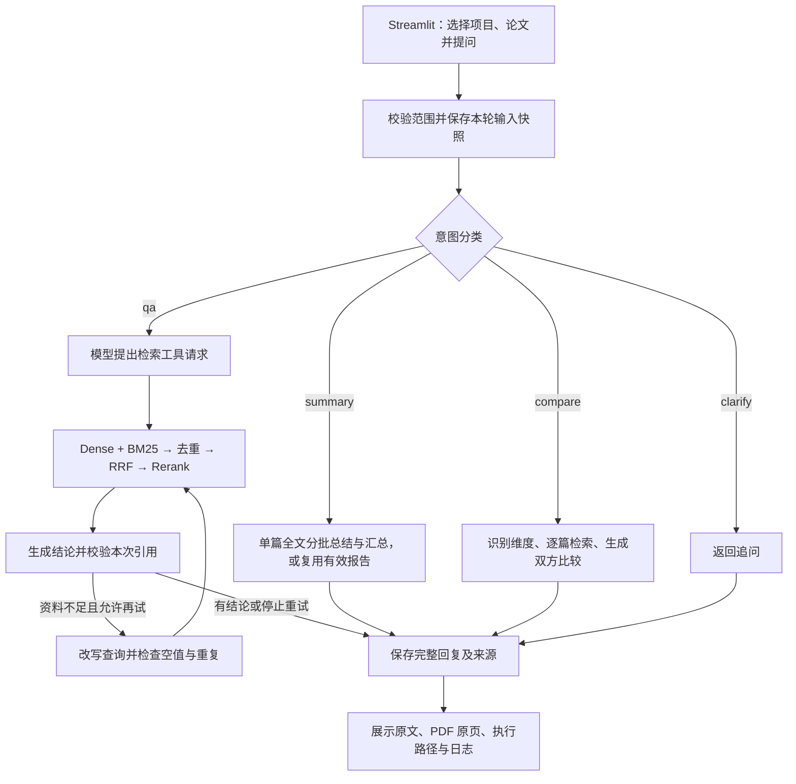

> 本文件保存重构前的学习历史，文中的旧路径与命令属于当时版本。当前入口与目录请看 [README](../readme.md) 和 [架构说明](architecture.md)。

# Paper Sage

通过亲手构建论文问答工作台，逐步学习 LLM 应用、RAG 和 Agent 开发。

最终目标是基于 **Streamlit + LangChain + LangGraph**，实现按项目组织论文、限定检索范围、自动选择工作流程，以及可追溯到论文原文的证据回答。检索层已实现 **Dense + BM25 双路召回 → RRF 排名融合 → Rerank 精排**。

**当前阶段：42 天学习路线已完成。五项真实演示、来源检查、空工作区导入验收与项目复盘已记录；比较中的格式失败和内容修订均保留。** 工作台支持项目创建与切换、PDF 导入查重、解析分块、索引保存、文档删除与失败清理重试，以及会话和文档检索范围隔离。提交问题后，模型先分类；`qa` 执行检索与回答，资料不足时在原范围最多补充检索一次，`clarify` 返回追问，`summary` 处理当前单选论文的全文总结，`compare` 为当前两篇论文识别最多三个比较维度，逐篇检索并生成双方发现、缺失说明、比较与限制。维度不明确时先追问。检索采用 Dense / BM25 各最多 6 条、RRF 保留最多 6 条、本地 BGE 精排后最多 3 条参考资料；比较的每个文档与维度独立执行检索。问答结论引用本次最终片段的标识，原文、文档和页码由程序查回；问答、总结和比较的原文依据处可按需查看对应 PDF 单页并下载。页面分别保留结论依据、检索候选、阶段记录和工作流路径，只有完整且通过结构与引用关联检查的回复才写入会话。结论支持关系仍需人工核对；离线来源检查和人工复核记录不会使工作台自动判断事实真伪，已增加完整聊天会话的手动保存与恢复；正式图按轮保存输入与 SQLite 检查点，可在侧栏载入、继续未完成运行或查看已完成结果。每轮另存 JSONL 诊断日志，可查看节点和模型调用的状态、耗时及异常类型；日志不代替检查点或事实核对。Day 28 固定新题复验中，四道有答案题的最终平均 Recall@3 / MRR@3 从 0.50 提升到 0.75，五题平均耗时从约 1.24 秒增加到 1.84 秒；这仍是小样本检索结果，不是回答正确率。

Day 21 已保存两条用户回传的实际回答、磁盘来源核对与四组隔离验收结果。学习者编写的归属断言用于检查每条候选；自动检查采用真实页面和 FAISS、控制向量与模拟回答，验证项目切换、文档选择、空选择和跨项目删除隔离，不作为语义召回或模型回答质量评估。

## 1. 学习路径

学习主线：

**模型调用 → 论文 RAG → 项目与检索范围 → 混合检索 → Agent 工作流 → 证据校验与评估。**

| 阶段 | 学习日 | 学习重点 | 阶段成果 |
| --- | --- | --- | --- |
| 第一阶段：模型与应用基础 | Day 01–07 | Python 环境、模型调用、消息、提示词、Streamlit、LangChain 基础、模块划分 | 能连续对话、可复现运行的基础应用 |
| 第二阶段：论文 RAG | Day 08–14 | PDF 解析、分块、Embedding、向量检索、上下文组装、基础引用 | 可以针对一篇论文提问，并查看回答依据 |
| 第三阶段：项目与范围管理 | Day 15–21 | 数据模型、持久化、文档生命周期、检索过滤、会话隔离 | 按项目管理论文，并限定参与问答的文档 |
| 第四阶段：混合检索 | Day 22–28 | Dense、BM25、RRF、Rerank、对照实验 | 能比较和解释各检索环节的效果与耗时 |
| 第五阶段：Agent 工作流 | Day 29–35 | 工具调用、LangGraph 状态与节点、路由、条件分支、循环终止 | 自动选择问答、总结、对比等流程 |
| 第六阶段：证据与工程完善 | Day 36–42 | 结构化证据、引用校验、原文定位、持久化、缓存、日志、评估 | 可演示、可维护的论文问答工作台 |

计划按每天约 **45–60 分钟**安排。这里的“天”是学习日，不是连续自然日；遇到基础知识缺口或调试问题，可以把一天拆成多次学习。

教学方式：学习者编写关键代码，助手负责讲解、拆解任务、检查和调试。每天开始时明确目标与验收标准，完成当天验收后收尾。

讲题约定：学习者表示不明白题意时，先解释场景与术语，再逐步给提示，保留学习者自行作答的机会；作答后再纠错和讲解。

建议节奏：10 分钟复盘、15 分钟讲解、25 分钟实践、10 分钟验证与记录。

## 2. 每日学习任务与状态

- `[x]`：已完成，已有代码、学习记录或验收结果支撑。
- `[ ]`：未完成，包括尚未开始的任务。
- 做了一部分但尚未达到验收标准的任务仍保留 `[ ]`，把已完成部分写入当天记录。

**当前进度：已完成 42 / 42 个学习日。** Day 42 五项真实工作台演示已完成行为验收，记录了比较失败、格式提示调整和独立内容修订；最终版本固定回归 14 / 14 通过。空工作区可创建项目、导入 PDF、建立并重载索引；复用现有依赖与模型缓存，尚未重新安装完整依赖。完成的是本轮学习路线，不代表模型答案全部正确或达到生产部署标准。

Day 01 实际完成内容超过最初的“跑通页面”目标。下面已按实际进度调整，已学会的模型调用、会话状态和函数拆分统一记入 Day 01，后续安排在此基础上推进。

### 第一阶段：模型与应用基础

- [x] **Day 01｜从页面到多轮模型对话**：创建 Python 虚拟环境；运行 Streamlit；接入 DeepSeek；理解消息角色和返回值；实现聊天历史与清空；封装函数并拆分模块。验收：基础聊天与清空由学习者验证，模块拆分后的语法与引用关系检查通过。
- [x] **Day 02｜用 LangChain 接入 DeepSeek**：复验现有功能；理解模型对象、消息对象和调用接口；将 `llm.py` 中的模型调用改为 LangChain 实现。验收：页面仍能完成单轮问答、多轮追问和清空，能解释与直接 HTTP 调用的对应关系。
- [x] **Day 03｜提示词与上下文实验**：整理系统提示词；手动给模型一小段论文原文；比较有无原文时的回答。验收：保存一组对照结果，并解释提示词、外部资料和聊天历史分别起什么作用。
- [x] **Day 04｜结构化输出**：学习字典、JSON 和数据校验；定义包含回答、依据和证据不足说明的结果结构。验收：程序可以读取各字段，并识别缺字段或格式错误的结果。
- [x] **Day 05｜调用失败与输出长度**：理解异常传播；区分认证、限流、超时等常见失败；处理输出被截断的情况。验收：用模拟失败验证提示与历史记录状态，能区分“请求成功”和“回答生成完整”。
- [x] **Day 06｜让项目可复现运行**：整理依赖文件、配置示例和启动步骤；学习 Git 的基本提交方式。验收：独立环境的依赖检查、问答与清空均已通过，依赖与配置有明确记录；已完成本地提交 `f5d99e0` 并核对提交内容。
- [x] **Day 07｜基础阶段复盘与样例准备**：复盘输入到输出的数据流；选择可提取文字的论文；准备 3 个有原文依据的问题和 1 个论文未提供答案的问题。验收：固定 NeurIPS 2017 的 11 页版本，保存 4 条 JSON 样例及依据与页码；问答、追问、资料不足和清空会话均由学习者实际验证通过。

### 第二阶段：论文 RAG

- [x] **Day 08｜读取 PDF 并保留来源**：使用 `pypdf` 读取文本型 PDF，封装逐页读取函数；在页面记录中保留文档标识、来源和 PDF 页序号，学习其与印刷页码的区别。验收：11 页记录完整，三条样例原文与页码匹配；空白、混合页面及仅空白字符场景检查通过，空白页保留在结果中。
- [x] **Day 09｜文档分块与元数据**：学习分块长度与目标重叠，封装逐页分块函数，为片段保留项目、文档、来源、页码和标识。验收：对比 400 / 100 与 800 / 100 两套配置，得到 113 与 51 个片段；来源、长度、三条样例依据及空页面等边界检查通过。跨配置标识重复问题已在 Day 11 加入参数区分后处理。
- [x] **Day 10｜Embedding 与语义相似度**：区分聊天模型与向量模型；在 CPU 上生成中英文文本向量并比较余弦相似度。验收：理解 `(4, 384)` 的含义与归一化后的点积；完成三组问题对照并保留排序失败案例，能解释语义相关不等于有回答依据。
- [x] **Day 11｜建立向量索引**：片段标识加入分块长度和重叠量，保存八个片段字段；用 FAISS + JSON 保存向量索引与原文记录。验收：三套参数的标识无交叉重复；51 个 384 维向量可在新进程中重新加载并查询到原片段；保存数量检查和读取版本、维度、数量检查通过。
- [x] **Day 12｜完成 Dense 检索**：按索引保存的编码配置生成问题向量，封装 `retrieve_dense()`，返回带名次、分数和完整来源的候选列表。验收：四组问题的封装前后结果一致；三条有答案问题分别记录 Top-1、Top-3 命中情况，保留漏检和无答案案例；空问题、非法数量、空索引及返回数量限制检查通过。
- [x] **Day 13｜跑通基础 RAG**：将检索片段、问题和回答要求组合后发送给模型；展示回答及对应片段。验收：真实页面回答编码器为 6 层并引用原文，耗电量问题说明资料不足；针对模型仍附引用的违规结果补充字段组合校验。固定数据与页面模拟验证合法结果、违规拦截、两轮来源保留及清空通过。
- [x] **Day 14｜建立 RAG 评估基线**：完成 20 题，覆盖单主题事实、多处依据组合和无答案问题，保存首轮结果、检索命中、回答正确性与引用支持。验收：汇总为 20 次提交、16 次正常返回、13 题回答正确；保留漏检与部分作答触发校验的案例，标准题、原始观测、核对和汇总分开保存。

### 第三阶段：项目与范围管理

- [x] **Day 15｜设计持久化数据模型**：整理 Project、Document、Chunk 的关系；为项目和文档元数据引入本地持久化，按项目、文档与索引版本规范索引目录命名。验收：学习者完成路径函数、JSON 保存读取及页面接入；新进程读到项目字典和 51 条片段，新旧索引文件完全一致，重启页面后显示可检索片段 51。
- [x] **Day 16｜创建与切换项目**：实现项目创建、列表与切换；展示当前项目的文档。验收：学习者确认页面创建、自动选中、空名称拒绝及两个项目切换；新进程读到三个已保存项目。修复提前使用变量后，AppTest 验证文件名随项目变化、空项目停止加载，以及切换时聊天与来源清空；未调用模型 API。文档上传与索引构建在 Day 17 接入。
- [x] **Day 17｜文档导入生命周期**：将上传、解析、分块和索引串起来；处理重复上传和失败状态。验收：学习者在 test 项目完成真实导入，文档数为 1、片段数为 51；再次上传提示已有。助手在隔离目录完成 8 组检查，覆盖改名查重、完整导入、保存与解析失败、无可用文字、索引与登记写入失败及重试；没有调用 DeepSeek。
- [x] **Day 18｜限定检索文档范围**：支持当前项目全部论文或选定论文，仅加载所选索引并在内存中合并检索。验收：学习者在同一项目完成两份不同 PDF 的三组问答，片段数量为 1、51、52；助手核对完整片段归属，并用实际索引验证全部模式、空选择、历史清理和等价范围缓存复用，未新增 DeepSeek 调用。
- [x] **Day 19｜隔离项目与会话上下文**：定义带编号与范围归属的会话记录，集中处理继续、切换、清空和历史校验。验收：学习者完成三个核心函数；实际页面配合真实索引、回放向量和模拟回答通过九组检查，确认历史与候选来源不跨范围、清空与错误处理正确，真实 DeepSeek 调用为 0。
- [x] **Day 20｜删除文档与同步索引**：记录移除、所属 PDF 与全部版本索引清理、失败待办和重试，以及页面选择、缓存和会话同步均已接入。验收：10 项文件检查与 8 组页面检查通过；学习者实际删除测试 PDF 后回传 1 份文档、51 个片段及输入框清空，助手核对记录、文件与索引一致，素材原件保留。
- [x] **Day 21｜项目管理阶段验收**：准备同名、相近内容的人工 PDF，学习者实现候选归属断言并完成 A、B 两次实际问答及切换清空确认。验收：磁盘来源核对和项目切换、范围选择、空选择、跨项目删除四组自动检查通过；保存人工回传与自动检查的独立记录，助手未调用模型。

### 第四阶段：混合检索

- [x] **Day 22｜BM25 关键词检索**：完成英文与数字词项处理、BM25 打分和候选排名，保留完整片段来源。验收：真实论文检索通过，四项边界检查通过；保存三条固定查询的 Dense 与 BM25 对比，明确当前分词的中文限制及有候选不等于有答案。
- [x] **Day 23｜统一双路召回接口**：统一入口、候选去重、两路排名与来源保存、页面接入均已完成；12 项检查通过，覆盖范围、失败拦截和空匹配。学习者实际页面确认 Dense 与 BM25 各 3 条、去重后 4 个片段，同一片段保留两路独立排名和分数。
- [x] **Day 24｜实现 RRF 排名融合**：手算与程序对照通过，完成打分、排序、同分规则、数量限制、来源保留及页面参考资料切换，17 项检查已验证。学习者确认实际页面使用三个融合片段、常数为 60，按顺序显示的 RRF 分数为 0.032522、0.032002、0.016393。
- [x] **Day 25｜加入 Rerank 精排**：输入对、模型打分、排序、真实候选对比与页面接入已完成，分别限制融合候选和最终返回数量，保留前后排名、分数、来源与耗时。21 项检查通过；学习者实际页面确认 4 条精排后选出 3 条、原 RRF 名次为 1 / 3 / 2，本次精排耗时 1.212 秒（不含模型加载）。
- [x] **Day 26｜观察完整检索流程**：计时与片段标识关联练习、六阶段记录及页面接入已完成，24 个不同场景经检查与复验验证通过。学习者回传六个阶段的数量、耗时和四条排名路径，确认 `p10:c3` 在最终截取时未入选；能够判断入选参考资料不保证支持回答。
- [x] **Day 27｜完成检索对照实验**：完成 Recall、RR、MRR 计算、全范围标注、输入检查和四种方法对照。学习者正确判断汇总指标的不同变化，并在纠正讲解后确认理解 q3 的首个命中提前、q17 的相关片段被排到第四名后落选，以及 Recall 分母和 Top-K 范围。报告保留 20 题的候选、排名和阶段记录，15 道有答案题参与指标平均。
- [x] **Day 28｜调整检索参数并复盘**：完成每路召回 3 / 6 的单参数对照，学习者明确质量优先并在复验前选择 B。五道新题复验中，四道有答案题的最终平均 Recall@3 / MRR@3 从 0.50 增至 0.75，平均耗时增加约 0.60 秒；v4 仍遗漏。工作台采用 B，16 个页面场景经检查与目标复验验证，保留原基线和全部报告，不继续在复验题上挑参数。

### 第五阶段：Agent 工作流

- [x] **Day 29｜把检索封装成工具**：完成工具定义、范围资源绑定、模型请求、工具执行和结果回传。学习者实际运行中，调用标识一致、工具结果为 2728 字符，四条消息交回模型后得到 `stop` 结束的结构化回答。保存单题验收记录，区分结构校验与引用校验；工作台接入和 LangGraph 编排待后续学习。
- [x] **Day 30｜LangGraph 的状态、节点和边**：完成两节点字段更新练习及工具请求、执行、回答的三节点图。验收：模拟与单题真实运行的消息数均为 `2 → 3 → 4 → 5`，原问题保留；真实资料为 2728 字符，最终答案通过结构校验。学习者正确指出模型接收 `messages`，助手补充原文状态字段与工具消息的分工，完成数据流复盘；图尚未接入页面。
- [x] **Day 31｜结构化意图路由**：完成四种意图的场景判断、JSON 校验、条件边及 DeepSeek 分类接入。验收：四个真实分类场景均符合预期并执行对应单个分支，澄清分支返回针对论文对象与任务的追问；报告输入、结构、路径及汇总复核通过。使用教学文档信息与处理节点，真实论文任务接入按后续课程推进。
- [x] **Day 32｜实现论文问答分支**：图与工作台已接入范围受控的检索工具、回答生成及澄清分支，并保留同范围历史、检索记录与实际路径。验收：30 个不同自动检查场景通过，学习者回传真实问答、澄清路径，并确认连续追问 GPU 型号回答正确；结构化引用与来源核对见 Day 36–37，结论支持关系仍需人工判断。
- [x] **Day 33｜实现论文总结分支**：完成全文分批、真实 Map → Reduce、来源追溯、报告复用、失败续传及 LangGraph/工作台接入。验收：学习者确认单选 Demo 论文后四类总结、复用提示、`summary_handler` 路径及原文依据符合预期；没有局限要点时明确说明不足，18 项相关业务和页面检查通过。来源传递检查不自动证明总结要点得到原文支持，仍需人工核对。
- [x] **Day 34｜实现论文对比分支**：完成维度识别、逐篇检索、带来源比较、内容修订、报告保存及 LangGraph/工作台接入。验收：学习者确认两篇论文的训练数据与实验结果比较符合预期，实际路径、双方原文和页码、两个维度及四项检索记录均正常；新报告只读关联检查通过。内容支持关系仍需人工核对，不能仅凭引用合法认定比较正确。
- [x] **Day 35｜受控重试与终止条件**：完成查询改写、空/重复查询检查、最多两次尝试、明确终止与失败记录；通过离线图检查、真实问答路径和工作台尝试记录/清空验收。验收：首次充分即结束，两次不足按上限结束，工具与改写失败、回答截断停止且不追加失败会话；保留各次查询、候选和结果。

### 第六阶段：证据与工程完善

- [x] **Day 36｜统一结构化证据**：完成证据表、结论与片段标识协议、逐次证据隔离、保存校验及工作台展示。独立真实回答与三组图练习已验收，85 项相关离线检查通过；学习者确认页面问答、原文来源展示及清空会话正常。回答引用限定在本次实际提供给回答模型的证据中，来源核对与人工支持关系复核衔接 Day 37。
- [x] **Day 37｜校验引用与结论支持关系**：完成支持/矛盾/证据不足判读、逐条复核记录、当前索引及 PDF 页文字核对，并保存三条真实结论的独立人工复核。验收：错误引用、来源错配和无依据结论样例已检查，10 项新增单元检查及真实记录保存后读取检查通过；原始报告保持不变。支持分类来自学习者，具体理由由助手补充，程序不自动验证语义支持关系。
- [x] **Day 38｜在界面查看原文证据**：完成页面定位、单页 PDF 准备、独立查看及工作台三类回答的引用入口。验收：37 项相关页面检查通过；学习者确认工作台 PDF 查看、下载与清空全部正常。从回答可定位对应原页并对照引用，范围改变时移除旧查看内容，查看操作不重复请求模型。
- [x] **Day 39｜会话与工作流持久化**：已完成。聊天存档、正式图续跑、输入与检查点关联、后端结果去重及工作台恢复入口均已验收；重启后可载入并继续未完成运行，完整回答与依据恢复，重复载入不重复追加，清空后刷新保持空白。
- [x] **Day 40｜缓存、日志与耗时记录**：已完成。缓存失效、步骤记录、异常传播及 JSONL 调用关联练习通过，正式流程和工作台日志面板已验收；可分别查看节点、模型调用及资源获取的状态和耗时，刷新不新增调用记录。
- [x] **Day 41｜完成关键场景回归**：整理固定清单与执行入口，补齐空项目、无文字 PDF、重复上传用例，覆盖资料不足、范围切换、删除、接口失败、循环终止、引用拦截及暂停恢复。验收：完整清单实际运行 14 项、全部通过，无跳过或未执行；报告与清单、逐项状态核对一致。使用临时项目与受控模型，不评价真实模型回答质量。
- [x] **Day 42｜项目演示与复盘**：完成问答、资料不足、澄清、总结复用和双篇比较的真实流程演示，核对来源、PDF 单页、重复载入与清空；整理架构、运行说明、评估边界和改进顺序。比较两次格式失败后调整提示词，新运行通过；内容核对产生 6 处独立修订。最终固定回归 14 / 14、比较专项 17 / 17 通过，空工作区导入与重载通过。验收不包含全新依赖安装、人工浏览器视觉检查或完整答案质量评估。

## 3. 当前项目与运行方式

### 当前工作流与模块分工



这是主要成功路径。总结或比较的所选论文数量不符合要求、比较维度不明确时，也会返回澄清；调用或校验失败时保留已有聊天，不保存半轮回答。问答最多尝试两次，空/重复改写提前停止。运行期间写入 SQLite 检查点与 JSONL 日志，恢复需要当前范围、文件和历史仍与原运行一致；图不是从任意 Python 行继续。

| 职责 | 主要模块 | 数据与边界 |
| --- | --- | --- |
| 页面与文档管理 | `app.py`、`project_store.py`、`document_importer.py`、`document_deleter.py` | PDF → 页面 → 片段 → FAISS / JSON；按项目查重与清理 |
| 模型与图编排 | `llm.py`、`intent_router.py`、`agent_graph.py`、`qa_retry.py` | DeepSeek 做分类、工具请求及文字生成；程序限制分支、范围和次数 |
| 混合检索工具 | `paper_tools.py`、`dual_retriever.py`、`rank_fusion.py`、`reranker.py` | 两路各最多 6 条，RRF 最多 6 条，精排后最多 3 条；本地计算 |
| 问答证据 | `cited_answer_model.py`、`answer_evidence.py`、`pdf_evidence.py` | 模型输出结论与标识；程序从本次原始片段查回来源和 PDF 页 |
| 全文总结与双篇比较 | `summary_service.py`、`comparison_service.py` 及各自模块 | 总结使用全文分批；比较按论文与维度分别检索，不用普通 QA 的单次 Top-3 代替全文 |
| 会话与恢复 | `session_store.py`、`session_recovery.py`、`workflow_runner.py`、`workflow_checkpoint.py` | `session_id` 标识聊天，`run_id` 标识一轮图执行并用作线程编号 |
| 诊断与验收 | `workflow_events.py`、`workflow_observation.py`、`run_regression.py` | 日志保留实际调用与耗时；固定回归验证程序行为，不给答案自动背书 |

### 评估记录与当前限制

| 记录 | 样本与结果 | 可以说明什么 |
| --- | --- | --- |
| [Day 14 基线](../data/evaluations/day14_summary.json) | 20 次提交，正常返回 16 次，回答正确 13 次 | 早期 RAG 的人工核对基线，不是当前版本准确率 |
| [Day 27 检索对照](../data/evaluations/day27_retrieval_comparison.json) | 15 道有答案题；Dense 的 Recall@3 / MRR@3 为 0.5133 / 0.5444，精排后为 0.5044 / 0.7333 | 首个相关片段排名改善，不代表召回率也提高 |
| [Day 28 新题复验](../data/evaluations/day28_validation_comparison.json) | 4 道有答案题的最终 Recall@3 / MRR@3 从 0.50 / 0.50 到 0.75 / 0.75；含无答案题的 5 题平均检索耗时从约 1.24 到 1.84 秒 | 支持本项目质量优先选择每路召回 6 条；仍有漏检且样本很小 |
| [Day 41 回归](../data/evaluations/day41_regression_20261029T120549146017Z_12ed85ee.json) | 14 项固定场景全部通过，无跳过 | 验证范围、导入、异常、循环、引用关联和恢复行为，不评价真实模型答案 |

目前只提取 PDF 的文字层，没有 OCR；图片、复杂表格与跨页内容可能丢失或错序。BM25 使用英文与数字词项，纯中文查询与英文论文容易错配；Dense 和精排也可能漏检。检索排名高、引用标识合法、模型正常结束，都不能单独证明结论得到原文支持。总结仍可能遗漏或误述；比较需要核对单位、任务和评测设置。当前是本地文件与 SQLite 的学习工作台，尚未提供多用户权限、服务部署和大规模性能验证。

### Day 42 固定演示与验收结果

使用同一 `Demo project` 中的两篇论文：Attention（11 页、51 个片段）与 Bahdanau（15 页、77 个片段），两篇合计 128 个片段。已只读核对现有 PDF 与索引，并将版本、文件摘要、问题和验收要点保存在 [演示计划](../data/evaluations/day42_demo_plan.json)。这份文件是计划，不是通过报告；五项初始状态均为 `not_run`。

| 编号 | 选择范围 | 固定问题 | 重点观察 |
| --- | --- | --- | --- |
| `demo_qa` | 仅 Attention | 训练模型使用了什么硬件？ | 结论有本次原文支持，能查看对应 PDF 原页 |
| `demo_insufficient` | 仅 Attention | 模型训练实际消耗了多少千瓦时（kWh）的电能？ | 资料不足时不编造电量，最多两次检索后停止 |
| `demo_clarify` | 两篇 | 帮我分析一下。 | 先问清对象或任务，不执行论文检索与生成 |
| `demo_summary` | 仅 Attention | 请概括这篇论文的研究问题、方法、主要结果和局限。 | 四类内容及来源，明确标出复用和未提取到的信息 |
| `demo_compare` | 两篇 | 比较这两篇论文的训练数据和实验结果。 | 两个维度、四项逐篇检索、双方来源与比较条件 |

已由助手按学习者委托完成，汇总见 [Day 42 验收与复盘](../data/evaluations/day42_completion.json)。计划文件保留初始状态，实际结果另存，避免将计划当作执行证据。五项分别在空会话和固定范围中执行；使用真实 Streamlit AppTest、DeepSeek 和本地模型，PDF 单页原文与页面组件入口均已检查，没有进行人工浏览器视觉验收。

| 场景 | 实际结果 | 内容核对与限制 |
| --- | --- | --- |
| 问答 | 1 次检索，引用第 7 页回答 8 块 NVIDIA P100 GPU | 主答案有依据；额外说明中的“最短 12 小时”措辞应收窄为“训练约 12 小时即可达到文中所述水平” |
| 资料不足 | 2 次检索后停止，`claims` 为空 | 未把 GPU、时长或 FLOPs 推算为实际 kWh |
| 澄清 | 只执行分类和澄清分支 | 没有执行论文检索或回答生成 |
| 总结 | 复用已有有效总结，只新增分类请求 | 抽查 2 条方法/结果要点及原文；不计为本次重新生成全文总结 |
| 比较 | 两个维度、4 项逐篇检索，最终完成 | 先有 2 次 JSON 格式失败，修改提示词后新运行通过；6 处文字问题另存助手修订，未覆盖原结果 |

来源检查共涉及问答 3 条、总结 9 条、比较 7 条去重后的原文记录；这些记录都能定位到实际 PDF 单页。重复载入、查看 PDF 和清空后刷新没有新增模型调用或重复聊天。最终完成的 5 轮共 13 次模型调用，加上原比较失败运行的 5 次，共 18 次；不把重载验收重复计数，也不声称一次执行全部成功。

比较原始结果与 [助手修订副本](../data/evaluations/day42_comparison_reviewed.md) 分开保存。主要修订包括：不能把 Bahdanau 的高频词选词规则套用到两篇；“当前候选未提供训练规模”不等于“整篇论文未报告”；词、token、句子和句对需要保持原单位。本次未召回 Bahdanau 的成绩表，不能借其他轮次结果填入本轮答案。

在现有 Demo 数据与索引摘要匹配的工作区，可以重复执行：

```bash
./.venv/Scripts/python.exe -X utf8 run_demo.py
./.venv/Scripts/python.exe -X utf8 run_demo.py --real
```

第一条只校验输入；第二条通过真实页面运行五项演示，会调用 DeepSeek 并生成新报告。可用 `--case demo_compare` 只选一项；`--replay-from <报告路径>` 只重载报告中已完成的运行、继续其余项，`--retry-failed` 则显式重试其中失败的图步骤。复用要求计划、应用源码与当前文件一致；源码改变后应启动新的对应场景，不强行复用旧执行。此脚本依赖本机现有演示计划与本地模型缓存；新克隆请先按运行说明准备数据和索引。**完整回归与真实演示应串行运行**，避免文件快照检查撞上正在写入的运行文件。

### 项目介绍与复盘

Paper Sage 是按项目组织论文的本地问答工作台。Streamlit 负责交互，LangChain 连接模型和工具，LangGraph 决定问答、总结、比较或澄清路径。问答和比较通过 Dense、BM25、RRF、Rerank 取得候选，模型用本次允许的来源标识给出结论；程序把标识还原为原文、文档和 PDF 页码。会话存档、按轮检查点和调用日志让结果可以检查、失败可以定位、未完成流程可以在条件一致时继续。

这轮开发最重要的三点是：检索相关不等于能支持答案；结构与引用合法不等于事实正确；日志、聊天存档与检查点分别解决诊断、展示恢复和流程续跑问题。本次比较的格式失败与内容修订也说明，即使启用 JSON 输出并提供 Schema，仍要检查响应完整性，并核对单位、缺失范围和比较条件。

后续优先扩充中英文检索题集，改善比较维度的候选覆盖；再持续统计格式失败与结论支持情况，加入单位、缺失说明和评测条件的内容评估；最后整理最小依赖和完整独立安装验证，按需求扩展 OCR 与部署。以上为后续改进清单，未标为已完成，也未擅自开始新一天任务。

### 当前文件结构（含本地练习文件）

```text
paper-sage/
├── app.py                    # 项目管理、混合检索问答、全文总结、双篇比较及来源展示
├── chat_session.py           # 会话创建、范围切换及模型历史的归属检查
├── llm.py                    # 统一 DeepSeek 配置，并保留旧练习调用函数
├── paper_tools.py            # 已选范围的混合检索工具、参考文本与完整检索 artifact
├── agent_graph.py            # 意图路由、工具调用与回答图，支持同范围聊天历史
├── agent_workflow.py         # 运行一轮图并整理完整消息；不修改原会话
├── workflow_runner.py       # 工作台按轮持久化、恢复与完整结果去重
├── workflow_checkpoint.py   # 检查点与原问题、历史、文件快照的关联校验
├── workflow_events.py       # JSONL 开始/结束事件与调用记录
├── workflow_observation.py  # 图节点及内部模型调用的日志观察
├── session_store.py         # 聊天会话 JSON 保存与读取
├── session_recovery.py      # 恢复时核对范围、来源和当前文件
├── answer_evidence.py       # 本次证据表、claims 协议与来源解析
├── cited_answer_model.py    # 使用当前尝试片段生成带标识的结论
├── pdf_evidence.py          # 引用归属校验与原 PDF 单页准备
├── run_regression.py        # 显式执行固定 14 项回归并保存报告
├── run_demo.py              # 默认核对固定演示输入，--real 通过真实页面逐项运行
├── retry_policy.py           # 已学重试策略：次数判断、空查询与标准化文本重复检查
├── query_rewrite.py          # 一次模型查询改写、响应记录与程序候选检查
├── practice_retry_policy.py  # 本地练习：固定结果下的重试决策与次数边界（不提交 Git）
├── practice_retry_query.py   # 本地练习：空查询、文本重复与执行前状态保留（不提交 Git）
├── practice_retry_graph.py   # 本地练习：计数节点、条件回边和六种模拟结束路径（不提交 Git）
├── practice_query_rewrite.py # 本地练习：默认固定响应，--real 只请求一次改写（不提交 Git）
├── practice_rewrite_retrieval.py # 本地练习：同范围对照原查询和改写查询（不提交 Git）
├── summary_inputs.py         # 单篇论文全文文字分批、页码与位置保留
├── summary_parser.py         # 每批总结的结构、来源标识校验与已知占位正文拦截
├── summary_model.py          # 单批原文消息、一次模型请求、完整响应校验与记录
├── summary_runner.py         # 完成记录校验复用、指定批次重做、逐批执行与进度回调
├── summary_reduce.py         # 汇总输入、独立人工校正及要点列表合并
├── summary_synthesis.py      # 一次 Reduce 请求、note_ids 校验与原文来源查找
├── summary_report.py         # 已保存全文总结的范围、原文、响应一致性核对与正文格式化
├── summary_service.py        # 当前单选范围的总结生成、报告复用及逐批进度恢复
├── comparison_inputs.py      # 两篇文档与比较维度转换为逐篇任务
├── comparison_plan.py        # 比较维度识别、英文查询与追问，记录复用校验
├── comparison_tools.py       # 分别加载单篇索引、绑定范围受控的检索工具
├── comparison_retrieval.py   # 按任务执行检索、保留工具结果和原始候选
├── comparison_context.py     # 按论文与维度组织资料，保留空候选
├── comparison_parser.py      # 比较结构、分组引用和双方来源校验
├── comparison_model.py       # 生成比较并从本轮候选查回原文与页码
├── comparison_review.py      # 独立内容修订应用到副本，不改原始模型结果
├── comparison_runner.py      # 计划、任务、工具、检索、资料、生成六阶段流程
├── comparison_service.py     # 真实服务绑定、报告保存、只读核对与显式修订复用
├── comparison_report.py      # 比较产物关联校验、聊天正文与修订副本格式化
├── comparison_view.py        # 页面展示会话中的计划、来源、检索与修订记录
├── practice_summary_inputs.py # 本地练习：全文输入、字符上限及顺序覆盖检查（不提交 Git）
├── practice_summary_schema.py # 本地练习：固定总结 JSON 与来源标识检查（不提交 Git）
├── practice_summary_batch.py # 本地练习：默认离线，--real 只总结第一批（不提交 Git）
├── practice_summary_map.py   # 本地练习：模拟循环、批次调用、进度恢复与定向重做（不提交 Git）
├── practice_summary_reduce.py # 本地练习：默认固定响应，--real 一次全文汇总（不提交 Git）
├── practice_summary_graph.py # 本地练习：固定分类，重放总结并验证图路径（不提交 Git）
├── intent_router.py          # 路由结构校验及基于所选文档信息的模型意图分类
├── practice_intent_router.py # 本地练习：四组固定路由结果的结构校验（不提交 Git）
├── practice_route_graph.py   # 本地练习：条件边与四个分支路径（不提交 Git）
├── practice_model_router.py  # 本地练习：--real 分类、分支执行与报告保存（不提交 Git）
├── practice_tool_artifact.py # 本地练习：工具正文与原始片段记录（不提交 Git）
├── practice_search_artifact.py # 本地练习：真实工具的片段、阶段记录与报告（不提交 Git）
├── practice_graph_artifact.py # 本地练习：重放报告并检查图内附加数据（不提交 Git）
├── practice_routed_qa.py     # 本地练习：路由连接问答与澄清路径（不提交 Git）
├── practice_tools.py         # 本地练习：模拟工具定义与手动调用（不提交 Git）
├── practice_paper_tool.py    # 本地练习：加载资源并手动调用真实检索工具（不提交 Git）
├── practice_tool_request.py  # 本地练习：模型请求与 --roundtrip 完整流程（不提交 Git）
├── practice_graph.py         # 本地练习：两节点状态更新与顺序连接（不提交 Git）
├── practice_agent_graph.py   # 本地练习：三节点图，默认模拟，--real 使用真实资源（不提交 Git）
├── answer_parser.py          # JSON、字段类型及资料不足时依据为空的校验
├── pdf_loader.py             # PDF 逐页读取，返回保留来源的页面记录
├── chunker.py                # 逐页分块，保留项目、文档、页码及片段标识
├── document_importer.py      # 文件摘要、项目内查重、PDF 保存及正式索引构建函数
├── document_deleter.py       # 文档移除、路径归属检查、清理待办与重试、导入登记协调
├── index_store.py            # FAISS 索引与 JSON 元数据的保存、读取和基础检查
├── project_store.py          # 项目创建与列表、JSON 临时写入后替换、规范索引路径
├── retriever.py              # 问题向量化、Dense 检索，返回分数与完整片段记录
├── bm25_retriever.py          # 英文与数字词项处理、BM25 排名及完整片段返回
├── dual_retriever.py         # 双路统一入口、结果归属检查与按标识合并候选
├── rank_fusion.py            # RRF 打分、排序、数量限制及来源保留
├── reranker.py               # 本地精排模型加载、候选打分与排序，保留原 RRF 信息
├── retrieval_trace.py        # 阶段计时、独立快照与片段排名路径汇总
├── config.example.toml       # 本机模型缓存目录配置模板
├── config.local.toml         # 本机缓存位置，不提交 Git
├── compare_retrievers.py     # 在相同范围比较三条固定查询，保存独立检索报告
├── retrieval_scope.py        # 选择项目内文档，校验并合并所选索引及片段
├── rag_context.py            # 将检索片段与来源组装为模型参考资料字符串
├── practice_chunks.py        # 比较两套分块配置，查看 GPU 样例所在片段
├── practice_embeddings.py    # 本地向量与相似度练习，当前保留耗电量问题
├── practice_index.py         # 为 51 个论文片段生成向量，建立并保存索引
├── practice_load_index.py    # 在新进程读取索引，检查向量与来源对应关系
├── practice_retrieval.py     # 打印检索候选，并查看组装后的参考资料字符串
├── practice_bm25.py          # 真实论文的 BM25 检索练习，打印分数与完整来源
├── practice_dual_retrieval.py # 回放 Day 22 候选，验证去重及两路排名保存
├── practice_rrf.py           # 两组手算对照及已保存真实候选的 RRF 回放
├── practice_rerank.py        # 输入对、本地精排打分及后续排序练习
├── practice_rerank_candidates.py # 四条已保存真实候选的 RRF 与精排对比
├── practice_retrieval_trace.py # 阶段输入输出数量、耗时与结果快照练习
├── retrieval_metrics.py      # 复用学习者的指标函数与已完成的片段标识读取
├── evaluate_retrieval.py     # 四种方法固定题集对照；支持 --check 输入检查
├── compare_recall_limits.py  # 三道开发题的召回上限 3 / 6 对照，记录阶段命中与耗时
├── validate_recall_limits.py # 校验事先选择，在固定五道新题上复验 A / B
├── practice_retrieval_metrics.py # 从正式模块导入指标，保留原教学样例
├── practice_relevance_labels.py # 展示三个真实片段与助手已记录的依据判断
├── practice_retrieval_tuning.py # 模拟检查每路召回参数传递，不加载模型
├── practice_evaluation.py    # 汇总五批评估记录，统计总数、正常返回与回答正确数量
├── requirements.txt          # 当前 Windows / Python 3.12 环境的依赖版本快照
├── readme.md                 # 学习路线、任务状态与每日学习记录
├── tests/
│   ├── test_document_deletion.py # 临时目录中的删除与失败恢复检查，不接触实际项目
│   ├── test_project_scope.py # 复用学习者归属断言，四组可重复运行的隔离验收
│   ├── test_bm25_retriever.py # 排名与来源、空匹配、输入边界及零分/负分匹配检查
│   ├── test_dual_retriever.py # 接口与合并检查、可复用的双路页面范围验收
│   ├── test_rank_fusion.py   # 八项融合检查、九组范围与参考资料页面验收
│   ├── test_reranker.py      # 七项精排与配置检查、十四组页面与历史验收
│   ├── test_paper_tool_artifact.py # 工具正文、附加数据、阶段快照及失败隔离
│   ├── test_agent_workflow.py # 路由问答/澄清、历史传递、范围及失败不保存
│   ├── test_summary_model.py # 单批总结输入、响应拒绝、记录隔离与模拟 HTTP 检查
│   ├── test_summary_resume.py # 已完成记录的原文、配置、响应一致性和复用检查
│   ├── test_summary_reduce.py # 汇总输入完整性、校正来源与原始响应保留检查
│   ├── test_summary_synthesis.py # Reduce 请求准备、输出结构及失败记录检查
│   ├── test_summary_report.py # 总结报告范围、原文变更及响应一致性检查
│   ├── test_summary_service.py # 总结生成、范围隔离、复用与失败续传检查
│   ├── test_summary_page.py  # 总结页面、原文展示、后续问答及失败不保存检查
│   └── test_retrieval_trace.py # 阶段快照、完整路径、失败与旧历史兼容检查
├── data/
│   ├── sample_questions.json # 3 条有答案样例与 1 条资料不足样例
│   ├── evaluation_questions.json # 固定 20 题的标准答案、原文依据和不足原因
│   ├── fixtures/
│   │   ├── day18_scope_note.pdf # 明确标注为人工测试资料，用于范围验收
│   │   └── day21/
│   │       ├── manifest.json # 测试用途、固定问题、预期校验码及文件摘要
│   │       ├── project_a/scope_note.pdf # 项目 A 测试素材，1 页、1 个片段
│   │       └── project_b/scope_note.pdf # 同名相近内容，校验码与 A 不同
│   ├── evaluations/
│   │   ├── day14_baseline.json # q1～q4 人工回传，保留运行失败与未获取字段
│   │   ├── day14_q5_q8.json   # q5～q8 真实自动调用，保存候选、回答、引用与核对结果
│   │   ├── day14_q9.json      # q9 人工回传，核对两项依据及不同片段中的等价引用
│   │   ├── day14_q10.json     # q10 人工回传，记录 CPU 型号问题的正常资料不足回答
│   │   ├── day14_q11_q20.json # 最后 10 题真实代跑，保留原始响应、失败与核对结果
│   │   ├── day14_summary.json # 全部 20 题的指标、逐题判定、题集快照及报告哈希
│   │   ├── day21_project_management.json # 人工回答、磁盘核对及四组项目范围验收
│   │   ├── day22_retrieval_comparison.json # 同范围、同查询的 Dense 与 BM25 候选
│   │   ├── day23_dual_retrieval.json # 去重回传、自动检查摘要及实际页面确认
│   │   ├── day24_rrf.json     # 手算回传、候选回放、两次检查记录及实际页面确认
│   │   ├── day25_rerank.json # 用户精排回传、自动检查摘要与实际页面确认
│   │   ├── day26_retrieval_trace.json # 排名路径回传、阶段快照测试与已完成页面确认
│   │   ├── day27_relevance_labels.json # 固定题集的片段依据标注、引用位置与范围摘要
│   │   ├── day27_retrieval_comparison.json # 四种方法的真实检索结果、指标与阶段快照
│   │   ├── day28_tuning_plan.json # 实验前固定的配置、开发题与新复验题标签
│   │   ├── day28_development_comparison.json # 三道开发题的两组实际结果、阶段命中与耗时
│   │   ├── day28_selection.json # 复验前暂选 B、用户的质量优先偏好与来源摘要
│   │   ├── day28_validation_comparison.json # 五道固定新题的实际 A/B 复验
│   │   ├── day28_conclusion.json # 采用 B 的依据、未解决问题与页面检查记录
│   │   └── day29_tool_roundtrip.json # 学习者回传的完整工具调用单题验收与原文核对
│   ├── papers/
│   │   ├── attention_is_all_you_need_neurips2017.pdf # 原始演示论文
│   │   └── project_<uuid>/
│   │       └── doc_<sha256>/
│   │           └── <文件名>.pdf # 上传后按项目保存的副本
│   ├── projects/
│   │   ├── demo_project/
│   │   │   └── project.json  # 项目名称、文档来源及当前索引版本
│   │   └── project_<uuid>/   # 新建项目，每个项目各有一个目录
│   │       └── project.json  # 新项目的 documents 初始为空列表
│   └── indexes/              # 本地生成文件，不提交到 Git
│       ├── demo_project/
│       │   └── attention_is_all_you_need_neurips2017/
│       │       └── v1/
│       │           ├── index.faiss
│       │           └── metadata.json
│       ├── project_<uuid>/
│       │   └── doc_<sha256>/
│       │       └── v1/       # 上传构建的 index.faiss 与 metadata.json
│       └── day11_s800_o100/   # 保留的旧目录，当前工作台与练习已不使用
├── .gitignore
└── .streamlit/
    ├── config.toml           # 关闭触发可选模块导入的文件扫描；改代码后重启服务
    ├── secrets.toml.example  # 配置模板，仅含占位符，提交到 Git
    └── secrets.toml          # 本地 API Key 配置，不提交到 GitHub
```

当前本机环境为 Python 3.12.6，通过 `langchain-deepseek` 提供的 `ChatDeepSeek` 调用代码中配置的 `deepseek-flash`。`llm.create_chat_model()` 统一客户端配置；页面通过 `workflow_runner.start_workflow_run()` 或 `resume_workflow_run()` 执行带检查点的正式图，按意图进入问答、总结、比较或澄清。完整结果按运行编号只写回一次。`agent_workflow.py` 提供消息整理等共用逻辑，旧 `run_paper_turn()` 和 `ask_deepseek()` 保留供已有练习与测试使用。

客户端可能在 `invoke()` 返回之前抛出长度限制或内容过滤异常，页面会提示并保留原会话。认证失败、限流、超时、连接失败、JSON 或结构错误、检索失败和图步数超限也不会保存半轮对话。问答首次充分时通常有三次模型请求（分类、工具请求、回答）和一次本地检索；资料不足且改写有效时再增加一次改写、一次检索与一次回答。完整比较通常有三次模型请求（分类、维度计划、比较生成），两个维度对应四次本地检索。分类直接澄清或文档数量被拦截时只请求分类；进入比较计划后再澄清时有分类和计划两次请求。总结复用只请求分类，新总结还需逐批 Map 与一次 Reduce。SDK 的 `max_retries=0` 与图内最多两次检索是不同设置。页面重新运行时展示已有会话记录；重新提交比较会生成新报告，不自动套用旧计划、候选或内容修订。

客户端默认 `max_tokens=1024`，结构化问答覆盖为 2048，其他分支按各自需要设置。该参数限制输出 token 数，不等于整个上下文窗口的长度。`finish_reason="stop"` 表示正常结束或遇到指定停止序列，仍不能证明答案事实正确或证据充分。

当前正式问答结果结构（总结与比较使用各自的结构）：

| 字段 | Python 类型 | 用途 |
| --- | --- | --- |
| `claims` | `list[dict]` | 结论列表；有不足说明时必须为空 |
| `claims[].text` | `str` | 非空的结论正文 |
| `claims[].chunk_ids` | `list[str]` | 支持该结论的非空片段标识列表，仅允许本次提供的标识 |
| `insufficient_reason` | `str` | 当前资料不足的原因；有结论时必须为空字符串 |

`answer_evidence.parse_cited_answer()` 检查字段、类型、结论与不足原因的组合以及引用范围，程序按 `chunk_id` 查回原文、项目、文档、来源和 PDF 页码，不接受模型自行填写这些来源字段。旧 `answer / evidence / insufficient_reason` 三字段格式仍用于早期练习，由 `answer_parser.py` 解析。引用关联通过只证明标识指向本次资料，结论是否得到原文支持仍需人工核对。

页面将回答组装成 Markdown 保存，并在助手消息中另存 `answer_artifact`、逐次尝试、检索六阶段记录与 `workflow_trace`。消息位于 `st.session_state['chat_session']['messages']`，会话含 `session_id` 与 `scope_key`，支持显式保存和恢复。发送历史前检查范围归属，仅提取普通消息的 `role` 和 `content`。分类及工具请求用历史理解追问；正式回答根据本次尝试的最终片段构造 `reference`，历史不作为事实依据。`ToolMessage.artifact` 供程序保留原始候选和阶段记录，不会自动全部发给模型；查询改写不覆盖原问题。每条结论的引用标识由程序解析回来源，查看器按该来源打开原 PDF 页。

当前主要包版本如下；这是本机环境与依赖快照中的版本，不表示这些包的最新版本：

| 包 | 当前版本 | 用途 |
| --- | --- | --- |
| `streamlit` | 1.65.0 | 页面交互与会话状态 |
| `langchain-deepseek` | 1.1.1 | DeepSeek 模型集成 |
| `langchain-core` | 1.6.10 | LangChain 消息与模型基础接口 |
| `langgraph` | 1.2.17 | 状态、节点和边组成的工作流 |
| `langgraph-checkpoint-sqlite` | 3.1.2 | 图检查点的 SQLite 持久化 |
| `streamlit-pdf` | 2.1.0 | 页面中的 PDF 查看 |
| `filelock` | 3.32.3 | 本地运行及日志文件锁 |
| `langchain-text-splitters` | 1.1.3 | 按字符长度与分隔符递归分块 |
| `langchain-openai` | 1.7.2 | 当前 DeepSeek 集成使用的模型客户端基础实现 |
| `openai` | 3.31.0 | 兼容协议客户端及页面捕获的 API 异常类型 |
| `pypdf` | 6.21.1 | 本地 PDF 逐页读取与文本提取 |
| `sentence-transformers` | 6.1.0 | 加载向量模型并编码文本 |
| `torch` | 2.14.1+cpu | 本地 CPU 模型计算 |
| `transformers` | 5.20.1 | 向量模型底层实现与分词 |
| `numpy` | 2.5.4 | 向量数组与数值计算 |
| `faiss-cpu` | 1.15.1 | CPU 向量索引、相似度查询与索引文件读写 |

`ChatDeepSeek` 在本项目中连接 `https://api.deepseek.com`。主要第三方依赖除上表外还包括 `rank-bm25`；完整清单见 `requirements.txt`。`json`、`pathlib`、`uuid`、`hashlib`、`tempfile`、`typing`、`sqlite3` 属于 Python 标准库。向量与索引构建使用本地计算，不调用 DeepSeek API。

`requirements.txt` 是项目环境的指定版本快照，当前有 106 条记录，包含间接依赖和环境中的其他已安装包，不是自动求解生成的锁文件或最小依赖集合。Day 06 的早期依赖曾在本机新环境验证；之后补入 PDF、向量模型、LangGraph、PDF 查看器及 SQLite 检查点等依赖。Day 42 开始时在现有 Python 3.12.6 环境执行 `pip check` 通过，尚未用完整现有快照重新安装独立环境，也未验证其他操作系统和 Python 版本。

当前锁定的是 `torch==2.14.1+cpu`。新环境先从 PyTorch 官方 CPU 源安装这一版本，再安装完整快照；`pip freeze` 本身不记录下载源。以下三处环境准备命令均包含这一步。

### 本地启动（Windows / Git Bash）

先安装 Python 3.12，并准备自己的 DeepSeek API Key。以下命令均在项目根目录执行，逐条执行成功后再继续。首次准备环境时运行：

```bash
py -3.12 -m venv .venv
./.venv/Scripts/python.exe -m pip install "torch==2.14.1+cpu" --index-url https://download.pytorch.org/whl/cpu
./.venv/Scripts/python.exe -m pip install -r requirements.txt
./.venv/Scripts/python.exe -m pip check
```

`-r` 表示从文件读取依赖清单；`pip check` 检查声明的依赖是否缺失或版本不兼容，预期输出 `No broken requirements found.`。直接指定环境中的 Python 路径，无需先激活环境。

首次配置时，从模板创建本地配置。下面的 `-n` 表示已有目标文件时不覆盖：

```bash
cp -n .streamlit/secrets.toml.example .streamlit/secrets.toml
```

在编辑器中打开 `.streamlit/secrets.toml`，将占位符替换为自己的 API Key：

```toml
DEEPSEEK_API_KEY = "your-deepseek-api-key"
```

模板 `secrets.toml.example` 用于说明配置格式；应用通过 `st.secrets["DEEPSEEK_API_KEY"]` 读取实际配置。已有可用配置时沿用原文件。

Day 25 起，问答还需要本地精排模型。首次配置时执行 `cp -n config.example.toml config.local.toml`，然后在编辑器中设置缓存位置。本机已配置为 `E:/hf-cache/hub`，并有完整模型缓存，可直接启动；其他机器按实际目录填写，空字符串沿用 Hugging Face 默认缓存。`config.local.toml` 已加入忽略规则。

```toml
[rerank]
cache_folder = "E:/hf-cache/hub"
```

若选定目录尚无精排模型，先单独准备缓存：

```bash
./.venv/Scripts/python.exe -X utf8 -c "from reranker import load_reranker, get_rerank_cache_folder; load_reranker(cache_folder=get_rerank_cache_folder())"
```

该命令首次下载约 1.11 GB 的 `BAAI/bge-reranker-base` 权重及配套文件，固定模型版本，后续复用缓存。页面使用 `local_files_only=True`，不会在提交问题时下载权重；缺少模型时显示精排资源提示，且不调用回答模型。缓存不会因关闭程序自动删除；后续精排仍需使用，先保留。向量模型继续使用原有缓存位置，不会因这项配置自动迁移。

启动页面：

```bash
./.venv/Scripts/python.exe -m streamlit run app.py
```

打开终端显示的 `Local URL`。已有虚拟环境和配置时，只需运行启动命令。

页面从 `data/projects/*/project.json` 读取项目列表。首次使用可以在侧栏创建一个空项目，上传自己的文本型 PDF 并点击“导入论文”；创建入口在项目加载之前，空项目也能导入。成功后按照“全部文档”或“指定文档”加载对应索引，未选文档时停止问答。若使用仓库已有的 Demo 项目，克隆后须确认两篇 PDF 均存在，再按下方示例重建已有记录对应的本地索引；不用已经忽略的练习脚本作为启动前提。本机现有两份 Demo 索引已在 Day 42 准备时读回检查通过，无需重建。首次加载模型可能较慢，成功后显示参与检索的文档及片段数量。

索引目录不提交到 Git。若克隆后已登记项目缺少索引，需要按各篇文档的来源与版本逐份重建，对应 PDF 必须存在；旧的 `practice_index.py` 默认只处理第一篇文档。重新上传已登记的相同文件会命中查重，不会替代重建。以下是项目根目录中 Git Bash 的按需重建示例，改动 `load_project()` 的参数可选择目标项目：

```bash
./.venv/Scripts/python.exe - <<'PY'
from project_store import load_project, get_index_dir
from pdf_loader import load_pdf_pages
from document_importer import build_document_index

project = load_project("demo_project")
for document in project["documents"]:
    pages = load_pdf_pages(document["source"], document["document_id"])
    output_dir = get_index_dir(
        project["project_id"], document["document_id"], document["index_version"]
    )
    result = build_document_index(pages, project["project_id"], output_dir)
    print(document["document_id"], result)
PY
```

该命令会重新计算并覆盖目标项目各文档当前版本的索引，不修改项目记录，也不调用 DeepSeek；已有正常索引时无需执行。重建后重启工作台，使内存缓存重新加载。

项目新增 `.streamlit/config.toml`，设置 `[server]` 下的 `fileWatcherType = "none"`，规避后台文件监视器扫描 Transformers 模块时触发的可选视觉依赖导入错误。该配置会关闭文件监视；修改代码或配置后，停止并重新启动 Streamlit，确保变更生效。按钮交互仍会触发页面运行，`st.cache_resource` 缓存仍可复用；重启服务会重新初始化资源。[Streamlit 配置说明](https://docs.streamlit.io/develop/api-reference/configuration/config.toml)

如果使用 PowerShell，安装和启动命令也可按以下形式执行；配置文件可在编辑器中从模板复制并填写：

```powershell
py -3.12 -m venv .venv
.\.venv\Scripts\python.exe -m pip install "torch==2.14.1+cpu" --index-url https://download.pytorch.org/whl/cpu
.\.venv\Scripts\python.exe -m pip install -r requirements.txt
.\.venv\Scripts\python.exe -m pip check
.\.venv\Scripts\python.exe -m streamlit run app.py
```

当前 `.gitignore` 已排除 `.venv/`、`__pycache__/`、`.streamlit/secrets.toml`、`practice_*` 和 `data/indexes/`。练习脚本均只在本地保留、未被 Git 跟踪，因此克隆仓库后不会自动获得它们；下方练习命令以本地已有对应文件为前提，Day 10～12 及 Day 14 附完整示例便于重建。索引文件由练习生成，克隆后按下方步骤重新构建。忽略文件不等于删除文件，原有练习仍按维护约定保留。提交配置模板、依赖文件及正式模块，真实密钥文件和虚拟环境保留在本地；手动通过网页选择文件上传时也应排除它们。

### 在独立环境中验证（Windows / Git Bash）

项目已有可用的 `.streamlit/secrets.toml` 时，可以新建 `.venv-check` 验证依赖清单。此处独立的是 Python 包环境，运行时使用当前项目源码与本地配置。

Day 06 使用的 `.venv-check` 已在练习后清理，当前 `.gitignore` 中也已移除它的规则。若再次执行下面的验证，先在 `.gitignore` 中加入一行 `.venv-check/`，再新建环境。

```bash
py -3.12 -m venv .venv-check
./.venv-check/Scripts/python.exe -m pip install "torch==2.14.1+cpu" --index-url https://download.pytorch.org/whl/cpu
./.venv-check/Scripts/python.exe -m pip install -r requirements.txt
./.venv-check/Scripts/python.exe -m pip check
./.venv-check/Scripts/python.exe -m streamlit run app.py --server.port=8502
```

打开 `http://localhost:8502`，选择或导入 Attention 论文并仅勾选该论文，清空会话，取消问答暂停选项。提交“训练模型使用了什么硬件？”，预期得到 8 块 NVIDIA P100 GPU 及对应原文；打开 PDF 原页核对，再清空并刷新，确认旧聊天不会重新出现。当前版本自动检索，不需要手动粘贴参考资料。Day 06 当时使用手动资料的依赖、问答和清空验收已通过，历史记录保留；它不等于完整现有依赖已经在新环境复验。

### 更新依赖记录

在项目环境中有意调整依赖并验证功能后，再更新快照。Git Bash 命令为：

```bash
./.venv/Scripts/python.exe -m pip freeze > requirements.txt
```

PowerShell 中使用明确的文件编码：

```powershell
.\.venv\Scripts\python.exe -m pip freeze | Set-Content -Encoding utf8 requirements.txt
```

导出后检查文件差异，并在新环境中验证。若仍锁定 CPU 版 PyTorch，应保留上述从官方 CPU 源预先安装的步骤；依赖快照不包含模型权重，首次运行向量练习时还需下载模型。`Set-Content` 是 PowerShell 命令，不能直接在 Bash 中使用。

### Git 基本提交流程

编辑文件后，用 `git status --short` 查看状态；`git add <文件路径>` 把指定文件的当前内容加入暂存区；`git diff --cached` 查看待提交差异；`git commit -m "提交说明"` 把暂存区内容记录为本地版本。`git log -1 --oneline` 可查看最新提交。修改已暂存的文件后，需要再次 `git add` 才能把新修改纳入提交。

本地提交与上传 GitHub 是两个步骤，上传远端使用 `git push`。Day 06 学习者已完成本地提交 `f5d99e0`（完善异常处理并添加可复现运行配置），提交内容经助手核对。本次验收未检查远端上传状态。

### 当前能力与本地练习

Day 42 文件核对补充：早期的 `practice_json.py`、`practice_errors.py`、`practice_pdf.py` 当前目录已不存在，正式模块也不引用它们；本次没有删除文件。下方对应命令保留作历史学习记录，不能在缺文件时直接运行。其他练习存在交叉引用，暂不批量清理；正式功能与回归入口已经独立于这三个早期文件。

当前聊天使用 Streamlit 内存中的 `chat_session`，可在侧栏手动保存至 `data/sessions/` 并恢复；正式图逐轮保存输入及 SQLite 检查点到 `data/checkpoints/runs/`，运行内还保存 JSONL 日志。切换实际范围或清空会话会新建聊天编号，切回不会自动恢复；已存档内容需要显式载入。清空聊天不删除磁盘存档，也不清理模型缓存。正式问答已自动检索，并校验结论引用是否属于本次最终片段；人工仍需核对原文支持关系。下面各学习日的练习命令保留当时教学用途，不代表当前页面仍使用旧协议或旧入口。

Day 04 接入结构化输出后，学习者完成了有无资料两组实际问答。Day 05 通过本地模拟进一步验证：调用失败、输出未正常结束、JSON 或字段校验失败时显示对应提示，保留已有历史；正常回答只追加一问一答。模拟验证使用占位密钥，不代表重新验证了远端 API 的实时可用性。

运行本地解析练习：

```bash
./.venv/Scripts/python.exe practice_json.py
```

练习文件目前保留正常样例；缺字段和格式错误的实验操作、实际报错保存在 Day 04 学习记录中。

运行本地异常传播练习：

```bash
./.venv/Scripts/python.exe practice_errors.py
```

文件当前保留模拟正常返回的版本。将模拟函数中的 `return "模拟回答"` 替换为 `raise TimeoutError("模拟请求超时")`，可以重现失败时跳过历史追加的行为；每次重新运行脚本都从两条历史消息开始。该练习不会调用 API。

### 论文与问答样例（Day 07）

当前选用《Attention Is All You Need》的 [NeurIPS 2017 官方 PDF](https://papers.neurips.cc/paper_files/paper/2017/file/3f5ee243547dee91fbd053c1c4a845aa-Paper.pdf)，共 11 页。如本地没有该文件，从这个地址下载，并保存为 `data/papers/attention_is_all_you_need_neurips2017.pdf`。

本地文件已与官方文件进行内容校验，大小为 569,417 字节，SHA-256 为：

```text
d87d482d5ae7960e2e43d7dd6d21377e60e73e8fce1bf2a01aff7aca8a08c537
```

本次样例的 `pdf_page` 表示从 1 开始的 PDF 页序号。不要直接套用其他版本的页码：例如，编码器层数的原句在这份文件的第 2 页，而在 [arXiv v7 的 15 页版本](https://arxiv.org/pdf/1706.03762v7)中位于第 3 页。

`data/sample_questions.json` 保存论文路径、官方来源及 `cases` 列表。每条样例包含问题、是否可回答、预期答案、原文摘录、页码和不足原因。预期答案可以概括，`evidence` 保存可对照原文的连续摘录。无答案样例使用 `answerable: false`、`evidence: []` 和 `pdf_page: null`；检查过哪些相关页写在不足原因中。

| 样例 | 问题 | 预期答案 | 支持答案的 PDF 页码 |
| --- | --- | --- | --- |
| q1 | 编码器由多少个相同层组成？ | 6 层 | 2 |
| q2 | 训练使用多少块 GPU，型号是什么？ | 8 块 NVIDIA P100 GPU | 7 |
| q3 | 位置编码使用哪两种函数？ | 正弦和余弦函数 | 6 |
| q4 | 模型训练实际消耗了多少 kWh 的电能？ | 无法依据论文确定；未报告实测能耗或足以确定耗电量的实际平均功率等数据。 | 无；相关内容核对位置为第 7～8 页 |

这些是人工核对的基础样例，供后续 PDF 解析与检索对照使用。它们尚未被应用自动加载，也不构成完整的 RAG 评估集；页面目前仍读取手动粘贴的资料。样例文件的字段结构与模型回答不同，不应直接传入 `parse_answer()`。

Day 07 页面回归使用 q2 的 GPU 原文摘录：先问 GPU 数量，再保留资料与历史追问型号；随后清空历史、保留资料，询问实际耗电量；最后再次清空。学习者确认回答正确、追问后保留两轮记录、资料不足时依据显示“无”，以及清空后聊天记录消失。清空按钮只清理历史，参考资料输入框仍保留内容。

### PDF 逐页读取与空文本检查（Day 08）

准备好上述 PDF 并安装依赖后，在项目根目录运行：

```bash
./.venv/Scripts/python.exe practice_pdf.py
```

练习使用 `load_pdf_pages(pdf_path, document_id)` 读取文件。该函数位于 `pdf_loader.py`，接收文件路径字符串与文档标识，返回一个列表，每条记录包含：

| 字段 | 类型 | 含义 |
| --- | --- | --- |
| `document_id` | `str` | 由调用方传入的文档标识，本次练习使用固定名称。 |
| `source` | `str` | 由调用方传入的 PDF 路径。 |
| `pdf_page` | `int` | 从 1 开始的 PDF 页面序号。 |
| `text` | `str` | 本页提取到的文字，可能为空字符串。 |

页面记录当前保存在内存中，没有写入数据库或解析结果文件。函数保留全部页面，练习脚本负责打印摘要及空文本提示。

当前论文应得到 11 条页面记录，页码从 1 到 11，空页检查输出：

```text
未提取到可用文字的页码： []
```

`empty_pages` 收集的是去除首尾空白后文本为空的页面编号。因此 `[]` 表示没有发现这类页面，不表示“没有编码”或“没有信息”。有非空文本也不能证明整页内容、图表、公式和阅读顺序都提取完整。若所有页面都没有可用文字，练习脚本会打印检查原文件的提示；Day 17 的正式构建函数也会在片段列表为空时拒绝建索引。逐页空文本清单仍由练习负责，当前不能自动判断是扫描件、空白文档还是其他解析问题，尚未接入 OCR。

需要查看具体文本时，可在练习脚本获得 `pages` 后打印 `pages[1]["text"]`，它对应 PDF 第 2 页。`pdf_page` 记录文件中的页面位置；页面上印刷的页码可能因封面、前言或编号方式而不同。即使某页为空，也保留它的记录与原页序号。

三条有答案样例的原文已在第 2、7、6 页的提取结果中找到；核对时仅忽略空格与换行差异。临时 PDF 检查还覆盖全空白文件、空白页与正文页混合的文件，以及单独构造的仅空白字符记录。检查脚本与临时 PDF 未保存为项目文件。

### 文档分块与来源核对（Day 09）

在项目根目录运行分块对照练习：

```bash
./.venv/Scripts/python.exe practice_chunks.py
```

`chunker.py` 提供 `split_pages(pages, project_id, chunk_size=800, chunk_overlap=100)`。输入是 PDF 读取函数返回的页面列表，以及调用方提供的项目标识。函数逐页调用 `RecursiveCharacterTextSplitter`，返回字典列表；每个片段只属于一个 PDF 页面，并包含：

| 字段 | 用途 |
| --- | --- |
| `project_id` | 调用方传入的项目标识，当前练习固定为 `demo_project`。 |
| `document_id` | 沿用来源页面的文档标识。 |
| `chunk_size` | Day 11 新增，本次调用传入的分块长度。 |
| `chunk_overlap` | Day 11 新增，本次调用传入的目标重叠量。 |
| `source` | 沿用来源页面的 PDF 路径。 |
| `pdf_page` | 沿用从 1 开始的 PDF 页序号。 |
| `chunk_id` | 由项目、文档、分块长度、重叠量、页码和页内片段编号组合的标识。 |
| `text` | 当前片段的字符串内容。 |

`length_function=len` 按 Python 字符数计算长度。`chunk_size` 是上限，片段可以更短；`chunk_overlap` 是目标重叠量，实际不保证相邻片段恰好重复指定字符数。当前使用默认分隔符顺序：段落、换行、空格，最后按字符切分，具体行为见 [LangChain 官方分块说明](https://docs.langchain.com/oss/python/integrations/splitters/recursive_text_splitter)。

当前固定论文与依赖版本下的结果：

| 配置 | 分块长度 | 目标重叠 | 片段总数 | 最短字符数 | 最长字符数 | 第 7 页包含 `P100` 的片段数 |
| --- | --- | --- | --- | --- | --- | --- |
| A | 400 | 100 | 113 | 112 | 400 | 1 |
| B | 800 | 100 | 51 | 198 | 797 | 2 |

本次仅改变分块长度。A 组总片段数更多；B 组的两个相邻片段都包含 GPU 原句，是重叠造成的证据重复。两组都完整保留 GPU 数量和型号，不能仅凭总片段数或关键词匹配数判断检索效果。此练习中的 `P100` 筛选用于人工核对；Day 11 另用 B 组建立了向量索引。

两套配置的每个片段都能在标注页的提取文本中直接找到，三条有答案样例也都在相应页的片段中保留。空白或仅含空白字符的页不生成片段，但输入页面记录不被修改，后续片段仍沿用原页码。项目字段目前只是元数据，尚未实现项目创建、切换或检索过滤。

**当前片段标识的适用范围**：Day 11 已将标识改为 `项目:文档:s长度:o重叠:p页码:c页内编号`。400 / 100、800 / 100、800 / 50 三套配置的标识分别无重复，彼此也无交集。新增配置字段直接读取函数参数，而非从 PDF 页面字典取值。此标识仍以固定文档内容与分块规则为前提；文档内容或算法变化时需进一步引入版本。FAISS 当前按向量位置对应片段记录，不会自动按字符串 `chunk_id` 去重或管理更新。

### 文本向量与相似度练习（Day 10）

使用 [intfloat/multilingual-e5-small](https://huggingface.co/intfloat/multilingual-e5-small) 处理中文问题和中英文候选文本，通过 `SentenceTransformer` 在 CPU 上运行。它输出 384 维向量：384 表示数值数量，不是单词或 token 数量；模型将整段文本编码为一个向量。聊天模型负责生成回答，向量模型在这个练习中负责生成用于比较的数值表示。

首次运行需要联网下载模型文件，后续可复用本机缓存；向量计算无需新增 API Key。`device="cpu"` 指定计算设备，当前安装的是 CPU 版 PyTorch，不能仅改为 `"cuda"` 就使用 NVIDIA GPU，还需兼容硬件、驱动及 CUDA 版 PyTorch。少量文本先使用 CPU；本次没有进行 GPU 性能测试。

`practice_embeddings.py` 当前仅保留耗电量问题。若克隆仓库后没有该文件，可在根目录新建同名文件，写入下面的完整练习代码：

```python
from sentence_transformers import SentenceTransformer

model = SentenceTransformer(
    "intfloat/multilingual-e5-small",
    device="cpu",
)

texts = [
    "query: 模型训练实际消耗了多少千瓦时的电能？",
    "passage: We trained our models on one machine with 8 NVIDIA P100 GPUs.",
    "passage: The encoder is composed of a stack of N = 6 identical layers.",
    "passage: 今天晚饭准备吃番茄鸡蛋面。",
]

embeddings = model.encode(
    texts,
    convert_to_numpy=True,
    normalize_embeddings=True,
)

print("结果类型：", type(embeddings))
print("结果形状：", embeddings.shape)
print("第一个向量的前 5 个数：", embeddings[0][:5])

question_vector = embeddings[0]
for index in range(1, len(texts)):
    passage_vector = embeddings[index]
    score = question_vector @ passage_vector
    print("候选片段：", texts[index])
    print("相似度：", round(float(score), 4))
```

运行命令：

```bash
./.venv/Scripts/python.exe practice_embeddings.py
```

输入列表第一条是带 `query: ` 前缀的问题，其余是带 `passage: ` 前缀的候选；这两个前缀是本次模型的检索约定，中文也保留英文前缀。返回 `numpy.ndarray`，四条文本对应形状 `(4, 384)`。归一化把每个向量的数学长度变为 1，不改变维度；此时一维数组的点积 `@` 等于余弦相似度。循环跳过问题自身，只比较问题与三个候选。

对照时保持候选不变，每次只替换第一条的问题，依次使用“训练这个模型使用了什么硬件？”、“编码器由多少个相同的层堆叠而成？”和“模型训练实际消耗了多少千瓦时的电能？”。三组实际结果保存在文末 Day 10 记录中，硬件与层数问题的第一名符合预期，耗电量问题的第一名却是晚饭片段。

相似度表示模型计算出的语义匹配程度，不是答案正确率，也不能单独判断证据是否充分。即使手动选回 GPU 片段，它仍未提供实际耗电量，无法回答 kWh。保留这个失败案例，后续扩大样例检查；此练习只使用三个手写候选，Day 11 另行建立整篇论文的索引，仍未实现自动判断可回答性。模型输入上限为 512 tokens，不能把分块的字符数上限直接视为 token 上限。

### 向量索引保存与重新加载（Day 11）

本地方案使用 FAISS 的 `IndexFlatIP` 保存向量，以 JSON 保存按相同顺序排列的片段记录。它逐一比较索引中的向量，按内积查询；问题和片段向量均归一化时，内积等于余弦相似度。当前索引包含 51 个 384 维、`float32` 类型的向量，来源为 800 / 100 配置的整篇论文片段。

编码前已用该模型的 tokenizer 检查全部 51 个输入，包括 `passage: ` 前缀和特殊标记：长度为 63～268 tokens，没有超过 512 tokens。这个检查针对当前固定论文和配置，不能代替后续导入新文档时的长度检查。

`index_store.py` 提供两个接口：

| 接口 | 行为 |
| --- | --- |
| `save_index(index, chunks, output_dir, embedding_config)` | 先检查向量与片段数量相同，创建目录，写入 `index.faiss` 和 `metadata.json`。 |
| `load_index(output_dir)` | 读取 JSON 和 FAISS 文件，检查格式版本为 1、维度一致、向量与片段数量一致，返回 `(index, metadata)`。 |

JSON 保存 `schema_version`、`dimension`、`embedding_config`、`chunks`。编码配置包含模型名、归一化开关及问题和资料前缀；`chunks` 保留八个片段字段和原列表顺序。FAISS 中位置 `i` 的向量对应 `chunks[i]`，不能独立重排其中一份。

克隆仓库后，先按前文安装依赖、准备论文，并确认 `data/projects/demo_project/project.json` 存在（格式见 Day 15 小节），再在根目录建立以下两个本地练习文件。模型首次使用需要下载，之后可复用缓存。以下示例已按 Day 15 更新：从项目记录取得来源与索引版本，通过 `get_index_dir()` 确定保存目录，当前为 `data/indexes/demo_project/attention_is_all_you_need_neurips2017/v1/`。

将下面代码保存为 `practice_index.py`：

```python
import faiss
from sentence_transformers import SentenceTransformer
from index_store import save_index
from project_store import load_project, get_index_dir

from pdf_loader import load_pdf_pages
from chunker import split_pages


project = load_project("demo_project")
document = project["documents"][0]
pdf_path = document["source"]
document_id = document["document_id"]

pages = load_pdf_pages(pdf_path, document_id)

chunks = split_pages(
    pages,
    project_id=project["project_id"],
    chunk_size=800,
    chunk_overlap=100,
)

passage_texts = []

for chunk in chunks:
    passage_texts.append("passage: " + chunk["text"])

model = SentenceTransformer(
    "intfloat/multilingual-e5-small",
    device="cpu",
)

embeddings = model.encode(
    passage_texts,
    convert_to_numpy=True,
    normalize_embeddings=True,
    show_progress_bar=True,
)

embeddings = embeddings.astype("float32")

index = faiss.IndexFlatIP(embeddings.shape[1])
index.add(embeddings)

print("片段数量：", len(chunks))
print("向量形状：", embeddings.shape)
print("索引维度：", index.d)
print("索引中的向量数量：", index.ntotal)

embedding_config = {
    "model_name": "intfloat/multilingual-e5-small",
    "normalize_embeddings": True,
    "passage_prefix": "passage: ",
    "query_prefix": "query: ",
}

output_dir = get_index_dir(
    project["project_id"],
    document["document_id"],
    document["index_version"],
)

save_index(
    index=index,
    chunks=chunks,
    output_dir=output_dir,
    embedding_config=embedding_config,
)

print("索引和片段记录已保存到：", output_dir)
```

运行一次以构建并保存索引：

```bash
./.venv/Scripts/python.exe practice_index.py
```

预期输出片段数 51、向量形状 `(51, 384)`、索引维度 384、索引数量 51，并生成 `index.faiss` 与 `metadata.json`。重复运行会重新编码并覆盖当前版本目录内的两个同名文件；不同配置或文档内容需使用新的索引版本，片段标识不同并不能防止文件被同路径覆盖。当前练习直接使用项目记录中的版本，没有自动分配版本或构建完成后切换版本的流程；调整配置与版本后须成功完成构建，再重启工作台。

将下面代码保存为 `practice_load_index.py`：

```python
from index_store import load_index
from project_store import load_project, get_index_dir


project = load_project("demo_project")
document = project["documents"][0]
output_dir = get_index_dir(
    project["project_id"],
    document["document_id"],
    document["index_version"],
)

index, metadata = load_index(output_dir)
chunks = metadata["chunks"]

print("读取的向量数量：", index.ntotal)
print("读取的片段数量：", len(chunks))
print("读取的索引维度：", index.d)

# 取出索引中的第三个向量，作为这次检查的查询向量。
probe_position = 2
probe_vector = index.reconstruct(probe_position)

# FAISS 接收二维数组：一行代表一条查询。
query_vectors = probe_vector.reshape(1, -1)

scores, positions = index.search(query_vectors, k=1)

matched_position = int(positions[0][0])
matched_chunk = chunks[matched_position]

print("用于查询的片段：", chunks[probe_position]["chunk_id"])
print("匹配到的片段：", matched_chunk["chunk_id"])
print("相似度：", round(float(scores[0][0]), 4))
print("来源：", matched_chunk["source"])
print("PDF 页码：", matched_chunk["pdf_page"])
```

在新的 Python 进程中运行：

```bash
./.venv/Scripts/python.exe practice_load_index.py
```

这个脚本直接读取已保存的索引与元数据，不重新读取 PDF 或调用 Embedding 模型。`reconstruct(2)` 取出第三个向量，`reshape(1, -1)` 将其变为一行查询，`search(..., k=1)` 返回分数与位置，再据位置读取片段记录。

实际结果为 51 个向量、51 条记录、384 维，查询与匹配标识同为 `demo_project:attention_is_all_you_need_neurips2017:s800:o100:p1:c3`，相似度显示 1.0，来源是固定论文的 PDF 第 1 页。这验证索引重新加载后可搜索，并能连接原文记录；中文用户问题的检索与答案所在片段命中检查见下节 Day 12。

**当前边界**：读取函数只做格式版本、维度和数量检查，不能发现同数量记录被重新排列或替换，也不自动核验模型配置与向量是否匹配。两个文件须配套保存，目前没有事务写入或完整性校验；模型仓库 revision 尚未固定。当前示例只有一份论文的索引，没有增量更新、删除同步或范围过滤；Day 13 已接入页面，Day 15 改为按项目记录定位索引。

### 中文问题的 Dense 检索（Day 12）

`retriever.py` 提供 `retrieve_dense(question, model, index, metadata, top_k=3)`。调用方先通过 `load_index()` 加载配套文件，再根据 `metadata["embedding_config"]["model_name"]` 初始化模型；函数复用传入的模型与索引，每次只编码新的问题。查询使用保存的 `query_prefix` 和归一化配置，生成二维 `float32` 数组，通过 FAISS 返回的位置取出原文记录。

返回值是按相似度从高到低排列的列表，每条结果包含：

| 字段 | 含义 |
| --- | --- |
| `rank` | 从 1 开始的名次。 |
| `score` | Python 浮点数，保留原始精度；展示时才取小数位。 |
| `chunk` | 完整片段字典，包含项目、文档、分块参数、来源、PDF 页码、片段标识和原文。 |

`question` 约定为字符串，去除首尾空白后不能为空；`top_k` 必须为正整数，布尔值也被拒绝。空索引返回空列表；请求数量超过索引数量时按实际数量返回。函数负责返回数据，打印由练习脚本负责；Day 13 页面已复用相同接口。

先按 Day 11 步骤生成本地索引，再将以下代码保存为 `practice_retrieval.py`：

```python
from sentence_transformers import SentenceTransformer
from retriever import retrieve_dense

from index_store import load_index
from project_store import load_project, get_index_dir


project = load_project("demo_project")
document = project["documents"][0]
output_dir = get_index_dir(
    project["project_id"],
    document["document_id"],
    document["index_version"],
)
index, metadata = load_index(output_dir)

embedding_config = metadata["embedding_config"]

model = SentenceTransformer(
    embedding_config["model_name"],
    device="cpu",
)

question = "模型训练实际消耗了多少千瓦时的电能？"

results = retrieve_dense(
    question=question,
    model=model,
    index=index,
    metadata=metadata,
    top_k=3,
)

print("结果类型：", type(results))
print("结果数量：", len(results))

for result in results:
    chunk = result["chunk"]

    print()
    print("排名：", result["rank"])
    print("相似度：", round(result["score"], 4))
    print("片段标识：", chunk["chunk_id"])
    print("来源：", chunk["source"])
    print("PDF 页码：", chunk["pdf_page"])
    print("片段原文：", chunk["text"])
```

运行：

```bash
./.venv/Scripts/python.exe practice_retrieval.py
```

当前耗电量问题返回 3 条记录，依次为 `p7:c4`、`p8:c3`、`p8:c1`，分数显示为 0.8284、0.8238、0.8130。这里的短标识省略了共同前缀 `demo_project:attention_is_all_you_need_neurips2017:s800:o100:`。这些片段涉及硬件、训练时间和 FLOPs，人工核对后仍无法确定实际耗电量；检索函数本身不判断能否回答。

本次实际使用的问题原句如下，与 `data/sample_questions.json` 中的问法不完全相同，复测时应固定表述；人工依据沿用样例集。

| 问题原句 | Top-1 命中 | Top-3 命中 | 核对结果 |
| --- | --- | --- | --- |
| 训练这个模型使用了什么硬件？ | 否 | 是 | 第 2 名 `p7:c4` 包含 8 块 NVIDIA P100 GPU 的依据。 |
| 编码器由多少个相同的层堆叠而成？ | 是 | 是 | 第 1 名 `p2:c7` 包含 6 层的依据。 |
| 论文中的位置编码使用了什么函数？ | 否 | 否 | 前三条均为参考文献；已核对的原文在第 6 页，属于检索漏检。 |
| 模型训练实际消耗了多少千瓦时的电能？ | 不适用 | 不适用 | 已知无答案样例；相关候选不提供实际耗电量或足够的计算依据。 |

Top-3 命中指前三条中至少一条含有直接依据；这三条有答案样例只能作为当前小样本检查，不能代表整体检索质量。无答案样例不计入有答案问题的命中统计。相似度不是答案正确的概率，当前函数没有分数阈值、自动拒答或引用校验。

Day 12 没有新增依赖，当天环境的 `pip check` 通过。真实问题复核与边界检查见文末学习记录。调用方仍须保证模型、索引和元数据配套；目前未实现额外的模型身份校验、长问题输入检查或元数据完整性校验。Day 13 已完成自动检索接入问答页面；Day 15 已将索引目录改为按项目、文档与版本命名，上述练习同步使用项目记录。

### 基础 RAG 工作台（Day 13）

当前流程：

```text
用户问题 → retrieve_dense(top_k=3) → build_reference_text()
        → 本次 <reference> + 问题 + 系统要求 + 聊天历史
        → ask_deepseek() → 结束状态与 parse_answer() 校验
        → 保存问题、回答及本轮候选 → 展示引用与来源
```

`rag_context.py` 中的 `build_reference_text(results)` 按检索顺序组装字符串，每条包括名次、片段标识、来源路径、PDF 页码和原文，片段之间用空行分隔。空列表返回空字符串；页面遇到空候选时会提前提示，不调用聊天模型。

若要在 Day 12 练习中查看资料组装结果，在导入区增加：

```python
from rag_context import build_reference_text
```

在已有 `results` 生成之后增加：

```python
reference_text = build_reference_text(results)
print("参考资料类型：", type(reference_text))
print("参考资料前 500 个字符：")
print(reference_text[:500])
```

前 500 个字符只用于终端查看；页面会将三条候选组装后的完整字符串交给模型。

页面中三种消息数据的用途：

| 数据 | 用途 |
| --- | --- |
| `user_message` | 本次发送给模型的问题与完整 `<reference>`。 |
| `display_user_message` | 保存并显示用户问题，不包含整段参考资料。 |
| `assistant_message` | 保存回答展示文字及本轮 `retrieval_results`；重运行时仍能展示这一轮的原文与来源。 |

`render_message()` 同时用于历史消息与新消息。回答下的“查看本轮检索片段”显示 Dense 数量、BM25 数量和去重数量。Day 25 的新消息按精排后的排名展示选入参考资料的片段，同时保存并展示原 RRF 排名、两种分数、原文、来源、PDF 页码及各路独立排名和分数，另显示参与精排数量和不含模型加载的精排耗时。旧消息继续按其当时的 Dense 或 RRF 规则展示。页面标注本轮实际使用的参考资料方式。候选中可能混有无关内容，不能把每条候选都当作支持结论的依据。折叠区域不会建立引用与片段之间的自动校验关系。

从 Day 18 起，`load_retrieval_resources(project, selected_document_ids)` 按项目记录（包含索引版本）和排序后的所选标识缓存范围索引与元数据；`load_embedding_model(model_name)` 单独缓存问答向量模型，同一模型可供不同范围复用。清空会话会移除聊天及其来源记录，已加载资源继续复用。Day 20 的页面删除、清理完成和导入成功会显式清除范围索引缓存，保留模型缓存；同一文档删除后重新导入也会加载新索引。手动替换同一路径、同一版本的索引仍需重启服务，尚未自动监测外部文件变更。

Day 25 的 `load_rerank_resources(cache_folder)` 单独缓存精排模型，仅在有候选的问题提交时加载。切换范围、清空会话和删除文档继续复用同一模型；普通页面重运行只重绘已保存的结果，不重新精排。精排加载、运行或分数校验失败时停止本轮，不调用 DeepSeek、不保存半轮对话，也不自动切回其他检索规则。

验收时先清空旧会话，输入“编码器由多少个相同的层堆叠而成？”，核对回答与第 2 页原文；随后输入“模型训练实际消耗了多少千瓦时的电能？”，检查是否说明当前资料不足。若模型返回非空不足原因和非空依据，页面会显示“回答结构不符合要求：资料不足时，evidence 必须为空列表”，且不保存该轮。程序目前不会自动重试或改写这类结果。

真实调用与本地模拟结果分别记录在文末。新增校验后的合规资料不足展示、违规拦截及会话状态由固定数据验证；尚未再次调用真实 DeepSeek 验证修正后的同一问题。后续真实调用仍可能违反提示词，校验不会让模型自动遵守要求。

### RAG 评估记录（Day 14 已完成）

固定问题集保存在 `data/evaluation_questions.json`，共 20 题：11 道单主题题、4 道需要组合多处依据的题，以及 5 道无答案题。标准答案和出处在各批实测前准备；没有为得到正确结果而重试或调整问法。该次历史评估使用同一篇 11 页论文、800 / 100 分块、51 个向量、`multilingual-e5-small` 和 Top-3 Dense 检索。

实际记录按批次保存：

| 文件 | 内容与采集方式 |
| --- | --- |
| `day14_baseline.json` | q1～q4，学习者回传页面结果；保留 q4 校验失败与未获取字段。 |
| `day14_q5_q8.json` | q5～q8，经用户授权通过真实工作台自动调用。 |
| `day14_q9.json` | q9，学习者回传，两处原文共同支持答案。 |
| `day14_q10.json` | q10，学习者回传 CPU 型号问题的正常资料不足回答。 |
| `day14_q11_q20.json` | 本次授权代跑的 10 题，保存真实候选、请求、原始返回、校验结果和助手核对结论。 |
| `day14_summary.json` | 全部 20 题的汇总、逐题判定、题集快照及各报告哈希；不是额外一批运行记录。 |

上述文件均在 `data/evaluations/` 下。各批报告中的题集哈希对应各自运行时版本，历史记录保留原样。前四题样例仍单独保存在 `data/sample_questions.json`。手工回传记录不冒充原始 API 响应，未采集到的数据使用 `null` 并说明原因。

#### 汇总结果

| 指标 | 结果 | 分母含义 |
| --- | --- | --- |
| 正常返回 | 16 / 20（80%） | 全部提交，包含正确和错误的正常回答。 |
| 回答正确 | 13 / 20（65%） | 全部提交；输出校验失败没有计入正确数量。 |
| Top-1 完整支持 | 4 / 15（26.7%） | 仅论文有答案的题，第一候选需支持全部所问信息。 |
| Top-3 完整支持 | 9 / 15（60%） | 仅论文有答案的题，前三候选合起来需支持全部所问信息。 |
| 引用支持 | 9 / 9 | 仅有效页面回答中带引用的 9 题；无引用或回答被拒绝的题不计成功。 |
| 无答案题正确说明不足 | 4 / 5 | 论文确实没有答案的题；q4 因校验失败未计成功。 |

四次输出校验失败的回答正确性为 `null`，另外三次正常返回未答出论文已有答案的正确性为 `false`。只看已取得有效回答的 16 题，正确为 13 / 16，但不能用该比例替代包含全部失败的 13 / 20。这是单篇论文上的教学开发集，每题仅保留一次结果，不代表独立测试集上的泛化表现。

#### 典型结果与判定规则

- **漏检后正常说明不足**：q5（注意力头）、q12（前馈网络维度）、q13（束搜索参数）正常返回，但没有答出论文已有答案。模型依据当前片段说明不足可以合理，整体问答仍判为未完成。
- **部分依据与校验冲突**：q15 只找到优化器，q16 只找到预热步数，q17 只找到 BLEU。模型返回了有依据的部分答案，同时提供非空引用和不足说明，被现有“资料不足时 evidence 必须为空列表”规则拦截。原始返回可供诊断，页面没有保存这些轮次。当前回答结构尚不能接受这种部分作答形式。
- **正常资料不足**：q10（CPU 型号）、q18（RAM 容量）、q19（CUDA 版本）、q20（随机种子）符合预期。它们的检索命中不适用，没有引用也不计引用支持成功。
- **等价依据**：q9 的预选原文来自第 2、7 页，实际两项依据都来自第 2 页不同片段，仍然完整支持答案。不能仅以页码或引用文字是否等于标准摘录判断命中。q9 是跨片段问答，不能据此声称必须跨页才能回答。
- **完整支持与数值线索**：q12 的第三候选 Table 3 含有 512、2048 及参数名，但缺少将参数对应到所问前馈网络输入、输出和内部层的定义。按完整支持标准未计命中，详细理由保存在实测记录中。

无答案题的 `top1_hit`、`top3_hit` 为 `null`。有答案的组合题必须覆盖所有部分，不能只找到一个信息点就计完整命中。跨页标准引用使用 `evidence_pages` 与 `evidence` 逐条对应；单页字段 `pdf_page` 为 `null` 时，应结合 `answerable` 与对应页码列表理解，不能直接推断无答案。

#### 本次 q11～q20 实测

| 题号 | 结果 | 核对结论 |
| --- | --- | --- |
| q11 | 正常、正确 | big 模型 300,000 步、约 3.5 天；补充的 GPU 信息和两条引用也有依据。 |
| q12 | 正常、未答出 | 前馈网络维度所需的完整依据未被召回。 |
| q13 | 正常、未答出 | 三个候选均为参考文献，未召回束宽与长度惩罚参数。 |
| q14 | 正常、正确 | 标签平滑参数为 0.1，第二候选支持。 |
| q15 | 输出校验失败 | 有 Adam 依据，缺少注意力头数量，部分作答触发字段组合校验。 |
| q16 | 输出校验失败 | 有 4000 步依据，缺少位置编码函数，部分作答触发校验。 |
| q17 | 输出校验失败 | 有 base 的 27.3 BLEU 依据，缺少训练步数，部分作答触发校验。 |
| q18 | 正常、正确 | RAM 容量未报告，说明不足。 |
| q19 | 正常、正确 | CUDA 版本未报告，说明不足。 |
| q20 | 正常、正确 | 随机种子未报告，说明不足。 |

本批通过 Streamlit AppTest 驱动原 `app.py`，使用真实向量模型、FAISS 与 DeepSeek。每题新会话，核对实际请求只有系统要求与本题检索资料，没有聊天历史或标准答案；实际调用 10 次，`max_retries=0`，没有额外模型评分。测试脚本最初的请求核对因 PowerShell 管道替换中文标点失败，尚未发出模型请求；改用字符码构造标点后完成正式运行，前置诊断保存在 `preflight_diagnostics` 中，不混入模型评估样本。

#### 复现当前统计

本地 `practice_evaluation.py` 已加入最后一批路径，运行输出为 20、16、13。核心计数逻辑由学习者编写，本次助手仅补入数据文件路径：

```python
import json

report_paths = [
    "data/evaluations/day14_baseline.json",
    "data/evaluations/day14_q5_q8.json",
    "data/evaluations/day14_q9.json",
    "data/evaluations/day14_q10.json",
    "data/evaluations/day14_q11_q20.json",
]

all_records = []
for report_path in report_paths:
    with open(report_path, "r", encoding="utf-8") as file:
        report = json.load(file)
    all_records.extend(report["results"])

ok_count = 0
correct_count = 0
for record in all_records:
    if record["status"] == "ok":
        ok_count += 1
    if record["status"] == "ok" and record["answer_correct"]:
        correct_count += 1

print("记录总数：", len(all_records))
print("正常返回数量：", ok_count)
print("回答正确数量：", correct_count)
```

运行 `./.venv/Scripts/python.exe practice_evaluation.py`。`json.load(file)` 从文件对象读取 JSON，`extend()` 将每条结果加入列表。`answer_correct` 来自已保存的人工或助手核对，计数脚本不会自行判断答案。显式列出五个运行报告，避免将汇总文件或诊断记录当成新增样本。

Day 14 已完成固定 20 题的基线任务，首次失败结果均保留。Day 15 仅调整项目数据存储与索引定位，不重写这些报告中的旧运行路径或历史结果。

### 项目记录与索引目录（Day 15 已完成）

一个 Project 包含多个 Document，一个 Document 经分块后对应多个 Chunk。目前项目和文档记录放在同一个 JSON 中，片段及编码配置继续存放在索引旁的 `metadata.json` 中。

`data/projects/demo_project/project.json` 的内容如下，作为可提交的示例配置保留；新克隆若缺少此文件，可按相同目录和内容创建：

```json
{
  "project_id": "demo_project",
  "name": "Demo project",
  "documents": [
    {
      "document_id": "attention_is_all_you_need_neurips2017",
      "source": "data/papers/attention_is_all_you_need_neurips2017.pdf",
      "index_version": "v1"
    }
  ]
}
```

| 字段 | 用途 |
| --- | --- |
| `project_id` | 项目标识，关联项目记录、片段归属及索引目录。 |
| `document_id` | 文档标识，在项目内关联文档记录及其片段。 |
| `source` | PDF 来源路径，构建索引时用来读取论文，片段中保留用于追溯。 |
| `index_version` | 当前使用的索引构建版本，本次为 `v1`；不是文件格式的 `schema_version`。 |
| `chunk_id` | 具体片段的标识，现有格式含项目、文档、分块参数、页码及页内序号。 |

`project_store.py` 在 Day 15 实现三个基础函数：`save_project(project)` 将字典写入项目 JSON；`load_project(project_id)` 从文件读取并返回字典；`get_index_dir(project_id, document_id, index_version)` 返回 `Path` 对象，路径为 `data/indexes/{project_id}/{document_id}/{index_version}/`。Day 16 又加入项目列表和创建函数，见下节。生成路径不会创建目录，保存函数负责创建所需目录。所有相对路径以项目根目录为运行位置。

工作台在 Day 16 开始读取用户选择的项目，Day 18 改为按所选文档范围加载索引。本地索引练习默认使用 Demo project，页面上传与构建已在 Day 17 接入。项目 JSON 更新先写同目录的唯一临时文件，关闭后替换正式文件；失败时清理临时文件。Day 20 在导入与删除流程增加标识、路径归属及相关记录检查，但底层通用存储函数尚无统一完整模式校验或并发更新协调；FAISS 与索引元数据也未做跨文件事务，`chunk_id` 不作为跨构建版本的唯一标识。

本次将旧目录中的 `index.faiss` 和 `metadata.json` 一起复制到规范目录，未重新生成向量。助手核对两份文件的 SHA-256 完全一致；新进程加载得到 51 个向量、51 条记录、384 维，各片段项目、文档和来源与项目记录一致。学习者重启页面后确认显示“可检索片段：51”。旧目录暂留作迁移对照，当前工作台和三个索引练习均不再引用它。

在新进程中检查项目记录与索引：

```bash
./.venv/Scripts/python.exe -c "from project_store import load_project; project = load_project('demo_project'); print(type(project)); print(project['name']); print(project['documents'][0]['document_id'])"
./.venv/Scripts/python.exe practice_load_index.py
```

现有索引已经迁移完成，无需为了路径变更重跑构建练习。新克隆按前文更新后的构建示例生成索引；构建、读取和检索练习都从同一份项目记录取路径。Day 15 没有新增依赖或模型评估调用，Day 14 基线保持不变。

### 页面项目管理（Day 16 已完成）

`list_projects()` 按路径排序扫描 `data/projects/*/project.json`，复用 `load_project()` 返回项目字典列表；`create_project(name)` 去除名称两端空白，拒绝空名称，用 `project_` 加 UUID 生成标识，并保存 `documents: []` 的新项目。项目名称用于显示，项目标识用于存储和选择，两者用途不同。

侧栏创建表单位于项目列表及选择框之前。提交成功后，代码先保存项目，再把新标识写入 `st.session_state['selected_project_id']`；随后读取最新列表并创建同名 `key` 的选择框，使它自动选中新项目。输入空名称时显示错误提示，不新增项目。项目记录在磁盘上持久化，当前选择和聊天记录仍属于会话状态。

选择后先读取项目，再比较 `active_project_id`，发生切换就清空当前 `messages`。随后显示文档数量：空项目提示“当前项目还没有论文”并停止；有文档时循环显示 `Path(document_record['source']).name`，最后加载第一篇文档的索引。切回先前项目不会恢复已经清空的聊天，按项目分别保存会话尚未实现。

学习者在 Day 16 通过真实页面确认创建成功后自动选中、空名称被拒绝，以及已有论文项目与空项目切换。助手当时在新进程中读到 `Demo project`、`My second project` 和页面创建的 `test`，对应文档数量为 1、0、0。

收尾时发现新增文档代码曾提前使用 `project`，运行触发 `NameError`。学习者将循环移到正确位置后，助手删去残留的提前取文档语句，保留其文档循环。正确顺序是：列出项目 → 选择项目 → 读取项目 → 检查文档 → 展示文档 → 加载索引。

修复后的 AppTest 使用真实应用、项目 JSON 和 FAISS 索引，将向量模型替换为测试对象，禁止检索编码与 DeepSeek 调用。检查通过：Demo project 显示文件名和 51 条片段；同项目重运行保留模拟聊天与来源；切到空项目清空聊天、隐藏旧文件名和问答框且不加载索引；切回后恢复文档与问答入口但不恢复旧聊天；空名称提交显示错误且不增加项目。项目及索引文件内容在检查前后一致。本次验证页面状态与加载流程，不作为新的真实模型问答评估。

Day 16 验收时只有 Demo project 有论文。Day 17 已完成向 test 项目导入论文，主区标题改为显示所选项目名称和实际 PDF 文件名；检索范围选择在 Day 18 实现。没有新增依赖，原练习文件继续保留。

### PDF 导入与失败处理（Day 17 已完成）

在侧栏选择项目，上传 PDF，再点击“导入论文”。文件选择本身只提供字节数据；点击按钮后才保存和建索引。上传控件的 key 包含项目标识，避免不同项目共用所选文件。

```text
上传字节 → SHA-256 摘要 → 当前项目内查重
未重复 → 保存 PDF → 解析页面 → 分块、向量化并保存 FAISS 索引
       → 写入项目文档记录 → 展示可检索片段与问答入口
```

| `document_importer.py` 接口 | 行为 |
| --- | --- |
| `get_file_hash(file_bytes)` | 返回文件内容的 SHA-256 十六进制摘要。 |
| `find_existing_document(project, file_hash)` | 在当前项目查找相同摘要，返回文档字典或 `None`；旧记录没有摘要时读取原文件计算。 |
| `save_uploaded_pdf(project_id, document_id, file_name, file_bytes)` | 保存到项目、文档目录，返回 PDF 的 `Path`。 |
| `build_document_index(pages, project_id, output_dir)` | 使用 800 / 100 分块、本地 E5 small 模型和 FAISS，保存索引并返回片段数、维度。没有可用片段时提前报错。 |

新文档标识为 `doc_{file_hash}`；PDF 保存到 `data/papers/{project_id}/{document_id}/{文件名}`，索引保存到 `data/indexes/{project_id}/{document_id}/v1/`。同一内容改名后仍会命中查重，不同项目可以分别导入。新文档记录保存 `document_id`、`source`、`index_version`、`file_hash`、`page_count`、`chunk_count`；旧的 Demo project 记录保持原格式，由查重函数兼容。

索引保存成功后才登记文档。页面先复制项目字典并生成新的文档列表，`save_project()` 成功后再使用新记录，避免登记失败时页面显示尚未保存的文档。项目 JSON 先写同目录临时文件，再替换正式记录；模拟写到一半失败的检查确认旧 JSON 内容保持完整。

页面通过 `import_stage` 区分保存 PDF、解析 PDF、构建索引和登记文档，显示对应失败提示；查重读取失败也有独立提示。常见 PDF 读取错误通过 `PyPdfError` 纳入处理，详见 [pypdf 异常说明](https://pypdf.readthedocs.io/en/stable/modules/errors.html)。学习时的摘要、字节类型、向量维度等临时输出已移除，保留文件名、导入页数、片段数和状态。

学习者实际将固定论文导入 test 项目，得到 11 页、51 个片段、384 维索引，文档数为 1；再次选择同一 PDF 显示已存在，数量仍为 1。助手重新读取保存的索引与项目 JSON，确认片段归属、来源和配置匹配。

收尾检查使用真实 Streamlit AppTest 上传控件、PDF 解析、分块、FAISS 和文件写入，在工作区临时副本中运行；向量模型使用已保存向量的回放对象，要求输入片段原文完全一致，没有重新执行神经网络编码。8 组结果如下：

| 检查 | 结果 |
| --- | --- |
| 已有记录与旧格式记录，上传改名但内容相同的 PDF | 提示已存在，数量不变，不编码。 |
| 空项目完成导入，再启动新的测试会话 | 保存 1 条记录，加载 51 条片段，再次上传不新增。 |
| 模拟 PDF 写入失败 | 提示保存环节，项目保持为空。 |
| 无效 PDF 字节 | 提示解析环节，不登记。 |
| 可解析但没有文字的空白 PDF | 在编码前拒绝，项目保持为空。 |
| 模拟索引写入失败 | 提示构建索引环节，不登记。 |
| 模拟项目 JSON 仅写入开头后失败 | 提示登记环节，磁盘旧记录完整，页面仍无文档。 |
| 登记失败后重试 | 正常完成导入。 |

检查中 DeepSeek 和问题检索调用均为 0，使用已保存向量回放 4 次；实际项目、PDF、索引和 Day 14 报告内容均未改变，临时副本已清理。这些检查验证导入流程和错误处理，不是新增的模型问答评估。

Day 17 结束时仍查询所选项目的第一篇文档，Day 18 开始接入文档范围选择。Day 20 已补充新导入的清理待办：写 PDF 前保存待办，成功登记文档时移除待办，失败则清理；清理不成功时可在页面重试。既有版本产生、且没有待办记录的历史残留不做自动扫描删除。尚无并发导入协调或跨文件事务，新上传内容的索引版本仍为 `v1`。索引构建和问答资源加载各自初始化模型；Day 18 的模型缓存只复用于不同问答范围，导入与问答共用模型仍留待后续工程阶段。

原有 `practice_json.py`、`practice_errors.py`、`practice_pdf.py` 按约定保留；逐页空文本检查仍由 PDF 练习承接，本日不触发删除提醒。本日没有新增依赖，也未重跑 Day 14 的 20 道题。

### Day 18：限定检索范围（已完成）

`retrieval_scope.py` 提供两个正式接口：

| 接口 | 行为 |
| --- | --- |
| `get_selected_documents(project, selected_document_ids)` | 返回当前项目中所选文档的完整记录，未知标识报错，空选择返回空列表。 |
| `load_scope_index(project, selected_document_ids)` | 拒绝空选择，仅加载所选索引；检查类型、维度、编码配置和片段归属后，在内存中合并向量与片段，返回合并索引及元数据。 |

学习者使用 `combined_index.add(vectors)` 与 `combined_chunks.extend(chunks)` 按相同顺序加入向量和片段。当前仅支持已使用的 `IndexFlatIP`，通过 `reconstruct_n()` 取回原向量，不重新编码论文，不创建新的索引目录。编码配置检查基于已保存字段，目前尚未固定模型 revision。

Day 18 将当前项目标识与排序后的所选文档标识、索引版本、来源组合为范围标识，Day 19 将其统一存入会话的 `scope_key`，替代原先独立的 `active_scope`。实际范围变化先新建空会话，再处理空选择；同一集合只改变选择顺序，或切换全部／指定模式但文档相同，均保留会话。查询复用原来的 `retrieve_dense()`，在所选文档合并后的索引上统一取最多三个候选。

已检查真实 Demo 索引的 51 条向量和片段顺序一致。隔离的两文档索引夹具检查了单选、多选、空选择、范围变更、版本变更、缓存复用及来源约束；该阶段真实 AppTest 中四轮回答使用测试替身，未调用 DeepSeek。随后学习者在 test 项目真实导入第二份 PDF 并完成三组问答，助手使用两份实际索引补查完整片段归属与页面状态，Day 18 验收通过。

双 PDF 验收素材为 [day18_scope_note.pdf](../data/fixtures/day18_scope_note.pdf)，它是助手生成的人工测试资料，页内明确标注并非研究论文。用现有解析和 800 / 100 分块配置检查得到 1 页、361 个字符、1 个片段；原文包含 `The verification code of this test document is SCOPE-B-742.`。文件 SHA-256 为 `3dd65aff86fe7cd8dfb4215beb9e7eef645bc2bc13f54b8c00ca2de7163506a6`。

学习者已通过页面将其导入 test 项目，与现有论文处于同一项目。固定问题为“检索范围测试文档的校验码是什么？”，三组实际回传如下：

| 组别 | 范围 | 实际片段总数 | 实际回传 |
| --- | --- | --- | --- |
| A | 仅测试 PDF | 1 | 正确返回 `SCOPE-B-742`，唯一候选来自测试 PDF 第 1 页。 |
| B | 仅原论文 | 51 | 明确说明资料不足，原文依据为空；没有继续回答 A 组的校验码。 |
| C | 指定两份 PDF | 52 | 第 1 名命中测试 PDF，返回 `SCOPE-B-742`，并引用完整原句。 |

用户未单独回传“全部文档”或 B、C 组全部候选列表。助手读取实际两份索引，逐条检查所有片段的项目、文档、来源和数量；用真实页面与真实索引确认全部文档为 52 个片段，单选为 1 或 51，指定两份为 52。此次页面检查替换了向量模型，未提交问题，模型推理和 DeepSeek 调用均为 0。切换范围清空历史、空选择停止问答，以及等价范围保留历史和复用资源均通过；23 个数据文件的路径与内容保持一致。

全部／多选只表示这些文档有资格参与检索，不保证前三候选中每篇都出现。范围约束、语义召回和回答质量分别核对；本次测试资料及两份文档的索引保留，供后续会话隔离和删除同步练习使用。

### Day 19：隔离项目与会话上下文（已完成）

`chat_session.py` 由学习者实现三个核心函数：

| 接口 | 行为 |
| --- | --- |
| `create_chat_session(scope_key)` | 返回带新 UUID 编号、范围标识和独立空消息列表的会话字典。 |
| `ensure_chat_session(session, scope_key)` | 无会话或范围不匹配时新建，相同范围返回原会话。 |
| `build_history_messages(session, scope_key)` | 范围不匹配时抛出 `ValueError`；匹配时返回只含 `role`、`content` 的新列表与新字典，不改写原记录。 |

应用中的聊天状态统一保存在 `st.session_state['chat_session']`，不再使用分散的 `messages`、`active_project_id`、`active_scope`。项目选择改变时先解除旧项目会话，再读取选中项目；空项目使用该项目的空范围会话并停止问答。范围选定后调用 `ensure_chat_session()`，空选择也先更新归属，再停止。成功回答及其候选保存到同一个会话的 `messages` 中。

| 操作 | 会话与页面行为 |
| --- | --- |
| 同范围继续提问 | 编号与消息保留，模型请求包含本会话的已有消息。 |
| 选择顺序改变，或全部／指定模式对应同一集合 | 保留原会话和输入框内容。 |
| 切换项目、改变实际文档范围 | 新会话，旧聊天、来源和问题输入不再显示；切回也不恢复。 |
| 点击清空会话 | 在相同范围创建新编号，清空聊天、来源和问题输入，资源缓存复用。 |
| 没有选择文档、项目为空 | 保持对应的空范围状态，停止问答，不调用模型。 |
| 会话归属检查不通过 | 展示“会话检查失败”，在渲染聊天、检索和模型请求前停止。 |
| 模型调用或返回检查失败 | 当前会话编号与已有消息保持，不保存失败的一轮。 |

问题输入框的 key 包含会话编号，新会话会得到新的输入控件，相同会话继续保留输入值。[Streamlit 控件状态说明](https://docs.streamlit.io/develop/concepts/architecture/widget-behavior)

助手用真实 `app.py`、项目和 FAISS 索引执行九组 AppTest 检查，覆盖连续追问、清空、文档范围、项目及空项目、等价范围、独立页面会话、失败返回、故意传入错误范围和选中项目读取失败。捕获实际组装的请求，确认历史只有 `role` 与 `content`，候选属于本范围，页面仍保留原始候选供展示。一次成功检查使用八次模拟模型请求（含一次模拟失败），查询向量由已保存向量回放；真实模型推理和 DeepSeek 调用均为 0，23 个数据文件未改动。

本日完成内存中的会话管理与隔离。聊天落盘、跨重启恢复及 LangGraph 检查点仍安排在 Day 39。重启 Streamlit 后加载新代码，已有练习与测试 PDF 继续保留。

### Day 20：删除文档与同步索引（已完成）

侧栏“文档管理”提供文档选择和“删除所选文档”。学习者编写的 `remove_document_record()` 负责准备项目副本，`get_document_paths()` 负责定位 PDF 与该文档全部版本的索引目录；实际操作入口是 `delete_document(project_id, document_id)`。

```text
读取最新项目 → 验证路径归属 → 生成移除文档后的记录
    → 保存 documents 与 pending_cleanup → 清理 PDF 和索引
    → 移除已完成的待办 → 刷新页面选择、索引缓存与会话
```

`pending_cleanup` 是可选的文档记录列表，没有待办时不保留该字段。移除可检索记录与增加待办在同一次项目 JSON 保存中完成；第一步保存失败时不动文件。文件被占用、部分清理失败，或清理后更新待办失败，均保留待办供 `retry_document_cleanup()` 重试。已经不存在的文件视为已清理，项目即使为空仍能看到重试入口。待清理文档不能重新导入，避免旧待办删除新文件。

上传副本仅清理 `data/papers/{project_id}/{document_id}/` 中登记的 PDF，索引清理 `data/indexes/{project_id}/{document_id}/` 下的全部版本。早期 Demo 位于 `data/papers/` 根目录的公共 PDF 保留；其他项目目录、测试素材目录与越界路径拒绝处理。检查原始路径的每一级，并拒绝索引树中的符号链接与 Windows 目录联接，再进行递归清理。[Python 路径检查](https://docs.python.org/3.12/library/pathlib.html#pathlib.Path.is_junction)、[目录清理接口](https://docs.python.org/3.12/library/shutil.html#shutil.rmtree)

删除成功保存后，先从多选控件状态移除目标，再重新创建页面控件；清空当前会话及问题输入，刷新范围索引缓存。模型缓存继续复用，其他项目的数据文件不变；缓存清除作用于当前进程，各页面在下次运行时重新加载。应用使用函数级 `clear()` 清除索引资源缓存。[Streamlit 缓存接口](https://docs.streamlit.io/develop/api-reference/caching-and-state/st.cache_resource)

本次持久化的是清理待办，不是聊天记录。JSON 替换与文件清理仍是分步操作，没有跨文件事务、并发写入锁或后台清理任务；当前按本机单人串行操作设计。历史未知残留不自动扫描，手动替换索引需重启服务。

助手已完成 10 项文件处理检查，覆盖保存失败不改动文件、部分清理与重试、待办保存失败、公共原件保留、目录归属、重复及未知标识、导入待办、文件已不存在和真实目录联接拒绝。运行命令如下，检查只创建和删除系统临时目录中的模拟数据：

```bash
./.venv/Scripts/python.exe -m unittest discover -s tests -p test_document_deletion.py -v
```

另以真实 `app.py`、PDF 与已保存索引的隔离副本完成 8 组页面检查：删除后 52 → 51、重新导入后 52、记录保存失败、清理失败与新会话重试、最后一份文档删除、导入解析失败、导入登记失败及公共 PDF 保留。查询与重新建索引使用保存向量回放，3 次回答均为模拟返回；共 5 次向量回放，真实模型推理和 DeepSeek 调用均为 0。实际工作区 23 个数据文件的路径和内容未改变，临时副本已清理，Day 14 基线未改动。

学习者已在 test 项目完成实际删除，回传“当前项目：test · 检索文档：1 / 1 · 可检索片段：51”，并确认输入框清空。助手只读核对项目 JSON 仅剩原论文且无清理待办，测试 PDF 的上传副本和文档索引目录均已不存在，剩余论文 PDF、索引及 51 条片段记录保留。聊天清理以此前页面自动检查为依据，本次未追加模型问答。素材原件 `data/fixtures/day18_scope_note.pdf` 保留，可在后续需要时再次导入。本日没有新增依赖或自动提交 Git，约定保留的练习文件继续保留。

### Day 21：项目管理阶段验收（已完成）

学习者已在 `tests/test_project_scope.py` 实现 `assert_results_in_scope()`，逐条检查候选的 `project_id` 等于当前项目、`document_id` 属于所选列表。合法候选通过；来自其他项目、但文档标识相同的候选被拒绝；当前项目内未选中文档的候选也被拒绝。该检查只判断已返回候选是否越界，不保证非空、回答正确或引用充分。

准备的两份 `scope_note.pdf` 位于不同素材目录，均标注人工测试用途、不属于研究论文。正文除了校验码之外相同，解析后各为 1 页、367 字符、1 个片段，文件摘要与预期值保存在 `data/fixtures/day21/manifest.json`。这些预期值供验收比较，模型应从导入后的 PDF 检索资料取得答案。

| 实际项目名称 | 导入素材 | 预期校验码 |
| --- | --- | --- |
| Day21 A | `data/fixtures/day21/project_a/scope_note.pdf` | `PROJECT-A-217` |
| Day21 B | `data/fixtures/day21/project_b/scope_note.pdf` | `PROJECT-B-963` |

学习者已通过页面新建两个项目并分别导入，在 A、B 各问“这份测试文档的校验码是什么？”。回传答案分别为 `PROJECT-A-217`、`PROJECT-B-963`，原文依据与各自 PDF 完全匹配，并确认切换后聊天全部清空。用户没有回传候选片段标识，报告中的人工候选字段保留为 `null`；助手另行只读核对实际项目 JSON、文件摘要与索引，确认各有 1 条 384 维向量，片段项目、文档、来源与页码一致，将这些结果单独记录为磁盘观察。

`tests/test_project_scope.py` 保留学习者的两个断言，扩展为四个 `unittest` 用例。每个用例创建独立临时目录，从两份真实 PDF 解析、分块并建立控制向量索引，运行真实 `app.py`。查询向量故意更匹配 B 文档，检查只选 A 时仍只能返回 A；每次正向查询先确认候选非空，再调用归属断言并核对来源路径。

| 场景 | 验收结果 |
| --- | --- |
| 项目切换 | A → B → A 的来源均属于当前项目；会话编号更新，旧聊天和输入不恢复。相同文档标识也不能绕过项目检查。 |
| 文档范围 | A 项目单选 A、单选 B、同时选择两份时，候选仅来自所选范围；换范围清空历史，仅改变选择顺序时保留。 |
| 空选择 | 隐藏问题入口、清空会话，不增加查询或模拟回答次数；后端拒绝空范围，重新选择后恢复。 |
| 删除隔离 | 同一份 B 文件分别放入两个项目，文档标识相同；删除 A 项目内的副本后，其文件与索引消失，B 项目的记录、PDF、索引哈希不变，两个项目的剩余文档均可查询。 |

运行四组检查的命令：

```bash
./.venv/Scripts/python.exe -m unittest discover -s tests -p test_project_scope.py -v
```

四组检查通过，共 11 次控制向量查询和 11 次模拟回答，真实模型推理与助手发起的 DeepSeek 调用均为 0。控制向量不代表真实语义检索效果，模拟回答不代表模型质量；本日模型实际表现以两条用户回传为依据。测试期间已有 31 个数据文件的路径和内容不变，临时目录已清理；新增验收报告位于 [day21_project_management.json](../data/evaluations/day21_project_management.json)，未修改 Day 14 基线。

Day 21 验收按本机单进程串行操作完成，不覆盖并发写入。两个真实 Day21 项目、PDF、索引与素材保留；已有练习文件按约定继续保留，没有新增依赖或自动提交 Git。今天无需追加模型问题，下一次进入 BM25 学习。

### BM25 基线与 Dense 对比（Day 22）

`bm25_retriever.py` 提供 `tokenize_bm25(text)` 与 `retrieve_bm25(question, chunks, top_k=3)`。后者接收当前范围内的完整片段列表，返回与 Dense 相同的 `rank`、`score`、`chunk` 字段。当前基线在每次调用时统计传入片段的词频和长度，使用 `BM25Okapi` 默认参数；尚未增加 BM25 资源缓存。Day 23 已通过统一入口接入页面，Day 24 开始将两路候选按 RRF 融合后选入回答参考资料。

分词规则为先转小写，再按 `[a-z0-9]+` 提取连续英文字母与数字，保留 `P100`、`2014` 等词项；连字符被拆开。该规则忽略中文，不执行翻译、词形还原、同义词扩展或停用词过滤，`GPU` 与 `GPUs` 仍是不同词项。问题和片段均使用同一函数，也不为 BM25 添加向量模型的 `query:` / `passage:` 前缀。

候选至少要与查询重合一个词项，因此允许部分匹配，最多返回 `top_k` 条。没有可用查询词、没有片段或没有任何匹配时返回空列表；空白问题和非法 `top_k` 报错。不要把 `score > 0` 当作通用的匹配判断：本库在特定小语料上会为确实匹配的词项给出零分或负分，测试中保留了这两个案例。BM25 分数不是概率，也不能与 Dense 原始分数直接比较或相加。

学习者完成 `NVIDIA P100` 查询，51 个片段中前三名为 `p7:c3`、`p7:c4`、`p2:c3`，分数约为 4.9147、4.4716、1.9785；前两条包含完整硬件说明，第三条只匹配到 `P100`。候选字典保留项目、文档、片段标识、原文、来源路径及 PDF 页码。

助手随后在 Demo project 的同一份 51 片段索引上运行三条固定查询。每条查询原样交给两路检索，Dense 使用本地已缓存的 `intfloat/multilingual-e5-small`、CPU 和已保存编码配置，BM25 使用相同片段文本。下表用片段标识末尾的 `p页码:c片段序号` 简写，完整标识、分数、原文和来源保存在 [对比报告](../data/evaluations/day22_retrieval_comparison.json)。

| 查询 | Dense 前三名 | BM25 前三名 |
| --- | --- | --- |
| `NVIDIA P100` | `p7:c4`、`p2:c3`、`p10:c3` | `p7:c3`、`p7:c4`、`p2:c3` |
| 编码器由多少个相同的层堆叠而成？ | `p2:c7`、`p10:c3`、`p5:c2` | 空列表 |
| `How much electrical energy in kWh was consumed during training?` | `p8:c3`、`p7:c4`、`p7:c2` | `p7:c5`、`p8:c2`、`p8:c4` |

本次观察：硬件型号查询两路均找到硬件说明，但次序和候选不同；纯中文问题在当前 BM25 分词下没有词项，Dense 找到含编码器 6 层说明的片段。英文耗电量问题两路都返回候选，助手核对六条原文后未见实际 kWh 数值，词项匹配或语义相关不能代替答案依据。三例只用于学习观察，不代表总体性能优劣；没有生成模型回答，也不计入 Day 14 的 20 题基线。

已完成四项自动检查，覆盖候选排序和来源映射、返回数量与无匹配排除、空输入及非法数量，以及零分或负分仍有匹配的情况。运行命令：

```bash
./.venv/Scripts/python.exe -m unittest discover -s tests -p test_bm25_retriever.py -v
```

对比脚本与报告均可纳入 Git。脚本须从项目根目录运行，读取已构建的 Demo 索引及本地已缓存的向量模型；首次安装后若尚无这些资源，先按前述索引构建步骤准备。已有结果文件不会覆盖，重新观察时另指定输出路径：

```bash
./.venv/Scripts/python.exe compare_retrievers.py --output data/evaluations/day22_retrieval_comparison_rerun.json
```

本次实际执行 3 次 Dense 查询和 3 次 BM25 查询，DeepSeek 调用为 0；原有 32 个数据文件路径和内容保持一致。报告包含输入索引摘要、依赖版本、参数和执行范围；原索引未固定模型 revision，查询使用本地已缓存的同名模型。后续跨项目双路接入与归属验证按 Day 23 继续。

### 双路入口与候选去重（Day 23）

`dual_retriever.py` 的 `retrieve_dual(question, model, index, metadata, top_k=3)` 复用调用方从 `load_scope_index()` 取得的配套索引与片段，分别返回 `dense` 和 `bm25` 两个候选列表。每路最多 `top_k` 条，原始名次和分数保持各自含义。入口先检查索引数量与片段数量、片段标识有效且唯一，再核对每条返回记录与当前范围内的原文、来源及其他字段一致；范围外或被改写的候选会在进入页面和模型请求前被拒绝。

`merge_candidates(dual_results)` 按 `chunk_id` 合并，每个候选包含完整 `chunk` 与 `retrievals`。后者以检索方式为键，保留对应的 `rank`、`score`。同一标识对应不同记录时拒绝合并，单路重复标识也报错；文字相同但片段标识不同的记录分别保留。列表按 Dense 后 BM25 的首次出现顺序返回，不代表融合后的相关性排名。

学习者回放 Day 22 已保存的 `NVIDIA P100` 候选，两路各 3 条，去重后为 4 个片段：`p7:c4` 保留 Dense 第 1、BM25 第 2；`p2:c3` 保留 Dense 第 2、BM25 第 3；`p10:c3` 仅来自 Dense；`p7:c3` 仅来自 BM25。这是旧结果的合并练习，没有产生新的模型请求。

页面已调用统一入口并保存各阶段候选。`retrieval_results` 保存实际提供给回答的片段，Day 23 为 Dense，Day 24 的新消息为 RRF 选中的结果；`retrieval_channels` 保存两路原始列表，`retrieval_candidates` 保存去重结果。新消息额外保存 `reference_method` 与融合参数，历史展示据此选择对应规则。组装模型历史时仍只取 `role` 和 `content`；切项目、换范围、清空或删除导致新会话时，候选随消息一起清除。页面兼容更新前仅有 `retrieval_results` 的旧消息。

BM25 无匹配时，页面显示当前分词只处理英文字母与数字的提示，Dense 可继续提供候选。Day 23 时模型只接收 Dense 片段，BM25 独有候选用于页面观察；Day 24 接入 RRF 后，任一路候选只要进入最终融合前三名，就可以成为本轮参考资料。

Day 23 时，`tests/test_dual_retriever.py` 的 12 项检查全部通过：五项检查覆盖真实保存结果的合并、空路、不同标识的相同文字、重复或冲突记录、输入不匹配与返回记录越界；七组页面检查覆盖项目切换、文档选择、空选择、删除隔离、BM25 无匹配及清空、BM25 独有候选展示和越界失败后的历史保留。Day 24 的页面检查已更新为当前 RRF 参考资料规则，并由 RRF 测试文件继承复用；原 Day 23 报告仍保留当时结果和代码摘要。

```bash
./.venv/Scripts/python.exe -m unittest discover -s tests -p test_dual_retriever.py -v
```

Day 23 页面检查复用 Day 21 的人工 PDF，在独立临时目录中运行真实页面、FAISS 和 BM25，查询向量受控，回答为模拟数据。当时的 BM25 独有候选场景把 Dense 数量控制为 1，检查该候选可见但没有进入参考资料。实际向量模型推理与 DeepSeek 调用均为 0，实际工作区原有 33 个数据文件不变；这些检查不代表语义召回或回答质量。检查摘要与旧候选回放分别保存在 [Day 23 报告](../data/evaluations/day23_dual_retrieval.json)，未记录逐次页面请求轨迹，也未改动 Day 14、Day 22 报告。

**实际页面验收已通过**：学习者回传 `Dense：3 条 · BM25：3 条 · 去重后：4 个片段`。第一个候选为 Demo 原论文的 `p7:c4`，PDF 第 7 页，Dense 排名 1、显示分数 0.8396，BM25 排名 2、显示分数 4.4716；页面同时说明参考资料使用 Dense，候选按首次出现顺序展示。回传记录与自动检查分别保存，只记录实际提供的数量和首条候选，不扩写为其余候选、答案质量或原始 API 响应。Day 23 已完成，下一次进入 RRF 排名融合。

### RRF 排名融合与参考资料（Day 24）

`rank_fusion.py` 中的 `calculate_rrf_score(retrievals, rank_constant=60)` 使用学习者编写的 `total += 1.0 / (rank_constant + rank)`，累加各路实际召回排名的贡献；原始 Dense 与 BM25 分数不参与计算。`fuse_rrf(candidates, top_k=3, rank_constant=60)` 接收已去重候选，生成独立结果记录，按融合分数降序、同分时按 `chunk_id` 升序排列，最后截取前 `top_k` 条并从 1 重新编号。

返回的 `score` 是 RRF 分数，`chunk` 保留完整来源，`retrievals` 保留各路原始排名和分数，输入记录不会被改写。空候选返回空列表，单路有结果时按该路排名计算贡献；正整数参数、有效排名、唯一片段标识和至少一路排名均有检查。融合分数用于排序，不是回答正确的概率。

学习者完成两组手算对照：常数为 1 时 A=0.5、B≈0.833333、C≈0.333333；常数为 2 时 A≈0.333333、B≈0.583333、C=0.25，两组顺序都是 B、A、C。本地 `practice_rrf.py` 保留这些样例，并可读取 Day 22 已保存的真实候选进行回放。

Day 24 页面每路最多召回 3 条，RRF 常数为 60，最终最多选 3 条。对已保存的 `NVIDIA P100` 候选进行回放，得到：

| 最终排名 | 片段标识末尾 | Dense 排名 | BM25 排名 | RRF 分数（约） |
| --- | --- | --- | --- | --- |
| 1 | `p7:c4` | 1 | 2 | 0.032522 |
| 2 | `p2:c3` | 2 | 3 | 0.032002 |
| 3 | `p7:c3` | 未出现 | 1 | 0.016393 |

原 Dense 第 3 名 `p10:c3` 未进入最终前三名，BM25 独有的硬件说明片段 `p7:c3` 被选入。本次回放只重算旧候选的融合分数，没有执行新的语义检索，也不能据此推断整体问答质量提升。常数 60 和召回数量尚未调优；Day 25 在此基础上接入 Rerank，见下一节。

Day 24 问答保存 `reference_method='rrf'`、`fusion_config` 和最终候选；模型的本轮 `<reference>` 仅包含融合选中的片段，片段编号跟随最终排名。页面显示“本轮回答使用 RRF 融合后的 N 个片段作为参考资料”，并展示其融合排名、RRF 分数和各路原始信息。该规则继续用于已有 RRF 历史，新问答从 Day 25 起使用下述精排规则；候选与配置不会进入模型的聊天历史字段。

`tests/test_rank_fusion.py` 包含八项打分与融合检查和九组页面检查。首次运行 17 项，其中 16 项通过；一个页面用例因只用四条候选重建 BM25，改变了统计语料和排名，与预期的完整论文结果不一致。修正为解析完整论文的 51 个片段后，只重跑该用例并通过，生产代码未因这次样例问题修改，其余通过项没有重复运行。

检查覆盖手算、原始分数不影响融合、单路与空候选、同分顺序、数量限制、参数与重复标识、输入不变性，以及项目切换、文档选择、删除、越界拦截、最终参考资料截取和旧历史兼容。页面测试使用真实 FAISS 和 BM25、控制向量与模拟回答，实际模型推理及 DeepSeek 调用为 0，工作区原有 34 个数据文件不变。完整论文用例验证模型只收到最终三个片段，未选中的参考文献片段不在本轮请求中。

```bash
./.venv/Scripts/python.exe -m unittest discover -s tests -p test_rank_fusion.py -v
```

[Day 24 报告](../data/evaluations/day24_rrf.json) 分别保存用户手算回传、三个旧查询的融合回放、首次检查的失败原因与针对性复验、复验页面观察以及学习者实际页面确认。原 Day 14、Day 22、Day 23 报告保持不变。

**实际页面验收已完成**：按 Demo project 查询 `NVIDIA P100` 的验收步骤，学习者回传“本轮回答使用 RRF 融合后的 3 个片段作为参考资料”、排名常数 60，以及按顺序显示的分数 0.032522、0.032002、0.016393，符合上表的六位小数结果。本次回传未包含片段标识、两路数量、回答正文或原始 API 响应，不将这些内容记为新增观察或回答质量结论；无需重复验收。

### Rerank 精排与页面接入（Day 25）

`reranker.py` 使用 `BAAI/bge-reranker-base`，固定 revision 为 `2cfc18c9415c912f9d8155881c133215df768a70`。模型在 CPU 上处理问题与候选原文的输入对，批量大小 3，最大长度 512 token，显式使用 Identity 保留原始相关性分数；负数属于正常输出，不能把分数当成回答正确率。超长输入可能被截断，该长度并非字符数。模型与调用方式参见 [官方模型卡](https://huggingface.co/BAAI/bge-reranker-base) 和 [CrossEncoder 文档](https://sbert.net/docs/cross_encoder/usage/usage.html)。

当前流程为 **两路各取最多 6 条 → 去重 → RRF 排序并保留最多 6 条 → 精排 → 最终最多 3 条作为参考资料**。Day 25 初接入时每路最多召回 3 条，Day 28 对照与复验后更新为 6；下方 Day 25 的回传仍是当时配置的历史记录。RRF 常数为 60；融合候选数量和最终参考数量分开控制。精排函数只能对传入候选重新排序和截取；完整 `chunk`、各路 `retrievals` 保留，结果深复制后保存原 `rrf_rank`、`rrf_score`，新 `rank` 从 1 编号，`score` 与 `rerank_score` 均为精排分数。同分沿用输入的 RRF 顺序。

学习者用三条短样例完成输入对、模型打分、降序排序和前两条截取。随后读取 Day 22 保存的四条真实候选，仅重新执行精排，回传以下结果：

| 精排排名 | 原 RRF 排名 | 片段标识末尾 | RRF 分数 | 精排分数 |
| --- | --- | --- | --- | --- |
| 1 | 1 | `p7:c4` | 0.032522 | 0.1071 |
| 2 | 3 | `p7:c3` | 0.016393 | -0.6970 |
| 3 | 2 | `p2:c3` | 0.032002 | -3.4262 |

这是 `NVIDIA P100` 查询的旧候选精排回放，不是新的召回对比或整个评估集的质量结论。短样例的单次打分耗时为 0.252 秒；上述四候选回放脚本的总耗时未回传，报告保留为空。后续实际页面回传的 1.212 秒另行记录，不回填为先前脚本的耗时，两者也不作为稳定性能基准。

Day 25 新消息保存 `reference_method='rerank'`、`rrf_results`、`rerank_config` 和 `rerank_elapsed_seconds`。DeepSeek 本轮只接收精排最终选出的参考资料；历史仍只传角色与正文。页面展示最终片段的新旧排名及分数，精排耗时包括输入准备、模型打分与结果整理，不含模型加载和回答生成。完整链路的阶段记录在下方 Day 26 中补充。

`tests/test_reranker.py` 的七项逻辑与配置检查、十四组页面检查共 21 项通过，用时 48.456 秒。覆盖项目与文档范围、空选择、清空与缓存复用、删除隔离、越界拦截、精排改序、最终参考截取、缺少缓存、异常分数、模型失败以及旧 Dense / RRF 历史展示。页面使用真实 FAISS 和 BM25、控制向量、控制精排分数和模拟回答；助手未调用真实模型或 DeepSeek，原有 35 个数据文件不变，临时目录已清理。共享页面测试已适配当前精排规则，旧报告继续记录各阶段当时的测试结果。

```bash
./.venv/Scripts/python.exe -X utf8 -m unittest discover -s tests -p test_reranker.py -v
```

[Day 25 报告](../data/evaluations/day25_rerank.json) 分别记录学习者的短样例与真实候选回传、自动检查及其边界，以及已完成的实际页面确认。**页面验收已通过**：学习者回传参与精排 4 条、最终参考 3 条、精排耗时 1.212 秒（不含模型加载）；最终片段依次为 `p7:c4`、`p7:c3`、`p2:c3`，原 RRF 名次为 1 / 3 / 2，PDF 页码为 7 / 7 / 2，两种分数与上表一致。此次未回传回答正文或原始 API 响应，不新增回答正确性结论；无需追加验收。

### 完整检索阶段记录（Day 26，已完成）

`retrieval_trace.py` 的 `run_stage()` 执行一次处理函数，记录输入数量、输出数量、耗时与深复制的结果快照。`retrieve_dual()` 可接收 `stage_records`，保持原有两路返回结构；通过范围校验后才交付召回记录。页面对全部 RRF 候选精排一次，保留完整排序后再截取前三条，未入选的片段仍在记录中。

新消息的 `retrieval_trace` 包含本轮问题、范围、六个阶段、按完整 `chunk_id` 汇总的排名路径及单独的资源获取和回答耗时。“查看本轮检索流程”面板展示两张表，并可展开原始 JSON 查看完整原文与分数。记录跟随成功的聊天消息，普通页面重运行不重新检索或打分；旧消息没有追踪字段时按原方式显示，不补造历史耗时。当前记录保存在 Streamlit 会话中，长期持久化留到 Day 39。

学习者按 Demo 原论文查询 `NVIDIA P100` 的验收步骤，回传以下阶段记录，数量与预期一致：

| 阶段 | 输入数量 | 输出数量 | 本次耗时（秒） |
| --- | ---: | ---: | ---: |
| Dense | 51 | 3 | 0.158026 |
| BM25 | 51 | 3 | 0.006838 |
| 去重 | 6 | 4 | 0.000015 |
| RRF | 4 | 4 | 0.000117 |
| Rerank | 4 | 4 | 1.226635 |
| 最终截取 | 4 | 3 | 0.000002 |

四条候选路径保留了同一来源、PDF 页码与前后排名。`p10:c3` 的 Dense 排名为 3，BM25 无返回，RRF 和精排排名均为 4，最终未入选；其他三条按精排名次依次为 `p7:c4`、`p7:c3`、`p2:c3`。本次耗时只代表这次运行，不与早先练习的去重计时混用，也不作为稳定性能基准。页面验收已通过，无需补做本轮未回传的回答内容或分数。

Dense 的耗时包含问题编码与索引查询；BM25 包含当前语料分词、统计构建与排序。各阶段计时不含额外的快照复制、模型资源加载、页面展示和回答生成；精排资源获取单列，包含缓存查找及缓存未命中时的加载，回答调用与校验也单列。页面不把这些值误称为端到端总耗时。

路径表按去重后的原顺序展示，缺少排名显示 `—`，原记录对应 `None`。入选状态只说明片段是否发送给回答模型，不能自动证明它支持回答；原文引用的事实支持仍需核对。失败时保留已有聊天，不追加半轮记录。

```bash
./.venv/Scripts/python.exe -X utf8 -m unittest discover -s tests -p test_retrieval_trace.py -v
```

学习者的去重计时与四条排名路径回传、控制模型的检查结果和实际页面确认状态分别记录在 [Day 26 报告](../data/evaluations/day26_retrieval_trace.json)。旧报告保持不变。

自动检查分两次：首次 24 项中 11 项通过，13 项因 AppTest 将 Arrow 表格转回 pandas 时的类型错误中断；测试改为直接读取页面发送的 Arrow 表格后，16 组页面场景全部通过，用时 73.876 秒。结合首次通过的 8 项逻辑检查，24 个不同场景均已验证；不是一次运行全部通过。检查使用临时项目、真实 FAISS / BM25、控制向量与精排分数及模拟回答，真实模型与 DeepSeek 调用均为 0，原有 36 个数据文件未变。

### 检索评估标注与对照结果（Day 27，已完成）

[day27_relevance_labels.json](../data/evaluations/day27_relevance_labels.json) 保存助手对 Demo 原论文固定 20 题与 51 个片段的判断。范围是 `s800:o100`、索引 `v1`，文件记录题集、PDF、索引元数据的 SHA-256，以及各片段的文本摘要；变更分块或来源后应建立新版本，不沿用旧标签。

本轮采用 `direct_evidence_v1`：一个片段自身须能明确支持至少一个预先定义的完整证据单元。单元及支持片段保存在 `facts` 中，每题的 `required_fact_ids` 列明需要哪些单元，`relevant_chunk_ids` 是这些单元的支持片段并集，`non_relevant_chunk_ids` 显式记录其余片段。共有 13 个证据单元、23 条带字符起止位置的原文引用。

标注规则包括：

- 仅有主题词、相同数值或参考文献条目不足以作为直接依据；不跨片段补全缺失的主语、表头、符号解释或量纲。重要边界在各题 `review_notes` 中解释。
- 单元可要求成组事实，例如 q8 的 base 训练安排须同时说明步数与时长；复合题则显式分成多个单元。命中一个单元不表示整道复合题已经具备全部证据。
- 按唯一 `chunk_id` 计数，重叠分块即使含有同一句原文，也分别计作片段。因此片段 Recall 与首个命中 MRR 不代表独立事实覆盖率。
- 15 道有答案题用于 Recall / MRR；5 道资料不足题的相关集合为空，单独记录。存在依据但系统未命中的问题仍以 0 参与平均。
- 这些是助手按固定规则完成的学习评估标注，尚无独立人工复核，也不是盲测基准。它们不是穷尽所有语义关联的标签，更不是模型回答正确性判定。

q3 的教学材料已由助手按学习者请求判断：`p5:c5` 只解释位置编码的用途，不能提供两个函数名称；`p6:c1`、`p6:c2` 均包含 “In this work, we use sine and cosine functions of different frequencies:”，能直接支持回答。完整范围内按本规则认定的 q3 相关片段数为 2。运行 `practice_relevance_labels.py` 可以同时查看三个片段及其判断，不会修改标签或调用模型。

本轮检查了 20 × 51 = 1020 个题目与片段标签的覆盖、正负集合互斥、全部原文引用位置和输入摘要；这些检查确认记录一致性，语义判断仍来自助手审阅。

`retrieval_metrics.py` 保留学习者完成的三个指标函数，练习脚本改为导入它们，原教学输出不变。学习者已在 `evaluate_retrieval_results()` 使用 `result.get("chunk", {}).get("chunk_id")` 读取完整标识，通过连接检查。项目根目录的输入检查命令为：

```bash
./.venv/Scripts/python.exe -X utf8 evaluate_retrieval.py --check
```

学习者已确认显示 20 题、15 道有答案题、5 道资料不足题和 51 个片段。该命令先验证指标连接，再核对题集、标注、项目与索引的一致性；不加载模型、不执行检索、不生成报告。缺少有效片段标识时会报数据校验错误。

2026-10-25 已执行一次完整对照。对同一原始问题共享 Dense / BM25 各前三条召回，RRF 最多保留六条交给精排，四种方法均评价各自前三条。只用 15 道有答案题计算 Mean Recall@3 与 MRR@3，保留未命中的 0；另 5 题记录候选但不参与均值。

| 方法 | 参与平均的题数 | Mean Recall@3 | MRR@3 |
| --- | ---: | ---: | ---: |
| Dense | 15 | 0.5133 | 0.5444 |
| BM25 | 15 | 0.1800 | 0.2444 |
| RRF | 15 | 0.5156 | 0.5111 |
| RRF 后加入 Rerank | 15 | 0.5044 | 0.7333 |

[对照报告](../data/evaluations/day27_retrieval_comparison.json) 保存每题候选、命中标识、原始分数、阶段快照与输入摘要。使用本地缓存的 E5 和 BGE 模型，分别执行 20 次查询与精排，DeepSeek 调用为 0；模型加载分别耗时约 6.99 秒与 11.73 秒，检索对照部分约 36.90 秒（不含模型加载及 Python 导入开销）。这些是单次运行记录。

独立复核了全部 80 组方法结果、阶段数量、相关标识交集、首次命中名次、15 题均值与输入摘要。原有 38 个数据文件未变，只新增本次报告。当前 BM25 只提取英文字母与数字，20 题中有 14 题返回空结果；本次保留原题文本，不做翻译或改写，不能将这组结果概括为 BM25 在其他语料与查询上的表现。片段指标也不等于回答正确率。

脚本通过 `./.venv/Scripts/python.exe -X utf8 evaluate_retrieval.py` 执行完整实验。默认报告已存在，重复执行会停止；后续有明确对照目的时可用 `--output` 指定新报告路径。本日实验和结果解读已完成，后续参数实验以该报告为基线，使用新报告保存结果。

### 召回数量对照（Day 28，已完成）

学习者已将 `evaluate_case()` 的每路召回参数传给 `retrieve_dual()`，默认仍为 3。`practice_retrieval_tuning.py` 确认分别传入 3 和 6 时底层收到相同值；RRF 上限保持 6，最终评价 K 保持 3。

[day28_tuning_plan.json](../data/evaluations/day28_tuning_plan.json) 在运行新配置前保存实验约定与输入摘要。开发题使用已知失败的 q5、q12、q13；另行固定五道新问题，四道有答案、一道资料不足，助手按同一直接依据标准检查 51 个片段，保存正负集合及四条精确引用。这些是同论文的新复验问题，没有使用它们运行检索或选择参数，不是跨文档或独立人工盲测基准。开发结果用于暂选配置，后续复验前记录选择，避免根据复验结果反复尝试新参数。

运行开发对照：

```bash
./.venv/Scripts/python.exe -X utf8 compare_recall_limits.py
```

脚本使用本地缓存的向量与精排模型，各加载一次，在三个开发问题上分别运行 A（每路最多 3 条）和 B（每路最多 6 条），共六次流程；按题交替 A/B 顺序。它打印召回池命中数、交给精排的候选命中数、最终 Recall@3 / RR@3 和耗时，再汇总两组结果。阶段完整候选集合的命中率与最终前三条的指标分别记录。

学习者已运行并保存 [开发题对照报告](../data/evaluations/day28_development_comparison.json)，已有报告时脚本拒绝覆盖；原 Day 27 报告保留。脚本未运行五道新复验题，未生成 DeepSeek 回答。单次计时包含流程和指标计算、不包含模型加载与 Python 导入，未专门预热，不作为稳定性能基准。

准备阶段通过了计划、范围、引用和摘要检查，以及使用合成向量、固定精排分数的受控流程检查；当时原有 39 个数据文件未变，只新增计划文件。随后学习者完成真实运行并回传六行结果，助手核对报告中的输入及代码摘要、全部阶段命中、24 组方法指标和汇总，均一致。

| 组别 | 每路召回上限 | 最终平均 Recall@3 | 最终 MRR@3 | 平均流程耗时（秒） |
| --- | ---: | ---: | ---: | ---: |
| A | 3 | 0.0000 | 0.0000 | 1.076 |
| B | 6 | 0.6667 | 0.6667 | 1.943 |

q12 的依据 `p5:c4` 在 Dense / RRF 中排第 6，q13 的依据 `p8:c3` 排第 5；B 组让它们进入精排后都升至第 1，A 组则在召回时就截掉了它们。q5 在 B 组完整候选集合中仍没有标注依据。平均耗时本次增加约 0.87 秒，约为 A 的 1.8 倍。结果只针对三道特意选择的已知失败题，尚不能推断全部问题的表现。

学习者明确愿意为检索质量接受额外耗时，在复验前暂选 B，记录在 [day28_selection.json](../data/evaluations/day28_selection.json)，其中包含选择时间、用户原话和开发报告摘要。此处观测到的是片段召回和排名改善，不是回答准确率提高。选择记录保留当时尚未切换页面的状态，复验后的实际采用结果另存于结论报告。

运行固定新题复验：

```bash
./.venv/Scripts/python.exe -X utf8 validate_recall_limits.py
```

脚本先核对计划、开发报告、选择记录和实际检索模块版本，再使用原有本地模型缓存运行五道新题的 A/B 配置，共十次流程。四道有答案题参与 Recall / MRR 平均；一道资料不足题显示“不适用”、在 JSON 中保留 `null`，不计入质量指标均值。五道题都参与耗时平均。返回候选不表示已经生成回答，也不据此评价拒答是否正确。

共用运行函数仅增加了 `None` 指标的显示处理，检索与指标算法不变，原开发报告保留当时的代码摘要。准备阶段通过了选择一致性和受控数据检查，包括未命中的 0 仍参与平均、资料不足题不参与平均及打印兼容；当时原有 41 个数据文件保持不变，只新增选择记录。

学习者已完成 [五道新题复验](../data/evaluations/day28_validation_comparison.json)。复核十条流程、40 组方法指标、阶段命中、输入与代码摘要，以及“先固定题目、再开发、再选择、最后复验”的时间顺序，均一致。最终精排结果如下：

| 组别 | 每路召回上限 | 平均 Recall@3（4 题） | MRR@3（4 题） | 平均流程耗时（5 题，秒） |
| --- | ---: | ---: | ---: | ---: |
| A | 3 | 0.5000 | 0.5000 | 1.242 |
| B | 6 | 0.7500 | 0.7500 | 1.840 |

v1 的依据 `p7:c3` 在 B 组 Dense / RRF 中排第 6，精排后升到第 1，A 组没有召回它；v2、v3 两组都命中且首条相关。v4 的代码仓库依据仍未进入任一组候选。v5 是资料不足题，两组指标均为 `null`，未参加质量平均，也没有生成回答来测量拒答质量。本次平均耗时增加约 0.60 秒、约为 A 的 1.48 倍，只是单次观测。

结合开发结果、新题复验和用户的质量优先偏好，工作台 `app.py` 已采用 **每路召回 6、RRF 上限 6、最终返回 3**。实验脚本保留原默认 3 作为 A 组基线，并通过参数显式传入 B=6，便于重现。重启 Streamlit 后，新提交使用新配置，已有消息按当时保存的参数展示。

[day28_conclusion.json](../data/evaluations/day28_conclusion.json) 保存采用依据、原报告摘要、未解决问题和页面检查记录。16 个不同页面场景已验证：首次 16 项中 15 项通过，1 项仍预期旧 BM25 数量；更新控制数据与数量/排名断言后，受影响的 2 项目标复验通过。检查确认两路各 6 条合并为 9 条、RRF 截到 6 条、最终取 3 条，并覆盖未进入精排的候选追踪、原第六名提升、旧历史和范围隔离。使用临时项目、真实 FAISS/BM25 与控制模型，真实模型和 DeepSeek 调用均为 0，原有 43 个数据文件保持不变，只新增结论报告。此小样本结果支持当前选择，不代表全局最优；开发题 q5 和复验题 v4 留作后续问题，不在本次复验集上继续尝试更多参数。

### 检索工具与结果回传（Day 29）

`paper_tools.py` 的 `create_search_tool()` 接收应用准备好的配套索引、元数据、向量模型和精排模型，返回只公开 `question` 参数的工具。检索范围由调用方的 `load_scope_index()` 确定；切换范围时重新创建工具。工具复用 6 / 6 / 3 混合检索，返回原文、片段标识、来源和 PDF 页码。

本地学习入口：

```bash
# 只观察 DeepSeek 提出的调用请求
python practice_tool_request.py

# 请求工具、执行检索、回传结果、生成结构化回答
python practice_tool_request.py --roundtrip
```

上述 `practice_*` 是本机保留的教学脚本，依照现有约定不提交 Git；正式工具模块及验收记录可提交。运行需要已准备好的 Demo 索引、本地模型缓存和 DeepSeek 配置。工作台当前仍运行原有问答流程，图与页面接入按后续学习日推进。

完整流程分为两次模型请求：第一次使用 `bind_tools()` 提供工具定义，获取含调用请求的 `AIMessage`；程序执行检索，将结果包装成 `ToolMessage`，其中 `tool_call_id` 对应本次请求的 `id`。第二次使用原始模型请求 JSON 回答，输入保留系统消息、用户问题、模型调用请求、工具结果四条消息。只有最终 `finish_reason="stop"` 且 `parse_answer()` 通过，才输出最终结果。

第二次不在已绑定普通工具的模型上追加 JSON 格式，否则当前 SDK 的自动解析校验会在发送前拒绝非 strict 工具。该问题已用本地 HTTP 回放复现并验证修复，学习者随后完成真实运行。

[day29_tool_roundtrip.json](../data/evaluations/day29_tool_roundtrip.json) 保存学习者回传：一次检索、两次模型请求、匹配的调用标识、2728 字符工具结果，以及最终答案。第 7 页原文支持回答中的硬件、训练步数与时长；三条引用在统一空白后都能匹配，后两条合并了原文换行。当前结构校验不检查引用是否逐字符一致。此次没有保存完整工具原文、候选集合、耗时或 token 用量，不能补充为全量运行追踪或通用回答质量结论。

### 学习参考

- [Streamlit 安装与启动](https://docs.streamlit.io/get-started/installation/command-line)
- [Streamlit Session State](https://docs.streamlit.io/develop/concepts/architecture/session-state)
- [Streamlit 按钮行为](https://docs.streamlit.io/develop/concepts/design/buttons)
- [Streamlit AppTest](https://docs.streamlit.io/develop/api-reference/app-testing/st.testing.v1.apptest)
- [Streamlit 本地配置与密钥](https://docs.streamlit.io/develop/concepts/connections/secrets-management)
- [Python 3.12 虚拟环境](https://docs.python.org/3.12/library/venv.html)
- [pip freeze](https://pip.pypa.io/en/stable/cli/pip_freeze/)
- [pip check](https://pip.pypa.io/en/stable/cli/pip_check/)
- [Git 暂存文件](https://git-scm.com/docs/git-add)
- [Git 本地提交](https://git-scm.com/docs/git-commit)
- [DeepSeek API 入门](https://api-docs.deepseek.com/)
- [DeepSeek JSON Output](https://api-docs.deepseek.com/zh-cn/guides/json_mode/)
- [DeepSeek 错误码](https://api-docs.deepseek.com/quick_start/error_codes/)
- [DeepSeek Chat Completions 与结束原因](https://api-docs.deepseek.com/api/create-chat-completion/)
- [Python 3.12 JSON 解析](https://docs.python.org/3.12/library/json.html)
- [pypdf 安装](https://pypdf.readthedocs.io/en/stable/user/installation.html)
- [pypdf 文本提取及限制](https://pypdf.readthedocs.io/en/stable/user/extract-text.html)
- [LangChain 递归字符分块](https://docs.langchain.com/oss/python/integrations/splitters/recursive_text_splitter)
- [Sentence Transformers 安装](https://sbert.net/docs/installation.html)
- [SentenceTransformer 参数与编码接口](https://sbert.net/docs/package_reference/sentence_transformer/model.html)
- [multilingual-e5-small 模型、前缀与相似度说明](https://huggingface.co/intfloat/multilingual-e5-small)
- [PyTorch 安装与 CPU / CUDA 环境](https://pytorch.org/get-started/locally/)
- [FAISS 向量格式、索引添加与查询](https://github.com/facebookresearch/faiss/wiki/Getting-started)
- [FAISS 索引类型与 IndexFlatIP](https://github.com/facebookresearch/faiss/wiki/Faiss-indexes)
- [FAISS 内积与余弦相似度](https://github.com/facebookresearch/faiss/wiki/MetricType-and-distances)
- [FAISS 索引文件读写](https://github.com/facebookresearch/faiss/wiki/Index-IO,-cloning-and-hyper-parameter-tuning)
- [FAISS 已存向量读取与索引操作](https://github.com/facebookresearch/faiss/wiki/Special-operations-on-indexes)
- [Rank-BM25 用法与预处理约定](https://github.com/dorianbrown/rank_bm25)
- [Rank-BM25 打分实现](https://github.com/dorianbrown/rank_bm25/blob/master/rank_bm25.py)
- [Streamlit 资源缓存](https://docs.streamlit.io/develop/api-reference/caching-and-state/st.cache_resource)
- [Attention Is All You Need：本项目使用的 NeurIPS 2017 版本](https://papers.neurips.cc/paper_files/paper/2017/file/3f5ee243547dee91fbd053c1c4a845aa-Paper.pdf)
- [LangChain 官方学习入口](https://docs.langchain.com/oss/python/learn)
- [LangChain 的 ChatDeepSeek 集成](https://docs.langchain.com/oss/python/integrations/chat/deepseek)
- [LangGraph 工作流与 Agent](https://docs.langchain.com/oss/python/langgraph/workflows-agents)
- [RRF 排名融合](https://www.elastic.co/docs/reference/elasticsearch/rest-apis/reciprocal-rank-fusion)
- [检索与 Rerank](https://www.sbert.net/examples/sentence_transformer/applications/retrieve_rerank/README.html)

## 4. README 长期维护约定

这份 README 同时作为项目说明和持续学习记录。每次学习开始时先阅读当前进度与最后一条学习记录，结束时更新以下内容：

1. **更新任务状态**：完成验收的学习日改为 `[x]`，未完成的保持 `[ ]`；同步修改完成数量和下一学习日。
2. **更新当前能力**：只有代码已经实现并有验证依据的功能，才写入“当前已完成”；计划中的能力继续保留为目标。
3. **追加当天记录**：在文末按时间顺序追加新条目，写明日期、任务、改动、理解的概念、问题及解决过程、验证方式和下一步。
4. **保留学习过程**：不要用新一天的记录覆盖旧记录；同一学习日分多次完成时，保留每次日期和进展。
5. **区分验证方式**：明确是学习者实际运行确认、代码检查，还是测试结果；未验证的事项如实写出。
6. **按实际调整计划**：提前完成或临时补课时，调整尚未开始的安排，并在当天记录说明原因。每次课明确结束条件，避免不断追加任务。
7. **同步运行说明**：变更依赖、配置、目录结构或启动命令后，同步修改本文件。示例配置只使用占位符。
8. **练习文件清理提醒（2026-10-18 约定）**：暂时保留 `practice_json.py`、`practice_errors.py` 和 `practice_pdf.py`。后续相关功能迁移或阶段验收时，检查它们是否仍有练习、验证或调用用途；确认不再需要时，主动提醒学习者删除，由学习者执行清理，不自动删除。尤其要先确认 `practice_pdf.py` 中的空文本检查已有正式功能或测试承接。实际清理后同步更新文件结构和运行说明，保留历史学习记录。

后续协作时可以直接说明：“先阅读 `readme.md`，从下一项未完成任务继续；今天结束后更新任务状态，并在文末追加学习记录。”

### 后续每日记录模板

复制以下模板到学习记录末尾。未完成或未验证的内容保留未完成状态，并说明下一次从哪里继续。

```markdown
### Day XX｜YYYY-MM-DD｜学习主题

- 当天目标：
- 本次状态：已完成 / 未完成
- 实际用时：未记录时注明“未记录”

#### 完成的任务

- [x] 已完成并有依据的任务
- [ ] 尚未完成的任务

#### 代码与文档改动

- 涉及的文件、改动及原因。

#### 学到的概念

- 用自己的话说明关键概念。

#### 问题与解决过程

- 现象 → 原因 → 修改 → 验证结果。

#### 验证与遗留事项

- 记录实际运行、代码检查或测试结果。
- 未完成、未验证的内容及下一次的起点。

#### 下一次学习

- 下一项任务、预期成果与验收标准。
```

## 5. 每日学习记录

### Day 01｜2026-10-13｜从第一个页面到多轮聊天应用

- **当天目标**：配置环境，亲手运行第一个 Streamlit 页面，理解输入到输出的基本过程。
- **本次状态**：已完成。
- **实际用时**：未记录。
- **计划调整**：当天继续完成了真实模型调用、多轮对话和函数拆分，已将这些成果统一计入 Day 01；Day 02 从 LangChain 模型调用开始。
- **当天剩余必做任务**：0。

#### 完成的任务

- [x] 使用 Python 3.12 创建项目虚拟环境，并安装、运行 Streamlit。
- [x] 创建标题、问题输入框、提交按钮、空输入提示和输入展示；完成字符数统计练习。
- [x] 将单纯显示输入升级为请求 DeepSeek，并展示模型回答。
- [x] 在本地 `secrets.toml` 中配置 API Key，通过 `.gitignore` 排除密钥文件与虚拟环境。
- [x] 理解 `system`、`user`、`assistant` 三种消息角色和提示词的作用。
- [x] 理解 `choices[0]["message"]["content"]` 如何提取一条回答的正文。
- [x] 用 `st.session_state.messages` 保存历史，并把历史与新问题一起发送给模型。
- [x] 展示多轮聊天记录，实现并修复清空会话按钮。
- [x] 理解函数参数、返回值与调用次数，封装 `ask_deepseek(messages, api_key)`。
- [x] 将模型请求函数移动到 `llm.py`，在 `app.py` 中导入并调用。
- [x] 创建本 README，整理学习路线、每日任务状态与长期维护方式。

#### 代码与文档改动

| 文件 | 当前职责 |
| --- | --- |
| `app.py` | 页面交互、输入检查、系统提示词与历史消息组装、聊天记录保存与展示、错误提示 |
| `llm.py` | 接收完整消息和 API Key，发送 DeepSeek 请求，检查响应并返回回答字符串 |
| `.gitignore` | 排除虚拟环境、Python 缓存和本地密钥配置 |
| `.streamlit/secrets.toml` | 仅在本地保存模型 API 配置，不提交到仓库 |
| `readme.md` | 记录项目目标、学习计划、任务状态和每日学习过程 |

当前一次请求的数据流：

**页面输入 → 组装系统提示词、历史和新问题 → 调用 `ask_deepseek` → 解析响应 → 返回回答 → 保存本轮消息 → 展示对话。**

#### 学到的概念

- **界面、模型调用与 RAG**：输入框和输出展示只构成交互界面；模型调用增加了生成能力；RAG 还需要读取资料、检索证据并把相关内容提供给模型。
- **消息角色**：`system` 设置整体回答要求，`user` 表示用户请求，`assistant` 表示模型已有回答。它们共同构成本次请求的上下文。
- **回答提取**：`choices[0]` 是结果列表中的第一项，不是回答的第一句话；`content` 是这条消息实际返回的正文。触及生成长度限制时，正文仍可能被截断。
- **多轮对话**：保存聊天记录、把记录发送给模型、在页面展示记录是三件独立的事。模型需要在本次请求中收到相关历史。
- **Streamlit 状态与执行顺序**：交互通常会触发脚本重新运行；会话状态用于跨重新运行保存数据；按钮只在自身点击触发的运行中返回 `True`。
- **函数与模块**：函数通过参数接收数据，通过 `return` 交还结果；模块让模型请求与页面职责分开。`llm.py` 中的函数不直接读写 Streamlit 状态。

#### 问题与解决过程

| 遇到的问题 | 原因与处理 |
| --- | --- |
| 首次启动要求输入邮箱 | 属于可选的邮件订阅提示，留空按回车即可继续。 |
| `Ctrl+C` 后停留在 `Stopping...` | 检查发现默认端口已关闭，但对应进程仍存活；结束了这次已核实的 Streamlit 进程。具体阻塞在哪个退出步骤尚未定位。 |
| 页面只把输入重新显示出来 | 最初版本仅实现界面；随后加入 API 请求和返回正文提取，接通真实模型回答。 |
| 模型不能利用上一轮问题 | 请求只包含系统提示词和本次问题；改为保存历史，并在下一次请求中一并发送。 |
| 清空会话后旧记录还在 | 清空按钮嵌套在提交按钮分支里，点击清空时外层分支不执行；将清空按钮移到顶层，并放在历史展示循环之前。 |
| 封装函数后返回结果异常 | 函数缺少 `return`，且一次提交调用两次，之后把历史覆盖成了 `[None]`；改为一次调用接收返回值，再由页面追加完整的一轮消息。 |
| 函数传入参数却仍依赖页面 | 原函数没有使用 `messages` 参数，而是读取外部问题和会话状态；改为显式传入 `messages` 与 `api_key`。 |

#### 验证与遗留事项

- 学习者已确认 DeepSeek 能正常回答，页面可以显示两轮记录，并在修正按钮位置后完成清空会话练习。
- 函数封装检查确认：存在返回值，每次有效提交的代码路径只调用一次，函数内部不再引用 Streamlit。
- 最后的模块拆分检查确认：`app.py` 与 `llm.py` 语法解析通过，页面通过 `from llm import ask_deepseek` 导入函数，模型函数只定义在 `llm.py` 中。
- 当前没有阻塞后续学习的问题。模块拆分后的完整交互复验安排在 Day 02 开始时进行；现有代码检查不等同于重新发起真实 API 调用。
- 论文读取、RAG、长期会话保存和 Agent 工作流属于后续未完成任务，状态已在每日任务中列明。

#### 下一次学习

**Day 02：用 LangChain 接入 DeepSeek。**

先简短复盘并复验现有应用，再学习 LangChain 的模型与消息接口，修改 `llm.py` 中的调用实现。

验收标准：单轮问答、多轮追问和清空会话仍然可用；能够解释 LangChain 调用与目前 HTTP 请求的对应关系。完成验收并追加当天记录后结束当次学习。

### Day 02｜2026-10-14｜用 LangChain 接入 DeepSeek

- **当天目标**：理解 LangChain 的模型对象、消息对象和调用接口，替换模型调用实现，并保留单轮问答、多轮追问与清空会话功能。
- **本次状态**：已完成。
- **实际用时**：未记录。
- **当天剩余必做任务**：0。

#### 完成的任务

- [x] 复验 Day 01 模块拆分后的应用，学习者确认原版功能正常。
- [x] 在项目虚拟环境中安装 `langchain-deepseek`，验证 `ChatDeepSeek` 可以导入。
- [x] 使用 `ChatDeepSeek(...)` 配置 DeepSeek 模型、接口地址、密钥和调用参数。
- [x] 将 `llm.py` 中的 Requests 请求替换为 `model.invoke(messages)`。
- [x] 理解返回的 `AIMessage` 对象，通过 `response.content` 向页面返回正文字符串。
- [x] 保留 `ask_deepseek(messages, api_key)` 的函数接口，继续由页面组装历史、保存消息和展示回答。
- [x] 将页面的异常处理改为 `APITimeoutError` 和 `APIError`，先捕获具体的超时错误。
- [x] 按单轮回答、多轮追问和清空会话的验收步骤验证，学习者确认运行通过。
- [x] 完成模型初始化、实际调用、消息对象及函数返回值的理解检查。
- [x] 更新 README 的任务状态、当前依赖、安装命令，并追加 Day 02 学习记录。

#### 代码与文档改动

| 文件 | 改动及原因 |
| --- | --- |
| `llm.py` | 使用 `ChatDeepSeek` 和 `invoke` 完成模型调用，通过消息对象读取正文；对页面继续提供相同的函数参数与字符串返回值。 |
| `app.py` | 把 Requests 异常类替换为客户端 SDK 的 API 异常类，使请求失败时仍能显示错误提示。 |
| `readme.md` | 将 Day 02 标记为完成，进度更新为 2 / 42；同步当前技术栈、安装依赖与下一学习日。 |

当前模型调用的数据流：

**页面组装消息 → `ask_deepseek(messages, api_key)` → 创建 `ChatDeepSeek` 对象 → `model.invoke(messages)` → 返回 `AIMessage` → 提取 `response.content` → 页面保存并展示。**

#### 学到的概念

| 原来的 HTTP 调用 | LangChain 实现 | 对应含义 |
| --- | --- | --- |
| URL、请求头中的密钥及 JSON 中的模型参数 | `ChatDeepSeek(...)` 的配置参数 | 创建并配置模型客户端对象 |
| `requests.post(...)` | `model.invoke(messages)` | 发起模型调用并等待结果 |
| 解析后的响应 JSON | `AIMessage` | 表示模型返回消息的数据结构 |
| `data["choices"][0]["message"]["content"]` | `response.content` | 读取本次纯文本回答的正文 |

- 创建 `ChatDeepSeek` 对象用于初始化客户端及调用配置；本次代码中真正发送模型请求的是 `invoke`。
- 原有的 `role` / `content` 字典列表可以作为输入，LangChain 会转换为对应的消息对象。
- `invoke` 返回 `AIMessage`，而我们自己的 `ask_deepseek` 返回其中的正文字符串，两者的返回类型不同。
- 多轮上下文仍由页面通过 `messages` 传入。接入 LangChain 后，历史记录的保存、传递和展示仍各有职责。
- 当前集成底层使用兼容协议客户端请求 DeepSeek，API 异常类型来自 `openai` 包；`APITimeoutError` 属于 `APIError` 的一种，应先处理更具体的超时错误。
- `max_retries=0` 关闭自动重试；`extra_body` 用来传递 DeepSeek 的非思考模式配置。

#### 问题与处理

本次学习者未报告新的运行故障。迁移时检查并同步处理了以下差异：

- 返回值由原始响应 JSON 变为 `AIMessage`，相应改用 `.content` 提取正文。
- 新客户端的异常不再由 `requests.Timeout` / `requests.RequestException` 捕获，页面需同步更换异常类型。
- README 的旧安装命令只包含 Streamlit 与 Requests，需补上当前模型集成及客户端依赖。

#### 验证与遗留事项

- **学习者实际运行确认**：原版功能复验正常，LangChain 安装与导入成功；修改后按问答、追问、清空的验收步骤确认“运行通过”。
- **本地接口检查**：使用占位密钥和模拟响应检查构造参数、字典消息转换及返回的 `AIMessage` 正文类型，该检查未向远端模型发送请求。
- **代码检查**：`app.py` 与 `llm.py` 语法解析通过；函数中只有一次 `invoke`，页面提交分支只调用一次 `ask_deepseek`；异常捕获顺序为 `APITimeoutError`、`APIError`。
- **理解检查**：学习者正确说明了 `ChatDeepSeek` 用于初始化配置、`invoke` 发起请求并返回 `AIMessage`，以及函数最终返回模型回答正文。
- **后续验证边界**：异常类型与捕获顺序已经核对，主动模拟认证失败、限流和超时等场景仍属于 Day 05 的未完成任务。
- 当前没有阻塞下一次学习的问题。论文读取、检索与持久化仍按后续计划推进。

#### 下一次学习

**Day 03：提示词与上下文实验。**

手动提供一小段论文原文，对同一个问题比较有无原文时的回答；实验时控制聊天历史，避免上一轮内容干扰对照。

验收标准：保存至少一组对照结果，并能解释系统提示词、外部资料和聊天历史分别起什么作用。完成后更新任务状态和学习记录。

### Day 03｜2026-10-14｜提示词与上下文实验

- **当天目标**：手动提供论文摘录，对比有无原文时的回答，理解系统提示词、外部资料和聊天历史的作用。
- **本次状态**：已完成；首次对照、代码修正后的复验和理解检查均已通过。
- **实际用时**：未记录。
- **学习安排**：学习者在完成 Day 02 后主动继续下一项，因此两个学习日记录使用同一自然日期。
- **当天剩余必做任务**：0。

#### 完成的任务

- [x] 在页面添加参考资料输入框，把手动粘贴的资料和问题一起组装到用户消息。
- [x] 调整系统提示词：论文事实依据本次资料，资料不足时说明不足，回答包含“结论”和“原文依据”。
- [x] 学习者提供了无资料与有资料两次实际回答，保存如下。
- [x] 补齐用户消息中的 `<reference>` 开始标记，代码检查确认标记成对存在且语法通过。
- [x] 用自己的话解释系统提示词、参考资料和聊天历史各自的作用，以及对照实验为何清空历史。
- [x] 按每组提交前清空历史的步骤完成修正后的两组复验，学习者提供实际回答并确认符合预期。

#### 代码与文档改动

- `app.py`：新增 `st.text_area`，使用格式化字符串组装参考资料和问题，调整系统提示词。
- `llm.py`：本次练习继续复用已有模型调用函数。
- `readme.md`：保存首次实验、标记修正、理解检查与复验结果；将 Day 03 标记为完成，进度更新为 3 / 42，下一学习日为 Day 04。

#### 首次对照实验

实验问题：**参考资料中的模型在什么翻译任务上取得了多少 BLEU？**

实验要求：使用同一问题、同一套系统提示词，每组开始前清空聊天历史，只改变本次参考资料。首次返回结果时，学习者未单独说明是否逐组清空历史；随后按明确的操作步骤完成了复验，结果补录在后文。

参考资料来源：[Attention Is All You Need 的摘要](https://arxiv.org/abs/1706.03762)。有资料组使用的输入为：

```text
文献：Attention Is All You Need
位置：摘要
原文摘录：Our model achieves 28.4 BLEU on the WMT 2014 English-to-German translation task
```

**A 组：参考资料为空。学习者提供的实际回答：**

```text
结论：本次用户消息中的 <reference> 内没有提供任何资料，因此无法回答该模型在什么翻译任务上取得了多少 BLEU。

原文依据：无可用原文依据。
```

**B 组：提供上述摘录。学习者提供的实际回答：**

```text
结论：参考资料中的模型在 WMT 2014 英语到德语翻译任务上取得了 28.4 BLEU。

原文依据：摘要中明确写道：“Our model achieves 28.4 BLEU on the WMT 2014 English-to-German translation task”。
```

观察：A 组说明资料不足，B 组的翻译方向和分数与摘录一致，并引用了对应原文。两次实际回答符合本次预期；这一组样例不能证明模型在所有情况下都遵守提示词。

#### 问题与处理

首次代码检查发现，用户消息的 `content` 直接以 `reference_text.strip()` 开头，后面有 `</reference>`，但缺少前面的 `<reference>`。这不会造成 Python 语法错误，模型本次也给出了符合预期的回答，但资料边界没有按设计完整传入。

学习者随后已在资料正文前补上 `f"<reference>\n"`。再次代码检查确认开始与结束标记均存在，`app.py` 语法解析通过；修正后的真实模型运行结果也已由学习者复验并确认符合预期。这些标记是提示词中的文本分隔符，不能代替检索或程序校验。

复验说明最初过于概括，学习者要求具体操作流程。随后明确为：第一次清空会话、手动清空参考资料并提交问题；第二次再次清空会话、粘贴摘录并提交相同问题。“清空会话”清除聊天历史，参考资料输入框的内容需要单独编辑。

#### 理解检查（2026-10-14）

学习者说明：系统提示词用于约束 AI；参考资料告诉 AI 从哪里找答案；聊天历史让模型知道之前的交流并保持上下文连贯；不清空历史会干扰对照实验。

理解检查通过，并补充明确：当前的参考资料直接提供回答所用的原文依据，后续检索功能才负责自动寻找相关片段。聊天历史中如果已经包含原文或答案，就可能影响“本次未提供资料”这一组的回答，因此对照实验需要控制历史。

#### 修正后复验（2026-10-14）

使用与首次实验相同的问题、论文摘录和系统提示词，按每组提交前清空会话的步骤操作。学习者返回了以下实际回答，并明确确认“符合上述预期”。

**A 组：参考资料为空。**

```text
结论：本次用户消息中的 <reference> 资料为空，没有提供任何模型或 BLEU 分数的信息，因此无法回答该模型在什么翻译任务上取得了多少 BLEU。

原文依据：无。参考资料为空，不能据此推测或补充事实。
```

**B 组：提供论文摘录。**

```text
结论：参考资料中的模型在 WMT 2014 英语到德语（English-to-German）翻译任务上取得了 28.4 BLEU。

原文依据：原文摘录为“Our model achieves 28.4 BLEU on the WMT 2014 English-to-German translation task”。
```

复验结论：无资料时说明依据不足；有资料时，翻译任务、BLEU 分数与原文引用均与提供的摘录一致。本次对照实验验收通过。

#### 验证与遗留事项

- **学习者实际运行结果**：首次对照和修正后的两组复验回答均由学习者提供，复验结果已明确确认符合预期；助手未重新调用远端模型。
- **代码检查结果**：参考资料和问题都已放入用户消息，系统提示词已更新；资料开始标记已补齐，`app.py` 语法解析通过。
- **理解检查结果**：学习者已说明三类上下文的作用及清空历史的实验目的。
- **当天遗留事项**：无；Day 03 验收已完成。
- **验证边界**：本次样例通过不代表提示词在所有情况下都能约束模型。自动检索、结构化输出与引用程序校验仍按后续计划推进。

#### 下一次学习

**Day 04：结构化输出。**

学习字典、JSON 和数据校验，将回答、依据和证据不足说明整理为程序可以分别读取的字段。

验收标准：程序能读取各字段，并识别缺字段或格式错误的结果。完成验收并更新记录后结束当次学习。

### Day 04｜2026-10-16｜结构化输出与数据校验

- **当天目标**：理解 JSON 文本与 Python 字典的区别；定义并读取回答字段；识别缺字段和 JSON 格式错误；将解析、校验接入真实问答页面。
- **本次状态**：已完成。
- **实际用时**：未记录。
- **当天剩余必做任务**：0。

#### 完成的任务

- [x] 编写 `practice_json.py`，用模拟 JSON 文本观察解析前的 `str` 和解析后的 `dict`。
- [x] 通过 `result["answer"]` 读取回答，通过 `result["evidence"][0]` 读取第一条原文依据。
- [x] 编写 `parse_answer()`，检查最外层类型、必需字段、字段类型及依据列表中的元素类型。
- [x] 运行正常样例，并分别构造缺少 `answer` 和缺少逗号的输入，观察两类错误。
- [x] 在 `llm.py` 中使用 `bind(response_format={"type": "json_object"})`，并返回解析、校验后的字典。
- [x] 更新系统提示词，明确三个字段的格式、资料不足时的行为及 JSON 示例。
- [x] 页面分别读取字段，组装展示文字，并添加 `JSONDecodeError`、`ValueError` 错误处理分支。
- [x] 定位并修正 JSON 模式参数拼写导致的 HTTP 422 错误。
- [x] 学习者提供修正后有无资料两组实际页面结果，均符合预期。
- [x] 更新 README 的文件结构、函数返回值说明、任务状态与学习记录。

#### 代码与文档改动

| 文件 | 改动及原因 |
| --- | --- |
| `answer_parser.py` | 新增解析函数，将 JSON 文本转换为字典并检查必需字段和类型。 |
| `practice_json.py` | 新增本地练习，通过模拟回答学习解析、字段读取和错误识别；当前文件已恢复为正常样例。 |
| `llm.py` | 开启 JSON 输出模式，调用解析函数；`ask_deepseek()` 的返回值由正文字符串改为校验后的字典。 |
| `app.py` | 更新系统提示词；读取字典字段并组装展示文字；补充格式与字段校验失败的错误提示。 |
| `readme.md` | 将 Day 04 标记为完成，进度更新为 4 / 42，下一学习日为 Day 05。 |

当前一次请求的数据流：

**页面组装消息 → JSON 模式调用 DeepSeek → `AIMessage.content` 中的 JSON 文本 → `parse_answer()` 解析与校验 → 返回字典 → 页面读取字段、组装展示文字 → 保存并展示本轮消息。**

#### 学到的概念

- JSON 文本可以保存在 Python 字符串中，外观类似字典不代表它已经是字典。
- 学习者说明 `json.loads()` 可以将文本解析后按字段读取；讲解中进一步明确：JSON 对象对应 Python 字典，JSON 数组对应列表，解析结果不一定总是字典。
- JSON 格式正确与满足业务字段要求是两项不同检查。缺少 `answer` 的 JSON 仍可能被正常解析，因此需要额外校验。
- `isinstance()` 用于检查数据类型；`raise ValueError(...)` 用于主动报告不符合要求的数据，并中断当前函数。
- `bind()` 设置后续请求使用的参数，实际发送请求的仍是 `invoke()`。
- 页面中的 `result` 是供程序读取的字典，`answer` 是用于展示和保存聊天历史的字符串。
- `JSONDecodeError` 是 `ValueError` 的子类，应先捕获更具体的 JSON 格式错误。
- 字段和类型检查不等于事实核验。当前解析函数不会自动判断依据是否出自资料、是否足以支持结论。

#### 本地解析练习结果

以下结果由学习者实际运行并反馈：

| 输入与操作 | 实际结果 |
| --- | --- |
| 正常 JSON 样例 | 解析前为 `str`，解析后为 `dict`；成功读取回答和第一条原文，学习者确认“正常通过”。 |
| 将模拟 JSON 中的 `"answer":` 改为 `"answer_typo":` | `ValueError: 回答缺少字段：answer` |
| 恢复字段名后删除回答字段一行末尾的逗号 | `json.decoder.JSONDecodeError: Expecting ',' delimiter: line 4 column 5 (char 61)` |

练习结束后已恢复正确字段名和逗号。类型检查分支已实现并完成代码检查，本次没有逐一构造所有错误类型的运行样例。

#### 问题与解决过程

接入页面后，有无资料两次调用都返回 HTTP 422。错误信息指出 `response_format.type` 收到了 `json.object`。检查发现 `llm.py` 将固定参数值 `json_object` 中的下划线误写成点号。

学习者将其修正为 `response_format={"type": "json_object"}` 并保存，随后两组真实问答通过。此次错误发生在服务端校验请求参数时，尚未执行到本地的 `parse_answer()`。

#### 修正后的实际页面结果

测试问题：**参考资料中的模型在什么翻译任务上取得了多少 BLEU？**

两组操作均从清空会话开始：第一组手动清空参考资料，第二组提供以下摘录，再提交相同问题：

```text
Our model achieves 28.4 BLEU on the WMT 2014 English-to-German translation task
```

摘录来源为此前使用的 [Attention Is All You Need 摘要](https://arxiv.org/abs/1706.03762)。以下保留学习者反馈的页面文字，而非推测或重建模型返回的原始 JSON。

**A 组：参考资料为空。**

```text
资料不足，无法回答。

原文依据

无。

资料不足说明

用户消息中的 <reference> 内没有提供任何参考资料内容，因此无法依据资料回答该模型在什么翻译任务上取得了多少 BLEU。
```

**B 组：提供论文摘录。**

```text
该模型在 WMT 2014 英语到德语翻译任务上取得了 28.4 BLEU。

原文依据

Our model achieves 28.4 BLEU on the WMT 2014 English-to-German translation task
```

结果：无资料时显示不足说明与“无”依据；有资料时，任务方向、分数和原文引用与输入摘录一致，未显示资料不足说明。

#### 验证与遗留事项

- **学习者实际运行确认**：本地正常样例、缺字段、格式错误三种情况均有反馈；修正参数拼写后，两组真实页面问答结果符合预期。
- **本地接口检查**：使用占位密钥检查 JSON 模式和非思考模式的请求参数组装，未发送远端请求。
- **最终代码检查**：四个 Python 文件语法解析通过；`llm.py` 使用正确的 `json_object` 参数，每次调用路径只有一次 `invoke`，返回 `parse_answer(response.content)`；页面先捕获 `JSONDecodeError` 再捕获 `ValueError`。
- **验证边界**：此次没有主动在页面中注入异常并验证历史状态，也没有全面复测认证、限流、超时和输出截断；这些属于 Day 05。当前会话仍保存展示文字，尚未持久化结构化结果，也尚未实现自动引用核验。
- **当天遗留事项**：无；Day 04 验收已完成。

#### 下一次学习

**Day 05：调用失败与输出长度。**

理解异常如何从模型调用传到页面，区分认证、限流、超时等失败，并学习识别回答被截断的情况。

验收标准：使用模拟失败验证页面提示和聊天历史状态，能够区分“请求成功”与“回答生成完整”。完成验收并追加记录后结束当次学习。

### Day 05｜2026-10-16｜调用失败、异常传播与输出长度

- **当天目标**：理解异常传播和捕获顺序，细分调用失败提示，识别未正常结束的回答，并用本地模拟验证失败时的聊天历史状态。
- **本次状态**：已完成。
- **实际用时**：未记录。
- **当天剩余必做任务**：0。

#### 完成的任务

- [x] 编写 `practice_errors.py`，分别运行模拟超时与正常返回两种情况，观察历史消息数量为 2 和 4。
- [x] 理解异常会向外传播，由匹配的 `except` 处理；同一 `try` 中尚未执行的保存代码会被跳过。
- [x] 为认证失败、限流、超时和连接失败增加专用提示，保留通用 API、JSON 格式与字段校验错误处理。
- [x] 完成捕获顺序理解检查，能说明通用 `APIError` 放在前面会遮住专用提示。
- [x] 定义 `IncompleteAnswerError`，在 JSON 解析之前检查 `finish_reason`。
- [x] 处理客户端在 `invoke()` 返回前抛出的 `LengthFinishReasonError` 和 `ContentFilterFinishReasonError`，保留原始异常原因。
- [x] 使用本地模拟检查失败提示、已有历史保留，以及正常回答只追加一问一答。
- [x] 理解合法 JSON 不代表回答已完整生成，区分输出 token 限制与上下文窗口长度。
- [x] 完成最终模拟验证，更新任务状态、当前功能说明和学习记录。

#### 代码与文档改动

| 文件 | 改动及原因 |
| --- | --- |
| `practice_errors.py` | 新增本地练习，通过主动抛出异常或正常返回观察控制流与历史数量变化。 |
| `app.py` | 添加认证、限流、连接失败与回答未正常结束的专用错误提示，并保持具体异常先于通用异常的顺序。 |
| `llm.py` | 定义自有异常，转换客户端的提前终止异常，检查响应结束原因，再执行 JSON 解析。 |
| `readme.md` | 将 Day 05 标记为完成，进度更新为 5 / 42；记录测试层次、结果和下一学习日。 |

正常路径：

**调用模型 → 检查结束原因 → 解析并校验 JSON → 页面组装展示文字 → 追加一问一答。**

失败路径：

**调用或检查中抛出异常 → 页面匹配相应错误分支 → 显示提示 → 保留已有聊天历史。**

#### 学到的概念

- 函数内没有被处理的异常会传到调用方；匹配的 `except` 执行后，程序可以继续执行异常处理块后面的语句。
- `except` 从上往下匹配，执行第一个匹配分支。认证和限流等专用异常应放在 `APIError` 前，超时应放在连接失败前，JSON 格式错误应放在 `ValueError` 前。
- `IncompleteAnswerError` 是应用自己的异常类型，用于统一表示回答未正常结束；`raise ... from error` 保留底层异常以便排查。
- `AIMessage.response_metadata` 中的 `finish_reason` 描述生成结束原因。当前流程仅接受 `stop`；`length` 或其他结束状态、缺失状态均不会作为成功回答保存。
- `length` 表示生成触及长度限制，即使正文恰好是合法 JSON，也不能据此把它视为完整回答。
- 当前 `max_tokens=1024` 限制输出 token 数。学习者最初将其表述为上下文长度，讲解中补充区分了输出限制与整个上下文窗口。
- 请求成功、正常结束、JSON 格式正确、字段符合要求和事实有证据支持，是不同层面的判断；本次仍未实现自动事实与引用核验。

#### 学习者本地练习结果

模拟超时的实际输出：

```text
准备调用
进入模拟调用函数
捕获到错误： 模拟请求超时
历史消息数量： 2
```

将抛出异常改为正常返回后的实际输出：

```text
准备调用
进入模拟调用函数
本轮对话已保存
历史消息数量： 4
```

学习者解释：第一次捕获到错误，第二次正常执行。补充说明了第一次跳过保存代码后仍会执行最后的数量打印。当前练习文件保留正常返回版本。

#### 问题与解决过程

首版教学示例只在 `invoke()` 返回后检查 `finish_reason`。检查当前安装的客户端实现，并用模拟 HTTP 响应运行实际 SDK 与 LangChain 调用后发现：JSON 模式可能在返回 `AIMessage` 前就抛出 `LengthFinishReasonError` 或 `ContentFilterFinishReasonError`。

这两个异常不是 `APIError` 的子类，原有页面处理也不会将其识别为 `IncompleteAnswerError`，因此只检查响应元数据存在遗漏。此遗漏来自助手给出的首版示例。

学习者随后在 `llm.py` 的 `invoke()` 周围添加专用捕获，将它们转换成 `IncompleteAnswerError`，并用 `from error` 保留原始原因。响应元数据检查继续保留，以覆盖已经返回响应但未正常结束的情况。修正后最终验证通过。

#### 助手执行的本地模拟验证

**第一轮：8 项页面检查全部通过。** 使用 AppTest 执行页面，将 `ask_deepseek()` 替换成模拟返回或异常，并预置两条历史消息。

| 场景 | 实际结果 |
| --- | --- |
| 认证失败、限流、超时、连接失败、通用 API 错误 | 5 项均显示对应错误，历史保持原来的两条，未追加失败轮次。 |
| JSON 格式错误、字段校验错误 | 2 项均显示对应错误，历史保持不变。 |
| 正常返回 | 只追加一问一答，历史由 2 条变为 4 条。 |

**最终补验：9 项全部通过。** 其中 7 项使用模拟 HTTP 响应运行实际安装的 SDK、LangChain、`llm.py` 和页面；另 2 项直接构造 `AIMessage`，验证返回响应后的检查分支。

| 场景 | 实际结果 |
| --- | --- |
| `stop` 且 JSON、字段有效 | 正常解析、展示，历史由 2 条变为 4 条。 |
| `length` 且正文为合法 JSON | SDK 的提前异常被转换，页面显示长度限制提示；未进入 JSON 解析，历史不变。 |
| `length` 且正文为残缺 JSON | 优先显示长度限制提示，未把截断误报为普通 JSON 格式问题；历史不变。 |
| `content_filter` | SDK 的提前异常被转换，页面显示内容过滤提示；历史不变。 |
| `aborted` | 结束状态检查拒绝该响应，显示未正常结束；历史不变。 |
| `stop` 但 JSON 格式错误 | 页面显示 JSON 错误；历史不变。 |
| `stop` 但缺少必需字段 | 页面显示结构校验错误；历史不变。 |
| 直接返回带 `length` 元数据的 `AIMessage` | 响应检查在 JSON 解析前拦截，历史不变。 |
| 直接返回缺少结束原因的 `AIMessage` | 响应检查在 JSON 解析前拦截，历史不变。 |

全部模拟使用占位密钥。模拟 HTTP 由本地 `MockTransport` 提供，未向外部模型发送请求；页面测试预置的历史和密钥与实际浏览器会话分开。自动化检查通过终端临时脚本执行，本次未另存为仓库中的测试文件。

#### 验证与遗留事项

- **学习者实际运行**：提供本地异常练习的两组输出，并完成捕获顺序和长度限制的理解检查；保存了最终代码修正。
- **助手代码检查**：`app.py`、`llm.py`、`answer_parser.py`、`practice_json.py`、`practice_errors.py` 五个文件语法解析通过。
- **助手模拟验证**：第一轮 8 项页面检查和最终 9 项补验通过，具体覆盖范围见上表。
- **验证边界**：本次验收针对本地错误处理、结束状态检查和历史状态，未重新调用真实 DeepSeek API，也未模拟完整的网络等待过程。自动重试、事实核验及持久化仍按后续计划推进。
- **当天遗留事项**：无；Day 05 验收已完成。

#### 下一次学习

**Day 06：让项目可复现运行。**

整理依赖文件、配置示例与启动步骤，学习 Git 基本提交方式，并在独立环境中验证说明是否足够完整。

验收标准：可以按文档准备配置和依赖并启动应用，依赖版本与必要配置有明确记录。完成验收并更新学习记录后结束当次学习。

### Day 06｜2026-10-16｜依赖快照、配置模板与独立环境验证

- **当天目标**：记录依赖与配置，在独立环境中验证启动步骤，并练习 Git 本地提交。
- **本次状态**：已完成。
- **实际用时**：未记录。
- **当天剩余必做任务**：0。

#### 完成的任务

- [x] 理解项目虚拟环境与外部 Python 环境的区别，明确使用项目环境中的 Python 导出依赖。
- [x] 生成 `requirements.txt`，保存当前环境的 66 条依赖版本记录。
- [x] 新建 `.streamlit/secrets.toml.example`，仅填写配置键名和占位符。
- [x] 在 `.gitignore` 中增加 `.venv-check/`，确认真实配置被忽略、模板可被跟踪。
- [x] 新建 `.venv-check`，根据依赖清单安装，并通过 `pip check`。
- [x] 用新环境在 8502 端口启动应用，完成带参考资料的问答与清空会话验证。
- [x] 更新 README 的依赖说明、配置方式、Bash 与 PowerShell 命令及验证步骤。
- [x] 学习者完成 Git 本地提交 `f5d99e0` 并反馈最新提交记录，助手核对提交文件与工作区状态。

#### 代码与文档改动

| 文件 | 改动及原因 |
| --- | --- |
| `requirements.txt` | 新增当前 Windows / Python 3.12 环境的已安装包版本快照。 |
| `.streamlit/secrets.toml.example` | 新增只含占位符的配置模板，说明需要填写的键名与格式。 |
| `.gitignore` | 增加独立验证环境目录，避免将其加入版本管理。 |
| `readme.md` | 更新运行步骤与独立环境验证方法；完成提交核对后，将 Day 06 标记为完成，进度更新为 6 / 42，并补充本次记录。 |

`app.py`、`llm.py` 和 `practice_errors.py` 的变化来自 Day 05 的异常处理与练习；本次环境整理没有修改这些文件。提交 `f5d99e0` 将这些尚未提交的代码与本次依赖、配置及文档改动一并保存。

#### 学到的概念

- 虚拟环境拥有独立的包安装目录。明确指定 `.venv/Scripts/python.exe`，可以避免导出其他 Python 环境中的包。
- `python -m pip` 使用所指定 Python 环境中的 pip；`pip freeze` 导出已安装包，`pip install -r` 按文件中的要求安装。
- `==` 指定包版本。当前快照包含直接依赖、间接依赖及环境中的其他已安装包，不是最小依赖集合，也不是自动求解生成的锁文件。
- 配置模板记录字段与占位符，实际配置保存个人密钥；应用默认读取 `.streamlit/secrets.toml`，不会自动读取 `.example` 模板。
- `pip check` 检查包声明的依赖关系；页面问答与清空验证用于检查应用实际行为，两者验证范围不同。
- 本次复现范围为同一台 Windows 电脑上的 Python 3.12.6 独立包环境，源码与现有本地配置共用；跨平台运行尚未验证。
- `git add` 将指定文件的当前内容加入暂存区，`git diff --cached` 查看待提交差异，`git commit` 将暂存内容保存为本地版本；上传远端属于另一步操作。

#### 问题与解决过程

学习者在 Bash 中执行助手最初按 PowerShell 提供的导出命令，收到 `bash: Set-Content: command not found`。原因是终端类型与命令语法不匹配。

改用 Bash 的正斜杠路径与输出重定向：

```bash
./.venv/Scripts/python.exe -m pip freeze > requirements.txt
```

随后成功生成文件。后续练习按学习者当前的 Bash 终端给出命令，README 也分别说明两种终端的写法。

#### 验证与遗留事项

- **学习者实际运行确认**：依赖检查通过、问答正常、清空正常。验证使用新环境启动的页面与 WMT 2014 英语到德语、28.4 BLEU 的参考摘录。
- **助手文件检查**：依赖文件为 66 条 `包名==版本` 记录，与原项目环境导出一致；配置模板 TOML 格式正确且使用预期占位符；真实配置与验证环境已被 Git 忽略，未被跟踪。
- **助手新环境检查**：`.venv-check` 的 Python 为 3.12.6，未启用系统包共享；已安装包快照与 `requirements.txt` 一致，主要依赖版本与原环境相同。
- **Git 提交核对**：学习者反馈 `f5d99e0 (HEAD -> main) 完善异常处理并添加可复现运行配置`。助手确认该提交包含 `.gitignore`、配置模板、`app.py`、`llm.py`、`practice_errors.py`、`readme.md` 和 `requirements.txt` 七个文件；核对时 `git status --short` 无输出，真实配置和两个虚拟环境均未被跟踪。
- **验证边界**：问答与清空结果来自学习者实际操作反馈；助手没有重新调用远端模型，也没有读取真实密钥。本次没有重复 Day 05 的完整异常模拟测试。
- **当天遗留事项**：无；Day 06 学习验收已完成。本段完成状态是在核对 `f5d99e0` 后补写，属于该提交之后新增的 README 修改，可单独提交保存。

#### 下一次学习

**Day 07：基础阶段复盘与样例准备。**

解释输入到输出的数据流，选择可提取文字的论文，准备 3 个有原文依据的问题和 1 个无答案问题，并记录对应页码。验收标准：能说明各模块的职责，保存问题与页码清单，并完成聊天功能回归检查。

### Day 07｜2026-10-16｜基础复盘、论文证据与问答样例

- **当天目标**：复盘问答数据流，准备固定版本的论文与 3 个有答案、1 个资料不足的样例，并检查现有页面功能。
- **本次状态**：已完成；第一阶段验收通过，总进度为 7 / 42。
- **实际用时**：未记录。
- **当天剩余必做任务**：0。

#### 完成的任务

- [x] 复盘页面、模型调用和解析模块的职责，以及各步骤的数据类型。
- [x] 通过练习区分 JSON 语法解析与 Python 字典结构校验。
- [x] 选择可提取文字的论文，核对本地 PDF 的来源、版本和页码。
- [x] 手动找到三条直接支持答案的原文，记录对应 PDF 页码。
- [x] 设计一个与论文相关、但原文资料不足的问题，并说明无法回答的原因。
- [x] 编写并修正 `data/sample_questions.json`，完成字段、类型、引用和页码检查。
- [x] 在页面验证 GPU 数量问答、型号追问和耗电量资料不足的情况。
- [x] 确认两轮历史保留、资料不足时原文依据显示“无”、清空后历史消失。
- [x] 更新 README 的任务状态、样例说明和每日学习记录。

#### 文件改动

| 文件 | 改动及原因 |
| --- | --- |
| `data/papers/attention_is_all_you_need_neurips2017.pdf` | 保存并核对 NeurIPS 2017 官方论文；将原先带有误导性 `v7` 后缀的文件名改为与实际版本对应的名称。 |
| `data/sample_questions.json` | 学习者编写四条样例，记录答案、原文、页码和资料不足原因；助手协助检查并统一两处标点。 |
| `readme.md` | 将 Day 07 标记为完成，增加论文来源、样例说明、验收结果与本次学习记录。 |

本次应用代码和依赖没有变化。样例文件已保存，应用尚未自动加载这些样例或解析 PDF。

#### 学到的概念

成功调用时，数据依次经过以下步骤：

```text
页面组织系统要求、聊天历史、当前参考资料与问题
→ invoke(messages) 返回 AIMessage
→ response.content 提供 JSON 文本
→ parse_answer() 内的 json.loads() 解析为 Python 值
→ 校验字典、必需字段与字段类型
→ ask_deepseek() 返回校验通过的 dict
→ 页面展示结果并保存本轮问答
```

- `invoke()` 负责模型调用；将 JSON 文本解析为 Python 值的是 `json.loads()`。
- JSON 数组也符合 JSON 语法。例如 `'["你好"]'` 能成功解析，但结果是 `list`，会被当前解析器的字典类型检查拒绝。
- `not False` 的结果是布尔值 `True`，因此相应 `if` 分支会执行，不应把表达式结果说成整数 `1`。
- 答案可以概括原文；证据字段应保留直接支持答案的连续原文，不能用自行改写的句子冒充引用。
- 页码必须对应具体文档版本。本次 `pdf_page` 使用从 1 开始的 PDF 页面序号。
- FLOPs 与 kWh 分别表示浮点运算量与电能，不能将论文中的计算成本直接当作实际耗电量。
- 无答案样例使用 `answerable: false`、`evidence: []`、`pdf_page: null`，另写资料不足原因；检查过哪些页不等于这些页提供了答案证据。

#### 问题与解决过程

**解析和校验的区别。** 学习者起初认为 JSON 数组会在 `loads()` 处失败。通过检查解析结果类型，明确语法合法不代表满足应用要求：当前应用只接受含指定字段的字典。以后学习者表示“不明白题目”时，先解释场景、术语并给提示，待其尝试后再讲解答案。

**论文版本与页码。** 学习者找到编码器层数的原文位于第 2 页，与先前参考的 arXiv v7 第 3 页不同。检查确认，本地文件实际是 NeurIPS 2017 的 11 页版本，其 SHA256 与官方文件一致；学习者记录的第 2 页正确。因此保留这份论文，并修正文件名与来源说明。

**证据是否直接回答问题。** 位置编码练习中，先找到的第 5 页段落解释了为什么需要位置信息；继续阅读后，在第 6 页找到正弦和余弦函数的直接依据。写入 JSON 时又将原文改写为解释句，随后恢复原文。引用省略句末冒号仍可构成有效的连续摘录；助手最初的整句严格相等检查过于严格，最终仅为统一记录补回冒号。

**资料不足与无关问题。** “明天吃什么？”与论文无关，因此改用论文训练实际耗电量作为样例。核对训练描述和成本表后确认，论文给出了硬件、训练时间及 FLOPs，但缺少实际耗电量和确定它所需的实际功率等数据，不能据此给出 kWh 数值。

#### 保存的四条样例

| 编号 | 问题主题 | 预期结果 | PDF 页码 |
| --- | --- | --- | --- |
| q1 | 编码器层数 | 6 层，有直接原文依据。 | 2 |
| q2 | 训练 GPU 数量与型号 | 8 块 NVIDIA P100 GPU，有直接原文依据。 | 7 |
| q3 | 位置编码使用的函数 | 正弦和余弦函数，有直接原文依据。 | 6 |
| q4 | 训练实际耗电量（kWh） | 资料不足，无法依据论文确定。 | `null` |

q4 的资料不足说明记录了相关检查位置第 7～8 页，证据列表仍为空。完整原文与字段保存在 `data/sample_questions.json`，后续可用于检查 PDF 解析与检索结果。

#### 验证与遗留事项

- **样例检查**：JSON 可解析，四条样例的编号、字段类型、可回答标记、页码和引用符合约定；本地论文与官方 NeurIPS PDF 的 SHA256 一致。
- **学习者实际页面验证**：手动粘贴训练 GPU 的原文后，首轮回答“训练使用了 8 块 NVIDIA P100 GPU。”；追问型号时回答“型号是 NVIDIA P100 GPU。”。清空历史并保留同一段参考资料，再问实际耗电量，页面说明资料不足，未编造数值。
- **页面状态确认**：学习者确认两轮问答记录均保留、资料不足时原文依据显示“无”、再次清空后全部聊天历史消失。
- **验证边界**：页面使用手动摘录，尚未自动读取整篇 PDF；四条样例的数据检查不代表已经完成四条自动问答或检索评测。助手核对 PDF 使用临时只读脚本，没有将其作为项目解析功能保存，也没有新增依赖或重复调用远端模型。
- **当天遗留事项**：无；Day 07 验收完成。

#### 下一次学习

**Day 08：读取 PDF 并保留页码来源。**

学习使用 PDF 解析库逐页提取文本，保留文档标识与从 1 开始的 PDF 页码，理解 PDF 页面序号与正文印刷页码的区别。

验收标准：能读取本次固定版本论文，展示提取到的文本及其来源页码，并用已有样例核对对应页面。完成验收后更新依赖与学习记录。

### Day 08｜2026-10-18｜PDF 逐页读取、来源记录与空文本检查

- **当天目标**：读取文本型 PDF，逐页保留文档来源和页码，核对样例原文，并识别未提取到可用文字的页面。
- **本次状态**：已完成，总进度为 8 / 42。
- **实际用时**：未记录。
- **当天剩余必做任务**：0。

#### 完成的任务

- [x] 在项目虚拟环境中安装 `pypdf`，实际版本为 6.21.1。
- [x] 使用 `PdfReader` 读取论文，确认共 11 页，第一页提取结果为 `str`。
- [x] 使用 `enumerate(..., start=1)` 逐页处理，并构造包含四个字段的页面记录。
- [x] 修正文档标识的字段名，确认文档标识和路径能通过固定键读取。
- [x] 查看第 2、6、7 页提取文本，对照已有三条有答案样例。
- [x] 将读取逻辑封装为 `load_pdf_pages(pdf_path, document_id)`，练习脚本负责调用和打印。
- [x] 修正循环缩进与重复打印，确认函数返回全部 11 页。
- [x] 编写空文本判断，收集需要检查的页码，并在整篇没有可用文字时提示。
- [x] 通过原论文、全空白 PDF、混合页面 PDF 和仅空白字符记录四组检查。
- [x] 更新依赖文件、当前能力说明和本次学习记录。

#### 代码与文档改动

| 文件 | 改动及原因 |
| --- | --- |
| `pdf_loader.py` | 学习者新增逐页读取函数，返回含 `document_id`、`source`、`pdf_page`、`text` 的字典列表，保留空白页。 |
| `practice_pdf.py` | 学习者新增读取练习，打印页面数、各页字符数和空文本页码，整篇无可用文字时打印提示。 |
| `requirements.txt` | 助手补入已安装并验证的 `pypdf==6.21.1`，其余 66 条记录不变。 |
| `readme.md` | 更新为 Day 08 完成、进度 8 / 42，补充读取方式、数据字段、验证边界与学习记录。 |

关键代码由学习者编写和修改。助手负责讲解、检查、临时验证及依赖与文档维护；本次未修改聊天页面和模型调用代码。

#### 学到的概念

- `PdfReader` 提供页面集合，页面对象通过 `extract_text()` 返回提取文本。
- 列表下标从 0 开始；学习者正确回答 PDF 第 7 页对应下标 6。对全部页面按原顺序保留的列表，可以用 `pages[pdf_page - 1]` 访问对应记录。
- `enumerate(reader.pages, start=1)` 同时提供从 1 开始的编号和页面对象，编号用于记录来源。
- 字典中的字符串键与变量含义不同：`"document_id": document_id` 左边是固定字段名称，右边是传入的值。
- 创建本页字典和追加记录都要放在循环内；初始化列表和最终返回放在循环外、函数内。
- 函数接收路径和标识，返回结构化数据；练习脚本负责展示，便于以后复用读取逻辑。
- PDF 页序号是文件中的位置，印刷页码是页面上写出的编号；两者可能不同。本次来源字段统一使用 PDF 页序号。
- `.strip()` 去掉字符串首尾的空白；`not record["text"].strip()` 可以判断空字符串或仅含空白的文本。
- `empty_pages` 是页码列表，`[]` 表示没有发现文本为空的页面；它与编码是否存在无关，也不能证明提取结果完整。

#### 问题与解决过程

**字段名使用了变量。** 初稿写成 `document_id: document_id`，导致键实际变成论文标识的值。页码和字符数仍可打印，因此仅检查这些输出没有发现问题。学习者改成 `"document_id": document_id` 后，成功按固定字段名读取文档标识和路径。

**封装函数时缩进改变了执行次数。** 首次封装后输出两次“页面记录数：1”，且只显示第 11 页。检查发现，循环内只有提取文本，创建字典与追加操作在循环外，因此只保存了最后一页。学习者将两个操作移回循环内，并删除函数中的打印；练习脚本随后只打印一次总数，保留第 1～11 页。无作用的 `pdf_path = pdf_path` 也已删除。

**空列表含义的解释。** 学习者正确实现了空文本判断，但将输出 `[]` 解释为“没有编码”。助手补充区分了文本与页码清单：列表收集的是异常页面的编号，空列表表示没有发现这类页面；当前 11 页均提取到了非空白文本。文本存在与内容是否完整是两项不同的检查。

#### 学习者实际运行结果

- 第一次读取显示 PDF 共 11 页、提取类型为 `<class 'str'>`，第一页开头包含论文标题和作者信息。
- 逐页记录及最终函数调用均得到 11 条记录，页码连续为 1～11；第 1 页字符数为 2908，第 11 页为 2328，封装前后各页字符数一致。
- 修正字段名后，打印出文档标识 `attention_is_all_you_need_neurips2017` 和预期 PDF 路径。
- 在练习中打印第 2、6、7 页全文后，学习者反馈对应页码正确；助手进一步核对三条样例原文。
- 空文本检查实际输出 `未提取到可用文字的页码： []`。

#### 助手验证结果

两个新文件的 Python 语法检查通过。以下四组检查均通过，使用当前安装的 `pypdf` 与学习者保存的代码：

| 场景 | 验证结果 |
| --- | --- |
| 原论文 | 函数返回 11 条记录，字段、来源、文档标识和连续页码正确；三条样例原文在对应页中匹配，比较时仅忽略空白字符；练习脚本得到空页清单 `[]`，不显示整篇无文字提示。 |
| 单页空白 PDF | 函数保留第 1 页，文本为空；练习脚本得到 `[1]`，并提示整篇未提取到可用文字。 |
| 空白页与正文页混合的 PDF | 临时文件第 1 页为空白，第 2 页复制自原论文的 GPU 训练页面；两条记录均保留，正文页的 `pdf_page` 为 2，空页清单为 `[1]`，不误报整篇没有文字。 |
| 仅空白字符的记录 | 单独构造文本为若干空格、换行和制表符的页面记录，练习脚本将其识别为空文本并显示整篇无文字提示。 |

前三组通过实际 PDF 文件调用读取函数，再将返回记录提供给练习脚本检查其实际输出分支；最后一组直接构造页面记录，验证 `.strip()` 判断。测试通过终端临时脚本执行，两份临时 PDF 已清理，没有新增仓库测试文件，也没有调用模型。

依赖检查输出 `No broken requirements found.`。与 Day 06 保存的快照相比，现有环境仅新增 `pypdf==6.21.1`，共 67 条记录；本次未重新创建独立虚拟环境。

#### 验证与遗留事项

- **当前能力**：可从本地文本型 PDF 提取逐页文本并保留来源，练习脚本可列出空文本页面；页面记录保存在内存中。
- **验证边界**：没有实现 OCR，也没有使用真实扫描件检验识别流程。空文本检查只报告未提取到可用文字，不能确定其原因；三条原文匹配不等于全文、图表或公式均已完整提取。
- **应用接入状态**：PDF 读取尚未接入 Streamlit 问答页面；本次未重复调用远端 API 或执行聊天页面回归。
- **当天遗留事项**：无；Day 08 学习验收完成。

#### 下一次学习

**Day 09：文档分块与元数据。**

把逐页文本切成适合后续检索的小段，学习分块长度和重叠，为片段保留标识及来源信息。

验收标准：比较两种分块设置产生的结果，抽查片段能定位到原文和对应 PDF 页码，并为后续向量化准备数据。

### Day 09｜2026-10-18｜递归分块、片段元数据与配置对照

- **当天目标**：理解分块长度与重叠，逐页生成带来源的片段，并比较两套配置。
- **本次状态**：已完成，总进度为 9 / 42。
- **实际用时**：未记录。
- **当天剩余必做任务**：0。

#### 完成的任务

- [x] 用字母串手算分块，正确给出第二个片段从 E 开始、内容为 EFGHIJ。
- [x] 安装 `langchain-text-splitters==1.1.3`，使用字符分块例子验证长度和重叠。
- [x] 理解分块长度是上限，最后一个片段可以更短，不补入原文没有的字符。
- [x] 学习递归分块的默认分隔符，以及目标重叠量不等于每次精确重复的字符数。
- [x] 编写 `chunker.py` 中的逐页分块函数，保存六个片段字段。
- [x] 运行真实论文分块，默认配置得到 51 个片段，第一条记录字段完整。
- [x] 固定目标重叠为 100，对比 400 与 800 两种分块长度，并检查 GPU 原文片段。
- [x] 核对全部片段的来源、长度和标识，以及三条有答案样例。
- [x] 完成空输入、空页面、来源编号及参数边界检查，并通过依赖检查。
- [x] 更新依赖、学习记录，并把跨配置标识重复问题纳入 Day 11 的入库准备任务。

#### 代码与文档改动

| 文件 | 改动及原因 |
| --- | --- |
| `chunker.py` | 学习者新增 `split_pages()`，逐页分块并返回含项目、文档、文件路径、PDF 页码、片段标识和文本的字典列表。 |
| `practice_chunks.py` | 学习者先运行字母串练习，随后改为真实论文的两组配置对照；助手在收尾时移除循环前一次结果未被使用的重复分块调用。 |
| `requirements.txt` | 助手补入 `langchain-text-splitters==1.1.3`，当前共 68 条记录，其余依赖版本不变。 |
| `readme.md` | 更新 Day 09 完成状态、分块接口与结果表，补充标识适用范围和后续入库要求。 |

分块和元数据代码由学习者编写；助手负责讲解、核对、临时检查及上述收尾整理。本次未修改聊天页面和模型调用逻辑。

#### 学到的概念

- `chunk_size` 控制长度上限；本次 `length_function=len` 按 Python 字符数计量，不是按单词数或 token 数计量。
- `chunk_overlap` 用于保留相邻片段的部分上下文。按字符切分的字母串例子可直接手算；真实论文使用默认分隔符时，实际重叠取决于边界，是一个目标值。
- `split_text()` 返回字符串列表；项目分块函数进一步把每段文字与来源字段放入字典，返回片段记录列表。
- 外层循环处理页面，内层循环处理该页面的片段；页码沿用原页面记录，片段编号在每页内从 1 开始。
- 元数据用于描述片段属于哪个项目、哪份文档和哪一页；当前 `demo_project` 是练习参数，尚未实现项目管理界面。
- 列表推导式 `[len(chunk["text"]) for chunk in chunks]` 收集各片段长度，`min()` 和 `max()` 用于观察结果范围。
- 同一句话可能因重叠出现在相邻片段中。关键词命中的片段数量，与整份论文的总片段数不同。
- 片段标识需要明确适用范围。当前组合标识可区分同一套配置中的片段，尚不能作为跨配置混存的唯一标识。

#### 字符分块练习

输入 `ABCDEFGHIJKLMNO`，设置 `chunk_size=6`、`chunk_overlap=2`、`separators=[""]`。学习者运行得到一个包含四个字符串的列表：

```text
ABCDEF   6
EFGHIJ   6
IJKLMN   6
MNO      3
```

学习者正确解释最后一块不足 6 个字符是因为原文已到末尾，不能加入原文没有的内容。

#### 真实论文对照结果

两组均使用同一份 NeurIPS 2017 论文、相同默认分隔符和目标重叠量 100，仅改变分块长度。

| 配置 | 分块长度 | 总片段数 | 最短字符数 | 最长字符数 | GPU 原文所在页与片段 |
| --- | --- | --- | --- | --- | --- |
| A | 400 | 113 | 112 | 400 | 第 7 页，c7。 |
| B | 800 | 51 | 198 | 797 | 第 7 页，c3 与 c4。 |

两组对应片段都完整保留了训练使用 8 块 NVIDIA P100 GPU 的原句。B 组的两个相邻片段重复包含这条依据，与目标重叠有关；最长片段为 797 字符，符合上限 800。

学习者正确判断两组都包含 GPU 数量与型号，但最初把总片段数判断为 B 组更多。助手据实际输出纠正：A 组 113 个，大于 B 组 51 个；B 组打印两段 GPU 内容，不代表整篇片段更多。本次对照说明了长度设置对该论文分块结果的影响，还不能据此确定哪组检索效果更好。

#### 助手验证结果

| 检查范围 | 结果 |
| --- | --- |
| 两套真实论文配置 | 数量、最短和最长长度与学习者输出一致；所有片段非空、不超长，六个字段完整，标识在各自结果中不重复；片段文字均能在标注页中直接找到，输入页面记录未被修改。 |
| 三条有答案样例 | 忽略空白字符差异后，两组都保留全部三条原文。400 / 100 分别位于 q1：p2:c14、q2：p7:c7、q3：p6:c3；800 / 100 分别位于 q1：p2:c7、q2：p7:c3 与 p7:c4、q3：p6:c1 与 p6:c2。 |
| 空输入与空页面 | 空列表、空字符串页面和仅空白字符页面均不生成片段。 |
| 来源编号与标识 | 构造含空页、不同文档且同为第 8 页的记录，生成片段仍保留第 8 页和各自文档来源；更换传入项目标识后，片段项目字段与标识随之区分。 |
| 参数边界 | 底层库对分块长度为 0、重叠为负数、重叠大于分块长度的情况抛出 `ValueError`。 |
| 保存的对照脚本 | 移除重复调用后执行成功，输出两组统计与 GPU 片段。 |

两个新文件语法检查通过。验证通过终端临时脚本执行，使用本地论文和内存中构造的页面记录，没有新增持久化测试文件，也没有调用模型。

`pip check` 输出 `No broken requirements found.`。环境相较 Day 08 仅新增 `langchain-text-splitters==1.1.3`，`langchain-core` 仍为 1.6.10；更新后的 68 条依赖记录与项目环境快照一致。本次未重新创建独立虚拟环境。

#### 当前限制与后续安排

- **跨配置标识**：实测两组配置共有 51 个相同 `chunk_id`，对应文本全部不同，因为当前标识不包含配置或版本。当前结果只在内存中分别观察；Day 11 入库前需调整标识，避免混存时覆盖。
- **验证边界**：当前检查证明片段与提取文本的来源关系，以及三条已知依据被保留；没有开展向量检索、模型回答或完整评估集测试，也不能据此宣称已经选出最优分块参数。
- **练习文件**：原有三个练习文件按约定继续保留，`practice_pdf.py` 的空文本提示尚未迁移；新增 `practice_chunks.py` 作为当前配置对照入口保留。
- **当天完成情况**：Day 09 必做任务已完成；标识升级已明确列入后续入库任务。

#### 下一次学习

**Day 10：Embedding 与语义相似度。**

区分聊天模型和向量模型，把文本转换成向量，用少量相近及不相关文本观察相似度，为后续 Dense 检索做准备。

验收标准：能获得文本向量并比较相似度，用自己的话解释语义相似度与关键词匹配的区别，并记录实际使用的模型和运行方式。

### Day 10｜2026-10-18｜中英文文本向量、余弦相似度与证据边界

- **当天目标**：区分聊天模型和向量模型，在本机生成文本向量，比较相关与不相关候选，并理解相似度的局限。
- **本次状态**：已完成，总进度为 10 / 42。
- **实际用时**：未记录。
- **当天剩余必做任务**：0。

#### 完成的任务

- [x] 用中文问题与英文原文判断相关片段，理解只检查原词出现可能漏掉跨语言匹配。
- [x] 在项目虚拟环境中安装 CPU 版 PyTorch 与 Sentence Transformers，运行本地多语言模型。
- [x] 编写并运行 `practice_embeddings.py`，获得 NumPy 数组和 384 维文本向量。
- [x] 区分向量数量、维度、词数和数值，正确判断两条文本的结果形状为 `(2, 384)`。
- [x] 了解 `device` 的含义，以及使用 GPU 所需的硬件与依赖条件。
- [x] 在向量归一化后通过点积计算余弦相似度，逐一比较问题和候选片段。
- [x] 固定候选，完成硬件、编码器层数和实际耗电量三组问题对照。
- [x] 保留晚饭片段错误排第一的案例，区分排序相关性与答案证据充分性。
- [x] 核对本地执行结果与依赖，更新运行说明、任务状态及本次学习记录。

#### 代码与文档改动

| 文件 | 改动及原因 |
| --- | --- |
| `practice_embeddings.py` | 学习者按讲解编写向量练习，逐次修改问题并运行；最终保存耗电量问题与三个候选的相似度输出代码。 |
| `requirements.txt` | 补入当前环境实际新增的 27 个包，共 95 条指定版本记录；此前 68 条版本不变。 |
| `readme.md` | 更新为 Day 10 完成、进度 10 / 42，补充模型、CPU 安装步骤、完整练习示例、三组结果与能力边界。 |

助手收尾时没有修改学习者的练习代码或聊天应用，也没有执行 Git 提交。当前 `.gitignore` 包含忽略 `practice_*` 的规则，检查确认五个练习脚本均未被 Git 跟踪；本次保留该设置与本地文件，在 README 提供 Day 10 示例以便克隆后重建。原有练习文件仍按维护约定保留，不自动删除。

#### 模型与运行配置

- 模型：`intfloat/multilingual-e5-small`，输出维度 384，输入上限 512 tokens。
- 运行方式：Windows / Python 3.12.6，`SentenceTransformer(..., device="cpu")`；本地模型计算，不调用聊天 API。
- 主要新增依赖：`sentence-transformers==6.1.0`、`torch==2.14.1+cpu`、`transformers==5.20.1`；已有 `numpy==2.5.4` 版本未变。
- 输入约定：问题使用 `query: `，候选使用 `passage: `，包括中文文本；问题和候选由同一个模型编码。
- 编码设置：`convert_to_numpy=True`、`normalize_embeddings=True`，用问题与候选的一维数组点积作为余弦相似度。
- PyTorch 检查结果为 `cuda_build: None`、`cuda_available: False`；这说明当前安装不支持 CUDA，不能据此断定电脑没有显卡。

#### 学到的概念与纠正

聊天模型接收消息并生成回答；向量模型把整段文本转换为数值表示，用于比较语义。中文问题与英文原文可能没有相同字面词汇，纯粹检查原词出现会漏掉相关内容。

学习者首次运行得到 `numpy.ndarray`，形状 `(4, 384)`，第一条向量的前五个数为 `[0.08890866, -0.01363697, -0.04262213, -0.03343075, 0.11417024]`。最初把 384 理解为词数，讲解后正确回答两条文本对应 `(2, 384)`：每个向量由 384 个数值组成，各维度不逐一对应输入词语。

`device="cpu"` 指定计算设备。GPU 对批量数值计算通常有优势，但本次未做性能对照，少量文本先使用 CPU；模型文件下载主要受网络影响。切换 CUDA 需要兼容硬件、驱动与对应 PyTorch 构建，不能只改字符串。

归一化把向量的数学长度变为 1，不改变维度。对归一化的一维数组执行 `@`，相当于对应元素相乘后相加，得到余弦相似度。循环从索引 1 开始，避开问题与自身的比较；分数仅显示到四位小数。

#### 三组实际实验结果

三个候选固定如下，每组只替换 `texts[0]` 中的问题：

- A：`We trained our models on one machine with 8 NVIDIA P100 GPUs.`
- B：`The encoder is composed of a stack of N = 6 identical layers.`
- C：`今天晚饭准备吃番茄鸡蛋面。`

| 中文问题 | A：GPU 硬件 | B：编码器层数 | C：晚饭 | 实际第一名及解释 |
| --- | --- | --- | --- | --- |
| 训练这个模型使用了什么硬件？ | **0.8107** | 0.7666 | 0.7980 | A，包含硬件依据，第一名符合预期；C 仍高于 B，不能据此认定整体排序可靠。 |
| 编码器由多少个相同的层堆叠而成？ | 0.7220 | **0.8100** | 0.7616 | B，包含 6 层的依据，第一名符合预期。 |
| 模型训练实际消耗了多少千瓦时的电能？ | 0.7871 | 0.7532 | **0.8000** | C，无关候选排第一；三个候选都没有实际耗电量答案。 |

以上为学习者实际运行并提供的结果，助手收尾时用本地缓存模型复跑，四位小数结果一致。保留第三组作为失败案例，没有更换措辞或候选来隐藏错误。

相似度不等于答案正确概率，不能将 `0.8` 直接设为“存在答案”的标准。检索排序可能出错；即使手动选回主题相关的 A，它也只有 GPU 数量和型号，没有实际 kWh。学习者回答“不能，因为虽然可能正相关，但是这个资料回答不了问题”；助手补充这里更准确的用语是“语义相关”，而非统计学的正相关。

#### 助手验证结果

- 阅读保存的脚本，确认问题、候选、前缀、CPU 设置、归一化和点积索引正确。
- 使用缓存模型在离线模式执行当前练习，验证结果形状为 `(4, 384)`，全部数值有限，四个向量的范数在误差范围内为 1，问题向量与自身的点积接近 1。
- 复用该模型另行编码硬件与层数问题，得到 `(2, 384)`，三组相似度与学习者报告一致；运行时最大输入长度为 512 tokens。
- `pip check` 输出 `No broken requirements found.`，95 条依赖记录与当前 `pip freeze` 快照一致，原有 68 个包未更改版本。
- 验证通过终端临时脚本执行，没有新增测试文件，没有调用远端聊天 API，也没有重新建立独立虚拟环境或重复验收聊天页面。

#### 当前限制与下一次学习

Day 10 学习任务已完成。当前仅比较三个手写候选，不能用这几次结果概括模型整体质量；尚未批量编码论文、持久化向量、建立完整检索流程或自动校验回答依据。模型名称和库版本已记录，模型仓库 revision 尚未固定，不保证未来不同模型快照的结果逐位一致。

**下一次从 Day 11：建立向量索引开始。** 先解决不同分块配置的 `chunk_id` 重复问题，再把论文片段的向量与来源信息一同保存，检查重新加载后仍可查询。入库时应记录模型及向量化配置，并注意 512 tokens 的限制与字符分块上限不是同一单位。

### Day 11｜2026-10-18｜分块配置标识、FAISS 索引与本地保存

- **当天目标**：区分不同分块参数的片段，生成整篇论文向量，保存索引和原文记录，再从新进程加载并查询。
- **本次状态**：已完成，总进度为 11 / 42。
- **实际用时**：未记录。
- **当天剩余必做任务**：0。

#### 完成的任务

- [x] 学习者提出把分块长度和重叠量加入片段标识，并完成对应修改。
- [x] 在片段字典中保存 `chunk_size`、`chunk_overlap`，修正从页面字典错误取值的问题。
- [x] 验证 400 / 100、800 / 100 和 800 / 50 配置的标识互不重复，来源字段与原页面仍匹配。
- [x] 安装 `faiss-cpu==1.15.1`，确认导入版本与依赖检查通过。
- [x] 理解文件名只能定位文档，还需保存片段原文、页码、标识以及向量与记录的对应顺序。
- [x] 补齐带 `passage: ` 前缀的文本列表，将 51 个片段编码成 `(51, 384)` 数组。
- [x] 用 `IndexFlatIP` 建立索引，转换为 `float32` 后加入归一化向量。
- [x] 编写 `save_index()` 与 `load_index()`，保存索引、完整片段记录和编码配置，并进行基础检查。
- [x] 在独立读取脚本中恢复 51 个向量和记录，用第三个已存向量检索回自身，读取来源与页码。
- [x] 完成实际文件、临时往返和异常分支验证，更新依赖、忽略规则、重建说明和本次学习记录。

#### 代码与文档改动

| 文件 | 改动及原因 |
| --- | --- |
| `chunker.py` | 学习者在标识中加入 `s{chunk_size}:o{chunk_overlap}`，并把两个参数写入片段字典；当前记录包含八个字段。 |
| `practice_chunks.py` | 学习者增加每套配置的第一条片段标识输出，便于观察参数如何进入标识。 |
| `practice_index.py` | 学习者按框架补齐文本列表构造，串联 PDF 读取、分块、CPU 向量编码、FAISS 索引与保存。 |
| `index_store.py` | 学习者根据讲解编写可复用的保存与读取函数，检查数量、格式版本和维度。 |
| `practice_load_index.py` | 学习者新增独立读取与查询检查脚本，通过位置找回对应片段记录。 |
| `requirements.txt` | 助手补入 `faiss-cpu==1.15.1`，共 96 条指定版本记录，其余 95 条不变。 |
| `.gitignore` | 助手新增 `data/indexes/`，保留本地索引文件并忽略提交，已有 `practice_*` 规则不变。 |
| `readme.md` | 助手更新 Day 11 完成状态、当前能力、八个片段字段、文件结构及两个完整练习脚本的重建步骤。 |

核心代码由学习者编写和运行；助手负责讲解、审阅、临时验证及依赖和文档整理。七个练习脚本继续保留在本地，不自动删除；正式保存模块不受 `practice_*` 忽略规则影响，应随项目源码提交。本次未执行 Git 提交或推送。

#### 学到的概念与调试过程

**参数与页面记录是不同的数据来源。** 新的 `chunk_id` 拼接正确，但学习者最初写成 `"chunk_size": page_record["chunk_size"]`，触发 `KeyError: 'chunk_size'`。PDF 页面字典只有文档标识、路径、页码和文本；分块长度与重叠量来自 `split_pages()` 的参数。改为 `"chunk_size": chunk_size`、`"chunk_overlap": chunk_overlap` 后，片段生成正常。

**片段标识与索引位置各有用途。** 学习者最初认为需要保存文件名。进一步讲解了同一篇论文含多个片段，必须保留原文、页码和片段标识。当前 FAISS 索引按加入顺序使用从 0 开始的位置，与 JSON 中的 `chunks[i]` 对应；字符串标识用于追溯，FAISS 不会自动据此去重。构建后独立重排记录会破坏对应关系。

**向量模型和 FAISS 分工不同。** 模型负责将文本编码为 384 维向量，FAISS 接收向量并组织查询。`IndexFlatIP` 使用内积；当前向量归一化后，内积等于余弦相似度。构造索引时传入的是维度，`ntotal` 表示已加入的向量数量。

**保存与读取。** `Path` 处理路径，`mkdir()` 创建目录，`faiss.write_index()` 与 `read_index()` 处理索引文件。`json.dump()` 和 `json.load()` 面向文件，之前的 `json.loads()` 面向字符串。JSON 还记录格式版本、维度和编码配置，便于后续查询使用一致的模型、前缀及归一化方式。

**查询结果到原文。** `reconstruct(2)` 取出第三个向量，`reshape(1, -1)` 整理成一行查询，`search(..., k=1)` 返回分数与位置。`positions[0][0]` 表示第一条查询的第一个结果位置，由它读取片段的来源和页码。

#### 实际结果

| 检查项目 | 结果 |
| --- | --- |
| 400 / 100 分块 | 113 个片段，第一条标识含 `:s400:o100:p1:c1`。 |
| 800 / 100 分块 | 51 个片段，第一条标识含 `:s800:o100:p1:c1`。 |
| 仅改变重叠的 800 / 50 对照 | 50 个片段，第一条标识含 `:s800:o50:p1:c1`；三套标识两两无交集，配置字段正确。 |
| 本次编码输入长度 | 用模型 tokenizer 检查 51 个输入，包含前缀和特殊标记后为 63～268 tokens，均不超过 512。 |
| 学习者构建索引 | 片段数 51，向量形状 `(51, 384)`，索引维度 384，索引内向量数 51。 |
| 保存目录 | `data/indexes/day11_s800_o100/`，包含 `index.faiss` 和 `metadata.json`。 |
| 学习者重新读取 | 读取 51 个向量、51 条片段记录、384 维；没有重新生成向量。 |
| 第三个向量查询 | 输入与结果标识均为 `demo_project:attention_is_all_you_need_neurips2017:s800:o100:p1:c3`，相似度显示 1.0。 |
| 来源 | `data/papers/attention_is_all_you_need_neurips2017.pdf`，PDF 页序号为 1。 |

第三套分块参数和输入 token 长度由助手检查；构建、保存、新脚本读取与单条查询由学习者实际运行并报告，助手随后复核。相似度 1.0 是已存向量查询自身的结果，不是论文问答正确率。

#### 助手验证结果

- 保存文件的 51 条记录与重新读取 PDF、分块得到的记录逐条一致，包括顺序、八个字段与原文。
- 恢复的索引为 `IndexFlatIP`，维度和数量正确，编码配置与构建脚本一致；全部向量为有限的 `float32` 数值，范数接近 1。
- 用全部 51 个已存向量查询，每条最高相似度均接近 1，匹配向量与查询向量在浮点误差范围内相同。
- 在新的 Python 进程中运行学习者的读取脚本，输出与报告一致，读取阶段不调用 Embedding 模型。
- 在临时目录中保存并读回三条合成单位向量，向量、包含非 ASCII 字符的片段记录和编码配置均保持一致。
- 保存时向量与记录数量不一致，会在创建目标目录前抛出 `ValueError`；读取时不支持的版本、维度不一致、记录数量不一致三种情况也均被拒绝。
- 原有索引文件哈希在验证前后保持一致；临时文件已清理，没有新增持久化测试文件。
- `pip check` 通过；96 条依赖与当前环境快照一致，仅新增 FAISS。本次未重新创建独立虚拟环境，也未重复验收聊天页面或调用远端 API。

#### 当前边界与下一次学习

Day 11 必做任务已完成。标识中的分块参数解决了当前固定论文与算法下的跨参数重复，尚未表达文档内容或分块规则版本。改变配置时需要换保存目录；保存函数会覆盖同路径文件，未实现增量更新和事务写入。

读取时的版本、维度、数量检查不是完整的文件一致性验证，无法发现同数量记录被打乱或同维度模型向量被替换。当前检查针对本项目生成的索引，保留向量与记录的配套关系仍是调用方责任。输入长度检查是本次验收中的临时检查，尚未封装进构建脚本；模型仓库 revision 也尚未固定。

**下一次从 Day 12：完成 Dense 检索开始。** 使用保存的编码配置，把中文问题转换成向量，查询已保存的索引，按返回位置取回片段原文和来源，用已准备的问题检查依据片段是否进入候选。Day 10 的无答案与排序失败现象仍需关注，不能把相似度当作证据充分性的判断。

### Day 12｜2026-10-19｜中文问题检索、命中检查与函数封装

- **当天目标**：把用户问题编码后查询已保存的索引，核对候选原文与来源，再将检索逻辑封装成可供项目调用的函数。
- **本次状态**：已完成，总进度为 12 / 42。
- **实际用时**：未记录。
- **当天剩余必做任务**：0。

#### 完成的任务

- [x] 使用保存的模型名、问题前缀与归一化配置，生成形状为 `(1, 384)`、类型为 `float32` 的问题向量。
- [x] 用 `k=3` 查询本地索引，通过返回位置取回片段原文、标识、来源与 PDF 页码。
- [x] 区分 Top-1 与 Top-3 命中，对三条有答案问题逐条核对依据，保留排序不佳和漏检结果。
- [x] 检查实际耗电量这一无答案样例，区分语义相关与足以回答。
- [x] 新建正式模块 `retriever.py`，封装 `retrieve_dense()`，返回包含 `rank`、`score`、`chunk` 的列表。
- [x] 修正循环内用字典覆盖结果列表和名次从 0 开始的问题，使用列表追加并从 1 记录名次。
- [x] 将 `practice_retrieval.py` 改为调用正式函数，验证耗电量问题的候选顺序、分数与来源保持一致。
- [x] 完成四组真实问题复核、边界检查及依赖检查，更新 README，并总结上次同步后的工作。

#### 代码与文档改动

| 文件 | 改动及原因 |
| --- | --- |
| `retriever.py` | 学习者新增正式 Dense 检索函数，复用调用方传入的模型与索引，验证问题和数量，返回结构化候选。 |
| `practice_retrieval.py` | 学习者新增问题向量化与检索练习，随后改为调用正式函数并负责打印结果；当前保留耗电量问题。 |
| `readme.md` | 助手更新 Day 12 状态、当前能力、接口与完整运行示例，追加本次结果及待提交工作范围；将已讨论的索引目录命名安排写入 Day 15。 |

今天没有新增依赖或重建论文索引。八个练习文件继续按既有 `practice_*` 规则保留在本地；新增正式模块不受此规则影响。原有三个练习文件仍按维护约定保留，本次未执行清理、Git 提交或推送。

#### 学到的概念与调试过程

**查询向量。** 问题加上保存配置中的 `query: ` 前缀后编码，`(1, 384)` 表示一条向量、384 个数值维度。将问题放在列表中传给 `encode()`，得到供 FAISS 查询使用的二维数组；文档向量继续使用 Day 11 的保存结果。

**名次与片段位置。** `scores[0]` 和 `positions[0]` 分别是第一条查询的候选分数与索引位置。名次用于显示先后顺序，索引位置用于读取 `chunks[position]`；记录中的 `pdf_page` 才是论文来源页码。

**Top-1 与 Top-3。** 硬件问题的第一名是参考文献，第二名包含直接依据，因此 Top-1 未命中、Top-3 命中。学习者最初将二者都判断为未命中，经原文对照后明确：前三条中至少一条有依据就算 Top-3 命中。编码器问题的依据位于第一名，两个检查项均命中。其他候选无关不影响这一命中判断。

**检索漏检与资料不足。** 位置编码问题在论文第 6 页已有依据，但前三候选均为参考文献，属于漏检。耗电量问题虽然检索到硬件、训练时间和 FLOPs，但没有实际电量或足够的功率信息；学习者判断这些片段无法回答。保留原始结果，没有调大候选数或改写问题来掩盖失败。

**收集结果与返回结果。** 初版在循环内执行 `results = {...}`，使列表变成字典，每轮覆盖前一条，最终只返回最后一条记录；初版还直接保存从 0 开始的 `rank`。改为构建单条字典、`results.append(result_records)` 和 `rank + 1`，循环结束后再返回列表。打印逻辑放在调用脚本中，正式函数可供后续页面复用。

#### 四组实际结果

保持同一模型、800 / 100 分块索引与 `k=3`。以下标识省略共同前缀 `demo_project:attention_is_all_you_need_neurips2017:s800:o100:`；分数展示四位小数，函数返回值保留原始精度。

| 本次问题原句 | 第 1 名 | 第 2 名 | 第 3 名 | 依据核对 |
| --- | --- | --- | --- | --- |
| 训练这个模型使用了什么硬件？ | `p11:c4`，0.8250 | `p7:c4`，0.8243 | `p10:c3`，0.8241 | Top-1 未命中；Top-3 命中，第二条包含 8 块 NVIDIA P100 GPU 的原文。 |
| 编码器由多少个相同的层堆叠而成？ | `p2:c7`，0.8109 | `p10:c3`，0.7878 | `p5:c2`，0.7837 | Top-1、Top-3 均命中，第一条明确写出 6 层。 |
| 论文中的位置编码使用了什么函数？ | `p10:c1`，0.8115 | `p11:c2`，0.8016 | `p11:c3`，0.7982 | Top-1、Top-3 均未命中；依据仍在索引中的第 6 页片段里。 |
| 模型训练实际消耗了多少千瓦时的电能？ | `p7:c4`，0.8284 | `p8:c3`，0.8238 | `p8:c1`，0.8130 | 相关片段仍不足以确定实际耗电量；不计入有答案问题的命中统计。 |

这些问题沿用 `data/sample_questions.json` 的参考依据，但问法并非逐字相同；本次没有修改原样例集。后续复测应记录具体问法和配置，不能将不同表述的结果直接视为同一次实验。

#### 助手验证结果

- 在本地缓存、CPU 环境中直接调用正式函数，复核四条本次问题原句；每组均返回列表、3 条记录、从 1 开始的名次及降序分数，候选标识和四位小数分数均与学习者输出一致。
- 三条有答案问题的依据按空白归一化后与片段原文核对，同时检查来源页码；复现硬件问题第二名命中、编码器问题第一名命中、位置编码问题前三未命中。确认位置编码依据仍存在于已保存片段中。
- 核对每条结果的完整片段记录与保存的元数据一致，查询前后元数据未被修改；索引和 JSON 文件的哈希保持不变。
- 用两条合成向量检查请求 9 条时只返回 2 条，名次和对应记录正确；请求 1 条时只返回首条。检查问题首尾空白会被去除，并使用配置中的前缀及归一化开关。
- 空字符串、纯空白问题，以及 `top_k` 为 0、负数、小数、布尔值、字符串或 `None` 时均抛出 `ValueError`，未调用模型；空索引返回空列表，同样未调用模型。
- `pip check` 通过。检查以临时终端脚本执行，没有新增持久化测试文件；没有重新生成论文向量、调用 DeepSeek、复测聊天页面或重建虚拟环境。

#### 上次同步后的工作范围

收尾时，本地 `main` 与远端跟踪引用 `origin/main` 均指向 `fefc9f6`（添加读取 pdf 论文逻辑，使用 langchain 工具进行文本切割），领先与落后提交数均为 0；该提交中的学习进度为 Day 09。以下总结以本地记录的同步点为基准，Day 10～12 的改动尚未提交。

| 范围 | 完成内容 |
| --- | --- |
| Day 10：文本向量 | 使用 `multilingual-e5-small` 在 CPU 上编码中英文文本，理解 384 维向量、前缀、归一化和点积，记录三组排序结果及失败案例。 |
| Day 11：索引保存 | 片段标识和记录加入分块长度与重叠量；为 51 个片段建立 FAISS 内积索引；新增 `index_store.py` 保存、读取配套向量与 JSON 元数据，检查版本、维度及数量。 |
| Day 12：问题检索 | 新增 `retriever.py`，完成中文问题向量化、候选返回和来源追溯；核对四组问题并保留真实失败结果，验证数量与空输入边界。 |
| 运行与记录 | `requirements.txt` 相较同步点新增 28 条依赖记录，共 96 条；补充 CPU 安装源与运行示例，忽略生成的 `data/indexes/`，维护 Day 10～12 的学习日志。 |

本次待提交的正式文件为 `.gitignore`、`chunker.py`、`index_store.py`、`retriever.py`、`requirements.txt` 和 `readme.md`。练习脚本与生成索引按既有忽略规则保留在本地，README 提供相应重建示例。

#### 当前边界与下一次学习

Day 12 必做任务已完成，完成标准是检索流程、来源对应和实验记录正确，并不意味着每个问题的答案都能被召回。当前函数不判断证据是否充分，也未校验模型身份、元数据完整性或长问题输入；调用方须提供配套的模型、索引与元数据。尚未接入 Streamlit 问答页面，也没有 BM25、RRF、Rerank 或 Agent 路由。

**下一次从 Day 13：跑通基础 RAG 开始。** 把检索片段与用户问题交给现有回答模块，在页面展示回答和对应来源，并检查证据不足时的说明。索引目录的正式命名按已讨论安排放在 Day 15，当前目录继续用于学习验收。

### Day 13｜2026-10-20｜参考资料组装与页面资源加载（进行中）

- **当前阶段状态**：尚未完成 Day 13，已完成的学习日仍为 12 / 42。
- **开始时的仓库状态**：本地 `main` 与跟踪引用 `origin/main` 均指向 `1fabbc0`（实现论文向量化、FAISS 索引持久化与 Dense 检索），工作区干净；Day 10～12 的正式文件已进入该提交。
- **学习者已完成**：新增 `rag_context.py` 的 `build_reference_text(results)`，逐条收集带标识、来源、PDF 页码和原文的字符串，再用空行连接。练习输出为 `str`，首条是耗电量问题检索到的 `p7:c4` 片段。
- **页面加载**：在 `app.py` 增加 `@st.cache_resource` 装饰的 `load_retrieval_resources(output_dir)`，返回模型、索引和元数据。学习者确认页面能显示可检索片段数量 51；交互后的缓存复用仍待确认。
- **遇到的问题**：终端出现 ZoeDepth 图像处理模块导入 `torchvision` 失败。学习者补充 traceback 起点为 `streamlit/watcher/local_sources_watcher.py` 的 `get_module_paths()`，同时页面仍能显示 51 条片段，定位为后台模块扫描报错。
- **助手复核**：项目 `.venv` 中未安装 `torchvision`，但文本模型可独立导入、加载，51 条索引可读取，并成功生成 `(1, 384)` 查询向量。堆栈中的 `C:\Python312\Lib` 是虚拟环境所依托的 Python 标准库路径，不能仅据此判断使用了错误的环境。
- **处理方式**：助手新增 `.streamlit/config.toml`，关闭 `server.fileWatcherType`，并同步启动说明。未安装视觉依赖，也未改变模型、索引或依赖版本；此为绕开扫描路径的配置处理，没有修改上游库代码。用户仍需重启现有 Streamlit 服务，确认终端不再出现该扫描异常。
- **当前尚未接通**：页面仍从手工输入框获得参考资料，尚未在提交问题时调用检索与资料组装函数，也未完成回答、来源展示和资料不足场景的端到端验收。
- **下一步**：重启后确认页面加载与缓存表现，再把检索结果接入本次请求的 `<reference>`，完成 Day 13 剩余学习任务。原有练习文件继续保留。

### Day 13｜2026-10-20｜基础 RAG 接入、每轮来源与输出约束（完成）

- **当天目标**：把已经学过的检索接入实际问答页面，展示可核对的来源，并验证资料不足的行为。
- **本次状态**：已完成，总进度为 13 / 42；上面的阶段记录保留为当时进展。
- **实际用时**：未完整记录。
- **当天剩余必做任务**：0。

#### 完成的任务

- [x] 在提交问题时执行 Dense 检索，将三条候选与元数据组装为本次参考资料。
- [x] 复用现有 DeepSeek 调用、结构化解析和异常处理，跑通真实页面问答。
- [x] 分开模型请求和用户聊天展示，避免整段参考资料出现在用户气泡中。
- [x] 将本轮检索结果保存到助手消息，统一渲染历史与新消息，展示可展开的来源区域。
- [x] 发送历史前只提取 `role`、`content`，让页面附加的检索记录留在会话展示层。
- [x] 发现真实模型未遵守“资料不足时依据为空”的约定，新增程序校验并验证拒绝路径。
- [x] 验证两轮来源保留、清空会话、缓存复用和失败不写入历史；更新运行说明与学习记录。

#### 代码与文档改动

| 文件 | 改动及原因 |
| --- | --- |
| `rag_context.py` | 学习者新增 `build_reference_text()`，将候选和来源整理为模型参考资料字符串。 |
| `app.py` | 学习者接入资源缓存、自动检索、资料组装、历史投影和来源展示；助手收尾时清理两处空白行中的尾随空格。 |
| `answer_parser.py` | 学习者在类型检查之后增加组合约束，拒绝非空不足原因与非空依据同时出现。 |
| `.streamlit/config.toml` | 助手新增禁用文件监视的配置，绕开可选视觉模块的后台扫描问题；修改代码后需要重启服务。 |
| `practice_retrieval.py` | 学习者追加参考资料类型与前 500 字符的打印，继续按既有规则保留在本地。 |
| `readme.md` | 助手同步当前能力、Day 13 完成状态、页面数据流、校验边界和下一次学习安排。 |

今天没有新增依赖或重建索引；没有执行 Git 提交、推送或练习文件清理。原有三个练习文件继续保留，PDF 空文本检查仍未完全迁移到正式导入流程。

#### 真实页面结果与发现的问题

**缓存复用。** 学习者确认点击清空会话后，终端没有再次输出“正在初始化检索资源”。这是当前交互复用了缓存的观察；不代表已经实现索引内容变化时的自动失效。

**有依据的问题。** 编码器问题返回“编码器由 N = 6 个相同的层堆叠而成。”，引用 `Encoder: The encoder is composed of a stack of N = 6 identical layers.`，与第 2 页候选原文一致。初次页面还展示了整段 `<reference>`，随后将用户展示消息与模型请求分开，并为每轮回答加入来源区域。

**资料不足的问题。** 耗电量问题明确说明资料只提供训练步数、时长和 FLOPs，不能回答实际 kWh，没有编造电量数值。但同一次结果仍列出训练时长和成本表引用，违反了本项目“资料不足时 `evidence` 为空”的约定。该结果作为真实失败案例保留，没有记作完全符合输出要求。

**字段组合校验。** 原解析器只检查 JSON、字段和类型，因此上述组合能够通过。学习者尝试用 `evidence.empty()` 判断，经讲解后改为检查整个 `result["evidence"]` 列表：空列表在条件中为假，非空列表为真；循环变量 `evidence` 代表单条依据。最终在所有类型检查之后加入：

```python
if result["insufficient_reason"].strip() and result["evidence"]:
    raise ValueError("资料不足时，evidence 必须为空列表")
```

提示词负责提出要求，程序负责检查已明确实现的约束。此处检查字段组合，不判断论文是否足以回答，也不自动检查引用是否真实或是否支持结论。

#### 助手验证结果

- 固定 JSON 数据验证：有依据且不足原因为空、依据为空且有不足原因，两种合法结果均通过；两字段同时非空的结果抛出预期 `ValueError`。原有缺字段、错误类型、依据元素类型错误和无效 JSON 仍被拒绝。
- 资料组装检查：三条实际保存的候选原文与来源均完整进入字符串，顺序一致；空列表返回空字符串。
- 使用 Streamlit AppTest 加载真实 `app.py`，模拟向量资源、检索和模型返回，调用真实 `build_reference_text()` 与 `parse_answer()`。两轮合法回答生成四条消息和两个来源区域，重运行后仍分别保留本轮原文；API 消息仅包含 `role` 和 `content`。
- 模拟这次违规模型输出，页面显示校验错误，先前四条消息和两轮来源保持不变。模拟未完整结束的回答、空检索和检索异常，也不追加历史；空问题与空检索/检索异常均不调用聊天模型。
- 清空操作移除聊天记录、来源区域和原文；整个模拟会话中资源加载函数及向量模型构造均只执行一次。
- 这些检查使用占位密钥和固定返回值，没有读取真实密钥或调用 DeepSeek；索引和元数据文件哈希不变，候选元数据也未被修改。检查脚本只在临时终端中执行，没有新增持久化测试文件。
- 新增校验后的合规不足回答由模拟数据验证，尚未进行新的真实模型复验。后台扫描异常是否完全消失未收到单独确认；已确认页面问答可运行和缓存可复用。

#### 当前边界与下一次学习

当前是固定单篇论文、`top_k=3` 的 Dense RAG。来源区域支持人工核对，尚未实现逐条引用自动绑定、真实性检查或 PDF 定位。原有位置编码漏检案例仍保留，未通过改问法或增大候选数掩盖问题；多轮历史不会自动改写下一轮检索问题。

新增约束拒绝违规结果，不会修改结果、自动重试或保证下次生成合规。其他字段组合、引用与答案支持关系仍需后续完善。会话当前保存在 Streamlit 状态中，尚无跨服务重启的持久化。

**下一次从 Day 14：建立 RAG 评估基线开始。** 逐步扩充固定问题集，分别记录检索命中、答案正确性、引用支持及无答案行为。索引目录命名仍按计划在 Day 15 整理，当前继续使用 `data/indexes/day11_s800_o100`。

### Day 14｜2026-10-20｜首批评估记录与失败分类（进行中）

- **当前状态**：已完成学习日仍为 13 / 42；Day 14 已记录 4 道题，尚未完成约 20 题的扩充与汇总任务。
- **开始时版本**：工作区干净，`HEAD` 为 `5b9ebab`（检索、模型回答、来源展示和异常处理接入 RAG 工作台）；本次未确认或更改远端状态。
- **操作要求**：使用 `sample_questions.json` 的原句，保持现有索引与 `top_k=3`，每题提交前清空会话，保留第一次运行结果。未自动采集会话状态或调用时间。
- **学习重点**：分开判断检索命中、回答正确和引用支持；区分正常的资料不足回答与输出校验失败。

#### 学习者回传结果与核对

下表的片段标识省略共同前缀 `demo_project:attention_is_all_you_need_neurips2017:s800:o100:`。完整问题、标识、回答、引用与错误提示保存在 `data/evaluations/day14_baseline.json`。

| 题目 | 前三候选 | Top-1 | Top-3 | 页面结果 |
| --- | --- | --- | --- | --- |
| q1：编码器层数 | `p2:c7`、`p10:c3`、`p9:c1` | 命中 | 命中 | 回答 6 层并引用对应原文，回答与引用通过人工核对。 |
| q2：GPU 数量与型号 | `p7:c4`、`p10:c3`、`p8:c4` | 命中 | 命中 | 回答 8 块 NVIDIA P100 GPU，依据同时覆盖数量与型号。 |
| q3：位置编码函数 | `p5:c5`、`p10:c1`、`p6:c2` | 未命中 | 命中 | 回答正弦、余弦及公式，直接依据在第三条；第一条只有位置编码动机。 |
| q4：实际耗电量 | 未记录 | 不适用 | 不适用 | 输出校验失败，页面未生成有效回答；错误为“资料不足时，evidence 必须为空列表”。 |

助手核对了保存的候选原文。q3 回传引用在去除空格、换行差异后可匹配 `p6:c2`；公式排版同时参考[原论文第 6 页](https://papers.neurips.cc/paper_files/paper/2017/file/3f5ee243547dee91fbd053c1c4a845aa-Paper.pdf#page=6)。当前问法与 Day 12 位置编码题不同，命中变化不能直接解释为算法改进。

q4 的错误发生在已取得候选并调用模型之后。当前页面在回答通过校验后才保存及展示本轮候选，因此本次未取得候选标识和原始回答。记录中用 `null` 表达缺失，不伪装成空检索，也不补用旧结果。这次失败保留为基线的一部分，程序校验成功拦截不等于问答任务成功完成。

#### 本次保存与后续任务

- 助手新增 `data/evaluations/day14_baseline.json`，按学习者回传内容保存四次结果、配置及核对结论；预期答案文件保持不变。
- 没有调整检索、提示词或校验代码，没有重新调用模型、重跑检索、提交 Git 或删除练习文件。
- 接下来由学习者读取评估 JSON，统计记录总数和正常返回数量，再继续扩充并验证问题集。当前仅有首批记录，不将 Day 14 标为完成。

### Day 14｜2026-10-20｜状态统计与 q5～q8 标准答案准备（进行中）

- **当前状态**：已完成学习日仍为 13 / 42；评估题集已有 8 题，实际页面记录仍为前 4 题。
- **学习者完成**：新增 `practice_evaluation.py`，用 `json.load(file)` 读取评估记录，在 `status == "ok"` 时累加 `ok_count`，实际输出记录总数 4、正常返回数量 3。此比例表示正常返回情况，回答正确性和引用支持仍需独立判断。
- **本次分工**：学习者明确请求助手完成 q5～q8 的标准答案准备。助手从本地固定版本 PDF 的第 5、7 页提取原文，核对答案和页码，并保存扩充题集；本次仅完成这四题的资料准备，没有代跑模型问答。

| 编号 | 标准答案 | PDF 页码 |
| --- | --- | --- |
| q5 | 8 个并行注意力头。 | 5 |
| q6 | Adam 优化器。 | 7 |
| q7 | 4000 个预热训练步。 | 7 |
| q8 | base 模型训练 100,000 步，耗时 12 小时。 | 7 |

完整问题和英文依据保存在 `data/evaluation_questions.json`。其中 q1～q4 沿用原样例，新增四题沿用相同字段结构；长句中提取造成的换行按空白归一化核对，不改写原文的数值或含义。q8 的同一句依据同时覆盖步数和时长。

原 `sample_questions.json` 和 `day14_baseline.json` 保持不变，未把标准答案写成模型实测结果，也没有改变检索、索引或提示词。下一步由学习者按 q5～q8 的问题原句测试工作台、回传真实结果，再继续扩充到约 20 题并补充其他题型。

### Day 14｜2026-10-20｜代跑 q5～q8 与真实结果核对（进行中）

- **用户请求**：学习者明确请求助手代为测试并回传 q5～q8。
- **执行方式**：通过 Streamlit AppTest 驱动现有 `app.py`，实际加载 CPU 向量模型和保存的 FAISS 索引，沿用原提示词、`top_k=3`、DeepSeek 配置与解析校验。观测包装调用原函数并记录输入输出，不替换模型或检索返回值。
- **隔离与次数**：每题使用新的测试会话，提交前验证历史为空；每题仅提交一次，合计 4 次真实 DeepSeek 调用，`max_retries=0`，未重试或额外调用模型评分。
- **保存位置**：新增 `data/evaluations/day14_q5_q8.json`。保留完整候选及分数、实际请求消息、模型解析前内容、校验后字段、页面显示结果、时间、文件哈希与助手核对结论；不记录 API 密钥。
- **当前进度**：8 道标准题已有 8 条实测记录；约 20 题的扩充及其他题型仍未完成，Day 14 保持未完成状态。

#### 本批真实结果

片段标识省略共同前缀 `demo_project:attention_is_all_you_need_neurips2017:s800:o100:`。

| 编号 | 前三候选 | Top-1 | Top-3 | 实际结果与核对 |
| --- | --- | --- | --- | --- |
| q5 | `p10:c5`、`p11:c4`、`p1:c2` | 未命中 | 未命中 | 返回“资料不足，无法回答”，说明候选未提供并行注意力头数量；依据为空。流程正常，但未回答出论文已有答案。 |
| q6 | `p10:c3`、`p7:c4`、`p10:c1` | 未命中 | 命中 | 返回 Adam 及参数 β1=0.9、β2=0.98、ε=10⁻⁹，并说明学习率调整；第二条原文支持回答和附加信息。 |
| q7 | `p7:c4`、`p7:c5`、`p10:c3` | 未命中 | 命中 | 返回 4000 个训练步；第二条提供明确数值，第一条只提及预热变量而未给出其值。 |
| q8 | `p7:c4`、`p11:c4`、`p10:c3` | 命中 | 命中 | 返回 100,000 步、12 小时；第一条原文同时支持两个信息点。 |

q6～q8 的引用经空白归一化后均能在实际候选中找到，语义也支持回答。q5 的原文依据仍存在于当前索引的 `p5:c1`，未进入前三候选，因此判为检索漏检。模型根据当前候选说明不足是合理行为，但题目在论文中有答案，故 `status` 为 `ok`、`answer_correct` 为 `false`；没有引用，`citation_supported` 记为 `null`（不适用）。

本批正常返回 4 / 4，回答正确 3 / 4；Top-1 命中 1 / 4、Top-3 命中 3 / 4；有引用的三条回答均获得原文支持。候选相关性、输出格式合规和答对问题是不同检查项，不用“正常返回比例”代替回答正确率。

#### 验证与保留事项

- 四题均只产生一次检索调用和一次模型调用，实际请求仅含系统要求与本题用户消息，没有历史或评估标准答案。
- 每题都产生两条页面消息和一个来源区域，没有页面错误。原始观测内容在补充助手判定时保持不变。
- 验证 q5 的标准依据存在于完整索引；核对所有候选与已保存元数据一致，保留首次漏检结果，未修改问法、候选数或排序。
- 源码、索引、元数据、标准题集及首批评估记录的文件哈希在运行前后保持不变。没有更改依赖、提示词或应用逻辑，也未执行 Git 提交或清理练习文件。
- 首次运行耗时包含向量资源初始化，记录中的 `total_seconds` 不宜直接与后续请求用来比较模型速度；检索和模型调用另有独立计时。
- 当前 `practice_evaluation.py` 仍读取首批文件；两批结果分别保存，后续再学习合并汇总。

下一步继续扩充问题集，补充事实、跨段落和无答案题，并保留 q4 校验失败与 q5 检索漏检，作为后续改进的对照案例。

### Day 14｜2026-10-21｜合并评估记录与回答正确计数（进行中）

- **学习者完成**：用 `extend(report["results"])` 合并两批记录；分别统计正常返回数量和正常返回且回答正确的数量，实际输出为 8、7、6。
- **排错过程**：用 `append()` 加入整批结果导致嵌套列表，按字符串键读取列表时触发 `TypeError`；修正后又因使用不存在的 `is_correct` 字段触发 `KeyError`，改为实际字段 `answer_correct` 后通过。
- **结果含义**：q4 输出校验失败且正确性未评估；q5 正常返回资料不足，但漏检了论文已有依据，回答正确性为假。其余六题已标记回答正确，正常返回数量与回答正确数量分别计数。
- **助手核对**：读取保存的脚本和两批 JSON，并在项目虚拟环境中运行统计脚本，复现记录总数 8、正常返回数量 7、回答正确数量 6；本次没有调用模型。
- **当前状态**：Day 14 继续保持未完成，已完成学习日仍为 13 / 42。下一步准备需要多处原文支持的题目，再扩充并实测问题集；尚未生成 q9 的标准答案或运行记录。

### Day 14｜2026-10-21｜q9 跨页问题标准答案准备（进行中）

- **用户请求**：学习者请助手完成 q9 的标准答案与原文依据准备。
- **标准问题**：编码器由多少个相同的层堆叠而成？训练时使用了多少块 GPU，型号是什么？
- **预期答案**：编码器由 6 个相同的层堆叠而成；训练时使用了 8 块 NVIDIA P100 GPU。
- **依据与页码**：`The encoder is composed of a stack of N = 6 identical layers.` 位于 PDF 第 2 页；`We trained our models on one machine with 8 NVIDIA P100 GPUs.` 位于 PDF 第 7 页。页码对应项目中的 11 页版本。
- **数据保存**：在 `data/evaluation_questions.json` 追加 q9，保留 q1～q8；用 `evidence_pages` 将两条原文分别对应到第 2、7 页，原单页字段在本题为 `null`，`answerable` 为 `true`。
- **核对方式**：从本地 PDF 提取第 2、7 页文字，核对两条连续原文；检查保存的索引元数据，层数依据位于 `p2:c7`，硬件依据位于 `p7:c3`、`p7:c4`。这证明完整索引包含所需依据，不代表问题检索时一定能找齐。
- **当前状态**：已有 9 道标准题和 8 条实测记录；本次只完成 q9 的资料准备，尚未调用模型实测 q9。已有统计仍为记录总数 8、正常返回数量 7、回答正确数量 6。Day 14 继续保持未完成。

### Day 14｜2026-10-21｜q9 实测与等价依据核对（进行中）

- **学习者回传**：前三片段依次为 `p10:c3`、`p2:c3`、`p2:c7`，判断层数和硬件两项均命中；页面回答为“编码器由 N=6 个相同的层堆叠而成。训练时使用了 8 块 P100 GPU。”，附两条引用。
- **引用核对**：第 3 名包含 `Encoder: The encoder is composed of a stack of N = 6 identical layers.`；第 2 名包含 `translation quality after being trained for as little as twelve hours on eight P100 GPUs.`。两段文字均可在保存的候选和本地 PDF 第 2 页找到；核对该页完整上下文，硬件描述对应 Transformer。
- **评估结论**：第一名参考文献没有支持本题；第二、三名共同覆盖所需信息。Top-1 未命中、Top-3 完整命中，正常返回、回答正确、引用支持。回答中的 P100 GPU 与预期型号一致，本题未另行要求厂商名称。
- **认识修正**：标准引用不是唯一有效依据。原先准备的是第 2、7 页的一组依据，实际检索找到了第 2 页的等价硬件表述，所以本次是同页跨片段问答，不是必须跨页才能回答的问题。保留原标准答案和历史记录，在新记录中保存实际引用映射。
- **保存与验证**：新增 `data/evaluations/day14_q9.json`，逐字保存回传回答和引用，记录按保存的候选及 PDF 核对的结果。没有重跑检索或调用模型，也未将人工回传内容写成原始 API 响应。助手合并三批记录核对得到 9、8、7；本地统计练习待学习者补充 q9 文件路径。
- **当前状态**：9 道标准题已有 9 条实测记录；Day 14 仍未完成约 20 题的扩充与汇总。继续补充不同问题及无答案案例，保留 q4 校验失败和 q5 检索漏检作为对照。

### Day 14｜2026-10-21｜三批统计通过与 q10 无答案题准备（进行中）

- **学习者完成**：在 `report_paths` 中加入 `data/evaluations/day14_q9.json`，回传记录总数 9、正常返回数量 8、回答正确数量 7。
- **助手核对**：检查保存的统计脚本，并用项目虚拟环境运行，复现 9、8、7；本次未改动学习者代码。
- **下一题准备**：在标准题集中追加 q10：“论文训练模型所用机器的 CPU 型号是什么？”核对本地 PDF 第 7 页硬件说明，文中给出了 GPU 数量、型号和训练计划，没有提供 CPU 型号；全文提取文本中的 CPU、CPUs、processor、Xeon 关键词检索均未命中。
- **评估重点**：CPU 型号无法从 GPU 型号推出。预期行为为明确说明资料不足、依据列表为空，并解释缺少 CPU 信息。无答案题不评检索命中，正常拒答与输出校验失败应分别记录。
- **当前状态**：10 道标准题、9 条实测记录；q10 尚未提交工作台，没有新增模型调用或实际回答记录。Day 14 继续保持未完成。

### Day 14｜2026-10-21｜q10 正常资料不足回答验收（进行中）

- **学习者回传**：候选依次为 `p11:c4`、`p1:c2`、`p9:c1`；回答为“无法依据资料回答。提供的参考片段未提及训练模型所用机器的 CPU 型号。”，原文依据显示为“无。”，另附资料不足说明。
- **助手核对**：三个候选分别是参考文献、摘要中的架构与实验描述、架构变体实验表，没有 CPU 型号信息。资料不足判断与已核对的标准题一致，没有用 GPU 型号替代 CPU 型号。
- **评估结论**：正常返回且回答正确，`actual_evidence` 整理为空列表，并保留原始页面显示。无答案题不评检索命中，没有引用则不评引用支持，相关指标为 `null`，不记为命中失败或引用支持成功。
- **保存位置**：新增 `data/evaluations/day14_q10.json`，逐字保存页面回答和不足说明，明确区分人工回传与原始 API 响应；没有重跑检索或调用模型。
- **对照案例**：q4 是输出校验失败；q5 是论文有答案但检索漏掉依据；q10 是论文没有所问信息，正常说明资料不足。这三种情况分别记录。
- **汇总与后续**：助手核对四批记录合计为记录总数 10、正常返回数量 9、回答正确数量 8；本地统计脚本待加入 q10 路径。Day 14 仍在进行，约 20 题的扩充及整体汇总尚未完成。

### Day 14｜2026-10-21｜资料不足判断澄清与 q11～q12 准备（进行中）

- **理解修正**：学习者最初将 q5 与 q10 的差别理解为问题和论文的相关性。讲解后，学习者对“论文明确提供 CPU 型号，但检索漏掉，最终回答资料不足”的情形正确判断为 `false`。判断依据是论文是否有答案，以及系统是否完成题目；模型根据缺少依据的当前片段说明不足仍可合理，但整体问答可能因检索漏检而失败。
- **统计脚本**：确认学习者已加入 q10 路径，助手运行当前脚本得到记录总数 10、正常返回数量 9、回答正确数量 8。
- **下一组标准题**：追加 q11 的 big 模型训练步数和时长，以及 q12 在逐位置前馈网络小节中的输入、输出、内部层维度。分别对照本地 PDF 第 7、5 页的连续原文，并核对保存的分块中存在相应依据。
- **测试安排**：两题作为一组，每题前清空会话，沿用当前 Top-3，回传首次候选、回答和引用，再统一记录与汇总。本次未运行这两题的检索或模型问答。
- **当前状态**：12 道标准题、10 条实测记录；q11～q12 待实测，Day 14 保持未完成。

### Day 14｜2026-10-21｜代跑剩余 10 题并完成评估基线（已完成）

- **用户请求**：学习者明确请助手完成剩余 q11～q20 的测试；Day 14 按固定 20 题收尾。
- **资料准备**：保留已有 q1～q12，补齐 q13～q20 的标准答案、原文与页码；新增束搜索、标签平滑、多项事实组合，以及 RAM、CUDA、随机种子无答案题。答案在正式测试前固定，并与本地 PDF 核对。
- **执行方式**：Streamlit AppTest 驱动原工作台，实际使用 CPU 向量模型、FAISS 和 DeepSeek；每题使用新会话，实际请求无历史或标准答案，10 道题各调用一次，未对失败结果进行付费重试或另用模型评分。
- **测试脚本排错**：首次请求核对遇到 PowerShell 管道将中文标点替换为问号，导致测试脚本断言失败，模型调用数为 0。修正字符构造后完成正式测试，原诊断完整保留，不作为模型失败样本。应用代码与已保存索引未因此改动。
- **本批结果**：正常返回 7 / 10，回答正确 5 / 10；q11、q14 和三道无答案题通过。q12、q13 漏检后正常说明不足；q15～q17 只召回部分依据，模型同时给出引用和不足说明，被现有字段组合校验拦截。
- **全部 20 题**：正常返回 16 次、回答正确 13 次；3 次正常但未答出、4 次输出校验失败。有答案的 15 题中 Top-1 完整支持 4 / 15、Top-3 完整支持 9 / 15；带引用的 9 条有效回答均获得来源支持；5 道无答案题中 4 道正常且正确说明不足。
- **保存与统计**：新增 `data/evaluations/day14_q11_q20.json` 和 `day14_summary.json`；补入统计练习的最后一批路径，保留学习者的计数逻辑；README 同步当前进度、指标分母、失败分类与复现方式。旧题、旧报告和以往学习日志保留原样。
- **验收边界**：已完成的是可追溯的评估基线，未将失败改写为成功；这些是单篇论文的开发样例，不作为独立泛化评估。当前回答结构对部分作答的限制已记录，留作后续改进依据。
- **下一次学习**：Day 15，整理 Project、Document、Chunk 的持久化模型，并将索引目录从学习日命名改为项目、文档与索引版本命名。原有练习文件继续按约定保留。

### Day 15｜2026-10-22｜数据关系与索引目录规范（开始）

- **当天目标**：按三个步骤完成规范路径生成、项目与文档元数据的 JSON 保存和读取、工作台按元数据加载索引。收尾时在新进程中仍能读取项目与文档记录，并从规范目录加载现有 51 条片段。
- **当前检查**：片段已有 `project_id`、`document_id`、来源和分块配置；正式的 `index_store.py` 已负责索引与片段元数据的保存、加载。项目和文档尚无独立记录，工作台与索引练习仍使用 `data/indexes/day11_s800_o100`。
- **拟采用的目录**：`data/indexes/{project_id}/{document_id}/{index_version}/`。目录对应项目、文档和某次索引构建版本；向量模型与分块等具体配置继续由元数据说明，索引构建版本与文件格式的 `schema_version` 区分。
- **第一步练习**：由学习者在正式模块 `project_store.py` 编写 `get_index_dir(project_id, document_id, index_version)`，返回 `Path` 对象。先验证路径拼接，再逐步接入保存、加载与工作台。
- **当前状态**：本次仅完成现状检查和练习安排，尚未创建上述模块、迁移索引或修改工作台；Day 15 保持未完成，完成进度仍为 14 / 42。

### Day 15｜2026-10-22｜项目记录持久化与索引目录接入（已完成）

- **当天目标**：完成规范路径生成、项目与文档 JSON 保存读取、工作台按记录定位索引。实际用时未记录。
- **学习者完成**：编写 `project_store.py` 中的三个函数；使用 `Path` 拼接路径，用 `json.dump()` 写文件、`json.load()` 读取文件；生成 `data/projects/demo_project/project.json`，保存项目名称及文档来源、索引版本。
- **关系与标识**：项目包含文档列表，片段已有项目、文档及来源标识；通过 `project_id`、`document_id`、`index_version` 确定索引目录。区分路径对象与字符串、JSON 文件与 Python 字典，以及索引构建版本与文件格式版本。
- **迁移与接入**：学习者将旧索引复制到 `data/indexes/demo_project/attention_is_all_you_need_neurips2017/v1/`，在 `app.py` 读取项目和第一篇文档，补齐路径函数实参，再传给现有缓存加载函数；重启页面后回传可检索片段为 51。
- **助手核对**：在新进程中实际读到项目字典、新目录的 51 个向量及 51 条片段，维度为 384；所有片段的项目、文档与来源均匹配项目记录。新旧两个索引文件分别进行 SHA-256 对比，内容完全一致。
- **收尾检查**：更新后的 `practice_load_index.py` 在新进程中运行通过，第三个向量匹配回原片段，相似度显示 1.0；涉及的五个 Python 文件语法检查通过，README 的构建与读取示例与本地脚本一致。核对确认学习者的 `app.py` 实现及此前每日记录保持原样。
- **收尾维护**：助手同步三个本地索引练习的路径来源与构建时的文档信息，更新 README 的当前能力、目录、启动及重建示例；保留学习者核心实现、旧索引和历史评估记录。练习文件继续遵守原保留约定。
- **验收边界**：本日完成数据关系与索引定位；页面仍固定读取一个项目的第一篇文档，尚未实现项目选择、文档导入、记录格式校验或并发写入。本次没有新增 DeepSeek 调用，也没有重跑 Day 14 的 20 道题。
- **当前状态**：Day 15 已完成，进度为 15 / 42；下一次从 Day 16：创建与切换项目开始。

### Day 16｜2026-10-22｜创建与切换项目（开始）

- **现状检查**：确认上次提交为 `415f954`，开始前工作区干净。`project_store.py` 已有路径生成及单项目保存读取函数，当前只有 `demo_project`；工作台仍固定读取该项目和 `documents[0]`。
- **当天安排**：先实现项目列表和新建空项目，再接入页面创建与选择，最后处理文档展示、空项目状态及切换时清空聊天。按现有 45–60 分钟的学习节奏分步完成，由学习者编写关键代码。
- **验收范围细化**：文档上传与索引构建安排在 Day 17，本日以已有论文项目和新建空项目验证创建、切换、持久化及文档列表归属。空项目应有正常提示，不能继续访问 `documents[0]`。切换时采用清空当前聊天的基础规则，完整会话隔离仍在 Day 19 学习。
- **第一步练习**：在 `project_store.py` 新增 `list_projects()`，扫描 `data/projects/*/project.json`，复用 `load_project()` 读取每个项目并返回字典列表。学习 `Path.glob()`、父目录名称与稳定排序，先用终端验证已有项目能被列出。
- **当前状态**：本次仅检查代码并安排练习，尚未实现列表、创建或页面切换；Day 16 保持未完成，进度为 15 / 42。

### Day 16｜2026-10-23｜项目创建函数与页面切换通过（进行中）

- **学习者完成**：实现 `list_projects()`，扫描各项目 JSON 并返回项目字典列表；实现 `create_project(name)`，去除名称首尾空白、拒绝空名称，以 UUID 生成项目标识，保存并返回文档列表为空的新项目。
- **持久化核对**：终端创建 `My second project` 后项目总数为 2，助手在新进程中读到已有论文项目和新建空项目；空白名称触发 `ValueError`，项目文件数量与内容均未改变。
- **页面接入**：学习者补齐 `load_project(selected_project_id)`，通过侧栏下拉框选择项目；代码在项目变化时清空当前聊天，并在访问第一篇文档前处理空列表。
- **人工回传**：学习者确认切换结果符合预期：Demo project 的文档数为 1、可检索片段为 51；My second project 的文档数为 0，显示空项目提示且没有问答输入框。此回传验证页面选择与空项目状态，尚未单独验收带历史消息时的切换清空。
- **下一步**：在项目列表加载之前加入创建表单，创建成功后通过下拉框对应的会话状态选中新项目；补齐文档列表展示后统一收尾。Day 16 仍未完成，进度为 15 / 42。

### Day 16｜2026-10-23｜页面创建、文档展示与切换验收（已完成）

- **完成情况**：学习者实现页面创建表单，补齐名称传参及新项目自动选中；回传成功创建与空名称拒绝均符合预期。新进程确认页面创建的 `test` 已保存，当前共三个项目。
- **文档展示**：学习者编写 `Path(document_record['source']).name` 并用侧栏显示文件名。初次插入位置早于 `project = load_project(...)`，出现变量尚未定义的错误；随后学习者移动循环，助手删除残留的提前取第一篇文档语句，保留后面正确位置的赋值。
- **学习要点**：`projects` 是项目列表，`project` 是选中后读取的单个项目字典；调用列表函数不会自动在页面定义单个项目变量。使用变量前必须先赋值，访问第一篇文档前必须先检查列表非空。
- **验证方式**：助手以 Streamlit AppTest 运行修复后的真实页面，使用真实项目和索引文件，以测试对象替代向量模型，并预置一轮模拟聊天和来源。验证同项目保留、切换清空、切回不恢复、文档列表归属、空项目停止加载及空名称表单提示均通过。DeepSeek 与检索调用次数均为 0，真实索引加载一次。
- **保存与边界**：检查未改动项目或索引数据；同步 README 当前能力、进度、运行方式及本记录，并清除代码空行上的多余空格。本日未重跑 Day 14 评估，没有新增依赖；项目分别保留会话、上传文档与检索范围仍按后续计划实现。
- **当前状态**：Day 16 已完成，进度为 16 / 42，实际用时未记录。页面关闭了文件监听，学习者需重启 Streamlit 加载本次修复；下一次从 Day 17：文档导入生命周期开始。

### Day 17｜2026-10-23｜文档导入生命周期（开始）

- **现状检查**：上次提交为 `4a13cc5`，开始前工作区干净；学习者已确认 Day 16 修复后页面符合预期。现有三个项目中 Demo project 有一篇论文，另外两个项目为空。
- **可复用代码**：PDF 逐页读取、分块、索引保存读取已有正式模块；生成向量和建立 FAISS 索引的流程仍在本地 `practice_index.py`。本日将这些环节逐步接入页面导入流程。
- **当天安排**：上传并识别重复文件；按项目保存 PDF，串联解析、分块和索引；成功后登记文档，失败时提示具体环节。问答沿用当前首篇文档方式，检索范围选择仍在 Day 18 学习。
- **收尾目标**：在现有空项目中导入固定论文并加载索引；同一项目重复导入相同文件不增加记录；解析或无可用文字等失败有明确提示，未完成导入不作为成功文档使用。已有示例文档也应纳入重复识别考虑。
- **第一步练习**：在读取所选项目之后、空项目停止执行之前加入单 PDF 上传控件，按项目设置控件 key；由学习者读取上传对象的字节，临时显示文件名、数据类型和字节数。区分选中文件、获得文件字节、保存到磁盘和完成索引导入。
- **当前状态**：本次仅检查代码、核对上传接口并安排练习，尚未修改应用或导入文件；Day 17 保持未完成，进度为 16 / 42。原有练习文件继续保留。

### Day 17｜2026-10-23｜上传查重与按项目保存解析通过（进行中）

- **学习者完成**：在空项目停止执行之前加入上传控件，使用包含项目标识的 key；通过 `getvalue()` 取得 569417 字节的 PDF 内容，在正式模块 `document_importer.py` 中实现 SHA-256 摘要、查重和文件保存函数。
- **摘要与兼容**：固定论文的摘要为 `d87d482d5ae7960e2e43d7dd6d21377e60e73e8fce1bf2a01aff7aca8a08c537`。查重只遍历当前项目的文档；旧记录缺少 `file_hash` 时，从原文件计算。学习者回传 Demo project 识别为已有论文，test 识别为尚未导入，助手只读复核一致。
- **保存与解析**：点击按钮后才写文件并调用已有 `load_pdf_pages()`。上传副本位于 `data/papers/{project_id}/doc_{file_hash}/{文件名}`；学习者正确使用 `write_bytes()` 保存，并把路径字符串和文档标识传给解析函数，页面显示 11 页。
- **助手复核**：保存副本的字节数和 SHA-256 与原论文一致，解析得到 11 页，无未提取到文字的页；用已有 800 / 100 参数只读检查得到 51 条片段。此检查尚未生成向量或保存新索引。
- **下一步**：将已有分块、向量编码、FAISS 建立和保存逻辑整理为正式函数，接入导入按钮。当前 test 项目尚未登记这份文档，页面仍显示空项目提示；Day 17 保持未完成，进度为 16 / 42。

### Day 17｜2026-10-23｜索引构建、文档登记与失败检查（已完成）

- **学习者完成**：将分块、向量编码和 FAISS 保存逻辑整理为正式 `build_document_index()`，正确添加向量并回传 51 条片段、384 维。随后在建索引成功后追加文档并保存项目，test 的文档数变为 1；再次上传显示已存在，数量不增加。主区标题已改为当前项目和实际文件名。
- **助手核对**：在新进程中加载实际新索引，读取 51 个向量、51 条片段和 384 维；项目、文档、来源及编码配置均正确。项目 JSON 保存了摘要、11 页和 51 条片段信息。
- **收尾改动**：为查重与导入各环节增加失败提示，捕获常见 PDF 读取错误；移除临时摘要、类型等调试输出。登记改为先准备更新记录，保存成功后再更新页面；项目 JSON 改为同目录临时写入后替换，失败时清理临时文件，防止直接截断旧记录。
- **验收方式**：在隔离副本中用真实 AppTest 上传控件执行 8 组检查，覆盖完整导入、重启会话、改名重复、文件写入失败、无效 PDF、空白 PDF、索引写入失败、部分 JSON 写入失败和重试。重复及旧格式兼容合为一组，完整导入与新会话合为一组；全部通过。
- **验证边界**：学习者已真实执行本地向量编码；助手收尾检查使用相同片段的已保存向量回放，未再次运行向量模型推理，DeepSeek 与问题检索调用均为 0。临时副本已清理，实际项目、PDF、索引及评估报告内容未改动。
- **文档与保留事项**：更新当前能力、目录、运行与重建说明、接口及失败边界；旧日志和 Day 14 基线保留，指定的三个练习文件继续保留。没有新增依赖，实际用时未记录。
- **当前状态**：Day 17 已完成，进度为 17 / 42。重启 Streamlit 可加载收尾修改；下一次从 Day 18：限定检索文档范围开始。

### Day 18｜2026-10-23｜限定检索文档范围（开始）

- **现状检查**：Day 17 的改动仍在工作区，最近提交为 `4a13cc5`。Demo project 和 test 各有一篇论文，My second project 为空；页面仍用 `project['documents'][0]` 加载第一篇文档，检索函数只接收一个索引。
- **当天安排**：实现所选文档记录的获取；接入当前项目全部文档或指定文档的选择；让检索实际使用所选文档的索引与片段，并验收单选、多选、全部及空选择。范围改变时先采用清空当前聊天的基础规则，完整会话策略仍在 Day 19 学习。
- **关键约束**：只展示选择框不足以限定检索；后端需要拒绝不属于当前项目的文档标识，空选择不能自动退回全部文档或第一篇文档。合并检索前需要核对索引归属、维度及编码配置。
- **第一步练习**：由学习者创建正式模块 `retrieval_scope.py`，编写 `get_selected_documents(project, selected_document_ids)`；输入项目记录和文档标识列表，返回所选文档字典列表，对未知标识报错。先用两份模拟文档记录检查单选和空选择，不读取实际 PDF。
- **验收资料**：目前单个项目只有一篇论文；后续需要在同一项目准备第二份内容可区分、明确标注用途的测试 PDF，验证不同选择确实改变候选来源。模拟记录练习不计作多文档检索验收。
- **当前状态**：本次只检查代码并安排练习，尚未新增范围模块、修改检索或改变项目数据；Day 18 保持未完成，进度为 17 / 42。

### Day 18｜2026-10-23｜按所选标识取得文档记录（进行中）

- **学习者完成**：在正式模块 `retrieval_scope.py` 中实现 `get_selected_documents()`，使用 `selected_documents.append(documents_by_id[document_id])` 完成查找和加入列表；单选 `paper_b` 返回一条对应记录，空选择返回空列表。
- **助手核对**：读取实际代码确认与回传一致，函数保留了未知文档标识的拒绝分支；本步未运行模型、检索或新增自动测试。
- **下一步**：在文档列表之后、原有第一篇文档赋值之前加入全部／指定文档选择控件，并把标识列表传给本函数。练习阶段在展示所选记录后暂时停止页面执行，避免选择控件与旧的首篇检索行为不一致；完成范围索引加载后再恢复问答。
- **当前状态**：仅文档记录选择函数完成，页面控件与实际范围检索尚未接入；Day 18 保持未完成，进度为 17 / 42。

### Day 18｜2026-10-23｜范围选择控件通过，准备合并索引（进行中）

- **学习者完成**：把 `selected_document_ids` 传入文档选择函数；回传 Demo project 的全部、指定但未选、指定一篇三个场景分别为 1、0、1。页面仍保留临时 `st.stop()`，尚未恢复问答。
- **助手核对与修正**：读取实际页面确认参数正确，将 `document_names = {}` 从文档展示循环内移到循环后。只读检查 Demo 索引，通过 `reconstruct_n()` 取回 `(51, 384)` 的 `float32` 向量，对应 51 条片段，未调用向量模型或 DeepSeek。
- **下一步框架**：在 `retrieval_scope.py` 加入 `load_scope_index()` 教学框架，按所选记录读取原索引，检查非空范围、索引类型、向量维度、编码配置、片段归属及重复标识；合并对象只存在于内存，不保存新索引目录。
- **学习者待完成**：替换函数内明确标注的 `NotImplementedError`，补齐添加向量和展开合并片段列表的两句代码。当前框架有意保持未完成，尚未接入页面；接入前还需检查合并结果与向量、片段顺序对应关系。
- **当前状态**：页面选择通过，实际范围检索尚未完成。后续还包括范围变更清空历史、空选择停止检索及多文档来源验收；Day 18 保持未完成，进度为 17 / 42。

### Day 18｜2026-10-23｜索引合并通过并接回页面（进行中）

- **学习者完成**：使用 `combined_index.add(vectors)` 和 `combined_chunks.extend(chunks)` 完成两句合并代码，回传向量 51 条、片段 51 条、384 维。助手逐项比对真实原索引与合并索引，向量值、顺序和片段列表一致。
- **页面接入**：移除教学暂停和固定第一篇文档的加载方式，改为加载所选范围；页面显示所选数量、文件名和范围内片段数。范围改变先清空聊天和来源，再在空选择时停止；所选标识排序后用于缓存，问答模型按模型名单独复用。
- **检查结果**：真实 AppTest 配合两个文档的控制向量索引通过单选、多选、空选择、等价范围与选择顺序、切换项目及索引版本变化检查。参考资料与保存的候选均来自所选范围，旧范围历史不会进入新请求；不兼容维度、配置、类型、归属和重复片段均被拒绝。
- **验证边界**：四次回答均为模拟结果，真实 DeepSeek 调用为 0；控制向量用于检查范围与排序，不用于判断语义检索质量。本次没有新增依赖，也没有重新执行 Day 14 基线。
- **测试清理**：首次测试脚本按控件位置定位，误触创建项目表单，产生一条空的测试项目。已核验并删除该条测试记录，改用标签定位，并阻止测试脚本写入真实项目。重跑通过；最后比较原有 19 个数据文件的路径与哈希，全部一致，临时索引夹具已清理。
- **当前状态**：范围选择与页面检索已接通，README 同步当前实现及缓存限制。待学习者确认页面恢复，并用同一项目的两份不同 PDF 完成实际来源验收；Day 18 保持未完成，进度为 17 / 42。

### Day 18｜2026-10-23｜页面确认通过，准备双 PDF 验收（进行中）

- **学习者回传**：Demo project 全部文档显示 51 个片段与问答入口；指定但未选择时提示并停止问答；重新选中论文后恢复，三项符合预期。
- **助手准备**：生成 `data/fixtures/day18_scope_note.pdf`，明确标注人工测试资料，含独有校验码；用项目现有 PDF 解析和分块函数检查为 1 页、1 个片段。原有 19 个数据文件的路径和内容保持一致，尚未导入、生成新索引或调用 DeepSeek。
- **验收安排**：由学习者在 test 项目导入素材，与原论文组成两份不同文档。仅测试 PDF、仅原论文、指定两份各问一次校验码，记录片段总数、候选来源与实际回答；最后切换全部文档只核对 52 个片段，无需再问。
- **判断边界**：范围约束要求返回片段全部属于所选文档，不要求每份文档都进入前三候选。回传后区分来源越界、召回遗漏与回答问题，按实际情况收尾。
- **当前状态**：Day 18 的页面确认完成，剩余双 PDF 实际验收；进度保持 17 / 42，未提前勾选完成。

### Day 18｜2026-10-23｜双 PDF 验收与收尾（已完成）

- **学习者回传**：test 项目已登记原论文与测试 PDF 两份文档。A 组仅选测试资料，显示 1 个片段，正确返回 `SCOPE-B-742`，来源为测试 PDF 第 1 页；B 组仅选原论文，显示 51 个片段，明确资料不足且依据为空；C 组选择两份，显示 52 个片段，第 1 名为测试 PDF，正确返回校验码并引用 `The verification code of this test document is SCOPE-B-742.`。
- **实际索引核对**：助手只读加载两份正式索引，确认 1、51、52 条向量与片段均为 384 维，全部片段的项目、文档与来源归属正确；两份已保存 PDF 的 SHA-256 与登记记录一致。
- **页面补查**：用户未单独回传全部模式，助手以真实项目和索引运行 AppTest，确认全部模式为 52，单选为 1 或 51，多选为 52；预置模拟聊天验证范围改变会清空，空选择停止问答，选择顺序及等价模式变化保留历史。三个范围仅初始化一次测试模型对象。
- **验证边界**：本轮自动检查未提交问题，向量模型为不可推理的测试替身，模型推理与 DeepSeek 调用均为 0；三组实际回答以学习者回传为依据，未补造未提供的完整候选列表或 A 组原文引用。检查前后 23 个数据文件路径与哈希一致，没有改写项目、PDF、索引或 Day 14 评估结果。
- **文档收尾**：更新当前能力、进度、验收表和按项目逐份重建索引的说明；保留旧日志、测试资料和约定保留的练习文件，没有新增依赖，也未自动提交 Git。测试资料继续用于后续隔离和删除同步学习。
- **当前状态**：Day 18 已完成，进度为 18 / 42，实际用时未记录。今天无需继续测试；下一次从 Day 19：隔离项目与会话上下文开始。

### Day 19｜2026-10-24｜隔离项目与会话上下文（开始）

- **现状检查**：学习者已提交 Day 17–18 的改动，当前 HEAD 为 `0d27611`，开始时工作区干净。页面已在项目或实际范围变化时清空 `messages`，相同范围保留；会话状态仍分散在 `messages`、`active_project_id` 与 `active_scope` 中，消息列表没有独立会话标识。
- **当天安排**：先定义包含 `session_id`、`scope_key`、`messages` 的会话记录；再集中处理相同范围继续、项目或范围变化重建、手动清空重建等规则；最后在组装模型历史前核对会话归属，并验证聊天和来源不会跨范围使用。
- **范围说明**：沿用 Day 18 的项目标识与排序后文档标识、版本、来源作为范围依据；本日会话仍保存在内存，长期保存与重启恢复按 Day 39 安排。已有检索和导入能力继续复用，测试 PDF 与约定保留的练习文件继续保留。
- **第一步练习**：由学习者创建 `chat_session.py`，实现 `create_chat_session(scope_key)`。使用已有的 UUID 思路生成新会话标识，补齐范围归属和空消息列表两个字段；用模拟范围验证相同范围可建立两次独立会话，修改其中一份消息不影响另一份。
- **当前状态**：仅检查代码、更新进度并安排首个练习，尚未新增会话模块或修改应用，没有调用模型、改动项目数据或重跑既有评估。Day 19 保持未完成，进度为 18 / 42。

### Day 19｜2026-10-24｜独立会话记录创建通过（进行中）

- **学习者完成**：在 `chat_session.py` 中实现 `create_chat_session(scope_key)`，保存传入的范围标识，每次调用创建新的 UUID 会话编号和独立的空消息列表。回传范围匹配、初始空列表、编号不同均符合预期；向 A 添加一条消息后，A 为 1 条、B 仍为 0 条。
- **助手核对**：读取实际文件确认两个字段及空列表创建位置正确，没有修改学习者代码或重跑模型。
- **下一步练习**：新增纯 Python 函数 `ensure_chat_session(session, scope_key)`；首次无会话或完整范围改变时新建，相同范围返回原会话。用模拟记录验证继续、切换及切回时的编号和消息数量，沿用切换后不恢复旧聊天的规则。
- **当前状态**：会话创建函数完成，切换函数与页面接入尚未完成；当前应用仍使用 Day 18 的状态管理，Day 19 保持未完成，进度为 18 / 42。

### Day 19｜2026-10-24｜会话继续与切换规则通过（进行中）

- **学习者完成**：在 `ensure_chat_session()` 中用 `session['scope_key'] != scope_key` 判断完整范围是否改变。首次创建后添加一条消息，同范围继续时保留原编号与 1 条消息；换范围、切回原范围均为新编号和 0 条消息，三组回传符合预期。
- **助手核对**：读取实际代码确认首次无会话分支、范围不匹配分支及返回原会话的分支正确；本次未修改应用或调用模型。
- **下一步练习**：由学习者编写 `build_history_messages(session, scope_key)`，先拒绝范围不匹配的会话，再从消息记录提取 `role` 与 `content`，生成独立的列表和字典。原会话及 `retrieval_results` 保留，供页面展示；本轮候选仍单独放入本轮参考资料。
- **验收安排**：本地检查历史字段、原记录保留与范围不匹配时的 `ValueError`。三个核心函数完成后统一接入页面，并检查项目切换、范围切换、清空、来源展示及模型请求中的历史归属。
- **当前状态**：创建与切换函数已完成，历史校验函数及页面接入待完成；Day 19 保持未完成，进度为 18 / 42。

### Day 19｜2026-10-24｜历史校验、页面接入与验收（已完成）

- **学习者完成**：实现 `build_history_messages()`，范围不匹配时抛出 `ValueError`，逐条创建只含 `role`、`content` 的新字典。回传原候选仍保留、修改整理后的消息不影响原问题，以及错误范围被拒绝；助手读取实际代码并在页面请求中核对字段正确。
- **页面接入**：导入三个函数，以 `chat_session` 统一保存编号、范围与消息。切项目时先解除旧归属，再读取目标项目；空项目与空选择在停止前更新会话。清空按钮创建同范围的新会话，输入框 key 关联编号；展示与组装历史前调用归属检查，成功问答及来源写回当前会话。
- **验收结果**：九组本地检查通过，覆盖同范围追问、清空、范围及项目切换、空范围与空项目、选择顺序与等价模式、两个独立页面、模型失败、错范围拦截及目标项目读取失败。旧范围的消息与来源不会进入新请求，同范围候选仍可正常展示。
- **测试边界**：使用真实页面与索引，八次模拟模型请求中含一次模拟失败；向量查询使用已保存向量回放，没有执行真实模型推理或 DeepSeek 调用。错误会话注入在渲染、检索及调用前被拦截；23 个数据文件路径与哈希保持一致。
- **文档与保存**：更新 README 当前能力、接口、会话规则与任务状态；保留旧学习日志、既有评估和约定的练习文件。没有新增依赖或自动提交 Git，会话仍只保存在内存中。
- **当前状态**：Day 19 已完成，进度为 19 / 42，实际用时未记录。重启工作台即可加载本次改动，今天无需追加模型测试；下一次从 Day 20：删除文档与同步索引开始。

### Day 20｜2026-10-24｜删除文档与同步索引（开始）

- **现状检查**：当前 HEAD 为 `0d27611`，Day 19 的 `app.py`、`chat_session.py` 与 README 改动尚未提交，继续保留。三个项目分别有 1、2、0 份文档；test 项目有原论文副本与测试 PDF 副本，源测试素材另存于 `data/fixtures/`。尚未实现文档删除入口。
- **当天安排**：准备移除指定文档后的新项目记录；连接记录保存、所属文件及索引清理，并处理失败；接入页面删除操作，更新所选范围、索引缓存和会话，验证目标文档不再进入检索且其他文档正常。
- **实现依据**：项目 JSON 是当前可选文档的登记来源，PDF 与索引各自按项目和文档定位，问答还会复用内存中的范围索引。旧版 Demo PDF 位于 `data/papers/` 根目录，上传副本则位于项目专属目录；后续文件清理需要依据实际归属检查路径，区别处理这些位置。
- **第一步练习**：由学习者创建 `document_deleter.py`，编写 `remove_document_record(project, document_id)`，返回项目副本与找到的目标文档记录。使用新的文档列表替换副本中的 `documents`，保留原项目；未知或重复目标标识报错。先以模拟的 A、B 两条记录检查移除 B、原记录保持及未知标识处理。
- **当前状态**：只完成现状检查和练习安排，尚未创建删除模块、保存新项目记录或删除任何文件；没有调用模型。约定保留的练习文件继续保留，Day 20 未完成，进度保持 19 / 42。

### Day 20｜2026-10-24｜准备移除后的项目记录通过（进行中）

- **学习者实现**：创建 `document_deleter.py`，在 `else` 分支将其他文档加入保留列表，并返回项目副本和目标记录。目标判断的字段名先写为 `index`，后改为 `id`，与记录中的实际键名不符，触发 `KeyError`。
- **修正与要点**：助手核对当前文件，将条件改为 `document['document_id'] == document_id`。方括号中的字符串必须与字典实际键名一致；右侧参数表示此次要移除的目标标识。
- **检查结果**：运行已有的模拟字典练习，更新后的文档为 `['paper_a']`，目标记录为 `paper_b`，原项目仍为 `['paper_a', 'paper_b']`；未知的 `paper_c` 正确抛出 `ValueError`。未保存项目记录、删除文件或调用模型。
- **当前状态**：纯记录处理函数完成，实际保存、关联文件与索引清理、页面及缓存同步尚未接入；Day 20 保持未完成，进度为 19 / 42。

### Day 20｜2026-10-24｜定位 PDF 与文档索引目录（进行中）

- **现状核对**：test 项目仍有原论文和测试资料两份文档，PDF 副本位于各自的项目／文档目录，索引登记版本均为 `v1`。Demo 原始论文位于 `data/papers/` 根目录，原测试素材位于 `data/fixtures/`，与 test 项目的上传副本是不同路径。
- **本步练习**：由学习者在 `document_deleter.py` 中新增 `get_document_paths(project_id, document)`，从记录的 `source` 取得 PDF 路径，并用 `get_index_dir()` 定位当前索引版本，再取父目录得到该文档的索引目录；两个路径均转为绝对路径后返回。
- **学习要点**：文档删除需考虑该文档的全部索引版本，因此预览的索引目标是 `data/indexes/{project_id}/{document_id}/`，不是其中某个版本目录。`resolve()` 用于明确路径位置，本步定位结果尚不代表已经完成文件归属检查。
- **后续接入**：助手在实际清理前补齐路径归属检查、原始公共 PDF 的处理及失败处理，再连接项目保存和页面缓存同步。本步只打印路径，不调用保存、移动或删除操作。
- **当前状态**：路径定位练习已安排，删除功能仍未接入，Day 20 保持未完成，进度为 19 / 42。

### Day 20｜2026-10-24｜路径定位通过，准备删除流程（进行中）

- **学习者完成**：从文档记录的 `source` 字段取得 PDF 路径，从 `document_id` 与 `index_version` 定位索引目录。回传测试 PDF 与文档索引目录均存在，索引目标止于文档目录，包含其下各版本。
- **字段查找**：通过 `app.py` 中创建文档记录的位置、项目 JSON 及 `document.keys()` 确认字典键名；`source_path`、`path` 均不是当前记录中的来源字段。
- **助手核对**：读取实际函数确认字段已修正，未重新运行路径检查或改写项目数据。本次回传仅证明路径定位和存在性，后续清理仍需核对目录归属；项目专属副本与公共原始 PDF 分别处理。
- **下一步**：先理解项目记录与文件分开保存时的失败情况，再连接保存与清理；以“先删文件、后保存记录，但保存失败”的场景判断会留下什么状态。实际删除前由助手补齐归属检查和失败处理。
- **当前状态**：两项基础函数已完成，文件清理、保存协调与页面同步尚未实现；Day 20 保持未完成，进度为 19 / 42。

### Day 20｜2026-10-24｜删除接入、失败恢复与本地验收（待页面确认）

- **理解与纠正**：学习者起初认为保存失败后磁盘记录也已移除；讲解后明确，修改 Python 字典只影响内存，成功保存 JSON 才改变磁盘记录。因此采用先保存退出检索与待清理事项、再清理文件的顺序。
- **正式实现**：复用学习者的记录移除和路径定位函数，加入路径归属、标识及目录联接检查；清理项目内的 PDF 副本与该文档全部索引版本，保留公共原始 PDF。待办随项目 JSON 保存，部分清理或末次保存失败后可重试；相同文档清理完成前禁止重新导入。
- **页面与导入**：增加文档管理、删除与重试入口。删除后修正所选标识、清空当前会话和输入、清除范围索引缓存并重新运行页面，模型缓存保留。新导入在写文件前登记待办，成功时转为正式文档，失败时清理本次残留，空项目也能处理待办。
- **文件检查**：新增 `tests/test_document_deletion.py`，10 项检查通过，所有写入与删除均位于临时工作区。覆盖保存失败、部分清理、最后保存失败、公共原件、非法路径、重复与未知记录、导入待办、缺失文件和真实目录联接；项目内其他文档、其他项目及素材不受影响。
- **页面检查**：8 组 AppTest 检查通过，使用真实页面、PDF 与已保存索引的隔离副本，验证 52 → 51、重新导入后 52、选择与会话同步、缓存复用、失败及重试、空项目和公共原件保留。3 次模拟回答、5 次向量回放，真实推理与 DeepSeek 调用均为 0；实际工作区 23 个数据文件路径和哈希一致。
- **边界与保留**：不自动清扫没有待办的历史残留；当前为本机串行操作，未实现并发写入协调或跨文件事务。没有新增依赖、提交 Git、修改既有评估或删除约定保留的练习文件；所有实际论文与测试素材保留给学习者操作。
- **当前状态**：代码与自动检查完成，剩一次学习者页面确认：在 test 项目全部文档范围删除测试 PDF，核对 1 份文档、51 个片段及空会话。Day 20 暂不勾选，进度保持 19 / 42。

### Day 20｜2026-10-24｜实际删除确认与收尾（已完成）

- **学习者回传**：页面显示“当前项目：test · 检索文档：1 / 1 · 可检索片段：51”，并明确输入框已清空，符合删除测试 PDF 后的预期。
- **磁盘核对**：助手只读检查当前项目 JSON，确认仅保留原论文、无 `pending_cleanup`；测试 PDF 的上传副本与文档索引目录均已删除。原论文 PDF、索引与 51 条片段记录仍在，公共原始 PDF 和 `data/fixtures/day18_scope_note.pdf` 素材原件保留。
- **验证边界**：本次核对没有重新执行删除、自动测试、向量推理或 DeepSeek 调用；聊天与候选清理、失败恢复等行为沿用前一轮已通过的自动检查，不把本次用户回传扩写为新的模型问答结果。
- **文档维护**：更新当前能力、任务勾选、进度与 Day 20 验收说明，保留先前各阶段日志。用户通过页面产生的项目记录修改与测试副本删除保持原样；没有提交 Git，也没有删除约定保留的练习文件。
- **当前状态**：Day 20 已完成，进度为 20 / 42，实际用时未记录。今天无需追加测试；下一次从 Day 21：项目管理阶段验收开始。

### Day 21｜2026-10-24｜项目管理阶段验收（开始）

- **现状检查**：当前 HEAD 仍为 `0d27611`，Day 19–20 的代码、README 与用户页面删除产生的数据变更尚未提交，继续保留。三个项目的文档数分别为 1、1、0，均无待清理记录；Day 20 已有 10 项文件检查和 8 组页面检查，本次不重复执行这些检查。
- **当天安排**：学习用断言检查每条候选的项目与所选文档归属；准备明确标注为人工测试资料的同名、相近内容样例；固定验证项目切换、文档范围切换、空选择和删除后的隔离四类场景，并保存结果。断言属于验收代码，应用中的输入校验继续使用明确的异常分支。
- **第一步练习**：由学习者新建 `tests/test_project_scope.py`，实现 `assert_results_in_scope(results, project_id, selected_document_ids)`，补齐项目匹配与文档属于所选集合两个断言。用合法候选、其他项目的同标识候选、当前项目内未选文档的候选三个模拟场景验证检查器本身。
- **判断边界**：归属检查针对已返回的每条候选，不能仅依据答案正确或相似度高判断范围正确；空结果没有越界片段，但也不能据此认为检索成功。非空结果、回答内容及证据支持在对应场景另行检查。
- **当前状态**：本次只读检查代码和项目记录，更新学习安排；尚未创建验收脚本、生成新样例、导入文档或调用模型。Day 21 保持未完成，进度为 20 / 42，原有练习文件和测试素材继续保留。

### Day 21｜2026-10-24｜归属断言通过，准备跨项目资料（进行中）

- **学习者完成**：使用 `chunk['project_id'] == project_id` 与 `chunk['document_id'] in selected_document_ids` 完成两个断言，回传合法候选通过、其他项目和未选文档分别被拒绝。助手读取文件确认实现，只整理空行，不重复执行这三个模拟场景。
- **样例准备**：新增 `data/fixtures/day21/project_a/scope_note.pdf`、`project_b/scope_note.pdf` 与 `manifest.json`。PDF 文件名相同，正文只在 `PROJECT-A-217` 与 `PROJECT-B-963` 校验码上不同，明确标注人工测试用途。用现有解析与分块函数确认各为 1 页、367 字符和 1 个片段；生成前已有 20 个数据文件的内容保持一致。
- **下一步练习**：学习者在页面创建 Day21 A 与 Day21 B，分别导入对应素材，各问一次相同的校验码问题，回传回答、原文依据和候选标识。切回 A 时仅检查旧聊天未恢复，不再追加问题。
- **判断依据**：同时核对回答值和候选的实际项目归属；文件名相同、文档标识相同或回答看似合理，都不能替代项目与所选文档的检查。资料生成不计作检索或问答验收。
- **当前状态**：归属断言练习完成，跨项目资料已准备；尚未创建新项目、导入资料、生成向量或调用 DeepSeek。四类场景的完整验收待继续，Day 21 未完成，进度为 20 / 42。

### Day 21｜2026-10-24｜实际问答、四组验收与收尾（已完成）

- **学习者回传**：Day21 A 回答 `PROJECT-A-217`，Day21 B 回答 `PROJECT-B-963`，均引用对应 PDF 的完整校验码原句，并确认切换后聊天“全清空了”。用户未提供候选片段标识，未将其补写为人工观察。
- **实际资料核对**：读取新建项目记录及索引，确认各项目仅登记对应 PDF，上传副本摘要与素材一致，均为 1 条 384 维向量；唯一片段的项目、文档、来源和页码匹配。该结果与用户回传分开保存，不冒充实际 API 请求或页面候选日志。
- **验收脚本**：保留学习者的归属断言，扩展 `tests/test_project_scope.py` 为四组可重复运行的检查。临时项目使用真实 PDF、解析、分块、FAISS 和页面，通过控制向量与模拟回答验证项目切换、单选及多选、空选择和删除隔离。
- **关键覆盖**：未选中文档的控制相似度更高时仍不能进入候选；另一项目存在同一文档标识时仍检查项目归属；删除一个项目中的副本不会影响另一项目的同内容文件。范围改变清空历史，空选择停止请求，等价选择顺序保留会话，删除后模型缓存复用。
- **检查结果**：四组全部通过，共 11 次控制向量查询和 11 次模拟回答，真实推理与助手发起的 DeepSeek 调用均为 0。测试前已有 31 个数据文件哈希保持一致，临时目录已清理；没有再次运行 Day 20 的既有检查。
- **保存与边界**：新增 `data/evaluations/day21_project_management.json`，分别记录两条人工回答、会话清空回传、磁盘来源和自动用例；明确缺少用户候选标识及控制向量的限制。README 更新任务状态、复现命令与进度，实际项目和素材继续保留，没有新增依赖、改动应用逻辑或提交 Git。
- **当前状态**：Day 21 已完成，进度为 21 / 42，实际用时未记录。项目与范围管理阶段收尾，今天无需追加测试；下一次从 Day 22：BM25 关键词检索开始。

### Day 22｜2026-10-25｜BM25 关键词检索（开始）

- **现状检查**：学习者已提交 Day 19–21 的改动，当前 HEAD 为 `2a08fc1`，开始时工作区干净。正式检索仍为 Dense，返回 `rank`、`score`、`chunk`；项目虚拟环境尚未安装 `rank_bm25`。
- **当天安排**：先将英文论文文本整理为词项列表；再学习词频、词项稀有程度与片段长度如何影响 BM25 排名，实现独立基线；最后在同一论文范围、同一组问题上比较 Dense 与 BM25 候选。双路统一接口与页面接入按后续学习步骤推进。
- **第一步练习**：由学习者创建 `bm25_retriever.py`，实现 `tokenize_bm25(text)`，将文本转为小写，再用 `re.findall(r"[a-z0-9]+", normalized_text)` 提取连续英文字母和数字，返回字符串列表。在 `practice_bm25.py` 中检查大小写、标点与型号中的数字；本步仅使用 Python 标准库。
- **处理边界**：这是英文与数字词项的起步规则，中文会被忽略，不做翻译、词形还原或同义词扩展；`GPU` 与 `GPUs` 不会自动合并。问题与片段必须使用同一预处理函数，纯中文输入在本规则下没有词项，需要在后续检索函数中明确处理，不能把任意候选当作匹配结果。
- **当前状态**：已检查代码与依赖、更新学习安排；尚未创建 BM25 模块、安装依赖或运行检索。Day 22 保持未完成，进度仍为 21 / 42，既有评估、数据与约定保留的练习文件继续保留。

### Day 22｜2026-10-25｜分词通过，准备 BM25 打分（进行中）

- **学习者完成**：使用 `text.lower()` 完成小写转换。两条大小写不同的型号文本均得到 `['nvidia', 'p100', 'gpus']`，第三条得到 `['wmt', '2014', 'english', 'to', 'german']`，结果类型均为列表。助手读取两个实际文件确认实现正确，没有重复运行分词练习。
- **依赖准备**：助手在项目 `.venv` 安装 `rank-bm25==0.2.2`，只在依赖清单中新增这一条。库导入及 `pip check` 通过，已有 NumPy 满足依赖，无需新增模型权重。
- **本步要点**：BM25 结合查询词在片段中的出现次数、在片段集合中的稀有程度和片段长度计算分数。`BM25Okapi` 接收每条文本的词项列表，`get_scores()` 返回按原文本顺序对应的分数，尚未自动排序；分数不是概率，也不能与 Dense 原始分数直接相加。
- **下一步练习**：由学习者将 `practice_bm25.py` 改为三条英文短文本的打分示例，分别补齐片段与查询的分词调用。查询为 `NVIDIA P100`，打印查询词项和每条原文的 BM25 分数；先观察分数，再进入排序与真实论文检索。
- **当前状态**：分词函数和依赖准备完成，尚未运行 BM25 打分、接入页面或调用模型。Day 22 未完成，进度保持 21 / 42；既有问答评估与项目数据保持原样。

### Day 22｜2026-10-25｜短文本打分通过，准备候选排名（进行中）

- **学习者完成**：对片段使用 `tokenize_bm25(text)`、对查询使用 `tokenize_bm25(question)`。查询 `NVIDIA P100` 得到 `['nvidia', 'p100']`，三条文本依次返回约 `1.0217`、`0.0`、`0.0`；查询词仅出现在第一条硬件说明中，符合本组样例预期。
- **助手核对**：读取实际练习与分词函数确认调用正确，未重复执行打分。当前打印按 `corpus` 原始顺序输出，还没有对结果排序；本例第一条恰好也是最高分，不能仅凭此验证排序。
- **下一步练习**：学习者把查询改成 `encoder`，按分数从高到低排序原文位置，再使用位置取得原文与对应分数，打印排名、原始位置、原文和分数。保留三条用于观察排序，理解排名从 1 开始、列表位置从 0 开始，以及位置与来源记录必须保持对应。
- **当前状态**：短文本分词与打分已完成，排名展示、正式 BM25 检索函数及真实论文候选对比待完成。Day 22 仍未完成，进度为 21 / 42；没有改动应用、项目数据或既有评估。

### Day 22｜2026-10-25｜排名通过，准备真实论文候选（进行中）

- **学习者完成**：通过 `corpus[position]` 取回排序位置对应的原文。查询 `encoder` 时，原始位置 1 的编码器说明排第 1，分数约 `0.5108`；位置 0、2 分别排第 2、3，分数均为 0。助手读取文件确认位置映射正确，未重复执行这组打分。
- **函数骨架**：助手在 `bm25_retriever.py` 中准备 `retrieve_bm25(question, chunks, top_k=3)`，复用已学的分词、BM25 打分和按位置排序。验证空问题与 `top_k`；没有可用查询词、没有片段或没有词项重合时返回空列表；以词项重合筛选候选，不把正分作为通用的匹配判断。
- **范围与来源**：练习脚本改为读取 Demo project 的已登记文档，通过 `load_scope_index()` 取得经范围校验的完整片段，输出候选标识、来源、页码和原文。BM25 用本次传入的全部片段统计词频与长度，返回最多 `top_k` 条有词项重合的记录。
- **留给学习者**：补齐每条候选的 `rank`、`score`、`chunk` 字段并加入结果列表。函数内暂保留明确的 `NotImplementedError`，须完成此处后再运行；完整片段字典必须保留，供后续追溯来源。
- **准备检查**：两个 Python 文件语法检查通过，已有索引可读取，共 51 个片段、51 条向量。本次未执行尚未完成的检索函数，没有生成向量或调用模型。
- **当前状态**：短文本排名已完成，函数候选组装和真实论文检索待学习者完成，随后比较同一组问题的 Dense 与 BM25 候选。Day 22 未完成，进度保持 21 / 42；页面仍使用原 Dense 流程。

### Day 22｜2026-10-25｜真实论文、同范围对比与收尾（已完成）

- **学习者完成**：将 `rank`、`float(scores[position])`、`chunks[position]` 保存为候选字段。真实论文的 `NVIDIA P100` 查询返回 3 条记录，标识依次为 `p7:c3`、`p7:c4`、`p2:c3`，分数约 4.9147、4.4716、1.9785；原文、页码及来源完整。助手读取函数确认实现，只更新已过时的未完成说明。
- **边界验证**：新增 `tests/test_bm25_retriever.py`，四项检查全部通过。排序后来源保持对应，输入不被改写，没有匹配时不凑满候选；空白问题和非法数量被拒绝；确有词项匹配的零分或负分记录不会被误删。
- **对比实现**：新增可提交的 `compare_retrievers.py`，固定 Demo 范围和三条查询，两路读取同一批 51 个片段，保存独立报告；已有结果文件拒绝覆盖。查询分别覆盖硬件型号、中文层数与英文耗电量，只做检索，不生成回答。
- **实测结果**：硬件型号的两路第一名分别为 `p7:c4` 与 `p7:c3`，均含硬件说明；中文层数问题 Dense 第一名为 `p2:c7`，BM25 为空；英文耗电量问题两路各有 3 条候选，助手核对原文后未见实际 kWh 数值。词项匹配、语义相关与可回答性分别判断。
- **执行与保存**：实际运行 3 次本地 CPU 向量查询和 3 次 BM25 查询，DeepSeek 调用为 0，原有 32 个数据文件哈希保持一致。新增 `data/evaluations/day22_retrieval_comparison.json` 保存参数、输入摘要、依赖版本及完整候选，不修改或混入既有评估。模型只使用本地缓存，本次没有重新构建索引。
- **当前状态**：Day 22 已完成，进度为 22 / 42，实际学习用时未记录。README 更新能力、任务勾选、文件结构、复现命令及观察结论；既有练习文件保留，没有自动提交 Git。页面仍使用 Dense，下一次从 Day 23：统一双路召回接口开始，今天无需再追加测试。

### Day 23｜2026-10-25｜统一双路召回接口（开始）

- **现状检查**：当前 HEAD 仍为 `2a08fc1`，Day 22 的模块、依赖、对比脚本、报告与学习记录尚未提交，继续保留。Dense 与 BM25 已分别返回 `rank`、`score`、`chunk`，对比脚本分别调用两者；页面仍只调用 Dense。
- **当天安排**：集中两路调用，复用同一份已按项目和所选文档范围加载的索引与片段；按片段标识组织去重候选，保留各路的原始排名和分数；完成接入与范围验证，检查单路无结果、重复候选和未选中文档等情况。RRF 排名融合仍安排在 Day 24。
- **第一步练习**：由学习者新建 `dual_retriever.py`，实现 `retrieve_dual(question, model, index, metadata, top_k=3)`。Dense 接收配套的 `index` 和 `metadata`，BM25 从同一个 `metadata` 取得片段列表，结果以 `dense`、`bm25` 两个键分别返回。本步补齐 BM25 的片段参数与返回字典对应值。
- **接口约定**：范围由调用前的 `load_scope_index()` 确定，统一入口复用其返回值，不重新读取其他项目或所有文档。两路分数保持各自含义；同一片段在两路出现属于重复候选，需要按 `chunk_id` 识别，不能因分数不同当作两个片段，也不直接相加原始分数。
- **当前状态**：只读核对代码并更新学习安排，尚未创建统一入口、修改页面或运行新检索。Day 23 保持未完成，进度为 22 / 42；既有学习记录、评估、项目数据与练习文件继续保留。

### Day 23｜2026-10-25｜统一入口通过，准备候选去重（进行中）

- **学习者完成**：在 `dual_retriever.py` 中实现 `retrieve_dual()`，BM25 的 `chunks` 使用同一个 `metadata['chunks']`，返回字典中的 `bm25` 对应 `bm25_results`。Dense 继续接收配套索引和同一份元数据，两路保持各自列表。
- **接口核对**：助手读取实际代码，并以 Demo 的真实索引、片段及一条已存向量回放调用统一入口。两路各返回 3 条记录，项目、所选文档及完整来源与输入记录一致；实际向量模型推理和 DeepSeek 调用均为 0。该检查用于接口与来源对应，不作为新的语义检索质量观察。
- **下一步练习**：学习者在同一模块追加 `merge_candidates(dual_results)`，以 `chunk_id` 为键去重，保留完整 `chunk`，在 `retrievals` 中分别记录 `dense`、`bm25` 的原始排名和分数。同一标识对应不同内容或来源时拒绝合并；单路重复标识也应明确报错，避免覆盖排名。
- **练习准备**：助手新增本地 `practice_dual_retrieval.py`，读取 Day 22 报告中 `NVIDIA P100` 的真实两路候选，打印去重数量、来源和各路排名。脚本依赖尚待学习者编写的去重函数，因此本轮未运行，也不需要重新调用模型。
- **判断边界**：去重后的列表按片段首次出现顺序排列，尚未计算综合排名；保留各路分数及排名供 Day 24 的 RRF 使用。文字相同但标识不同的片段仍分别保留其来源。
- **当前状态**：统一入口已完成，候选去重、页面接入和完整范围验收待继续。Day 23 未完成，进度为 22 / 42；应用、项目数据和旧评估均未修改。

### Day 23｜2026-10-25｜候选合并、页面接入与自动验收（待页面确认）

- **学习者完成**：使用 `result['chunk']['chunk_id']` 提取片段标识，以 `method` 保存各路排名与分数。回传两路各 3 条、去重后 4 条；共同片段保留两份排名，独有片段保留所属单路信息，符合预期。
- **正式接入**：保留学习者函数，补充配套数量、唯一标识及返回记录归属检查。页面通过统一入口检索并合并候选，在成功问答中保存两路结果和去重记录；折叠区展示数量、来源、原文及各路分数，空 BM25 有明确提示。参考资料继续使用 Dense，RRF 排序按 Day 24 推进。
- **自动检查**：新增 `tests/test_dual_retriever.py`，五项接口与合并检查、七组页面范围检查全部通过，运行用时 22.791 秒。范围切换与删除后两路来源均正确；BM25 独有候选可显示但不进入当前参考资料；注入越界候选时拦截模型请求并保留旧历史。
- **执行边界**：页面使用临时项目、真实 PDF、FAISS 和 BM25，配合控制向量及模拟回答，未执行真实模型推理或 DeepSeek 调用。工作区原有 33 个数据文件未改变，临时目录已清理；没有重复运行 Day 22 的真实向量对比或其他未受影响的检查。
- **记录保存**：新增 `data/evaluations/day23_dual_retrieval.json`，区分学习者的旧结果回放、自动检查摘要与待完成的页面确认；记录验证代码摘要和测试边界，不将模拟回答视为实际问答质量。README 更新能力、数据流和复现步骤，原学习日志及练习文件保留，没有自动提交 Git。
- **当前状态**：代码与自动检查已完成，Day 23 只剩一次学习者页面确认：重启后在 Demo project 查询 `NVIDIA P100`，核对两路数量和独立排名。任务暂不勾选，进度保持 22 / 42，无需重新执行其余场景。

### Day 23｜2026-10-25｜实际页面确认与收尾（已完成）

- **学习者回传**：页面显示 Dense 与 BM25 各 3 条、去重后 4 个片段。首条候选为 `demo_project:attention_is_all_you_need_neurips2017:s800:o100:p7:c4`，来源为原论文 PDF、第 7 页；Dense 第 1、分数 0.8396，BM25 第 2、分数 4.4716，两路信息均保留。
- **页面说明核对**：回传包含“本轮回答使用 Dense 候选作为参考资料”以及按首次出现顺序展示的说明，符合当前两路展示、尚未融合排序的阶段设计。
- **记录维护**：将 `day23_dual_retrieval.json` 的页面确认与整体状态更新为通过和完成，保存用户提供的数量、说明及首条候选，与旧结果回放、自动检查分开记录。用户未提供回答正文或原始 API 响应，不据此新增回答正确性结论。
- **当前状态**：Day 23 已完成，进度为 23 / 42，实际学习用时未记录。本轮仅维护报告和 README，没有重跑模型或自动测试，没有修改应用、项目数据或提交 Git；今天无需追加验收，下一次从 Day 24：实现 RRF 排名融合开始。

### Day 24｜2026-10-25｜RRF 排名融合（开始）

- **现状检查**：当前 HEAD 仍为 `2a08fc1`，Day 22–23 的改动尚未提交，继续保留。两路统一检索和按标识去重已完成，每个合并候选包含完整 `chunk` 及各路 `retrievals`；页面按首次出现顺序展示，回答参考资料仍取 Dense 候选。
- **当天安排**：先手算小型排名表，理解每一路的排名贡献；再实现 RRF 打分、排序和最终数量限制，保留片段来源及各路排名；最后把融合候选用于回答参考资料，并检查单路为空、去重、来源与历史展示等行为。
- **公式依据**：参考 [RRF 官方说明](https://www.elastic.co/docs/reference/elasticsearch/rest-apis/reciprocal-rank-fusion)，每个召回该片段的检索方式贡献 `1 / (rank_constant + rank)`，各路贡献相加。名次从 1 开始，未返回该片段的检索方式贡献 0；不直接使用 Dense 或 BM25 的原始分数。
- **第一步练习**：为便于手算，暂设 `rank_constant=1`。Dense 排名为 A 第 1、B 第 2；BM25 排名为 B 第 1、C 第 2。学习者计算 A、B、C 的融合分数并给出从高到低的顺序，作答前不提供结果。
- **参数说明**：`rank_constant` 是控制排名差异影响的常数，不是候选数量 `top_k`。后续正式基线计划从常见的 60 开始，该值尚未在本项目中调优；两路权重暂按相同处理。
- **当前状态**：本次只读核对代码、查阅公式并更新学习安排，尚未新增 RRF 模块、修改页面或运行检索。Day 24 保持未完成，进度为 23 / 42；既有报告、项目数据与练习文件继续保留。

### Day 24｜2026-10-25｜手算纠正，准备 RRF 打分函数（进行中）

- **手算与纠正**：学习者首次给出 B=0.75、C=0.5、A=0.25。讲解后明确，常数为 1 时 A 为 `1/2`、B 为 `1/3 + 1/2`、C 为 `1/3`，顺序是 B、A、C；只对实际召回该片段的检索方式累加贡献。
- **学习者复验**：保持排名不变、常数改为 2 后，正确写出 B 的计算式 `1/(2+2) + 1/(2+1)`，能够把常数与各路排名分别代入。
- **下一步练习**：由学习者新建 `rank_fusion.py`，实现 `calculate_rrf_score(retrievals, rank_constant=60)`，遍历各路信息，从 `rank` 取得名次，补齐累计贡献的表达式，返回浮点总分。常数和名次均要求为正整数，原始 `score` 不参与计算。
- **练习准备**：助手新增本地 `practice_rrf.py`，使用 A、B、C 的小型排名表，分别计算常数为 1 和 2 的分数并打印排序。脚本依赖尚待学习者创建的打分函数，本轮仅检查语法，没有执行脚本。
- **当前状态**：手算中的参数代入已纠正，RRF 打分函数、正式候选融合及页面接入仍待完成。Day 24 未完成，进度为 23 / 42；本轮没有修改应用或旧报告，没有调用模型。

### Day 24｜2026-10-25｜RRF 打分、排序与页面接入（待页面确认）

- **学习者完成**：使用 `total += 1.0 / (rank_constant + rank)` 实现逐路累加。常数 1 与 2 的 A、B、C 分数均符合手算，两组排序都是 B、A、C；助手核对实际文件后保留核心表达式。
- **正式实现**：补齐打分输入校验和 `fuse_rrf()`，保留完整片段与各路信息，按 RRF 分数排序、同分按片段标识固定顺序，最后限制数量并重新编号。页面每路最多召回 3 条，常数 60，最终最多 3 条，参考资料已切换为融合结果。
- **历史与展示**：新消息保存参考资料方式、融合参数和最终片段，展示 RRF 排名与分数；旧 Dense 消息仍显示原规则。历史传入模型时继续只包含角色与正文，RRF 元数据保留在页面记录中。
- **真实候选回放**：复用 Day 22 的固定候选，硬件查询的融合前三名为 `p7:c4`、`p2:c3`、`p7:c3`，分数约为 0.032522、0.032002、0.016393。BM25 独有片段进入最终列表，原 Dense 参考文献候选退出；没有为此重新运行向量检索或调用 DeepSeek。
- **验证与修正**：八项融合检查、九组页面检查首次运行 16 项通过、1 项失败。失败源于页面测试仅用四条候选重建 BM25，导致语料统计变化；改为完整 51 片段后，只重跑该项并通过，首次用时 31.034 秒、复验 1.319 秒。17 项现已完成验证，没有重复运行其余通过项。
- **执行与记录**：自动页面检查使用控制向量与模拟回答，真实模型推理和 DeepSeek 调用为 0；原有 34 个数据文件不变，临时目录已清理。新增 `day24_rrf.json` 区分手算、旧候选回放和两次检查过程，保留测试边界；Day 23 的可复用页面断言更新为当前 RRF 规则，旧报告不改写。
- **当前状态**：代码与自动检查已完成，Day 24 只剩一次学习者实际页面确认。重启后在 Demo project 查询 `NVIDIA P100`，核对使用 RRF 的说明、三个融合片段及分数；任务暂不勾选，进度仍为 23 / 42。本轮没有新增依赖、自动提交 Git或删除约定保留的练习文件。

### Day 24｜2026-10-25｜实际页面确认与收尾（已完成）

- **学习者回传**：页面说明本轮回答使用 RRF 融合后的 3 个片段作为参考资料，排名常数为 60，按融合排名展示并保留各路原始排名与分数。三个 RRF 分数依次为 0.032522、0.032002、0.016393，与候选回放的六位小数结果一致。
- **记录维护**：将 `day24_rrf.json` 的页面确认与整体状态更新为通过和完成，保存回传说明、常数、数量及分数，与候选回放和自动检查分开记录。本次未回传片段标识、两路数量、回答正文或原始 API 响应，不补造这些观察，也不新增回答正确性结论。
- **当前状态**：Day 24 已完成，进度为 24 / 42，实际学习用时未记录。本轮仅更新报告和 README，没有重跑模型或自动测试，没有修改应用、项目数据或提交 Git；约定保留的练习文件继续保留。
- **下一次学习**：Day 25，加入 Rerank 精排，学习根据问题与候选原文计算相关性，观察精排前后的顺序与额外耗时。

### Day 25｜2026-10-25｜Rerank 精排与输入对（开始）

- **现状检查**：页面仍使用 Day 24 的 RRF 结果作为参考资料，每路召回最多 3 条、融合后最多 3 条、排名常数为 60；已有改动继续保留。当前 `calculate_rrf_score()` 只使用各路排名，尚未接入精排模型。
- **当天安排**：先理解 CrossEncoder 如何同时读取问题与候选原文，并组织输入对；再运行模型，观察分数和排序；最后将精排接入当前范围内的融合候选，保留 RRF 信息及来源，记录耗时并验证页面。待精排的候选数量与最终交给回答模型的数量分别控制。
- **资料依据**：核对 [Sentence Transformers 精排流程](https://sbert.net/examples/sentence_transformer/applications/retrieve_rerank/README.html) 和 [CrossEncoder 使用说明](https://sbert.net/docs/cross_encoder/usage/usage.html)，并只读查看当前虚拟环境的 `cross_encoder/model.py` 接口。文本精排使用问题与片段的输入对，每对得到一个相关性分数；分数尺度由具体模型及输出设置决定，不能直接当作回答正确率。
- **第一步练习**：新增本地 `practice_rerank.py`，提供三个仅含练习所需字段的候选样例。学习者补齐 `pairs.append([..., ...])` 的两项，使每组输入包含同一个问题和当前候选原文，再回传补齐的代码、输入对数量及第一组输入。样例不冒充真实检索记录，当前步骤不加载模型。
- **当前状态**：Day 25 保持未完成，进度为 24 / 42；尚未选择或下载精排模型，也未修改应用、索引、依赖或旧报告。约定保留的练习文件继续保留，没有自动提交 Git。

### Day 25｜2026-10-25｜输入对通过，准备模型打分（进行中）

- **学习者完成**：补齐 `pairs.append([question, candidate["chunk"]["text"]])`，回传输入对数量为 3，第一组包含中文硬件问题与英文 GPU 原文，结构正确。助手核对本地文件后保留学习者写法。
- **模型选择**：本次使用支持中英文的 `BAAI/bge-reranker-base`，通过已安装的 `sentence-transformers` 调用，在 CPU 上进行小批量练习。参考 [官方模型卡](https://huggingface.co/BAAI/bge-reranker-base) 与 [BGE 模型说明](https://bge-model.com/bge/bge_reranker.html)；权重约 1.11 GB，首次运行需下载，后续使用本地缓存。本项目上的实际排序质量仍待观察。
- **调用准备**：在 `practice_rerank.py` 补充 CrossEncoder 初始化与 `predict(pairs)`，固定模型版本 `2cfc18c9415c912f9d8155881c133215df768a70`，使用 CPU、最大输入长度 512 token、批量 3、safetensors 权重。显式使用 Identity 保留原始相关性分数，打印数组类型、形状、各片段分数和本次打分耗时；下载加载计时与打分计时分开，首次打分不作为稳定性能基准。
- **下一步练习**：学习者运行脚本，回传分数类型、形状、三个片段的分数及打分耗时。当前输出保持输入顺序，待理解分数与片段的对应关系后再练习排序。相关性分数不能作为回答正确率或跨模型通用阈值。
- **验证边界**：本轮仅核对官方资料、远程模型版本和已安装接口，并检查练习文件语法；助手未下载权重或执行推理，尚无实际模型分数。正式应用、索引、依赖和旧报告保持原样，Day 25 未完成，进度仍为 24 / 42。

### Day 25｜2026-10-25｜模型打分通过，练习排序与数量限制（进行中）

- **缓存位置**：学习者考虑系统盘空间，在 CrossEncoder 参数中加入 `cache_folder="E:/hf-cache/hub"`，助手已核对本地代码。后续正式精排接入沿用这个缓存目录；模型仍需使用，先保留，旧 C 盘向量模型缓存未移动或删除。
- **学习者回传**：分数类型为 `numpy.ndarray`，形状为 `(3,)`，本次打分耗时 0.252 秒。`practice:a` 为 -1.5961，`practice:b` 为 -10.1963，`practice:c` 为 -10.1873；学习者正确判断包含训练硬件原文的 `practice:a` 得分最高。
- **结果理解**：三个输入对各得到一个相关性分数，`predict()` 返回顺序与输入一致，尚未排序。Identity 配置下负分属于正常输出；比较本次候选时按数值大小排序，不能把分数当成回答正确率。0.252 秒仅为三条短样例的一次打分耗时，不包含模型加载，也不代表真实论文检索的稳定端到端耗时。
- **下一步练习**：由学习者在脚本末尾将每个分数与对应 `chunk` 组成记录，补齐排序键和降序开关，排序后取前 2 条并打印重新编号的排名、片段标识和分数。这里的 2 只用于练习数量限制，不改正式页面参数；作答前不提供完整排序结果。
- **当前状态**：Day 25 尚未完成，进度保持 24 / 42。此次记录来自学习者回传，助手未重复执行模型推理，也未修改正式应用、索引、依赖或旧报告；排序函数封装、真实融合候选精排及页面验收仍待继续。

### Day 25｜2026-10-25｜排序通过，封装精排并准备真实候选对比（进行中）

- **学习者完成**：使用 `key=lambda item: item["rerank_score"]` 和 `reverse=True` 完成降序排序；前两条为 `practice:a`（-1.5961）和 `practice:c`（-10.1873），符合预期，助手已核对脚本中的实际写法。
- **函数封装**：新增 `reranker.py`，`load_reranker()` 使用既定 BGE 模型与版本；`rerank_candidates(question, candidates, model, top_k=3)` 接收按 RRF 排好的候选，沿用学习者的输入对与排序逻辑，校验分数形状、数量和有限值，排序后截取并重新编号。同分时沿用输入的 RRF 顺序，空候选直接返回，不调用模型。
- **来源与分数**：输出深复制原候选，完整保留 `chunk` 和各路 `retrievals`；原融合排名和分数另存为 `rrf_rank`、`rrf_score`，新排名写入 `rank`，精排分数写入 `rerank_score`，通用 `score` 与精排分数一致。这样能对比排序前后变化，且不会改坏原 RRF 列表。
- **逻辑验证**：`tests/test_reranker.py` 六项检查全部通过，覆盖排序后再限量、来源与两路信息保留、原记录不被修改、同分顺序、空输入、无效参数、异常分数及模型失败传播。使用模拟分数，未加载模型；可通过 `./.venv/Scripts/python.exe -X utf8 -m unittest discover -s tests -p test_reranker.py -v` 复现。
- **真实候选练习准备**：新增本地 `practice_rerank_candidates.py`，读取 Day 22 的 `NVIDIA P100` 双路记录，去重后将四条全部交给 RRF 和精排，再取精排前三条，打印前后排名、两种分数、来源、页码与耗时。模型只从 `E:/hf-cache/hub` 已有缓存加载，`local_files_only=True`；助手已确认固定版本的配置和权重文件存在。
- **验证边界与下一步**：本轮只执行六项逻辑检查和脚本语法检查，真实候选精排尚待学习者运行回传。候选来自旧报告，不算新增召回实验；没有调用 DeepSeek、修改页面或项目数据，旧报告和原练习继续保留。Day 25 未完成，进度仍为 24 / 42。

### Day 25｜2026-10-25｜真实候选回传、页面接入与自动验收（待页面确认）

- **学习者回传**：精排顺序为 `p7:c4`、`p7:c3`、`p2:c3`，原 RRF 排名依次为 1、3、2；精排分数分别为 0.1071、-0.697、-3.4262，来源为 Demo 原论文的第 7、7、2 页。学习者正确指出后两个片段交换名次；助手已询问本次脚本总耗时，当前尚未回传。
- **正式接入**：页面两路各召回最多 3 条，RRF 保留最多 6 条供精排，最终最多 3 条进入参考资料。新消息保存精排配置、耗时及精排前后的结果，页面显示对应排名和分数；旧 Dense 与 RRF 消息继续使用原有说明。
- **缓存配置**：新增 `config.example.toml` 与已忽略的本机 `config.local.toml`，本机指向学习者已使用的 `E:/hf-cache/hub`；未配置时使用 Hugging Face 默认缓存。页面精排模型独立缓存，使用 `local_files_only=True`，仅有候选时加载；已有 C 盘向量缓存保持原样。
- **异常与历史**：模型缓存缺失、精排失败或分数校验失败时展示对应提示，停止回答生成并保留历史；不会自动切回 RRF。空范围或无候选时不加载精排模型，普通重运行和清空会话不重复打分，删除与范围切换继续复用模型。
- **自动验收**：七项逻辑与配置检查、十四组页面检查共 21 项一次通过，用时 48.456 秒。控制分数的专门场景将 RRF 第 4 名提升到最终列表，验证参考资料确实按精排选择；这不是模型质量结论。测试使用临时项目与模拟模型，助手真实推理和 DeepSeek 调用均为 0，原有 35 个数据文件不变。
- **记录与剩余步骤**：新增 `day25_rerank.json` 保存回传和测试观察，原学习日志及旧评估继续保留。本日任务暂不勾选，进度保持 24 / 42；只剩学习者在 Demo project 查询一次 `NVIDIA P100`，确认精排说明、三个片段的新旧排名及页面耗时。本轮没有新增依赖、自动提交 Git或删除练习文件。

### Day 25｜2026-10-25｜实际页面确认与收尾（已完成）

- **学习者回传**：页面显示参与精排 4 条、最终参考 3 条、精排耗时 1.212 秒（不含模型加载）。最终片段为 `p7:c4`、`p7:c3`、`p2:c3`，新排名为 1、2、3，原 RRF 排名为 1、3、2；来源均为 Demo 原论文，PDF 页码依次为 7、7、2。
- **分数核对**：页面 RRF 分数依次为 0.032522、0.016393、0.032002，精排分数为 0.1071、-0.6970、-3.4262，与练习回传的顺序及显示精度一致。精排接入及来源展示验收通过；未提供回答正文或原始 API 响应，不据此追加回答质量结论。
- **记录维护**：将 `day25_rerank.json` 的页面确认与整体状态改为通过和完成，保存实际回传的数量、完整标识、来源、页码、两种排名与分数及页面耗时。早先脚本的未回传耗时保留为空，不以这次页面耗时替代，也无需补做该次运行。
- **当前状态**：Day 25 已完成，进度为 25 / 42，实际学习用时未记录。本轮仅维护报告和 README，没有重跑模型或自动测试，没有修改应用、项目数据或提交 Git；既有练习文件与 E 盘模型缓存继续保留。
- **下一次学习**：Day 26，观察完整检索流程，记录召回、融合和精排各阶段的候选、排名与耗时，追踪最终参考片段的来源。

### Day 26｜2026-10-25｜检索阶段记录与计时（开始）

- **现状检查**：当前页面保存双路结果、去重候选、RRF 候选与精排最终结果，已展示精排前后排名和单独的精排耗时；Dense、BM25、去重及 RRF 尚无独立耗时记录。精排函数目前仅返回最终截取结果，完整精排候选的打分与未入选状态留待本日补充。
- **当天安排**：先为一个阶段记录输入数量、输出数量、结果快照和耗时；再逐步记录各阶段，并按 `chunk_id` 汇总片段经过的路径；最后接入页面，观察入选及未入选候选。保持当前检索参数，区分模型加载、检索处理和回答生成的计时范围。
- **第一步练习**：新增本地 `practice_retrieval_trace.py`，读取 Day 22 的固定关键词候选，只对当前 `merge_candidates()` 调用计时。学习者补齐 `elapsed_seconds` 和 `output_count` 两处，再回传代码及阶段输出。输入数量统计两路返回的记录总数，输出数量统计去重后的片段；结果快照保留完整来源与各路排名。
- **计时依据**：使用 [Python 3.12 的 perf_counter](https://docs.python.org/3.12/library/time.html#time.perf_counter)，取两次计时值的差得到经过的秒数。当前计时不包含文件读取、结果快照复制、模型加载或其他检索阶段，不从旧报告推算历史耗时。
- **当前状态**：Day 26 未完成，进度保持 25 / 42。本轮仅准备练习并检查语法，未执行模型或新增检索实验，应用、原有索引、依赖与旧报告未修改；E 盘模型缓存和约定保留的练习文件继续保留，没有提交 Git。

### Day 26｜2026-10-25｜阶段记录通过，关联同一片段的排名（进行中）

- **学习者完成**：使用 `elapsed_seconds = ended - started` 和 `"output_count": len(merged)`，回传 `NVIDIA P100` 的去重输入记录 6 条、输出片段 4 条、快照 4 条，本次去重耗时为 0.000011 秒；助手核对实际文件后保留写法。该耗时仅属于这次去重调用，不代表完整检索耗时。
- **下一步练习**：在 `practice_retrieval_trace.py` 末尾补充 RRF 回放与排名路径表。学习者从 RRF 记录中取完整 `chunk_id` 建立映射，再用当前候选的同一标识查找 RRF 记录；表中保留来源和 PDF 页码，并展示 Dense、BM25、RRF 三种排名。RRF 常数 60、最多保留 6 条，与当前页面配置一致。
- **身份与缺失值**：片段经过排序后名次和列表位置会变化，用完整 `chunk_id` 关联同一片段。某一路没有返回该片段时，其排名记为 `None`，不能把它解释为第 0 名，也不能据此判断该路未执行。
- **当前状态**：只准备了两处待补的映射练习并检查语法，尚未执行新的路径汇总或接入完整阶段记录；没有重新运行模型，也没有改动应用、项目数据或旧报告。Day 26 仍未完成，进度为 25 / 42。

### Day 26｜2026-10-25｜排名关联通过与完整流程接入（待页面确认）

- **学习者完成**：正确填写 `chunk_id = result["chunk"]["chunk_id"]` 与 `rrf_result = rrf_by_id.get(chunk_id)`。四个候选按去重原顺序为 `p7:c4`、`p2:c3`、`p10:c3`、`p7:c3`，Dense / BM25 / RRF 名次分别是 `1 / 2 / 1`、`2 / 3 / 2`、`3 / None / 4`、`None / 1 / 3`，与固定候选一致。缺失名次表示该阶段没有返回这个片段。
- **正式实现**：新增 `retrieval_trace.py`，把一次阶段调用的输入输出数量、耗时和独立结果快照集中记录；双路接口仍返回原有两路字典，范围校验通过后交付召回记录。页面记录 Dense、BM25、去重、RRF、精排、最终截取六个阶段，并以完整片段标识关联前后排名、分数、来源与入选状态。
- **精排与参考资料**：每轮仅调用一次精排预测，先保留全部精排结果，再选前三条构建实际参考资料。被截去的候选仍可在路径表与原始快照中查看；入选仅表示已发送给模型，不能据此认定支持回答或引用已通过事实校验。
- **计时与生命周期**：各阶段独立计时，不包括额外快照复制；资源获取和回答调用单独记录。追踪记录跟随成功的问答保存在会话中，普通重运行不重算；清空和范围切换沿用现有会话机制。检索、精排或回答失败时不追加半轮记录，旧消息没有追踪字段时不补造历史数据。
- **自动检查与修正**：首次 24 项用时 66.327 秒，11 项通过、13 项在测试读取表格时遇到 pandas / Arrow 类型错误，页面本身未抛异常。改为直接读取页面发送的 Arrow 内容后，16 组页面场景全部通过，用时 73.876 秒；结合此前通过的 8 项逻辑检查，24 个不同场景均已验证。包括完整四候选及未入选状态、改序后的实际参考资料、空匹配、范围与删除隔离、清空、缓存复用、越界拦截、精排及回答失败、旧 Dense / RRF / Rerank 历史兼容。
- **证据边界**：测试使用控制模型与模拟回答，真实推理及 DeepSeek 调用为 0，不产生新的模型质量或性能结论。原有 36 个数据文件不变，临时目录已清理；新增 `day26_retrieval_trace.json` 分别保存学习者回传、两次检查及受控完整快照，旧报告不改动。
- **剩余验收**：重启 Streamlit，在 Demo project 选择原论文并查询一次 `NVIDIA P100`，展开“查看本轮检索流程”。核对六个阶段的输入输出数量，回传未入选候选的排名路径，并说明入选与回答依据的区别。Day 26 暂不勾选，进度保持 25 / 42；本轮没有安装依赖、下载模型、删除练习文件或提交 Git，E 盘模型缓存继续保留。

### Day 26｜2026-10-25｜实际页面确认与收尾（已完成）

- **页面数量与耗时**：学习者回传 Dense `51 → 3`、BM25 `51 → 3`、去重 `6 → 4`、RRF `4 → 4`、精排 `4 → 4`、最终截取 `4 → 3`，耗时依次为 0.158026、0.006838、0.000015、0.000117、1.226635、0.000002 秒，六阶段数量全部符合预期。这是单次运行观测，不代表端到端总耗时或稳定性能。
- **完整候选路径**：四条记录均来自 Demo 原论文。按去重原顺序，`p7:c4` 的 Dense / BM25 / RRF / 精排名次为 `1 / 2 / 1 / 1`，`p2:c3` 为 `2 / 3 / 2 / 3`，`p10:c3` 为 `3 / None / 4 / 4`，`p7:c3` 为 `None / 1 / 3 / 2`。其中 `p10:c3` 显示“未进入精排前 K 条”，其他三条已入选，说明完整精排记录与最终参考资料的截取结果可以分别追踪。
- **理解核对**：学习者回答“不一定，只是代表语义方面有关联”，正确判断入选不保证支持回答。助手补充：入选表示经过当前排序与截取后被送入参考资料，不能只凭入选认定语义相关或事实支持，还需核对原文与具体结论。
- **记录与边界**：将 `day26_retrieval_trace.json` 更新为完成，保存实际回传的六组数量和耗时、四条完整片段标识、来源、页码、排名及入选状态；自动检查与早先练习数据保持原样。此次未回传原始追踪 JSON、候选分数、资源获取和回答耗时、回答正文或引用，不从旧运行补填，也不新增回答质量结论。
- **当前状态**：Day 26 已完成，进度为 26 / 42，实际学习用时未记录。本轮仅维护报告和 README，未修改程序、重跑测试或模型、删除练习文件或提交 Git；约定保留的练习及 E 盘缓存继续保留。
- **下一次学习**：Day 27，在固定问题与相同范围上对比 Dense、BM25、RRF 和 Rerank 的检索结果，学习 Recall@K、MRR，并观察改善与退化案例。

### Day 27｜2026-10-25｜检索对照实验与 Recall@K（开始）

- **现状核对**：`evaluation_questions.json` 包含 20 道固定题，15 道有答案、5 道资料不足，保存了标准答案、原文依据与页码，但尚无完整的相关片段标识集合。Day 26 已能保存各阶段候选、排名和耗时；Day 22 的三查询对比与 Day 14 回答评估继续保留，不把旧回答正确率当成新检索指标。
- **当天安排**：先用固定标注的小例子学习 Recall@K，再实现指标计算并学习首个命中排名与 MRR；随后为真实问题建立可核对的片段标注，在相同文档、分块、查询及 K 下比较 Dense、BM25、RRF、Rerank。仅执行检索对比，不需要为指标再次生成模型回答。
- **指标口径**：本日按唯一 `chunk_id` 统计片段。Recall@K 为前 K 条中命中的相关片段数，除以该问题标注的全部相关片段数；分母不是返回数量。真实实验应先明确相关性标准与标注覆盖范围，不能仅把某次系统返回的候选当作全部相关片段。无相关答案的题需单独记录，不把分母为零的情况直接算作正常召回率。
- **第一步练习**：假定已完整确认某问题只有 A、C 两个相关片段，其他片段均无关。方法甲的前三条为 `B → A → D`，方法乙为 `C → B → A`。学习者分别手算两者的 Recall@3，说明分母代表什么；先等待计算过程，再给反馈与代码练习，不提前填入答案。
- **参考依据**：核对 [Stanford《Introduction to Information Retrieval》的召回率定义](https://nlp.stanford.edu/IR-book/html/htmledition/evaluation-of-unranked-retrieval-sets-1.html)、[排名结果与前 K 条评估](https://nlp.stanford.edu/IR-book/html/htmledition/evaluation-of-ranked-retrieval-results-1.html)，以及 [Sentence Transformers 检索评估接口](https://sbert.net/docs/package_reference/sentence_transformer/evaluation.html) 中查询、语料、相关性标注和 Recall / MRR 参数的区分。
- **当前状态**：Day 27 未完成，进度保持 26 / 42。本轮只读取现有代码与题集并更新 README，尚未生成新的实验结果或标注；没有运行模型、改动应用与依赖、覆盖旧报告、删除练习文件或提交 Git。

### Day 27｜2026-10-25｜Recall 手算纠正与函数练习（进行中）

- **学习者回传与讲解**：首次回答“4，5，知识库中的片段”。助手说明 Recall 是 0～1 的比例，分母应为知识库中与当前问题相关的全部片段数量，并用方法甲演示命中 A、计算 `1 ÷ 2 = 0.5`。随后学习者回答“1”，按方法乙的最终 Recall@3 理解是正确的；补充区分其命中数量为 2，最终比例为 `2 ÷ 2 = 1`。
- **代码练习**：新增本地 `practice_retrieval_metrics.py`，准备 `calculate_recall_at_k(retrieved_ids, relevant_ids, k=3)`。先按排名截取前 K 条，再收集其中命中的不同相关片段，学习者填写命中数量与 Recall 比例两处表达式。`set` 用于避免重复片段被重复统计；相关集合为空时返回 `None` 表示本指标不适用，非法 K 提示错误。
- **当前状态**：脚本保留两处 `None` 等待填写，目前只检查语法，尚未执行完成后的指标函数。没有生成新检索结果或修改应用、依赖、索引与旧报告；未调用模型、删除练习文件或提交 Git。Day 27 未完成，进度保持 26 / 42。

### Day 27｜2026-10-25｜Recall 函数通过，学习 RR 与 MRR（进行中）

- **学习者完成**：填写 `hit_count = len(hit_ids)` 与 `recall = hit_count / len(relevant_ids)`，回传方法甲 Recall@3 为 0.5、方法乙为 1.0。助手核对实际文件，并在项目虚拟环境运行同一练习，输出一致；保留学习者写法，更新已过期的待填提示。
- **新指标**：RR@K 取前 K 条中第一个相关片段名次的倒数；本来存在相关片段但前 K 条没有命中时，RR@K 为 0。MRR@K 对同一检索方法在多个评估问题上的 RR@K 求平均。它关注首个命中的位置，不衡量全部证据是否完整；无相关片段的题仍需单独处理，并明确汇总范围。
- **手算练习**：同一检索方法处理三个假设问题。问题 1 的全部相关片段为 A、C，前三条为 `B → A → D`；问题 2 的全部相关片段为 E、G，前三条为 `E → F → H`；问题 3 的全部相关片段为 J、L，前三条为 `I → K → M`。学习者计算各题 RR@3，再求三题的 MRR@3，等待回传后核对。
- **参考依据**：核对 [TorchMetrics 的 MRR 文档](https://lightning.ai/docs/torchmetrics/stable/retrieval/mrr.html)，区分每个查询的倒数排名、Top-K 截取、按查询求平均及没有正例时的处理规则；本练习无需安装新库。
- **当前状态**：本轮只运行已有 Recall 教学样例并维护练习说明与 README，没有执行真实检索或模型调用、改动应用与旧报告、删除文件或提交 Git。Day 27 未完成，进度保持 26 / 42。

### Day 27｜2026-10-25｜RR / MRR 手算通过，准备指标代码（进行中）

- **学习者回传**：三个问题的 RR@3 为 `1/2 = 0.5`、`1/1 = 1`、`0`，最终 MRR@3 为 0.5，数值正确。助手提醒平均值的完整算式应写为 `(0.5 + 1 + 0) / 3`，避免按运算优先级只对最后一项做除法。
- **代码练习**：在 `practice_retrieval_metrics.py` 保留已完成的 Recall 函数，补充 `calculate_rr_at_k()`、`calculate_mrr()` 和三个教学问题。学习者填写首次命中时的倒数名次、前 K 条未命中的返回值、跨问题平均值三处核心计算。`enumerate(..., start=1)` 提供从 1 开始的名次，找到首个相关片段后立即返回。
- **汇总范围**：已有相关片段却没有检索到时，RR 为 0，仍参加平均；没有相关片段的题在本练习中返回 `None`，单独处理并排除在 MRR 分母之外。`applicable_values` 仅排除 `None`，不能用真假判断把 0 也排除。
- **当前状态**：新增部分仍保留三处 TODO，本轮只检查脚本语法，没有执行未完成的 RR / MRR 计算，也没有运行真实检索或模型。应用、依赖、索引及旧报告保持原样，未删除练习文件或提交 Git。Day 27 未完成，进度保持 26 / 42。

### Day 27｜2026-10-25｜指标计算通过，开始真实片段标注（进行中）

- **学习者完成**：正确填写首次命中时的 `return 1.0 / rank`、未命中的 `return 0.0`，以及 `mrr = sum(applicable_values) / len(applicable_values)`。回传三个 RR@3 为 0.5、1.0、0.0，MRR@3 为 0.5，与手算一致；助手核对实际文件并保留写法。
- **轻量检查**：检查重复标识不重复计数、RR 使用首次命中、K 之外不计命中、空召回但存在相关片段时记 0、无相关片段时返回 `None`、MRR 保留 0 并排除 `None`，均通过。没有调用向量模型、精排模型或 DeepSeek。
- **真实材料准备**：新增 `practice_relevance_labels.py`，读取 Demo 原论文的已存索引与固定题 q3“位置编码使用哪两种函数？”，展示 `p5:c5`、`p6:c1`、`p6:c2` 三个片段的完整标识、来源、PDF 页码与原文。学习者逐条判断该段是否直接提供两个函数名称，并摘录依据。
- **标注范围**：这三个片段是预先选定的教学材料，不是新的检索结果，也不是全库的完整相关标签。正式实验前还需按明确的依据标准检查完整范围，不能仅凭这三段或某一路 Top-3 决定整个知识库的相关片段集合。
- **当前状态**：指标练习已完成核心计算，当前等待真实片段的判断回传；尚未生成正式标注或四种方法的对照报告。应用、依赖、索引与旧报告保持原样，未删除练习文件或提交 Git，Day 27 未完成，进度保持 26 / 42。

### Day 27｜2026-10-25｜助手完成依据判断与评估标注（进行中）

- **学习者请求**：由助手代为判断三个真实片段。助手核对原文后确认 `p5:c5` 不直接支持 q3；`p6:c1`、`p6:c2` 都明确写出 sine 与 cosine，支持回答。两条相关片段因标识不同分别计数，虽然共享同一句证据。
- **完整标注**：继续审阅固定索引的 51 个片段，按 `direct_evidence_v1` 为原有 20 道题整理正负片段集合与必需证据单元，保存为 `data/evaluations/day27_relevance_labels.json`。覆盖 15 道有答案题、5 道资料不足题，共 1020 个题目与片段组合；记录 13 个证据单元和 23 条精确原文位置，不依据检索分数判断支持关系。
- **边界与复合题**：主题相近、缺少具体事实、其他对象的数字和符号定义不完整等情况有单独说明。表 3 的 base 训练步数还通过本地 PDF 第 9 页的 layout 提取核对列对应；该片段的开发集 BLEU 不可作为 q17 的测试集 BLEU。复合题的正例可以只支持其中一个完整证据单元，不能由 RR / MRR 推断整题可答。
- **核对与展示**：校验片段归属、题集与语料摘要、正负集合覆盖及所有引用位置；保留原题集和旧报告。练习脚本改为显示原文及已完成的助手判断，并在元数据摘要变化时提示复核标注版本。标注来自助手审阅，未经过独立人工复核，不作为盲测或回答质量结论。
- **当前状态**：直接依据标注已完成，Day 27 的指标模块整合、四种方法检索对照和结果解读仍待继续，进度保持 26 / 42。本轮没有调用向量、精排或 DeepSeek 模型，没有修改应用、依赖与索引、删除练习文件或提交 Git。

### Day 27｜2026-10-25｜准备指标模块与四种方法对照脚本（进行中）

- **函数复用**：将学习者完成的 Recall、RR、MRR 函数移入 `retrieval_metrics.py`，函数语法树摘要与迁移前一致；原练习改为导入正式模块，教学样例输出仍为 Recall 0.5 / 1.0、RR 0.5 / 1.0 / 0.0、MRR 0.5。
- **连接练习**：准备 `evaluate_retrieval_results()`，由学习者填写一处从完整检索记录读取片段标识的表达式；其他转换、重复标识检查和指标调用已接好。未填写时抛出明确提示，模型加载前即可发现。
- **对照脚本**：新增 `evaluate_retrieval.py`，固定原题、原索引与当前 3 / 6 / 3 参数，复用双路召回、去重、RRF 和精排模块。记录输入摘要、标注口径、模型配置、各题完整候选及阶段快照，四种方法统一按前三条计算指标。15 道有答案题参加均值，5 道资料不足题单独记录候选；不生成模型回答。
- **轻量验证**：三个脚本语法与原教学输出通过，真实输入检查确认 20 题、15 道有答案题、5 道资料不足题及 51 个片段一致。受控汇总检查确认未命中的 0 保留、资料不足题排除、有答案题缺失指标时拒绝汇总；确认待填位置在模型加载前阻止执行。
- **当前状态**：下一步由学习者补齐片段标识读取，并执行 `--check` 回传。本轮未加载向量或精排模型，未调用 DeepSeek，未生成新的检索对照报告，未删除练习或提交 Git。Day 27 尚未完成，进度保持 26 / 42。

### Day 27｜2026-10-25｜指标连接通过与真实对照运行（进行中）

- **学习者完成**：使用 `chunk_id = result.get("chunk", {}).get("chunk_id")` 读取片段标识，回传输入检查通过：20 题、15 道有答案题、5 道资料不足题、51 个片段。保留学习者写法，将已过期的“练习未完成”异常改为正常的缺少有效标识校验。
- **连接验证**：检查排名顺序、命中标识、Recall / RR、空返回、空相关集合以及缺失和重复标识，均通过。随后由助手在项目虚拟环境运行一次真实对照，使用本地 E5 与 E 盘缓存的 BGE，未下载模型或调用 DeepSeek。
- **实际结果**：15 道有答案题的 Mean Recall@3 / MRR@3 分别为 Dense `0.5133 / 0.5444`、BM25 `0.1800 / 0.2444`、RRF `0.5156 / 0.5111`、Rerank `0.5044 / 0.7333`。保留 5 道资料不足题的候选与不适用指标，未将它们算入平均。20 题检索部分耗时约 36.90 秒，不含模型加载。
- **保存与复核**：新增 `day27_retrieval_comparison.json`，独立重算全部 80 组结果的命中与指标，检查阶段记录、15 题汇总和所有输入摘要；原有 38 个数据文件保持不变。报告不是回答生成实验，未新增回答正确率结论。
- **下一步学习**：先由学习者比较 Dense 与 Rerank 的两个汇总指标，再查看具体问题中的排名变化，解释改善与退化。Day 27 仍待结果解读，进度保持 26 / 42；本轮未删除练习、调整检索参数或提交 Git。

### Day 27｜2026-10-25｜汇总指标理解通过，进入案例解读（进行中）

- **学习者判断**：回答“recall@3 减小了，mrr@3 增大了，不能这么说”，正确识别本次 Dense 与 Rerank 的不同指标变化。助手补充：平均相关片段覆盖比例降低，而首个相关片段的倒数名次均值提高；不能由汇总值认定每一道题都有改善，也不能将检索指标当作回答正确率。
- **案例材料**：只读取已保存的对照报告。q3 的全部相关片段为 `p6:c1`、`p6:c2`，RRF 顺序是 `p5:c5 → p10:c1 → p6:c2`，精排后为 `p6:c2 → p5:c5 → p10:c1`。q17 的全部相关片段为 `p7:c4`、`p8:c1`、`p9:c1`，四条完整 RRF 候选为 `p1:c2 → p8:c1 → p8:c3 → p8:c2`，精排后为 `p8:c3 → p1:c2 → p8:c2 → p8:c1`，最终仅取前三条。这里用短标识便于阅读，报告保留完整标识和来源。
- **最后一项练习**：学习者分别计算两题精排前后的 Recall@3、RR@3，并判断 q17 中原本已找到的相关片段为何没有进入最终参考资料。单题使用 RR，跨题汇总才称 MRR；等待作答后核对，不提前填入结果。
- **当前状态**：Day 27 剩具体案例解读，进度仍为 26 / 42。本轮仅读取已有报告和维护学习记录，没有运行模型、改动代码与指标结果或提交 Git。

### Day 27｜2026-10-25｜澄清 Recall 分母与前三条截取（进行中）

- **学习者回传**：q3 两个 RR 为 `1/3`、`1/1`，计算正确；Recall 分母及 q17 的指标存在混淆，对相关片段为何落选尚不清楚。不将这次作答记录为案例验收通过。
- **计算说明**：Recall@3 的分母是本题全部标注相关片段数量，q3 固定为 2、q17 固定为 3，与候选条数和排名无关。q3 精排前后都命中一个相关片段，因此 Recall 都为 `1/2`；首个相关片段由第 3 名升到第 1 名，RR 从 `1/3` 变为 1。q17 的 RRF 前三条命中一个相关片段，Recall 为 `1/3`、RR 为 `1/2`；精排后的前三条没有标注相关片段，两项均为 0。
- **落选环节**：核对原报告，q17 的 `p8:c1` 已在融合候选中，精排将其放到第 4 名，随后最终前三条截取将其排除。它仍是标注相关片段，排序分数不保证真实依据支持关系；RR@3 不继续寻找第 4 条，因此不能记为 `1/4`。本次记录能确认排名与截取过程，不能据此断言模型内部为何给出该分数。
- **当前状态**：先解释已尝试的两个案例，不新增模型运行或调参实验。Day 27 继续保持未完成，待学习者确认分母与截取规则的理解；本轮只维护学习记录，原报告和程序不变。

### Day 27｜2026-10-25｜理解确认与收尾（已完成）

- **学习者确认**：在纠正讲解 q3、q17 后回复“明白了”。本次记录为讲解后的理解确认，没有将之前的错误计算改写为独立作答通过，也没有新增一轮测试。
- **当天成果**：学习者完成 Recall、RR、MRR 的核心代码与片段标识读取；助手完成固定题集的片段依据标注、四种方法对照脚本、一次真实模型检索及报告复核。15 道有答案题的 Mean Recall@3 / MRR@3 为 Dense `0.5133 / 0.5444`、BM25 `0.1800 / 0.2444`、RRF `0.5156 / 0.5111`、Rerank `0.5044 / 0.7333`，另 5 道资料不足题单独记录。
- **案例结论**：q3 精排前后 Recall 都为 `1/2`，RR 从 `1/3` 升至 1；q17 的相关片段 `p8:c1` 已进入候选，但精排后排第四，最终前三条没有命中，Recall@3 与 RR@3 均为 0。一次排序改善不能保证所有题、所有指标都改善；检索指标不等于回答正确率。
- **当前状态**：Day 27 标记完成，学习进度更新为 27 / 42。本轮仅维护 README，不修改报告、程序或检索参数，不重复运行模型，不删除练习文件或提交 Git；实际学习用时未记录。
- **下一次学习**：Day 28，依据失败案例选择一个检索参数做对照，优先观察召回候选数量对命中、最终排名与耗时的影响；保留本日基线和独立问题用于复验，再讨论配置取舍。当前尚未开始调参。

### Day 28｜2026-10-25｜区分召回遗漏与排序落选（开始）

- **现状核对**：现有评估脚本的每路召回上限为 3、RRF 上限为 6、最终评价 K 为 3，排名常数为 60。Day 27 的 q5、q12、q13 在当前各阶段最终前三条中均未命中；q17 则已有相关片段进入候选，但在精排后落到第四名。两类失败需要分别观察。
- **第一步材料**：q5“论文采用了多少个并行注意力头？”的标注相关片段为 `p5:c1`；Dense 返回 `p10:c5 → p11:c4 → p1:c2`，BM25 返回空，因此交给精排的候选也只有这三条。学习者先判断仅改变这些候选的精排顺序能否找到缺失依据，并解释原因；暂不提前提供作答结论。
- **单参数对照计划**：A 组每路召回最多 3 条，B 组最多 6 条；两组都保持 RRF 最多 6 条、最终最多 3 条以及同一分块、模型、原始问题和标注。去重前记录数的上限分别为 6 和 12，实际数量取决于匹配与重叠。增加召回数量只是待验证的假设，不预设最终指标一定提高；需要跟踪相关片段是否进入融合、精排和最终参考资料。
- **评价与复验计划**：先用已知失败题定位问题，再按统一 K 比较指标和耗时，记录本地模型加载与检索阶段的区别。原 20 题已经用于观察和分析，只作为开发材料；在运行新配置前另行固定复验问题及其标签，不用复验结果反复挑参数。具体复验题尚待准备。
- **当前状态**：Day 28 未完成，进度保持 27 / 42。本轮只读取代码、旧报告并维护学习记录，没有运行模型、修改检索参数或页面、生成新实验报告、删除练习文件或提交 Git。

### Day 28｜2026-10-25｜确认召回遗漏，准备参数传递练习（进行中）

- **学习者判断**：回答“找不到，因为 p5:c1 就不在 dense 候选里面”，针对本题判断正确。助手补充范围：精排面对的是两路合并后的候选，本题 BM25 为空，所以该片段完全没有进入精排输入；其他题若 Dense 漏掉而 BM25 找到，仍可能进入后续流程。
- **参数入口**：在 `evaluate_retrieval.py` 的 `evaluate_case()` 新增仅限关键字传入的 `recall_top_k`，默认沿用原常数 3，并检查其为正整数。学习者需要将调用 `retrieve_dual()` 时 `top_k` 右侧的固定常数改为本次收到的参数；当前该行保留 TODO，尚未完成传递。默认 CLI 配置与正式页面配置仍为原值。
- **检查脚本**：新增本地 `practice_retrieval_tuning.py`，分别传入 3 和 6，临时用返回空候选的模拟函数替换双路检索，检查底层实际收到的参数。同时检查原默认配置保持 3 / 6 / 3；无需模型、网络或输出报告。这只检查参数连接，不代表真实召回效果。
- **当前状态**：两个脚本语法检查通过，尚未运行待补齐的参数检查。下一步由学习者填写一行并回传模拟输出，再准备固定复验材料和真实实验。Day 28 未完成，进度保持 27 / 42；未修改页面、运行模型、覆盖原报告、删除练习或提交 Git。

### Day 28｜2026-10-25｜参数传递通过，固定对照与复验材料（进行中）

- **学习者完成**：填写 `top_k=recall_top_k`，回传两组传入与收到的数量分别为 3 / 3、6 / 6，RRF 上限为 6、最终 K 为 3。助手核对实际代码并运行同一模拟检查，结果一致；保留学习者写法，更新已过期的练习注释。
- **固定计划**：在真实运行新配置前新增 `day28_tuning_plan.json`，保存 A=3、B=6 的配置，开发题 q5 / q12 / q13，以及五道新复验题的标签。复验题覆盖训练句对数量、base dropout、检查点平均、代码仓库路径和未提供的操作系统版本；按 51 个片段审阅 255 个题目与片段组合，四道有答案、一道资料不足，记录四条精确引用和边界说明。题集来自同一篇论文，标签由助手审阅，没有独立人工复核。
- **实验入口**：新增 `compare_recall_limits.py`，复用学习者参数化的 `evaluate_case()`，同一进程加载一次模型，对三道开发题交替运行 A/B 共六次流程。记录完整阶段结果、各阶段相关片段是否进入、最终前三条指标与耗时，并保存独立报告。五道复验题本轮只校验数据，不运行模型。
- **轻量验证**：计划与输入一致性、原文引用位置及摘要检查通过；用合成向量、固定精排分数验证六次调用、交替顺序、每路 3 / 6 上限、最终 K=3、阶段命中和分组汇总。实际数据文件的前后摘要确认原有 39 个文件未变，只新增计划；未运行真实论文模型检索。
- **下一步**：学习者运行开发对照脚本，回传六行逐题明细和两行汇总，再判断候选数量改变后的命中与耗时。新复验题保留到暂选配置后使用。Day 28 未完成，进度仍为 27 / 42；正式页面和旧报告未修改，未下载模型、调用 DeepSeek、删除练习或提交 Git。

### Day 28｜2026-10-25｜开发题真实对照完成，分析收益与开销（进行中）

- **实际回传**：学习者运行六次流程并回传结果。A 组 q5 / q12 / q13 均未命中，平均 Recall@3 和 MRR@3 均为 0；B 组 q12、q13 都命中且首条相关，q5 仍未命中，两项均值均为 `2/3 = 0.6667`。A、B 平均耗时分别为 1.076、1.943 秒。
- **排名路径核对**：报告显示 q12 的 `p5:c4` 在 B 组 Dense / RRF 中均为第 6，精排后第 1；q13 的 `p8:c3` 原为第 5，精排后第 1。扩充召回数量使这两段进入精排输入，精排再将其移入最终前三条。q5 的依据没有进入 B 组候选，增加到 6 条仍未解决本题。
- **开销与边界**：按报告未四舍五入的计时，B 平均增加约 0.866 秒、约为 A 的 1.805 倍。该计时不含模型加载及 Python 导入，仅为三道开发题的单次观测。开发题已知失败且数量很少，不能据此认定所有题都改善，也不能将候选命中解释为最终模型回答正确。
- **报告验证**：只读复核六条流程记录、24 组方法结果、完整阶段命中及组内平均；输入、实验计划与代码摘要一致。确认计划保存早于实际实验，五道新复验题运行次数和 DeepSeek 调用次数均为 0。保留原始报告，没有补跑模型或修改实验数据。
- **下一步学习**：由学习者基于开发结果暂选 A 或 B，并说明检索收益与耗时代价；记录选择后再进行固定新问题复验。Day 28 尚未完成，进度保持 27 / 42，正式页面配置未调整；本轮只维护 README，未提交 Git。

### Day 28｜2026-10-25｜按质量优先暂选 B，准备固定新题复验（进行中）

- **学习者选择**：选择 B，说明愿意接受时间增加，个人更看重质量。助手澄清本次提高的是相关片段召回与排名，尚未测量模型回答正确率；保留该偏好用于后续配置取舍。
- **事先记录**：在运行新题之前新增 `day28_selection.json`，保存用户原话、暂选 B 的参数、开发结果与输入摘要，并记录当时复验运行次数为 0。原计划、题目、标签、开发报告和正式页面配置保持不变。
- **复验入口**：新增 `validate_recall_limits.py`，复用原对照函数，在固定 v1～v5 上分别运行 A/B 共十次流程。运行前核对暂选配置和来源摘要，质量均值仅包含四道有答案题，耗时均值包含全部五道题；资料不足题保留候选并将指标记为不适用。共用驱动只补充 `None` 指标打印，不改变检索算法。
- **验证边界**：`--check` 通过，受控检查确认空相关集合显示与排除规则、未命中的 0 保留、最终 K=3，以及不一致的选择会被拦截。未加载真实模型，未执行新问题检索，未生成复验报告；原有 41 个数据文件摘要未变，只新增选择记录。
- **下一步**：学习者运行复验脚本，保存完成后由助手直接读取报告，一起比较新题结果并形成最终配置结论。Day 28 未完成，进度保持 27 / 42；未下载模型、调用 DeepSeek、删除练习文件或提交 Git。

### Day 28｜2026-10-25｜新题复验、采用 B 与收尾（已完成）

- **实际复验**：学习者完成运行并回复“保存好了”。助手读取报告：五道新题分别运行 A/B，共十次流程；四道有答案题的最终平均 Recall@3 与 MRR@3 均从 A 的 0.50 提升到 B 的 0.75，五题平均耗时由 1.241940 秒增至 1.840414 秒。资料不足题 v5 的指标保留 `null`，不计入质量均值。
- **逐题复盘**：v1 的 `p7:c3` 被 B 组以 Dense / RRF 第 6 名召回，经精排升到第 1；v2、v3 两组均命中，v4 两组仍未命中。新题中未观察到最终 Recall / RR 的退化，但仅有四道有答案题，不能推广为所有问题都改善。未调用 DeepSeek，因此不新增回答正确率或拒答质量结论。
- **采用配置**：依据学习者先前明确的质量优先偏好及本次复验，工作台每路召回上限从 3 调整为 6，RRF 上限保持 6、最终返回保持 3。实验脚本的 A 组默认值与原报告不变，选择记录保留复验前状态，新增 `day28_conclusion.json` 保存最终采用依据。
- **页面检查**：沿用现有 16 组页面场景，扩展控制候选来覆盖两路各 6 条、合并 9 条、融合 6 条和最终 3 条，以及未进入精排的候选。首次运行 72.113 秒，15 项通过、1 项因旧 BM25 数量断言失败；定位后更新控制排序与断言，受影响的两项复验耗时 6.397 秒并通过。16 个不同场景均已验证，不表述为一次运行全部通过。原有 43 个数据文件摘要未变，测试未加载真实模型或调用 DeepSeek。
- **当天完成**：Day 28 标记完成，学习进度更新为 28 / 42。重启 Streamlit 后新问题采用 B 配置。保留开发题 q5、复验题 v4 的遗漏记录，不继续用本次新题调整更多参数；没有删除练习、缓存、旧报告或提交 Git，实际学习用时未记录。
- **下一次学习**：Day 29，把现有检索封装成带名称、描述和参数的工具，学习模型如何请求调用工具，以及程序如何执行并把结果交回模型。当前尚未开始 Agent 工具改造。

### Day 29｜2026-10-26｜理解工具调用请求（开始）

- **现状核对**：上次改动已提交为 `b444d54`，本轮开始时工作区干净。当前 `app.py` 在用户提交后直接执行双路召回、去重、RRF、精排与最终截取，再调用 `ask_deepseek()`；尚未由模型发出检索工具请求。本地 `ChatDeepSeek` 已提供 `bind_tools()`，`AIMessage.tool_calls` 中的调用记录包含工具名称、参数字典及调用标识。
- **当天目标**：理解工具名称、描述、输入和返回值；将当前范围内的混合检索封装为工具；观察模型提出调用、程序执行、结果回传模型并继续回答的完整过程。检索范围由应用依据用户的项目与文档选择确定，工具复用已有检索配置和来源信息。
- **第一步讲解**：模型通过工具说明了解用途与参数，生成调用请求；本项目的 Python 程序根据请求执行本地检索，再把工具结果交回模型。工具调用请求与检索结果属于不同阶段，绑定工具本身不等于执行检索。
- **第一步练习**：展示一条教学用 `search_papers` 调用字典，含 `args.question` 与 `id`。学习者填写从字典读取问题的表达式，并判断如果程序只打印调用记录就结束，是否已经执行本地检索及原因。该字典是教学示例，尚无真实模型调用或工具执行结果；等待作答后继续编写工具。
- **参考依据**：核对 [LangChain 工具定义](https://docs.langchain.com/oss/python/langchain/tools) 与 [模型工具调用循环](https://docs.langchain.com/oss/python/langchain/models#tool-calling)，并对照本地已安装依赖中的 `bind_tools()`、`ToolCall` 和 `AIMessage` 定义。
- **当前状态**：Day 29 未完成，进度保持 28 / 42。本轮只核对代码、依赖接口及文档并维护 README，尚未修改应用或运行模型；实际学习用时未记录。

### Day 29｜2026-10-26｜调用请求理解通过，准备工具定义练习（进行中）

- **学习者完成**：正确写出 `tool_call["args"]["question"]`，并判断仅打印调用记录没有执行检索。助手补充：`print()` 把请求显示在终端，本身不执行工具，也不等于把记录持久化保存。
- **工具练习**：新增本地 `practice_tools.py`，用已安装的 `langchain_core.tools.tool` 将 `search_papers(question: str) -> dict` 包装成工具。展示 `.name`、`.description` 和 `.args`，讲解函数名、文档字符串和参数类型如何形成工具说明。当前函数明确标记为模拟，仅返回调用信息；后续再接入真实混合检索。
- **待填内容**：学习者将 `tool_args = None` 改为从教学调用记录提取完整参数字典，随后由现成的 `search_papers.invoke(tool_args)` 执行工具。此处传入参数字典，观察函数体中的打印与字典返回值；请求由脚本手工构造，尚无模型参与。
- **检查与状态**：语法、工具名称及唯一字符串参数 `question` 的定义检查通过，未执行函数体或待填主流程。Day 29 未完成，进度保持 28 / 42，等待学习者填写一处并回传输出；正式应用与检索配置未变。

### Day 29｜2026-10-26｜模拟工具执行通过，准备真实检索工具（进行中）

- **学习者完成**：填写 `tool_args = tool_call.get("args", {})`，回传工具名称、描述、字符串参数定义，以及“准备执行工具 → 进入工具函数”的执行顺序。模拟工具返回 Python 字典，证明参数已传入函数并取得返回值；这仍是手动调用，没有模型发出的请求。
- **参数说明**：保留学习者的 `.get()` 写法。缺少 `args` 时默认得到空字典，后续工具参数校验仍会因缺少必填的 `question` 拒绝调用；默认值不会自动补齐问题。将已完成练习中的旧待填报错提示改为正常类型错误提示。
- **真实工具脚手架**：新增 `paper_tools.py`，通过 `create_search_tool()` 在外层接收配套索引、元数据、向量模型和精排模型，内层 `search_papers(question: str) -> str` 仅公开问题参数。复用已有双路召回、去重、RRF、精排和参考资料组装函数，沿用 6 / 6 / 3 配置，返回带片段标识、来源与 PDF 页码的原文字符串。
- **范围与练习**：新增本地 `practice_paper_tool.py`，通过 `load_scope_index()` 明确选择 Demo 原论文，使用已缓存的本地模型，手动调用工具。学习者需补齐工具内部传给 `retrieve_dual()` 的 `question` 一处参数；外层资源由程序提供，切换范围时应重新创建工具。
- **检查与状态**：新文件语法、工具仅公开字符串参数 `question`、Demo 选定范围的 51 个片段归属检查通过，未运行尚待填写的真实工具流程。工作台尚未改为工具调用，Day 29 未完成，进度保持 28 / 42，下一步等待学习者运行并回传真实参考资料。

### Day 29｜2026-10-26｜真实工具手动调用通过，准备模型发出请求（进行中）

- **学习者完成**：在 `paper_tools.py` 填写 `question=question`，回传真实工具名称、仅包含 `question` 的参数定义、字符串返回类型和 2728 个字符的参考资料。首条为 Demo 原论文 `p7:c4`，来源为原 PDF、第 7 页，原文包含使用 8 块 NVIDIA P100 GPU 的依据。助手核对实际代码，保留学习者写法；此次完整候选及耗时未回传，不补填为新的检索评估报告。
- **下一步原理**：用 `bind_tools()` 把工具说明附到模型调用配置，再用模型的 `invoke()` 获取 `AIMessage`，查看 `.tool_calls` 中的名称、参数和调用标识。该步骤尚未执行本地工具；只有程序再调用工具的 `invoke()` 才会检索。工具请求可以使用 `finish_reason="tool_calls"`，不能直接套用旧回答函数的仅接受 `stop` 与答案 JSON 解析流程。
- **练习准备**：新增本地 `practice_tool_request.py`，沿用 `deepseek-flash` 非思考模式和现有密钥配置，准备一次 API 请求并打印响应类型、结束原因、正文与工具请求。学习者需在 `bind_search_tool()` 的 `available_tools` 列表放入传入的真实工具对象。未填写时明确报错，不发送模型请求；不设置强制工具选择，保留未发出调用时的输出供检查。
- **资源复用**：将上一练习中的资源准备步骤提取为 `load_search_tool()`，原手动检索入口继续保留。新练习复用该函数加载当前 Demo 范围及已有模型缓存，但收到请求后即结束，本轮不执行检索或生成依据回答；后续再连接工具执行和结果回传。
- **离线检查**：使用测试占位密钥核对本地 `ChatDeepSeek.bind_tools()` 生成的工具说明，只公开必填字符串参数 `question`；语法与未完成练习的拦截检查通过。没有读取实际密钥、调用 DeepSeek 或重复运行本地模型。
- **参考与状态**：核对 [DeepSeek 工具调用示例](https://api-docs.deepseek.com/guides/tool_calls/) 和 [Chat Completion 参数说明](https://api-docs.deepseek.com/api/create-chat-completion/)，并对照本地 LangChain 接口。Day 29 未完成，进度保持 28 / 42，等待学习者回传模型实际产生的调用请求；正式工作台仍使用已有问答流程。

### Day 29｜2026-10-26｜收到真实工具请求，准备结果回传（进行中）

- **学习者完成**：最初将单个 `search_tool` 对象直接赋给 `available_tools`，经讲解后改为包含该对象的列表。实际代码为 `[search_tool]`，真实请求返回 `AIMessage`，结束原因是 `tool_calls`，包含一个 `search_papers` 调用，参数为“训练模型使用了什么硬件？”。此次调用标识为 `call_00_XSUyRqPRu42g4k1wl8s04026`，只作为这次回传的记录，不写死进后续执行逻辑。
- **响应理解**：正文为准备检索的英文说明，调用参数中尚无论文依据。这说明正文与工具请求可以同时出现，不能把正文当成本次论文答案，也不能由收到请求推断工具已执行。
- **结果消息练习**：在 `paper_tools.py` 新增 `build_tool_message(reference_text, tool_call)`，学习者填写 `ToolMessage` 的 `content` 与 `tool_call_id` 两处。原文来自本次真实工具返回，标识来自同一轮模型请求；请求消息与结果消息应按顺序一起追加到消息列表。
- **完整流程入口**：原 `practice_tool_request.py` 默认仍只查看请求，新增 `--roundtrip` 模式。先用不发送给模型的本地样例检查待填字段，再发出新请求、校验工具名称与参数、执行一次范围内检索、回传请求和结果消息，最后请求 JSON 回答。第二次通过 `tool_choice="none"` 关闭继续调用工具，使用已有 `parse_answer()` 校验最终结构；仅正常结束的答案才打印为最终结果。
- **准备检查**：未完成字段能在读取密钥和加载资源之前被拦截。另以模拟响应和替代消息构造函数检查完整消息顺序、未知工具拒绝执行、最终回答截断拒绝接受、调用标识不匹配拒绝回传，四项通过；这些是脚手架检查，学习者的两处待填代码仍保留。没有运行真实模型、读取实际密钥或新增真实 API 请求。
- **当前状态**：Day 29 尚未完成，进度保持 28 / 42。下一步学习者填写两处并运行完整模式，回传工具消息及最终回答；当前尚无模型使用真实工具结果继续回答的验收记录。参考 [LangChain 工具执行循环](https://docs.langchain.com/oss/python/langchain/models#tool-calling) 与 [DeepSeek 工具结果回传示例](https://api-docs.deepseek.com/guides/tool_calls/)。

### Day 29｜2026-10-26｜结果消息填写正确，修复第二次请求配置（进行中）

- **学习者完成**：正确填写 `content=reference_text` 与 `tool_call_id=tool_call["id"]`。随后回传在 `answer_model.invoke(messages)` 处报错的 traceback 开头，尚未提供末尾异常信息；没有将本次运行记录为完整流程通过。
- **本地复现**：助手使用测试占位密钥和本地 HTTP 模拟传输，复用真实已安装客户端，复现 `ValueError: search_papers is not strict. Only strict function tools can be auto-parsed`。原写法在绑定工具的模型上追加 JSON 输出格式，仍携带普通工具定义；底层 SDK 进入自动解析路径后，在发送请求之前拒绝非 strict 工具。`tool_choice="none"` 不会移除这些定义，模拟传输收到的请求数为 0。
- **实际修复**：第二次回答改为从原始 `model` 绑定 `response_format={"type": "json_object"}`，本轮消息仍按顺序保留模型提出的调用和真实工具结果。该次请求不再携带工具定义，第一轮的工具绑定、学习者填写的两处消息字段和原有检索配置均保留。
- **验证范围**：通过实际练习入口、真实 LangChain / OpenAI SDK 与本地模拟 HTTP 响应验证完整流程：两次模型请求、一次受控工具执行、四条消息顺序、请求与结果标识对应，以及最终 JSON 结构校验均通过。此次使用学习者完成的真实消息构造函数，不再替换该函数；没有读取实际密钥、访问远端 API 或加载检索模型。此前仅替换模型对象的检查没有覆盖到 SDK 的解析校验，这次补充到了该层。
- **当前状态**：修复已经保存，Day 29 仍未完成，进度保持 28 / 42，等待学习者重新运行 `python practice_tool_request.py --roundtrip` 确认真实服务返回。正式工作台与已有报告未改动。

### Day 29｜2026-10-26｜完整工具调用通过与收尾（已完成）

- **实际回传**：DeepSeek 首次返回 `AIMessage`，正文为空、结束原因 `tool_calls`，请求 `search_papers` 检索训练硬件。程序执行真实本地检索，返回 `ToolMessage`，其标识与请求的 `call_00_WeGEMgAd5CfyW0LotbBl2395` 一致，内容长度为 2728 字符。四条消息交回模型后，最终结束原因为 `stop`；本轮共两次模型请求和一次检索。
- **最终回答**：模型回答训练使用一台配备 8 块 NVIDIA P100 GPU 的机器，并补充基础模型与大模型的训练步数、单步时长和总时长；`evidence` 包含三条引用，`insufficient_reason` 为空字符串。结构校验通过，助手只读取本地原文并复核回传内容，没有重新运行模型。
- **原文核对**：已保存索引的 `p7:c4`（PDF 第 7 页）支持全部上述事实。第一条引用能原样匹配，第二、三条合并了原文换行，统一空白后可匹配。该核对使用固定语料，并非完整工具消息回放；引用存在性与结论支持的自动校验仍按 Day 36–37 学习，不将结构通过写成严格引用校验通过。
- **记录保存**：新增 `data/evaluations/day29_tool_roundtrip.json`，保存学习者回传的请求、调用标识、结果长度、最终答案和核对边界；未提供的完整工具内容、耗时、token 用量和实际候选集合保持未知。既有报告与用户数据保留。
- **当天完成**：Day 29 标记完成，进度更新为 29 / 42。学习者完成参数读取、真实问题传递、工具列表与结果消息字段；完整工具流程已在独立教学脚本验证，尚未替换 Streamlit 页面。本轮没有新增模型运行、删除练习或缓存、提交 Git，实际学习用时未记录。
- **下一次学习**：Day 30，学习 LangGraph 的状态、节点和边，把已有流程组织成可运行的图，并解释每个节点读取和更新什么信息。

### Day 30｜2026-10-26｜认识状态、节点和边（开始）

- **现状核对**：Day 29 已通过单题真实工具调用验收，当前保留工具模块、验收报告和本地练习；尚未提交的改动继续保留。项目虚拟环境无法导入 `langgraph`，依赖快照也未包含它，本轮尚未安装或修改已有依赖。
- **当天目标**：认识 State、Node、Edge；先用简单字段理解节点读取与返回的更新，再运行最小图，最后将已有模型请求、工具执行和回答生成组织成图。当天验收要求图可以运行，并能说明每个节点使用和更新的数据；复杂意图路由和受控重试按后续学习日推进。
- **流程拆分**：计划使用 `START → request_tool → execute_tool → generate_answer → END`。图负责调度节点，节点复用昨天的工具与模型调用；正式状态需要保留模型调用消息和工具结果消息，沿用 Day 29 的请求与结果配对规则。
- **第一步讲解**：State 是节点之间传递的本次流程数据，Node 是执行一步工作的函数，Edge 确定接下来执行哪个节点。先按普通字段学习：节点接收当前状态，返回包含待更新字段的字典；未返回的字段继续保留。消息列表的更新方式在编写正式状态时再说明。
- **第一步练习**：假设模型请求已存入 `state["tool_call"]`，执行节点通过 `search_tool.invoke(state["tool_call"]["args"])` 得到 `reference_text`。学习者填写节点的返回值，使后续节点能通过 `state["reference_text"]` 读取原文。此时只写概念练习的返回表达式，尚未创建或运行 LangGraph 代码，不提前填入答案。
- **参考依据**：核对 [LangGraph Graph API](https://docs.langchain.com/oss/python/langgraph/graph-api) 的状态、节点、边及字段更新规则，以及 [官方快速入门](https://docs.langchain.com/oss/python/langgraph/quickstart) 的模型与工具节点连接方式。
- **当前状态**：Day 30 未完成，进度保持 29 / 42。本轮只核对项目、依赖与官方文档并维护 README，未运行模型、安装依赖、修改应用或删除文件；下一步先核对状态更新练习，再准备最小图。

### Day 30｜2026-10-26｜字段更新理解确认，准备两节点图（进行中）

- **学习者回传**：首次写出 `return reference_text`，助手解释该值是字符串，StateGraph 节点需要返回字段更新字典，并示范 `return {"reference_text": reference_text}`。随后学习者正确判断 `return {"answer": reference_text}` 会更新 `answer` 字段；记录为讲解后的字段理解确认，尚未把首次作答记为正确。
- **依赖准备**：助手在项目 `.venv` 中用原 `requirements.txt` 约束进行 dry-run，再安装 LangGraph 1.2.17 及四项新依赖。新增版本已写入依赖快照，原有 98 个已安装包（含 pip）版本全部保持不变；`pip check` 返回 `No broken requirements found.`。这次安装的是 Python 库，没有下载模型。
- **最小图练习**：新增本地 `practice_graph.py`，用 `TypedDict` 声明 `question`、`clean_question`、`question_length` 三个字段。两个节点分别清理首尾空白和统计清理后问题的字符数，按 `START → normalize_question → measure_question → END` 顺序连接；通过 `compile()` 准备图，再由 `invoke()` 执行。
- **待填内容**：学习者把 `normalize_question()` 中的 `raise NotImplementedError(...)` 替换为返回字段更新字典的语句，将局部变量 `clean_question` 写入同名状态字段。第二个节点从状态读取该字段，最终打印原问题是否保留；本例全部使用普通 Python 计算。
- **准备检查与状态**：脚本语法、依赖导入、图编译和三条顺序边检查通过；待填节点尚未执行，没有将脚手架编译成功记为学习者运行通过。Day 30 未完成，进度保持 29 / 42，等待填写与实际输出；应用、索引、已有报告及约定保留的练习未改动，未调用模型或提交 Git。参考 [LangGraph 安装](https://docs.langchain.com/oss/python/langgraph/install) 与 [状态及图编译说明](https://docs.langchain.com/oss/python/langgraph/graph-api)。

### Day 30｜2026-10-26｜两节点图通过，准备工具调用图（进行中）

- **学习者完成**：填写 `return {"clean_question": clean_question}`，回传节点执行顺序为 `normalize_question → measure_question`，第二个节点读到去除首尾空格的问题，字符数为 12。最终状态保留原始含空格的 `question`，学习者确认“保留了”；助手核对实际代码，保留其写法。
- **消息更新规则**：普通字段采用覆盖更新；正式图的 `messages` 使用 `Annotated[list[AnyMessage], add_messages]`。`add_messages` 对新消息追加，对相同消息 ID 的更新替换对应消息。节点只提交本次新消息，不直接修改原状态中的消息列表。
- **三节点脚手架**：新增 `agent_graph.py`，定义 `PaperState` 和 `START → request_tool → execute_tool → generate_answer → END`。复用 Day 29 的工具和消息包装，保留请求名称、参数、调用标识及最终回答结构校验；最终 JSON 请求仍从原始模型绑定，避免重新引入非 strict 工具与自动解析的冲突。
- **待填内容**：学习者在执行工具节点中填写 `messages_update`，将本次 `tool_message` 放进列表；节点同时返回原文和当前步骤名称。正常过程的消息数量预期为初始 2 条、请求后 3 条、工具执行后 4 条、最终回答后 5 条，最后一条为生成的回答。
- **运行入口**：新增本地 `practice_agent_graph.py`，默认以模拟模型和固定资料运行真实 LangGraph 节点，展示每一步完整状态中的阶段、消息数量及资料长度；显式 `--real` 才加载本地检索模型并请求 DeepSeek。本轮安排先运行默认模拟模式，模拟回答不作为论文答案或检索质量结果。
- **检查与状态**：两份新脚本语法、导入、图编译、四条顺序边及消息合并规则绑定检查通过，待填节点未执行；尚无三节点图的运行验收。Day 30 未完成，进度保持 29 / 42，页面、依赖版本、旧报告与练习继续保留。参考 [LangGraph 消息状态与 add_messages](https://docs.langchain.com/oss/python/langgraph/graph-api#using-messages-in-your-graph)。

### Day 30｜2026-10-26｜三节点模拟图通过，准备真实运行（进行中）

- **学习者回传**：填写 `messages_update = add_messages(state["messages"], [tool_message])`，模拟图按 `start → request_tool → execute_tool → generate_answer` 运行，消息数量为 `2 → 3 → 4 → 5`。工具执行后参考资料为 18 个字符；最终消息类型为 `system、human、ai、tool、ai`，原问题保留，模拟回答通过结构校验。
- **写法说明**：当前代码可以运行。手动合并后的完整列表再次交给状态字段的 `add_messages`；已有消息保持相同的消息 ID，因此会更新对应消息，没有重复追加。建议将该行简化为 `messages_update = [tool_message]`，让图统一负责合并；此次保留学习者代码，等待其修改。消息自身的 `id` 用于合并，`tool_call_id` 用于关联工具请求与结果，两者用途不同。
- **助手离线核对**：使用实际 LangGraph、ChatDeepSeek 客户端与 `httpx.MockTransport` 执行当前图，HTTP 响应和检索工具返回固定测试数据。确认两次模拟 HTTP 请求、一次工具执行、消息数量 `2 → 3 → 4 → 5`、请求与结果标识匹配、原问题保留及最终 JSON 校验。第一次请求携带工具定义，第二次仅指定 JSON 输出且不携带工具定义；未读取真实凭据、调用远程 API 或加载检索模型。
- **下一步与状态**：简化消息更新后，在项目虚拟环境运行 `python practice_agent_graph.py --real`，观察真实检索与两次 DeepSeek 请求经过三个节点的状态变化，并回传阶段输出及最终结果。模拟结果只验证连接和消息传递；真实图流程及节点理解验收尚未完成，Day 30 保持未完成，进度仍为 29 / 42。

### Day 30｜2026-10-26｜真实图运行通过，等待节点理解收尾（进行中）

- **学习者回传**：真实模式按 `start → request_tool → execute_tool → generate_answer` 执行，消息数为 `2 → 3 → 4 → 5`；工具节点得到 2728 字符资料，回答节点保留该资料，最终消息类型及原问题保留检查符合预期。回答给出 8 块 NVIDIA P100 GPU，以及基础模型和大模型的训练步数、时长，通过结构校验。
- **代码整理**：学习者已改为提交本次工具消息的列表；实际文件多写了一次赋值，助手将 `messages_update = messages_update = [tool_message]` 简化为 `messages_update = [tool_message]`，移除完成练习后已无用途的 `None` 占位检查。重复赋值没有影响此次运行结果。
- **依据核对**：第 7 页 `p7:c4` 支持回答中的硬件和训练数据。三条引用分别能在已有语料的 `p7:c4`、`p2:c2`、`p1:c2` 找到对应内容，但均非原始文本的逐字子串：第二、三条合并了换行，第一条还去掉 `steps` 与括号间的空白。本次没有回传完整工具资料，不能据此确认引用均属于本轮实际候选；自动引用校验继续留待后续课程。
- **记录与检查**：保存 [真实图运行记录](../data/evaluations/day30_graph_run.json)，区分用户回传、脚本配置和语料复核。已检查报告 JSON、答案结构、源码语法与原文匹配，没有重新发起模型请求；本次没有调用标识、完整工具内容、耗时或 token 数据，不从旧运行补填。
- **最后一步**：解释 `execute_tool` 为什么既更新 `reference_text`，又向 `messages` 添加 `ToolMessage`；指出回答节点通过哪个字段把资料交给模型。单题真实图运行验收通过，节点理解检查待完成，Day 30 暂保持未完成，进度 29 / 42；工作台页面仍使用原有流程。

### Day 30｜2026-10-26｜节点数据流复盘与当天收尾（完成）

- **学习者回答**：说明状态是数据，正确指出 `generate_answer` 将 `messages` 状态字段传给模型。关于“两个不同的参数”，助手补充更准确的称呼是同一状态中的两个字段，并说明二者分工；不将这部分补充记为学习者已独立完整作答。
- **补充讲解**：`reference_text` 保存本轮检索原文，供程序读取与一致性检查；`messages` 保存模型交互序列，其中的 `ToolMessage.content` 包含该原文，`tool_call_id` 对应前一条模型消息中的工具调用。当前代码调用 `answer_model.invoke(messages)`，只更新 `reference_text` 不会自动把原文加入这次模型请求。
- **节点回顾**：`request_tool` 读取消息并追加模型的工具请求；`execute_tool` 读取请求参数、执行检索，更新原文并追加工具结果；`generate_answer` 读取和核对这些状态，调用模型后追加回答消息，并将校验后的字典写入 `result`。三者通过顺序边连接，均更新 `last_node` 供练习展示。
- **完成状态**：结合已通过的两节点练习、消息合并练习、模拟图与单题真实图运行，Day 30 标记完成，进度更新为 30 / 42。本轮仅维护学习记录，未重复运行模型；保留原始验收数据、旧日志和练习文件。
- **下一学习日**：Day 31 学习结构化意图路由，让程序根据请求选择论文问答、总结、对比或澄清分支；当前顺序图的页面接入及引用自动校验继续按后续课程推进。

### Day 31｜2026-10-27｜认识意图路由与条件分支（开始）

- **现状与目标**：Day 30 的图依次执行工具请求、工具执行和回答生成。今天先判断用户需要哪类处理，再用结构化结果驱动条件边；验收时同时检查分类结果与实际执行路径。前一天的代码、报告和未提交改动继续保留。
- **教学步骤**：先人工判断请求与上下文，使用 `qa`、`summary`、`compare`、`clarify` 四种分支标识；再准备路由结果的结构与校验，最后接入 LangGraph 条件边并运行固定样例。总结和对比分支先用教学节点验证路径，具体功能分别在 Day 33、34 实现，不能把分支命中当作业务功能已完成。
- **分类约定**：`qa` 回答论文中的具体问题；`summary` 概括论文的主要内容；`compare` 按维度比较明确的论文对象；`clarify` 在任务或对象不明确时先请求补充。判断要结合当前选定文档与可用上下文；选择某个任务不表示已经找到回答依据。
- **第一组练习**：A：只选论文 A，要求概括其研究问题、方法和主要结论；B：只选论文 A，询问编码器堆叠层数；C：选中论文 A、B，要求比较两者训练数据与实验结果；D：选中论文 A、B、C，且无历史对话，只说“帮我分析一下”。学习者分别选择分支，并为需要澄清的场景写一句追问；此时保留作答机会，不提前填写分类答案。
- **技术依据**：已核对 [LangGraph 条件边说明](https://docs.langchain.com/oss/python/langgraph/graph-api#conditional-edges) 及本地 `add_conditional_edges` 接口。路由函数可以根据状态返回分支标识，再由映射确定目标节点；后续练习将使用单个分支返回值。
- **当前状态**：Day 31 未完成，进度保持 30 / 42。本轮完成现状检查与教学准备，仅更新 README；等待场景判断后再准备代码练习，尚未运行路由、检索或模型。

### Day 31｜2026-10-27｜场景判断通过，准备结构化路由校验（进行中）

- **学习者回传**：正确判断 A 为 `summary`、B 为 `qa`、C 为 `compare`、D 为 `clarify`，并提出“您想分析哪篇论文”。助手说明这句能确认论文对象，也可补问分析目标；补充内容不记作学习者已独立作答。
- **路由结构**：约定 `intent` 为四种分支标识之一，`reason` 为非空的简短判断理由，`clarification_question` 为澄清时的追问。三项均为字符串；`clarify` 必须有追问，其余分支的追问为空字符串。结构合法只说明符合约定，分类是否符合用户需求仍需单独验证。
- **代码练习**：新增 `intent_router.py`，复用已学过的 `json.loads()` 与字段校验方式，准备 `parse_route()`。学习者填写 `intent_is_supported`，判断 `intent` 是否属于 `ALLOWED_INTENTS`；保留 `None` 占位与明确提示，未提前填写答案。非法标签会报错，不静默退回论文问答。
- **运行入口**：新增本地 `practice_intent_router.py`，固定四组 JSON：合法问答、合法澄清、未知分类、澄清缺少追问。填写后运行 `python practice_intent_router.py`，预期前两组通过，后两组被校验拦截；本步骤不需要模型或检索。
- **检查与状态**：两份新文件语法、导入及四种分类常量核对通过，未执行待填函数或将准备检查记为练习通过。Day 31 保持未完成，进度 30 / 42；等待核心判断和实际输出，随后继续条件边。现有应用、图流程、依赖、索引和验收报告保持原样。

### Day 31｜2026-10-27｜路由结构校验通过，准备条件边练习（进行中）

- **学习者完成**：正确填写 `intent_is_supported = intent in ALLOWED_INTENTS`。合法问答和合法澄清解析为字典并通过检查，未知标签 `search` 与缺少追问的澄清结果均被拦截。助手保留成员判断，移除已无用途的 `None` 占位检查，并运行相同练习确认输出一致。
- **条件边练习**：新增本地 `practice_route_graph.py`，`read_route` 节点解析固定 JSON 并把字典写入 `route`；随后由 `choose_next` 返回分支标识，通过 `add_conditional_edges` 映射至四个处理节点中的一个。各处理节点更新输出和 `last_node` 后到达 `END`，不会在本练习中执行论文检索、总结或对比。
- **待填写内容**：将 `choose_next` 中的占位异常替换为返回表达式，从当前状态的 `route` 字典读取 `intent`。这是条件边调用的选择函数，返回标识字符串，不返回状态更新字典；未提前填写核心表达式。
- **验收方式**：运行 `python practice_route_graph.py`，四组固定分类分别打印实际节点路径与分支输出。脚本核对每组路径恰为 `start → read_route → 对应处理节点`，同时检查原问题保留；类别来自固定数据，不能据此判断模型分类质量。
- **检查与状态**：新脚本语法、导入、图编译、四条条件映射和五条固定边检查通过；尚未执行待填选择函数或四组图运行。Day 31 保持未完成，进度 30 / 42，等待填写与输出。参考 [LangGraph 条件边](https://docs.langchain.com/oss/python/langgraph/graph-api#conditional-edges)。

### Day 31｜2026-10-28｜条件边通过，准备真实模型分类（进行中）

- **学习者完成**：填写 `return state["route"]["intent"]`，四个固定场景分别经过 `summary_handler`、`qa_handler`、`compare_handler`、`clarify_handler`，每次仅执行对应处理节点。助手保留返回语句并更新练习注释；四组实际输出复验一致。跨自然日继续 Day 31，不据日期自动增加学习进度。
- **真实分类函数**：在 `intent_router.py` 新增 `classify_intent(question, documents, model)`，只向模型提供问题与程序选定的文档名称、标识，要求返回既定三个字段的 JSON。提示词区分任务分类与是否有原文依据，并考虑文档指代不明确时的澄清；输入信息、结束原因及意外工具调用均有检查。学习者仍需填写最后一处返回语句：将 `response.content` 交给已有校验函数并返回字典。
- **图连接**：`build_route_graph()` 保留默认的固定数据入口，新增可传入分类节点及节点名称的参数。真实练习使用 `classify_request` 节点，后续复用学习者完成的 `choose_next` 和四个教学分支；模型预期标签只用于运行后对照，不放进分类请求。
- **真实练习入口**：新增本地 `practice_model_router.py`。默认仅用模拟响应检查待填解析返回值，`--real` 先完成同一检查，再对 A～D 四个场景分别请求 DeepSeek 一次，关闭自动重试。文档 A/B/C 是教学用名称与标识，不读取 PDF 或加载检索模型；分类、理由、追问、实际路径分别输出。
- **记录与范围**：真实运行会新建带 UTC 时间戳的 `data/evaluations/day31_router_*.json`，保存场景输入、分类结果、路径及错误，分别统计分类是否符合预期、路径是否匹配模型分类。每次写新文件，不覆盖旧报告；单场景失败也保留记录，四题结果不代表所有请求的分类质量。
- **准备检查**：三份相关文件的语法、导入、预设场景信息及替换分类节点后的图编译检查通过；未执行待填分类函数、读取凭据、发起真实请求或生成本次分类报告。Day 31 未完成，进度仍为 30 / 42，等待填写及 `python practice_model_router.py --real` 的输出。

### Day 31｜2026-10-28｜真实分类与条件分支验收（完成）

- **学习者完成**：填写 `return parse_route(response.content)`，将模型正文解析并校验为字典；真实运行四个场景，分类依次为 `summary`、`qa`、`compare`、`clarify`。各场景均执行 `start → classify_request → 对应处理节点`，原问题保留，澄清追问同时询问论文对象与分析目标。
- **实际结果**：正常返回、分类符合预期、路径匹配模型分类均为 4 / 4。这分别说明固定场景的响应可用、意图判断正确，以及条件边按分类执行；四题验证不代表任意请求或复杂上下文的分类能力。
- **原始报告**：[day31_router_20261027T161720510397Z.json](../data/evaluations/day31_router_20261027T161720510397Z.json) 保存四个输入、教学用所选文档信息、模型理由与追问、执行路径和汇总。文件名使用 UTC，对应北京时间 2026-10-28 00:17:20；原始报告保持不变。
- **助手复核**：确认三处关键代码均由学习者完成；核对实际报告与预设场景一致，重新校验四个路由字典、逐条路径和原问题保留标记，重算汇总与报告一致，相关代码语法检查通过。本轮只读取报告和检查本地数据，未再次请求模型。
- **完成边界**：实际模型负责分类，四个处理节点仍为教学节点，没有把论文问答、总结、对比的内容生成记为完成；工作台尚未使用此路由图。保留练习、已有图和报告，Day 31 标记完成，进度更新为 31 / 42。
- **下一学习日**：Day 32 将 `qa` 分支连接到已有的范围受控检索、原文资料与结构化回答流程，并在工作台展示执行路径和证据来源。

### Day 32｜2026-10-28｜准备真实问答分支，认识工具附加数据（开始）

- **现状核对**：Day 31 的模型分类与条件分支已通过，`qa_handler` 目前只输出教学提示。Day 30 有真实工具调用顺序图，工作台则独立完成六阶段混合检索并保存片段、排名、耗时与会话记录。当前 `paper_tools.py` 仅返回参考文本，接入图时还需保留页面所需的原始检索记录。
- **当天安排**：先学习工具正文与结构化附加数据的传递，再让真实检索工具带回片段和检索记录，连接 `qa` 分支，最后接入工作台并验证问答、资料不足、澄清及范围切换。接入时保留当前范围、同范围历史与失败不保存本轮消息的约定；总结、对比的完整功能继续按 Day 33、34 推进。
- **新概念**：`ToolMessage.content` 保存发给模型的参考文本，`artifact` 保存程序可访问的结构化数据，正常消息转换不会把 artifact 自动发送给模型。原文中的来源标识仍可保留在 content 中；artifact 使程序可以直接读取原始片段、页码和检索记录。技术依据为 [LangChain 工具消息与 artifact](https://docs.langchain.com/oss/python/langchain/messages#tool-message) 及本地工具、消息转换实现。
- **第一步练习**：新增本地 `practice_tool_artifact.py`，使用 `@tool(response_format="content_and_artifact")`。工具准备参考文本 `reference_text` 和附加字典 `artifact`，学习者填写按此顺序返回两项的语句。传入带 `name`、`args`、`id`、`type` 的完整工具调用记录后，LangChain 将返回值包装为带关联标识的 `ToolMessage`。
- **样例与验收**：固定一条人工片段，`practice/paper_a.pdf` 仅是示例来源路径，不读取该文件。填写后运行 `python practice_tool_artifact.py`，查看消息类型、正文字符串、附加字典、调用标识及一条来源记录，并检查正文与原始片段一致。此步骤不调用模型或执行真实检索。
- **准备检查与状态**：新脚本语法、导入、工具注册、仅公开字符串 `question` 参数及返回格式配置核对通过；待填工具尚未执行。Day 32 未完成，进度保持 31 / 42，现有应用、正式图、工具实现及历史报告暂未修改，等待练习回传后推进集成。

### Day 32｜2026-10-28｜工具附加数据练习通过，接入真实检索记录（进行中）

- **学习者完成**：填写 `return reference_text, artifact`，回传结果为 `ToolMessage`，正文为字符串、附加数据为字典，调用标识一致。程序读取一条人工片段的标识、来源和页码，并确认正文与原始记录一致；助手保留返回语句并更新练习注释。
- **真实工具改动**：`create_search_tool()` 采用相同的双项返回方式，保留默认每路召回 6、RRF 6、最终 3、排名常数 60。检索参数由程序在构建工具时配置，模型仍只能提供 `question`。六阶段沿用既有 `run_stage()`，精排执行一次后保存全部候选再截取；artifact 包含最终片段、双路候选、RRF 和精排结果、阶段快照、排名路径及配置。
- **调用兼容与隔离**：传入完整工具调用记录时返回携带 artifact 的 `ToolMessage`；仅传参数字典时仍返回文本，旧练习可继续使用。每次调用独立创建阶段记录，返回前复制附加数据，避免页面修改结果时影响缓存的索引元数据；失败向上传递，空检索返回说明和六个空阶段。
- **离线验证**：新增 `tests/test_paper_tool_artifact.py`，使用真实 FAISS、BM25 和控制模型，七项检查通过，覆盖正文与六阶段记录、旧文本接口、调用间隔离、空索引、越范围来源拒绝、精排失败后重新调用以及非法参数。未加载真实向量或精排模型，也未调用 DeepSeek。
- **真实验收入口**：新增 `practice_search_artifact.py`，复用 Demo 已选论文与本地模型缓存，仅执行一次真实检索。检查完整调用标识、正文与最终片段一致，以及所有阶段的原始片段都属于当前索引；输出阶段数量、耗时和最终片段标识，并新增 `data/evaluations/day32_search_artifact_*.json`，不覆盖已有报告。
- **下一步与状态**：学习者运行 `python practice_search_artifact.py` 并回传输出，无需重复填写刚学过的返回语句。本次真实工具运行尚待验收，Day 32 未完成，进度 31 / 42；正式图和页面接入留到后续步骤，旧练习与历史报告继续保留。

### Day 32｜2026-10-28｜真实工具验收通过，准备图状态传递（进行中）

- **学习者回传**：真实本地工具返回 `ToolMessage`，正文为字符串、artifact 为字典，调用标识一致，正文 2728 字符、最终三个片段。Dense 从 51 个片段取回 6 条，BM25 返回 0 条；去重、RRF 与精排均为 6 条，最终截取 3 条。片段依次为 `p7:c4`、`p1:c2`、`p2:c2`，Dense 耗时约 0.325 秒、精排约 1.633 秒，均不含资源加载。
- **报告核对**：读取 [本次真实工具报告](../data/evaluations/day32_search_artifact_20261027T163211499457Z.json)，确认正文可由最终片段生成、六阶段数量与快照一致、全部片段与当前索引原记录匹配，并重算排名路径。当前中文查询经既有 BM25 分词得到空列表，因此 0 条符合分词规则；不将其记为运行失败。本轮未重复执行真实检索，原报告保持不变。
- **正式图准备**：`PaperState` 增加初始为 `None` 的 `retrieval_artifact` 字段。工具节点改为传完整 ToolCall，直接取得含正文、附加数据和调用标识的消息，检查名称、状态、问题及正文与片段一致性；回答节点也会核对状态与工具消息中的附加数据一致。普通文本模拟工具仍可不带 artifact。
- **待填内容**：学习者在 `execute_tool()` 中填写 `artifact_update`，从 `tool_message` 读取附加数据；节点已准备好通过返回字典的 `retrieval_artifact` 字段写入状态。该行仍保留 `None` 与占位提示，带附加数据的图执行需填写后继续。
- **重放练习**：新增本地 `practice_graph_artifact.py`，读取上述真实报告、使用 Day 30 的模拟模型并重放一次工具结果。检查消息数 `2 → 3 → 4 → 5`、状态片段数 `0 → 0 → 3 → 3`、正文及完整附加数据保留；阶段数据来自已存报告，不把重放当作新的模型回答、检索或性能测试。
- **准备检查与状态**：图和练习语法、导入、工具输入定义、初始字段及图编译检查通过，原普通文本模拟流程仍正常。带附加数据的图流程未执行，等待填写及 `python practice_graph_artifact.py` 的输出；Day 32 未完成，进度 31 / 42，工作台接入继续待后续步骤。

### Day 32｜2026-10-28｜图状态传递通过，连接路由与问答节点（进行中）

- **学习者完成**：填写 `artifact_update = tool_message.artifact`，报告重放中消息数为 `2 → 3 → 4 → 5`，状态中的片段数为 `0 → 0 → 3 → 3`，工具执行一次，最终 2728 字符正文和六阶段记录完整保留。助手保留赋值并移除已无用途的占位检查；同一重放复验通过，没有新增真实检索或 DeepSeek 请求。
- **图连接准备**：`build_paper_graph()` 增加仅由程序传入的 `documents` 参数；省略时仍运行原三节点图，提供文档信息时先调用 `classify_intent()`。分类结果写入 `route`，不追加到论文问答消息序列。条件边计划把 `qa` 接入已有工具请求、执行、回答节点，把 `clarify` 接入追问节点后结束。
- **非问答结果**：状态增加 `response_kind` 与 `reply`，用于区分结构化论文回答、澄清追问和暂未支持的功能提示。总结与对比目前返回明确的未接入提示后结束，不执行检索，也不生成假设的总结或对比；这些能力仍在后续课程实现。
- **待填写映射**：学习者在 `agent_graph.py` 的 `route_destinations` 中把 `"qa": None` 改为对应的现有节点名称字符串。三个问答节点和后续顺序边已经保留，当前未提前填写目标名称，启用路由时会提示完成练习。
- **运行练习**：新增本地 `practice_routed_qa.py`，使用 Demo 的所选文档信息、固定模拟分类与回答，以及已保存的检索报告。论文问答应依次经过分类、工具请求、工具执行和回答生成；澄清应在追问后结束。分别核对模型各类调用次数、工具重放次数、完整检索记录与原问题，分类正确性和新答案质量不在本次重放的评价范围。
- **检查与状态**：代码语法、导入及新增初始状态字段检查通过，原报告重放路径仍通过；带路由的图因目标待填而尚未编译或运行。等待填写并运行 `python practice_routed_qa.py`，Day 32 未完成，进度 31 / 42；页面、同范围会话接入与实际工作台验收继续待后续步骤。

### Day 32｜2026-10-28｜路由连接通过，工作台接入完成待实际验收（进行中）

- **学习者完成**：把 `qa` 的目标修正为 `"request_tool"`。此前指回 `classify_request` 造成重复分类并触发图步数上限；本次问答路径为 `start → classify_request → request_tool → execute_tool → generate_answer`，三类模拟模型调用各一次、工具重放一次、三个片段完整保留。澄清路径为 `start → classify_request → clarify_handler`，分类一次、工具零次。助手修正过时注释并移除占位检查。
- **工作台接入**：`app.py` 使用范围绑定的 `create_search_tool()` 和路由图，取代页面内重复的固定检索流程。`agent_workflow.py` 在运行前检查会话与所选文档范围，运行后整理完整消息；页面在成功后一次性追加用户与助手记录。失败不保存半轮消息或检索快照。工作台图运行设置 12 步上限，及时发现意外循环。
- **历史与追问**：初始图状态接收同范围的用户/助手文本历史；分类节点可以理解澄清回复，工具请求可以补全追问的指代。原始问题与实际检索问题分别保留。旧检索片段、工具调用协议与追踪字段不作为历史再次送入模型；历史只用于理解问题，论文事实依据仍限定为本轮工具正文。
- **数据与展示**：新增“查看本轮工作流程”，展示分类、理由、实际路径及本轮检索问题。工具 artifact 中的最终片段、各路结果、完整六阶段快照与排名路径继续保存，增加本轮范围归属与回答调用耗时。兼容旧 Dense、RRF 和 Rerank 历史消息。引用真实性及结论支持关系仍待 Day 36–37 实现。
- **资源与调用**：精排模型在检索确有候选时才从已有缓存获取，资源获取耗时与精排打分分开记录。澄清不执行检索、不加载精排模型；页面仍保留已有的所选索引与向量资源缓存。正常问答每轮三次 DeepSeek 请求，澄清一次，自动重试为零；总结和对比目前明确提示尚未接入。
- **自动检查**：7 项工具 artifact 检查、4 项已有项目/文档范围检查、7 项新增 Agent 页面场景及 12 项检索展示/历史/异常回归场景通过，共 30 个不同检查场景。使用真实 Streamlit、LangGraph、FAISS 与受控向量、模拟模型；本次没有调用 DeepSeek 或加载真实检索模型。检查涵盖问答协议、澄清后继续提问、追问补全、范围不匹配、错误分类、请求失败、回答截断/缺字段、精排失败、缓存缺失、空候选及旧消息展示。原 `practice_routed_qa.py` 两条重放路径也仍通过。
- **待学习者验收**：重启 Streamlit，在 Demo 论文中提问“训练模型使用了什么硬件？”，查看回答、工作流程及检索流程；不清空直接追问“型号呢？”，核对历史理解和检索问题；随后清空会话，提交“帮我分析一下”，检查是否追问并直接结束、无本轮检索记录。回传实际路径与回答后再完成 Day 32，当前仍为 31 / 42。

### Day 32｜2026-10-28｜真实页面路径回传（进行中）

- **问答路径通过**：学习者回传 `start → classify_request → request_tool → execute_tool → generate_answer → END`，实际页面走完预期问答分支。
- **澄清路径通过**：学习者回传 `start → classify_request → clarify_handler → END`，路径未进入工具请求、检索或回答生成节点。
- **待确认**：学习者表示第二项追问的回答忘记复制，目前没有记录其回答内容或是否正确。先询问是否记得正确回答 GPU 型号为 NVIDIA P100，无需仅为补齐复制文本重新调用模型。两条路径回传不单独证明答案质量；Day 32 仍为进行中，完成进度保持 31 / 42。

### Day 32｜2026-10-28｜连续追问确认与当天收尾（完成）

- **学习者确认**：针对“型号呢？”是否正确回答 NVIDIA P100 GPU 的询问，学习者回复“正确回答了”。据此记录该次连续追问验收通过；未补造完整回答、检索问题、引用文本或新的运行报告，也未为补齐文本重复调用模型。
- **当天成果**：完成工具 content / artifact 分工与图状态传递、修正路由循环、把 qa 和 clarify 接入真实工作台；保留范围隔离、同范围历史、完整检索记录和失败不保存半轮对话。两条真实页面路径与本次追问确认共同完成当天验收。
- **状态更新**：Day 32 标记完成，总进度更新为 32 / 42；历史记录中的待办状态按当时情况保留。本次仅更新学习文档，无新增程序修改、模型调用或 Git 提交。
- **下一学习日**：Day 33 实现论文总结分支，学习如何覆盖全文并组织研究问题、方法、结果与局限，同时保留相关来源。

### Day 33｜2026-10-28｜全文总结的输入覆盖与分批（开始）

- **当天目标**：为明确选定的一篇论文准备完整提取文字，分批整理要点，再汇总研究问题、方法、结果与局限并接入 summary 分支。问答的最终 Top-3 候选只针对某个问题，不能保证覆盖论文各部分。
- **第一步准备**：新增 `summary_inputs.py`，按 PDF 页码顺序读取页面记录；单页超过上限时先分成不重叠文字段，再把文字段放入批次。记录项目、文档、来源、页码、文字段标识和页内字符位置；无可用提取文字的页单独列出，不把它们解释为无信息。
- **学习者任务**：填写 `would_overflow`，判断当前批次加入本段后是否超过 `max_chars`；应得到布尔值，恰好达到上限仍允许加入。本步默认上限 6000 个字符，是简单的输入长度控制，不等同于模型 token 上限。
- **练习入口**：运行 `python practice_summary_inputs.py`，逐批显示页码与字符数，按页重建原文并检查顺序、来源、遗漏、重复及字符上限。当前占位判断未填，完整分批检查尚未运行。
- **准备检查**：两个新增文件的语法检查通过；`python practice_summary_inputs.py --check-input` 成功读取 Demo 论文 11 页、32601 个字符。没有加载向量/精排模型、没有请求 DeepSeek、没有生成总结或新的索引，也没有改动已验收的工作台流程。
- **状态**：Day 33 进行中，完成进度仍为 32 / 42；等待长度判断与练习输出后继续分批总结。

### Day 33｜2026-10-28｜全文分批通过，准备每批总结结构（进行中）

- **学习者完成**：填写 `would_overflow = True if current_chars + len(part["text"]) > max_chars else False`，逻辑正确。保留学习者写法，移除已无用途的占位检查；比较表达式本身已返回布尔值，三元表达式可以简化但不影响当前正确性。
- **实际输入结果**：11 页、32601 个字符分成 7 批，页码依次为 `[1]`、`[2, 3]`、`[4, 5]`、`[6]`、`[7]`、`[8, 9]`、`[10, 11]`；字符数依次为 2908、5998、5620、3521、3207、5929、5418。全部批次不超过 6000，按页重建与原提取文字一致，无可用提取文字的页码为 `[]`。
- **复核边界**：完整练习复核通过；额外用固定短文本检查恰好达到上限、单页超过上限、末尾不足一批及空白/None 页记录。没有请求模型，也没有把文字覆盖检查当成图片读取或总结质量验证。
- **输出约定**：每批总结包含 `research_question`、`method`、`results`、`limitations` 四个列表，每条要点包含 `text` 和非空 `part_ids`。本批次没有某类要点时该列表为空；空列表只表示这批资料未提取到该类要点，不能据此断言整篇论文没有局限等内容。来源页码和原文由程序根据文字段标识查回。
- **待填写练习**：新增 `summary_parser.py`，留下 `part_is_allowed`，判断模型给出的 `part_id` 是否属于当前批次的 `allowed_part_ids`。`practice_summary_schema.py` 准备合法要点、引用其他论文、要点缺来源和全部空列表四组固定 JSON；语法检查通过，完整校验练习待填写后运行，不调用 DeepSeek。
- **阶段边界**：本步校验结构与来源标识归属，尚不自动判断要点是否得到所指原文支持；真实分批总结、全篇汇总与工作台 summary 分支待继续。Day 33 未完成，进度 32 / 42。

### Day 33｜2026-10-28｜每批总结结构通过，准备第一批真实总结（进行中）

- **学习者完成**：填写 `part_is_allowed = True if part_id in allowed_part_ids else False`，四组固定 JSON 检查通过；合法方法要点引用 `practice:paper_a:p2:chars0-61`，其他论文标识与缺少来源被拒绝，全部空列表允许通过。保留学习者实现，移除已无用途的占位检查；同一离线练习复核通过。
- **单批调用**：新增 `summary_model.py`，只发送当前批次的原文、文字段标识和页码，模型提取四类要点。没有依据的类别为空，参考文献不当作本论文实验结果，局限不凭空补充。每次函数调用只请求一次，`finish_reason=stop`、无工具调用且解析校验通过后，保留批次输入快照、原始正文、解析结果、用量和耗时。
- **输出配置**：单批总结使用 JSON 输出及 `max_tokens=2048`，为四类要点与完整来源标识留出空间；原问答默认配置保持原样。真实练习复用已有 DeepSeek 客户端配置，自动重试为零。
- **真实练习入口**：`python practice_summary_batch.py --real` 仅处理 Demo 的第 1 批，即 PDF 第 1 页的 2908 个字符。脚本先做离线准备检查，再请求一次真实总结；成功后保存独立时间戳报告 `data/evaluations/day33_summary_batch_<UTC时间>.json`，包含原文、原始响应、要点及来源定位。默认不带 `--real` 时不读取密钥、不请求 API、不生成报告。
- **检查结果**：默认离线准备通过；5 项自动检查通过，覆盖真实客户端在本地模拟 HTTP 下的 JSON 请求与输出上限、当前批次输入范围、截断/错误 JSON/越界标识/额外工具调用拒绝、混入其他文档或错误字符位置的提前拦截、空类别允许及快照独立性。未请求 DeepSeek，未加载本地检索模型。
- **状态**：等待学习者回传第一批的总结和报告路径，并核对要点能否由当前原文支持；尚未总结其余六批、生成全文总结或接入页面 summary 分支。Day 33 仍为进行中，进度 32 / 42。

### Day 33｜2026-10-28｜第一批真实响应结构失败，补齐诊断（进行中）

- **实际回传**：离线准备通过，第一批为 PDF 第 1 页、2908 字符；一次真实请求后报错“每条要点必须且只能包含 text 和 part_ids”。该消息来自 JSON 解析后的要点结构检查，可能是列表元素不是对象，或对象缺少/增加字段。旧代码在校验失败时没有保存正文，当前目录也未发现该次报告，因此不推测具体错误字段或补造原始响应。
- **格式约束说明**：`json_object` 提供 JSON 输出，业务字段仍需校验。[DeepSeek 官方 JSON Output 指南](https://api-docs.deepseek.com/guides/json_mode/) 建议在提示词中提供目标 JSON 示例。本次保留严格校验，加入完整格式示例、列表元素必须是对象以及键名约束；示例只说明形状，不作为论文结论。
- **诊断改进**：解析器显示具体位置（例如 `method[0]`）、缺少字段、多余字段和实际字段；非对象元素也显示实际类型。`BatchSummaryError` 为收到 AIMessage 后的校验失败保留本批次输入、请求消息、提示词版本、原始正文、结束原因、用量、耗时和错误信息，`summary` 保持 `None`。
- **失败报告**：真实练习失败时先在终端显示具体错误和原始正文，再保存 `day33_summary_batch_failed_<UTC时间>.json`。状态为 `validation_failed`、`accepted_as_summary=false`，只记录尝试过的批次，不计入完成批次。成功报告继续独立保存，自动重试仍为零。
- **验证**：7 项总结调用检查、四组固定结构练习和默认离线准备通过；另在已核对的临时目录中模拟字段错误，检查失败退出、原始正文显示与落盘、完成批次为空、只调用一次及未记录密钥。未发起真实 API 请求；尚未声称格式示例已经解决真实输出问题。
- **下一步与状态**：学习者重新运行 `python practice_summary_batch.py --real` 一次；若仍失败，依据保存的原始响应和精确位置修复，不连续盲目重跑。Day 33 未完成，完成进度 32 / 42。

### Day 33｜2026-10-28｜第一批总结通过，准备逐批提取（进行中）

- **真实回传与报告**：第一批返回 `stop`，研究问题 1 条、方法 1 条、结果 2 条、局限为空；来源均为第 1 页的 `demo_project:attention_is_all_you_need_neurips2017:p1:chars0-2908`。保存报告为 `data/evaluations/day33_summary_batch_20261028T124837167868Z.json`，记录耗时约 2.701 秒，输入 1198 token、输出 310 token。输入 token 包含提示词与消息结构，不等于 PDF 的字符数。
- **原文核对**：报告输入与当前 PDF 重新提取、分批后的首批完全一致，原始模型正文重新解析后与已存总结一致。研究问题是对摘要的概括；纯注意力 Transformer、不使用循环与卷积，以及英语到德语 28.4 BLEU、超过既有最佳结果 2 BLEU、英语到法语 41.0 BLEU、八块 GPU 训练 3.5 天，都能由第 1 页支持。该页未明示局限，空列表合理；此判断仅针对本批次，不扩展为整篇论文的结论。
- **记录复用**：新增 `summary_runner.py`。复用前核对项目、文档、模型配置、批次原文与来源、提示词版本及消息、结束原因、原始响应与解析结果，拒绝失败、错范围、重复或不一致记录。当前已确认 1 批可复用，剩余 6 批待处理，不重新请求第一批。
- **学习者任务**：在 `summarize_batches()` 的循环中补齐 `record = None`，用已有 `summarize_batch` 处理本轮 `batch` 和 `model`。默认 `python practice_summary_map.py` 将已完成记录与剩余批次的模拟响应串起来，预期复用 1 批、模拟调用 6 次、最终 7 条批次记录；完整循环仍待填写后检查。
- **进度保存准备**：真实模式下每成功一批就保存本次独立进度报告；收到失败响应或 API 错误时停止，保留已完成记录与可用的失败正文，不自动重试。后续可通过 `--resume` 指定这份报告，继续未完成批次；当前阶段只产生各批要点，不生成全文汇总。原单批报告保留不变。
- **检查与边界**：新文件语法、真实单批报告的来源和响应一致性检查通过；5 项复用校验检查通过，包括重复/错来源/旧提示词/被改动的响应拒绝、失败进度中仅复用成功记录，以及全部完成时不调用模型。未完成批次的循环及实际进度写入仍待填入调用行后检查，没有新增真实请求。Day 33 进行中，完成进度仍为 32 / 42。

### Day 33｜2026-10-28｜逐批调用与进度恢复离线检查通过（进行中）

- **学习者完成**：填写 `record = summarize_batch(batch, model)`，默认练习回传复用 1 批、模拟调用 6 次、最终 7 条记录。保留调用实现，移除已无用途的占位检查；默认练习复核通过。其余六批仍未进行真实总结。
- **循环与复用检查**：7 项检查通过，新增验证中途校验失败立即停止后续批次、继续时跳过之前已完成记录，以及保存回调修改其副本不会污染最终结果。
- **进度保存与恢复**：在已核对的临时目录中使用模拟模型运行完整脚本：复用第一批后再成功一批，下一批模拟失败，报告保留两条成功记录和失败正文；指定该报告继续时仅调用剩余五批，最终保存七条记录。再次读取全部完成报告不创建模型或新报告。另验证替换进度文件失败时原文件保持不变、临时文件清理；用户原单批报告内容未变。未读取真实密钥、未请求 API，临时模拟报告未写入项目评估目录。
- **下一步**：运行 `python practice_summary_map.py --real`，正常情况下复用第一批并请求剩余六批，每批成功即保存进度，自动重试为零。若中途失败，先核对报错与进度报告，再通过 `--resume` 继续；不要把默认的第一批报告当成最新进度重复启动。
- **状态**：Day 33 进行中，进度 32 / 42。等待真实逐批输出及进度报告，之后再进行全篇汇总与工作台接入。

### Day 33｜2026-10-28｜七批响应完成，内容核对发现两批需修正（进行中）

- **真实执行**：学习者回传复用第 1 批、顺序调用其余六批，最终保存 7 / 7。报告为 `data/evaluations/day33_summary_batches_20261028T130132597101Z_3e03a53b.json`。核对当前 PDF 与分批配置、各批原文与来源、请求消息、原始正文和解析结果一致；第 1 批与原单批报告完全一致。此处的完成指调用和保存完成。
- **内容问题一**：第 6 批（PDF 第 8、9 页）的 `method[0]`、`results[0]`、`results[1]` 正文全部为“中文要点”；原始响应也如此，且结束原因为 `stop`。字段和标识合法，内容却不能作为总结，说明结构校验不能代替内容核对。该批原文包含翻译结果、实验设置、消融实验和结论，需要重新提取。
- **内容问题二**：第 3 批 `results[1]` 写成“未缩放的加性注意力优于点积注意力”。第 4 页原文是 `additive attention outperforms dot product attention without scaling for larger values of dk`，其中“未缩放”修饰点积注意力；应保留这一比较条件。该问题依靠对照原文发现，已知占位检查无法自动发现此类语义错误。
- **修正实现**：新增 `reject_summary_placeholders()`，只拦截已观察到的占位正文及提示词示例占位句；新响应失败时保留原始正文，旧记录复用时也检查。新请求使用 v3 提示词，强调实际要点、比较对象及条件；可复用已知 v2 的其他记录，但仍逐字核对对应版本请求，不接受任意旧提示词。
- **定向重做**：`practice_summary_map.py --resume <报告> --redo-batches 3 6` 从本次复用列表中排除第 3、6 批。新进度报告保留来源报告路径及重做编号，原文件和原始响应不覆盖；其余记录仍完整校验。默认模式只模拟，添加 `--real` 才请求模型。成功后再核对新正文，不能把提示词调整当成质量保证。
- **验证**：18 项总结调用与复用检查通过，包括占位正文拒绝并保留失败响应、旧提示词原文一致性、仅重做指定批次、错误编号/重复记录/跨项目报告拒绝。针对真实报告的离线练习回传复用 5 批、模拟调用 2 次、最终 7 批；没有读取密钥、调用 API 或生成新的模型报告。
- **边界与下一步**：第 7 批仅有参考文献，四类空列表可以接受；各批 `limitations=[]` 不能推导出“论文没有局限”，当前提取也不保证没有遗漏。下一步真实重做第 3、6 批并核对内容，然后再合并为全文总结。Day 33 仍未完成，进度 32 / 42。

### Day 33｜2026-10-28｜定向重做完成，准备全文汇总输入（进行中）

- **真实回传**：新报告 `data/evaluations/day33_summary_batches_20261028T131208197252Z_912fee88.json` 保存 7 / 7，复用 5 批，指定重做 `[3, 6]`。读取当前 PDF 校验七条记录通过；第 1、2、4、5、7 批与上一报告完全一致。第 6 批已输出具体方法和结果，原占位问题解决；这一检查不代表其所有细节都完成了事实核验。
- **持续存在的问题**：第 3 批 `results[1]` 仍写成“dk较大时不缩放的加性注意力优于点积注意力”。提示词调整和重新调用没有自动纠正这一语义错误，因此本轮不再重复请求模型。
- **人工校正与记录**：新增与新报告同名的 `_review.json`，标明 `manual_summary_review`、审核者、源报告路径与 SHA-256、原要点、替换正文、理由及第 4 页原文。改为“当 dk 较小时，加性注意力与点积注意力表现相近；当 dk 较大时，加性注意力优于未进行缩放的点积注意力”。该校正仅应用于后续汇总输入，原模型正文、原解析结果及原报告均保留；不把人工内容冒充模型输出。
- **汇总准备**：新增 `summary_reduce.py`，先确认全部批次齐备，再生成带 `note_id`、`batch_id`、类别、正文和 `part_ids` 的要点。校正必须匹配原要点、保留原来源，引用在对应原文中能找到（只忽略空白差异）；来源文本匹配不等于自动判断语义正确。空参考文献批次保留，缺失批次则拒绝进入全文汇总。
- **学习者任务**：完成 `collect_summary_notes()` 内的一行合并操作，把各批列表里的要点依次放入 `notes`，保持一维列表。运行 `python practice_summary_reduce.py`，预期每批数量 `[4, 5, 6, 5, 4, 5, 0]`，总计 29 条，每条为字典，原始记录保持不变。此步骤只整理输入，语义去重和最终全文总结随后实现。
- **本次验证**：`python practice_summary_reduce.py --check-input` 通过，7 批、1 条人工校正，原文依据匹配且原报告不变；4 项新增输入检查通过，覆盖缺批拒绝、空批保留、过期/跨来源/无引用/虚构引用/重复校正拒绝与独立副本。合并操作仍待学习者填写，尚未验证该循环。没有读取密钥、请求模型或生成全文总结。Day 33 继续进行，完成进度 32 / 42。

### Day 33｜2026-10-28｜要点合并通过，准备一次全文汇总与来源传递（进行中）

- **学习者完成**：填写 `notes.extend(batch_notes)`，将七批 `[4, 5, 6, 5, 4, 5, 0]` 条要点合并为 29 条字典，顺序和标识保留，原始模型记录保持不变。保留学习者实现，移除过期占位注释；同一数据的合并与来源输入复核通过。
- **Reduce 输入与输出**：新增 `summary_synthesis.py`，模型接收全部要点的 `note_id`、类别和正文，原始文字段、页码、文件路径及人工校正记录保留在程序端。输出仍为研究问题、方法、结果、局限四类，但每条总结引用 `note_ids`。程序沿“总结 → 要点 → part_ids → 原文段”查回来源，同一原文段在一条总结中只保留一次。
- **约束与边界**：模型需要归纳与去重，保留配置、数据集、指标及比较条件；没有局限类输入时输出空列表，展示为“现有批次要点未提供明确的局限信息”，不能写成论文没有局限。不存在、缺失或重复的要点标识被拒绝；合法标识仍不等于内容受原文支持。
- **请求与记录准备**：全文汇总使用 JSON、`max_tokens=4096`，复用全部 Map 结果，仅计划一次新请求，自动重试为零。准备保留原始响应、输入要点与原文、人工校正、提示词版本、用量和耗时；收到但未通过校验的响应另记为失败，不当作完成总结。成功报告计划保存为 `day33_summary_reduce_<UTC时间>_<短标识>.json`，目前尚未生成。
- **学习者任务**：补齐 `resolve_summary_sources()` 中的 `note = None`，根据当前 `note_id` 从 `notes_by_id` 查找完整要点字典。填写后运行 `python practice_summary_reduce.py`，默认使用固定响应，不请求 API；本例两条要点引用同一页文字段，预期模拟调用一次、引用两条要点、去重后一个原文段。该步骤通过后才运行真实汇总。
- **本次验证**：5 项新检查通过，覆盖请求中全部要点的传递、四类结构与合法引用、错误引用与虚构局限拒绝、错范围输入在请求前失败、失败原始响应保留且不重试。`--check-input` 确认全部 29 条要点进入汇总消息；来源查找的教学行与成功调用全流程尚未验证。没有读取密钥、请求外部模型或接入工作台，Day 33 仍为进行中，进度 32 / 42。

### Day 33｜2026-10-28｜全文汇总来源传递通过，等待真实请求（进行中）

- **学习者完成**：填写 `note = notes_by_id.get(note_id)`，固定响应的离线练习通过。全部 29 条要点发送给模拟模型，模拟调用一次；两条要点同引一段原文，来源去重后为一个原文段，原始模型记录保持不变。保留 `.get()` 实现，将遗留的教学占位报错改为明确的无效引用错误；有效调用前仍先校验模型返回的 `note_ids`。
- **完整调用验证**：7 项汇总检查通过。新增使用真实 ChatDeepSeek 客户端配合本地 HTTP 模拟响应，确认 JSON 格式、4096 输出上限、仅一次请求、不绑定工具，以及完整响应解析和来源定位；同时验证原文去重顺序、输出副本独立及未知要点拒绝。默认练习复核与用户回传一致。
- **下一步**：运行 `python practice_summary_reduce.py --real`，复用已保存的七批要点及人工校正，仅执行一次真实全文汇总，自动重试为零。报告包含模型原始正文、四类总结、支持要点及原文来源；失败响应会保留诊断记录。收到报告后再核对总结内容和来源，不因结构校验通过就直接认定总结准确。
- **状态**：本轮未读取真实密钥、未请求 DeepSeek，也未生成真实全文汇总报告。Day 33 继续进行，进度 32 / 42；真实汇总验收与工作台接入仍待完成。

### Day 33｜2026-10-28｜真实全文汇总完成，准备总结图节点（进行中）

- **真实汇总**：学习者保存 `data/evaluations/day33_summary_reduce_20261028T133258343149Z_464f1f78.json`，结束原因为 `stop`，耗时约 7.176 秒；输入 2830 token、输出 1733 token，共 4563 token。复用 7 批的 29 条要点，仅新增一次 Reduce 请求，输出研究问题 2 条、方法 4 条、结果 3 条，局限为空。
- **报告核对**：源批次报告摘要、当前 PDF 提取文字、重新构造的要点与人工校正、请求消息均与报告一致；原始响应重新解析及来源映射后，与保存的总结及来源记录相同。英语到德语 28.4 BLEU、英语到法语 41.0 BLEU、训练硬件和时长均可定位到来源；第 3 批人工校正后的“加性注意力优于未缩放的点积注意力”正确传到最终总结。
- **内容边界**：部分方法与结果条目较长，后续可精简展示；`d_model=512`、8 个头等参数需结合基础模型配置理解，不能泛化为所有 Transformer 配置。局限为空表示现有要点未提供明确局限，不代表论文没有局限。以上为结构、来源和关键内容核对，不作为所有事实已自动验证的声明。
- **总结复用**：新增 `summary_report.py`，检查当前项目与文档、批次报告摘要、提取文字及分批、人工校正、提示词和请求消息、原始响应与来源。原文提取内容或关联记录变化、失败报告、错范围报告、被修改的正文或来源均拒绝复用；不请求模型，不改写原报告。
- **图节点准备**：`PaperState` 新增 `summary_artifact`；图允许传入 `summary_runner` 业务函数，总结节点只负责调用并保存结果。未传函数时维持原页面行为；已传函数但未单选一篇时返回明确选择范围的提示。总结回复单独使用 `response_kind=summary`，不混入检索记录。
- **学习者任务**：补齐 `summary_handler()` 中的 `artifact = None`，调用 `summary_runner` 并传入当前 `document_id`。运行 `python practice_summary_graph.py`，用固定分类重放已保存的总结，检查单篇总结、澄清及多篇所选时要求单选的三组情况。原文与总结来自真实报告，分类为固定值；本步不验证新的模型分类能力，也不重新生成总结。
- **准备检查**：报告复用的 5 项检查与真实报告的 `--check-report` 通过；原有工作台问答、澄清、会话范围与失败保留的 11 项检查通过。总结节点调用行仍待填写，新总结图路径尚未运行。工作台页面接入仍待下一步，Day 33 未完成，进度 32 / 42。

### Day 33｜2026-10-28｜总结图路径通过，工作台接入完成待实测（进行中）

- **学习者完成**：填写 `artifact = summary_runner(document_id)`。单篇总结走 `start → classify_request → summary_handler → END`，重放总结一次，完整保留四类内容与原文；澄清路径不读取总结，多篇所选时返回单选提示。三组固定分类路径通过。保留调用实现，将旧占位报错改为明确的数据错误。
- **业务接入**：新增 `summary_service.py`，仅在总结分支实际执行时读取当前单选论文。优先核对并复用同项目、同文档、相同提取文字与要点的成功报告；没有可用总结时，复用已完成批次或调用 Map，然后执行一次 Reduce。完整总结复用仍需要本轮一次意图分类；新总结通常需要分类一次、每个未完成批次一次、全文汇总一次，自动重试为零。
- **进度与失败**：每成功一批即保存本次独立进度文件，写入使用同目录临时文件后替换；中途失败保留已完成批次和可用的失败响应。Reduce 失败后下次提交复用完整 Map 结果。旧报告保留，新结果使用独立文件名；已有人工校正随来源继承，不将空校正列表解释为人工审核通过。
- **工作台与会话**：总结成功后把正文和 `summary_artifact` 一起保存，展示生成或复用状态；“查看总结原文依据”包含支持要点、文件来源、PDF 页码和原文文字段。写入会话前再次检查总结及原文归属。失败时本轮消息不保存，切换项目或文档范围继续清空会话，清空聊天不会删除总结报告；同范围后续问答只传递聊天正文。
- **自动验证**：4 项业务检查通过，覆盖生成后复用、跨项目不复用、Map 中途失败后跳过已完成部分、Reduce 失败后只重做 Reduce，以及文字变更后不复用旧总结。14 项页面和工作流检查通过（11 项回归、3 项新增），使用真实 Streamlit、LangGraph、PDF 与 FAISS，模型为固定响应；验证总结与原文展示、复用、后续问答、项目切换与清空、失败和跨范围来源拒绝。没有请求外部模型，实际项目数据未变。
- **真实报告复用检查**：对 Demo 论文执行只读检查，命中 `data/evaluations/day33_summary_reduce_20261028T133258343149Z_464f1f78.json`，四类数量为 2 / 4 / 3 / 0。模型调用被禁止、报告写入被禁止，仍成功返回已有总结，确认页面验收可以复用现有结果。
- **最后页面验收**：重启 Streamlit，选择 Demo 项目，仅勾选 Attention Is All You Need，清空会话后提交“请概括这篇论文的研究问题、方法和主要结果。”；确认显示总结、复用提示、`summary_handler` 路径及可展开的原文依据。等待学习者回传后再将 Day 33 标为完成，当前进度仍为 32 / 42。

### Day 33｜2026-10-28｜页面实测通过，当天完成

- **学习者验收**：回传“符合预期”，确认四类总结及“已复用保存的总结”提示正常，实际路径为 `start → classify_request → summary_handler → END`，展开“查看总结原文依据”能够看到支持要点、PDF 页码和原文。该次页面使用已有真实总结报告，不重复执行七批 Map 或 Reduce。
- **当天成果**：完成提取文字的全文分批、批次要点生成、记录复用与恢复、人工校正单独留痕、29 条要点合并、一次真实全文汇总，以及按 `note_ids → part_ids` 查回来源。总结业务已接入工作台，成功后保存完整消息，失败保留旧会话，项目与文档范围保持隔离。
- **学习重点**：Map 分批提取，Reduce 归纳去重；合法 JSON 和合法标识不等于正确内容。已观察到的占位正文可用规则拦截，比较条件误述仍需对照原文；人工校正与模型原始响应分别保存。局限列表为空只能说明当前要点未提供相应信息。
- **状态更新**：Day 33 标记为 `[x]`，完成进度更新为 33 / 42。历史进行中记录继续保留，本次收尾仅更新文档，不新增模型请求或重复运行测试。
- **练习文件清理核查**：按此前约定检查 `practice_json.py`、`practice_errors.py` 和 `practice_pdf.py`。未发现其他 Python 文件引用；JSON 解析已有 `answer_parser.py`，失败不保存由正式工作流及检查承接，PDF 读取及空文字页检查已有 `pdf_loader.py`、`summary_inputs.py`。这三份旧练习已非运行必需，提醒学习者无需复习时可自行删除；本次未删除，文件结构与历史记录暂时保留。此结论不扩展到其他 practice 文件。
- **下一学习日**：Day 34 实现论文对比分支，按指定维度分别收集各论文证据，再组织有双方来源的比较结果，缺失信息明确标注。

### Day 34｜2026-10-28｜准备对比任务拆分练习（进行中）

- **当天目标**：先支持两篇明确所选论文，按用户指定维度分别收集原文，再生成带双方来源的比较结果；一方资料不足时单独标明，不把未检索到解释为论文没有相关内容。
- **第一步准备**：新增 `comparison_inputs.py` 与 `practice_comparison_inputs.py`。使用教学文档 A/B 和“训练数据、实验结果”两个维度，生成逐篇、逐维度的任务；项目、文档、来源与维度随每条任务保留。
- **学习者任务**：填写当前 `document` 的文档标识，运行练习并检查四个任务的归属。准备任务与执行检索分开；仅写入文档标识还不构成检索隔离，后续执行器必须据此加载对应单篇索引。
- **当前状态**：关键一行待填写，尚未执行真实检索或比较模型调用，工作台对比分支仍为占位提示。Day 34 保持 `[ ]`，已完成进度仍为 33 / 42。

### Day 34｜2026-10-28｜任务拆分通过，准备逐篇工具调用（进行中）

- **学习者完成**：填写 `document_id = document["document_id"]`，回传 A/B 两篇论文各自的训练数据、实验结果任务，共四项；覆盖、来源归属与原输入不变检查通过。
- **第二步准备**：新增 `comparison_retrieval.py` 与 `practice_comparison_retrieval.py`。每项任务按 `document_id` 选择已绑定的单篇检索工具，传入完整 ToolCall，保留参考正文与 artifact，并检查返回片段及中间记录归属。
- **学习者任务**：从 `tools_by_document` 中取出当前论文的工具。练习使用固定教学数据，验证 A/A/B/B 调用顺序、B 的实验结果空候选任务仍被保留，以及错误返回 A 的片段时被拦截。
- **边界与进度**：固定工具用于验证数据流，不验证真实检索能力；没有候选仅说明本次未找到依据，不能判断原论文没有相关实验。真实单篇索引绑定、比较结果生成和页面接入待完成。Day 34 保持 `[ ]`，进度仍为 33 / 42。

### Day 34｜2026-10-29｜逐篇调用通过，导入第二篇真实论文（进行中）

- **学习者完成**：填写 `search_tool = tools_by_document[document_id]`，四项任务按 A/A/B/B 选择工具；候选数量为 1/1/1/0，空候选任务仍保留，B 的工具错误返回 A 的片段时被拦截。以上为固定数据的模拟调用验收。
- **用户授权与选材**：用户要求助手选择第二篇论文并导入同一项目。选择 Bahdanau、Cho、Bengio 的 *Neural Machine Translation by Jointly Learning to Align and Translate*，与现有 Transformer 论文共同用于机器翻译任务的训练数据、实验设置与结果对比。采用 [arXiv 1409.0473v7](https://arxiv.org/abs/1409.0473v7)，固定 PDF 下载地址为 `https://arxiv.org/pdf/1409.0473v7`；正式比较时仍需分别核对任务、数据处理和评测条件，不能只按分数排列优劣。
- **真实导入完成**：沿用现有导入登记、PDF 保存、分块、建索引和成功登记流程，导入 `demo_project`。PDF 大小 444482 字节、15 页、77 个片段；分块长度 800、重叠 100，使用已有本地 `intfloat/multilingual-e5-small` 缓存，生成 384 维向量。未请求 DeepSeek、未下载新模型。
- **来源记录**：文件名 `bahdanau_align_and_translate_1409.0473v7.pdf`，文件 SHA-256 为 `84801c8410da51b449d379d2fa4939a416123f2c93991077a680f863026022a7`，文档标识为 `doc_` 加该摘要；PDF 位于 `data/papers/demo_project/<document_id>/`，索引位于 `data/indexes/demo_project/<document_id>/v1/`。项目记录保存论文标题、arXiv 版本、下载地址、文件摘要和导入时间。
- **读回核对**：原 Transformer 文档记录保持不变，原索引读回为 51 个向量与片段，新索引读回为 77 个向量与片段，两者均为 384 维；文件摘要与下载内容一致。
- **下一练习**：新增 `comparison_tools.py` 与 `practice_comparison_indexes.py`，学习者填写当前循环的单篇文档标识列表，让 `load_scope_index()` 分别读取两篇论文的索引。索引加载后核对实际片段归属，为后续创建真实单篇检索工具准备资源。当前关键一行待填写；Day 34 未完成，进度仍为 33 / 42。

### Day 34｜2026-10-29｜单篇索引通过，准备真实混合检索（进行中）

- **学习者完成**：填写 `selected_document_ids = [document_id]`，两篇索引分别读回 51、77 个向量与片段，均为 384 维；片段只属于各自论文，原项目记录保持不变。
- **真实工具准备**：`create_comparison_tools()` 复用现有 `create_search_tool()`，共用向量与精排模型，分别绑定两篇的索引和配套元数据。每路召回最多 6 条、RRF 最多 6 条、最终参考最多 3 条，保留六阶段记录。共享向量模型前要求两篇索引编码配置一致。
- **自动检查**：4 项检查通过，使用真实内存 FAISS 与控制模型；覆盖四项任务的单篇归属、完整六阶段、结果副本隔离、跨项目或文档拒绝、配置及索引不配套拒绝，以及中间阶段串入来源的拦截。未请求 DeepSeek，也未用真实模型评价召回质量。
- **下一练习**：在 `practice_comparison_search.py` 中调用已完成的收集函数，传入任务与按文档组织的工具，返回四项记录。默认只检查参数传递；`--run` 使用本机缓存模型进行四项真实检索，成功后保存独立报告，保留 PDF、索引文件摘要、任务、原文、候选和阶段记录，后续比较可复用这些结果。
- **当前状态**：收集调用待学习者填写，真实检索报告尚未生成；比较结论、维度识别与页面接入待完成。Day 34 保持 `[ ]`，进度仍为 33 / 42。

### Day 34｜2026-10-29｜首次真实检索完成，发现查询问题（进行中）

- **学习者完成**：填写 `records = collect_comparison_evidence(tasks, tools_by_document)`，执行四项真实本地检索。每项最终返回 3 个片段，总检索耗时 4.151 秒（不含模型加载）。报告为 `data/evaluations/day34_comparison_retrieval_20261028T161603841551Z_02473e32.json`；没有请求 DeepSeek 或生成比较结论。
- **报告复核**：当前 PDF、元数据和向量索引的摘要与报告一致；四项任务、原文正文、片段及中间记录的项目和文档归属检查通过。调用链与范围正确不代表找到了足够的比较证据。
- **内容问题**：Transformer 的训练数据候选主要为参考文献和硬件训练安排，实验结果候选全部为参考文献；Bahdanau 的训练数据候选也为参考文献，实验结果中有定性翻译示例，但不足以完成数据规模与量化结果的比较。暂不把这些候选交给模型生成完整比较。
- **已确认原因**：首次通用问句为纯中文，而当前 `tokenize_bm25()` 仅提取 `[a-z0-9]+`，四条查询的词项均为 `[]`，因此 BM25 四次召回均为 0。Dense 候选池也未稳定包含目标证据，Rerank 无法补入池外片段。通用问句的具体程度和语言表达是本次调整对象；尚不据此认定英文查询一定更好。
- **下一练习**：将展示维度与检索问题分开。`build_comparison_tasks()` 增加可选的 `queries_by_dimension` 映射，旧调用保持原行为；学习者填写按当前维度读取问题的代码。本次实践为两篇机器翻译论文提供明确的英文训练语料与数据规模查询、测试集 BLEU 与基线比较查询，不包含已知答案、特定数据集名、页码或片段标识。
- **对照安排**：保留首次报告；默认使用 `translation_en_v1` 方案，`generic_zh` 可重现首次问题。真实运行前核对文档及索引摘要，运行后核对检索与精排配置，新增报告保存查询方案及首次报告路径和摘要。只改变查询表达，不调整模型、召回数量或精排数量。新的方案尚未执行真实检索，Day 34 保持 `[ ]`，进度仍为 33 / 42。

### Day 34｜2026-10-29｜改写查询取得相关证据，准备双篇证据分组（进行中）

- **学习者完成**：填写 `question = queries_by_dimension[dimension]`，运行具体英文查询方案。四项 BM25 召回数均为 6，最终每项保留 3 个候选，检索耗时 8.301 秒（不含模型加载）。报告为 `data/evaluations/day34_comparison_retrieval_20261028T162304935922Z_35cdfc4b.json`；保留首次中文查询报告及其摘要。
- **对照与来源复核**：两次运行的 PDF、索引摘要、文档范围、检索及精排配置一致；新报告全部阶段的原始片段与当前索引逐条一致，正文与候选匹配。新运行同时调整了查询语言和具体程度，不能把改善单独归因于其中一个因素；单次耗时也不作为稳定性能结论。
- **证据改善**：Transformer 训练数据候选包含第 7 页数据集与规模，实验结果包含第 1 页摘要和第 8 页 BLEU 表格；Bahdanau 训练数据包含第 4 页语料说明，实验结果包含第 7 页 BLEU 表格及第 5 页评测设置。仍保留无关或不完整候选，不将 BM25 非空、来源合法或入选参考直接等同于支持结论。
- **已识别边界**：Bahdanau 第 4 页候选在“缩减语料”的句子中截断，850M words 描述原始语料，当前训练数据候选未完整给出缩减后的训练规模；不能将其当作最终训练用量，也不能把 words 与另一篇的句子或句对直接比较。其结果表的 `All` 与 `No UNK` 为不同评测范围，后者排除未知词句子，并附带生成约束。后续输出须保留条件并标注当前证据缺失。
- **下一练习**：新增 `comparison_context.py` 与 `practice_comparison_context.py`。使用 `(论文标识, 比较维度)` 的组合定位记录，再按维度排列两篇论文的候选、问题、来源与原文。学习者填写组合键；练习重放新报告，不重新检索或调用模型，并验证重复记录拒绝、空候选位置保留及原记录不被修改。
- **当前状态**：证据分组关键一行待填写，比较结论、维度识别和工作台接入尚未完成。Day 34 保持 `[ ]`，进度仍为 33 / 42。

### Day 34｜2026-10-29｜证据分组通过，准备比较结果结构（进行中）

- **学习者完成**：用 `(document_id, dimension)` 组成记录键，并增加非空条件。两个字段已在前面校验，因此条件可省略；保留学习者的有效写法。回传两组维度下双方候选页码，重复记录被拦截，模拟空候选位置保留，原报告未改变。
- **结果结构准备**：新增 `comparison_parser.py` 与 `practice_comparison_schema.py`。每个维度分别返回两篇论文的 `findings` 与 `missing_information`；有依据的部分发现可以与缺失说明同时存在。每条发现带 `chunk_ids`，比较结论也保留双方已列出的发现来源，另用 `comparison_limit` 说明比较条件或限制。
- **缺失信息规则**：一方没有可支持的发现时，保留空发现列表及具体缺失说明，该维度的 `comparison` 为 JSON `null`；不能用另一篇论文补齐。只缺部分信息时可比较已有依据的部分，同时标注限制。该结构用于对比，不改变现有问答的 `answer/evidence/insufficient_reason` 约定。
- **来源边界**：允许引用的片段按“论文、维度”分别建立集合；不接受其他论文或只出现在另一维度候选中的片段。页码与来源仍由程序保留，不由模型填写。本步检查结构与引用归属，不自动证明原文支持结论，也不证明两篇结果可直接比较。
- **下一练习**：学习者填写引用片段是否在允许集合中的判断，运行六组固定 JSON 场景，检查部分已知与缺失并存、跨论文引用、跨维度引用、完全缺失、一方缺失说明为空、比较只引用一方的处理。本次尚未请求模型或生成真实比较，Day 34 保持 `[ ]`，进度仍为 33 / 42。

### Day 34｜2026-10-29｜比较结构通过，准备一次真实生成（进行中）

- **学习者完成**：填写 `chunk_is_allowed = True if chunk_id in allowed_chunk_ids else False`，六组固定响应检查符合预期。此写法有效，也可简写为成员判断；保留学习者实现，移除已完成练习的占位报错。
- **生成准备**：新增 `comparison_model.py` 与 `practice_comparison_model.py`。将两篇论文在各维度的全部候选正文与标识发送给模型，输出通过 `parse_comparison()` 后，程序分别从对应分组查回完整原文、文件来源和 PDF 页码。模型不生成来源路径或页码。
- **提示与边界**：要求保留单位、模型及评测条件，区分原始语料与筛选后的规模、全部样本与测试子集；片段截断时标明当前资料缺失。仅有部分依据可形成有条件的描述性比较，一方完全无依据时该维度不生成双方比较。提示约束与结构校验不替代事实核对。
- **自动检查**：6 项检查通过，覆盖完整候选消息、部分缺失与完全缺失、跨论文或维度引用、单方来源比较、截断及错误 JSON/工具调用响应的原始记录保留、来源副本隔离和客户端参数序列化。客户端使用本地 HTTP 模拟响应，未请求真实 DeepSeek。
- **下一练习**：在 `practice_comparison_model.py` 中调用 `compare_papers`，传入分组资料与模型。默认重放已保存的真实候选、使用固定响应检查数据流；`--real` 才请求一次 DeepSeek，自动重试为零、输出上限 4096。不重复检索；报告另存原始响应、输入、消息、来源与失败信息，旧报告不变。
- **当前状态**：调用行待填写，尚未生成真实比较。报告中的 `accepted` 仅表示完整性、结构和来源归属校验通过，`semantic_review` 初始为 `pending`；内容与可比性须继续核对。维度识别及工作台接入待完成，Day 34 保持 `[ ]`，进度仍为 33 / 42。

### Day 34｜2026-10-29｜真实比较完成，人工核对限定条件（进行中）

- **学习者完成**：填写 `record = compare_papers(material, model)`，离线传递检查通过后请求一次 DeepSeek。原始报告为 `data/evaluations/day34_comparison_20261028T164436737831Z_52cc2518.json`，结束原因为 `stop`；输入 4287、输出 2280、合计 6567 tokens，生成耗时约 10.914 秒。两维度均返回双方发现、缺失说明、带来源的比较及限制。
- **来源复核**：当前文件与检索报告、生成输入、请求消息、原始响应、解析结果和查回的来源一致。主要数字可定位到相应原文，但结构和来源校验没有发现文字限定条件的错误。
- **人工核对发现**：训练数据的比较限制增加了原文未明确说明的“筛选后”标签，并把句子与句对的表述混用；Transformer 的实验缺失说明含义不清，表 2 已提供 base/big 的四项汇总 BLEU；“任务和测试条件不同”强于现有证据，应表达为评测实现尚未确认一致。另补全取出 1600 个句对的每 20 次更新条件，以及 `No UNK` 子集/生成约束和星号模型训练更久的说明。
- **修订留痕**：另存 `data/evaluations/day34_comparison_20261028T164436737831Z_52cc2518_review.json`，记录助手人工核对的 7 处文字修订、原文字、新文字、理由、证据标识及原报告/原比较摘要。未修改原报告中的模型响应、结果、状态或 `semantic_review=pending`。修订只在派生副本应用，不能冒充模型的新输出或自动事实验证结果。
- **实现与检查**：新增 `comparison_review.py` 与 `practice_comparison_review.py`。只允许修订发现/比较正文、缺失说明和比较限制，禁止修改文档标识及引用来源；要求原结果摘要、原文字和证据范围匹配。4 项自动检查通过；真实 7 处修订在内存应用并再次通过结构与来源检查，原报告摘要保持不变，未请求模型。
- **下一练习**：学习者调用 `apply_comparison_review`，依次传入原结果、分组资料和修订记录，得到修订副本。后续继续实现比较维度识别与 LangGraph/工作台接入。Day 34 仍为 `[ ]`，完成进度 33 / 42。

### Day 34｜2026-10-29｜人工修订应用通过，准备比较维度识别（进行中）

- **学习者完成**：填写 `reviewed = apply_comparison_review(result, material, review)`，7 处修订应用到派生副本。两个维度的比较均保留双方来源，原始模型响应和报告保持不变；修订来自人工核对，程序只检查关联、允许修改的字段及来源归属。
- **下一步目的**：意图路由的 `compare` 只表示用户希望对比论文，还需要从请求中识别具体比较维度。新增 `comparison_plan.py` 与 `practice_comparison_plan.py`，输入用户问题、程序固定的两篇论文名称和标识，以及可选的同范围聊天历史；模型返回维度名称与对应英文检索问题，或返回澄清问题。
- **计划约定**：本阶段最多 3 个维度；明确维度时 `dimensions` 非空且追问为空，信息不足时维度为空且必须追问。仅说“比较一下”且历史没有提供维度时，不默认训练数据和实验结果。模型只准备查询，不添加或替换文档，不把记忆中的实验数值当作查询条件；英文查询用于适配当前英文论文与 BM25 词项规则。
- **自动检查**：5 项离线测试通过，覆盖计划与追问的互斥约定、输入文档和历史边界、消息只传文档基本信息与普通聊天文本、单次调用及原始响应保留，以及截断、非法 JSON 和意外工具调用的拦截。通过语法检查与命令行帮助检查；未请求真实模型，也未评价真实维度识别和查询质量。
- **下一练习**：学习者在 `practice_comparison_plan.py` 的 `run_plan()` 中调用 `request_comparison_plan`，传入问题、文档信息、模型和 `history`。默认运行两种固定响应；`--real` 才执行两个真实场景，每场景一次请求，自动重试为零，并另存计划报告。返回记录保留输入、请求消息、原始响应、解析结果和分支预期检查。
- **当前状态**：核心调用待填写，真实计划尚未执行；比较流程与工作台接入待完成。Day 34 保持 `[ ]`，完成进度仍为 33 / 42。

### Day 34｜2026-10-29｜真实维度识别通过，准备转换为检索任务（进行中）

- **学习者完成**：填写 `record = request_comparison_plan(question, documents, model, history=history)`。两个真实场景均符合预期：明确请求返回“训练数据、实验结果”及对应英文查询；模糊请求返回空维度和追问。报告为 `data/evaluations/day34_comparison_plan_20261028T170958184281Z_16566606.json`，两次响应均以 `stop` 结束，合计使用 1272 tokens。
- **报告复核**：所选论文名称与标识、请求问题、完整消息、提示词版本、原始响应与解析结果一致。当前查询分别覆盖数据集、语言方向、规模与预处理，以及指标、基线与测试条件；未填入已知的实验成绩。两个场景的意图处理通过，尚未验证新查询的召回效果，也不表示所有请求都能正确识别。
- **复用检查**：新增 `validate_comparison_plan_record()`，在复用计划前核对当前问题、所选论文、聊天历史、请求消息与原始响应；修改后的问题、文档或历史不能直接沿用旧计划。原有 5 项测试及新增 2 项记录复用测试通过，未请求模型。
- **下一练习**：新增 `practice_comparison_plan_tasks.py`。读取并核对本次真实计划，在 `prepare_tasks()` 中将维度名称映射到模型生成的英文查询，再交给已有 `build_comparison_tasks()`。明确计划应得到“两篇 × 两维度”的 4 项任务；追问计划提前返回，不生成任务。文档标识和来源仍取自程序加载的项目记录。
- **当前状态**：输入核对和语法检查通过，查询映射一行待学习者填写。此次仅准备任务，不加载模型、不检索、不生成比较，也不复用旧查询的检索结果来冒充新查询结果。后续还需串联执行流程并接入工作台；Day 34 保持 `[ ]`，完成进度仍为 33 / 42。

### Day 34｜2026-10-29｜计划转任务通过，准备串联比较流程（进行中）

- **学习者完成**：填写 `queries_by_dimension[name] = dimension["query"]`。明确计划生成两篇论文各两个维度的 4 项任务，每项使用计划中的英文查询；模糊请求返回追问及空任务列表，原计划报告不变。
- **代码进入正式模块**：将已完成的任务转换逻辑移入 `comparison_inputs.prepare_comparison_tasks()`，保留学习者填写的映射。原练习通过导入继续使用该函数，重新运行后结果一致；正式流程不依赖练习文件。
- **流程准备**：新增 `comparison_runner.run_comparison()`，串联计划获取或关联校验、任务转换、工具加载、逐篇检索、证据分组和比较生成。返回记录保留计划、四项检索资料、生成响应、查回来源与各阶段耗时；失败时保留已完成阶段及收到的错误响应，不返回正常比较结果。未接入会话或页面，也不自动写报告。
- **延后加载**：`tools_loader` 接收零参数函数；只有明确比较维度后才调用一次。需要澄清时提前返回，因此不加载工具、不检索、不生成比较。检索工具字典必须恰好覆盖所选两篇，返回片段继续接受项目、文档和来源校验。
- **自动检查**：6 项流程测试通过，覆盖计划与生成顺序、聊天历史传递、精确查询转交、空候选任务保留、澄清时跳过后续动作、计划复用关联、错误来源拦截、非法生成响应留存以及工具配置错误。使用模拟模型和工具，没有真实 API 请求。任务转换旧练习、语法与新练习输入检查通过。
- **下一练习**：新增 `practice_comparison_runner.py`，重放两个已保存的真实计划，使用显式标记的模拟检索文字和模拟比较。学习者填写 `tools_loader` 参数，传入加载函数本身。明确分支预期加载 1 次、检索 4 次、生成 1 次；追问分支三者均为 0。模拟文字只验证数据流，不能作为论文事实或新查询召回效果的验证。
- **当前状态**：加载函数参数待填写，真实流程与 LangGraph/工作台接入待完成。Day 34 保持 `[ ]`，完成进度仍为 33 / 42。

### Day 34｜2026-10-29｜延后加载通过，比较流程接入图节点（进行中）

- **学习者完成**：填写 `tools_loader=load_tools`，传递加载函数本身。明确分支加载 1 次、模拟检索 4 次、模拟生成 1 次，并保留四项记录及双方来源；追问分支在计划与任务阶段结束，三种调用次数均为 0，原计划报告不变。
- **图节点接入**：`build_paper_graph()` 增加可选 `comparison_runner`，`PaperState` 增加 `comparison_artifact`。`compare_handler` 检查恰好选中两篇后，把本轮问题和同范围历史传给比较函数；接收 `compare` 或 `clarify` 结果，写入聊天正文与独立的完整比较记录。没有配置比较函数时保留原来的未接入提示。
- **两层执行记录**：外层图路径为 `start → classify_request → compare_handler → END`；比较函数内部另外保留计划、任务、工具加载、检索、分组和生成阶段。进入比较节点不保证最终一定生成比较：维度不明确时最终响应为 `clarify`，文档数量不合适时甚至不调用比较函数。
- **结果校验与展示**：新增 `comparison_report.py`，检查计划、查询任务、各项检索记录、生成输入及消息、原始响应、解析结果与程序查回来源的一致性，再生成含双方发现、缺失信息、PDF 页码、比较和限制的正文。完整原文与片段标识留在 artifact；这些检查不代表自动证明结论得到原文支持。
- **自动检查**：7 项比较图测试通过，覆盖完整产物保留、其他响应数据清空、比较转澄清、文档数量限制、历史传递、错误产物与来源拒绝、未配置回调的行为。另有 4 项现有页面回归检查通过，覆盖问答、澄清及追问、多文档总结与比较未启用状态、总结生成复用及后续问答。使用模拟模型，未请求 DeepSeek。
- **下一练习**：运行 `python practice_comparison_graph.py`，本步代码已接好，重点观察三种情况的外层路径、内部阶段、最终响应类型与图状态中的记录。脚本固定分类为 `compare`，复用已有真实计划，其余检索和生成均为模拟；第三个场景仅临时模拟选中三篇，即使分类仍为比较，程序也会先要求缩小为两篇。助手已运行三组检查通过，待学习者运行并解释状态字段。
- **当前状态**：比较功能已接入可配置的 LangGraph 节点；真实服务、会话保存和工作台页面尚未接入。没有新增模型报告或验证新查询的真实召回效果。Day 34 保持 `[ ]`，完成进度仍为 33 / 42。

### Day 34｜2026-10-29｜图路径通过，准备保存完整比较会话（进行中）

- **学习者完成**：运行三个比较图场景，明确请求返回比较，维度不明确返回追问，模拟选中三篇时不调用比较函数。完整比较记录在 `final["comparison_artifact"]`，其中的 `plan_record["plan"]` 仅为计划；学习者确认没有调用比较流程时，该状态字段为 Python 的 `None`。
- **会话接口接入**：`run_paper_turn()` 增加可选 `comparison_runner` 并传入图；比较成功时，助手消息同时保存正文、完整 `comparison_artifact` 与外层工作流记录。比较流程返回澄清时也保留计划与空检索记录；在调用比较流程前就澄清的场景没有比较 artifact。
- **范围核对**：保存前核对当前项目、问题、历史、两篇文档标识、来源与索引版本，拒绝其他项目或不同来源/版本的结果。下一轮仍通过 `build_history_messages()` 仅提取普通 `role/content`，不将上轮候选与整份流程记录当作聊天历史发给模型。
- **保存时机**：`run_paper_turn()` 不直接修改会话，完整成功后返回用户消息与助手消息；调用方再用 `extend()` 一起加入历史。异常发生时不返回正常消息对，原历史保持不变。这里处理内存会话，尚未实现会话磁盘持久化。
- **自动检查**：6 项会话测试通过，覆盖完整消息与可序列化记录、计划澄清、文档数量澄清、后续历史过滤、失败时原历史不变，以及跨项目、来源或索引版本拒绝。另有 4 项现有问答、澄清、总结与未启用比较入口的页面回归检查通过；均未请求真实模型。
- **下一练习**：新增 `practice_comparison_session.py`。从 `assistant_message` 读取完整比较记录赋给 `saved_artifact`。预期成功返回 2 条消息，保存后历史为 2 条并保留 4 项检索记录；模拟下一轮失败后历史仍为 2 条；独立澄清会话保存 2 条消息、保留计划且检索记录为空。默认练习使用模拟模型；语法及输入检查已通过，读取字段一行待填写。
- **当前状态**：图到会话消息的保存接口已接通；真实服务与工作台比较入口尚未启用，没有生成新的模型报告。Day 34 保持 `[ ]`，完成进度仍为 33 / 42。

### Day 34｜2026-10-29｜会话保存通过，准备真实比较服务（进行中）

- **学习者完成**：填写 `saved_artifact = assistant_message.get("comparison_artifact")`，会话练习符合预期。成功消息保留完整比较记录，模拟失败没有增加历史；比较流程的澄清保留计划和空检索记录。`.get()` 在字段不存在时返回 `None`，与前一步理解一致。
- **服务绑定**：新增 `comparison_service.create_comparison_runner()`，绑定项目、所选论文、模型及两个模型加载函数，返回可供图调用的函数。创建时不读取索引或加载模型；执行时核对项目中当前所选文档，明确比较维度后才读取各篇独立索引，共用一次加载的向量模型和精排模型。
- **范围与文件记录**：`load_scope_index()` 和 `load_comparison_indexes()` 支持显式工作区路径，原调用方式保留。服务在真实检索前后核对 PDF、元数据与索引文件摘要；已登记文件摘要的文档还检查 PDF 是否匹配。这里验证运行期间文件没有变化，不将摘要检查等同于自动证明所有索引内容与论文事实正确。
- **报告保存**：每次执行新建 `day34_comparison_run_*.json`，保留完整计划、任务、检索、生成响应、来源、阶段和文件摘要。可显式复用经验证的计划，但不自动复用旧查询的检索或比较结果。旧报告不覆盖；执行失败时保存已有完整阶段和收到的响应，向调用方抛出异常。成功报告的 `accepted` 表示结构及关联检查通过，`semantic_review` 仍为 `pending`。
- **自动检查**：6 项服务测试通过，使用临时目录、真实 FAISS 文件及受控模型，覆盖延后加载、单篇范围、完整六阶段、计划复用、旧报告不变、生成失败留痕、运行中输入变化拒绝与项目/编码配置变化拒绝。4 项现有比较工具检查通过。通过新工作区参数只读核对真实索引，分别为 51、77 个向量与片段，均为 384 维；未加载真实模型或请求 DeepSeek。
- **下一练习**：新增 `practice_comparison_service.py`，学习者调用已绑定的 `runner`，传入问题、空历史及已保存的 `plan_record`，取得完整 artifact。默认运行只检查传参和服务绑定；`--real` 才复用已有明确计划，执行四项本地检索并请求一次 DeepSeek 生成比较，自动重试为零，结果另存报告。模型仅从本机缓存加载。
- **当前状态**：调用行待填写，真实服务尚未执行，工作台比较入口仍未启用。后续核对真实候选与比较内容，再接页面。Day 34 保持 `[ ]`，完成进度仍为 33 / 42。

### Day 34｜2026-10-29｜真实比较服务通过，核对内容并读取修订副本（进行中）

- **学习者完成**：填写 `artifact = runner(question, history=[], plan_record=plan_record)`，复用已验证的计划，执行四项逐篇检索及一次 DeepSeek 比较生成。报告为 `data/evaluations/day34_comparison_run_20261028T175330887785Z_2b23b56b.json`，返回 `compare`，生成以 `stop` 结束；输入 4285、输出 2232、共 6517 tokens。结构、文档范围及运行期间文件一致性检查通过。
- **候选变化**：新的计划查询为 Bahdanau 训练数据召回第 5 页的预处理、短词表、训练句长与开发/测试集信息，没有召回上一份检索报告中的完整训练语料段。不能沿用上一轮候选来补齐本轮比较的缺失信息；具体发现及比较都需要核对各自引用。
- **内容复核**：助手对照本轮候选记录 10 处文字修订，涵盖将“32000 个词表”改为“词表大小为 32000”、保留两类模型的 30/50 词训练设置、避免补全被截断的开发集名称、纠正已有 FLOPs 却称缺失的说明，以及补齐 All / No UNK 子集与生成约束、星号模型训练更久等条件。部分修订用于补充限定条件，并非 10 个独立数值错误。
- **修订留痕**：修订单独保存在同目录的 `day34_comparison_run_20261028T175330887785Z_2b23b56b_review.json`，包含原报告与原结果摘要、原文、新文、理由和本轮证据标识。原始报告及 `semantic_review=pending` 保持不变；修订由助手核对提出，尚不能视为学习者确认全部内容，也不代表程序自动完成事实验证。
- **只读入口**：新增 `comparison_service.load_saved_comparison()`，检查当前项目、所选论文、PDF/索引摘要、报告结构以及所有保留候选与当前索引原文的一致性。显式指定修订文件时在返回副本的 `content_review` 中保存修订及查回来源，`generation_record` 保留原始模型记录。格式化函数核对修订关联后展示副本，并标明应用了单独记录的修订。此入口面向当前文件一致的报告复用，不用于查看来源已更换的历史档案。
- **验证**：10 项服务测试和 7 项图测试通过。新检查覆盖只读加载不新增模型调用或文件写入、原始记录保留、错配修订与改动后的派生内容拒绝、过期文件及未完成报告拒绝，以及中间候选对照当前索引。只读运行本次真实报告，10 处修订应用通过，原文件摘要保持不变；未请求 DeepSeek。
- **下一练习**：运行 `python practice_comparison_run_review.py`，逐项阅读原文、修订和理由，观察原始模型记录不变、正文使用修订副本、原报告仍为 `pending`。本次代码已接好，不需要填空，也不重新检索或生成报告。
- **当前状态**：真实比较服务已运行，来源核对与修订副本读取完成；工作台比较入口待接入。Day 34 仍为 `[ ]`，完成进度保持 33 / 42。

### Day 34｜2026-10-29｜修订读取符合预期，比较入口接入工作台（进行中）

- **学习者完成**：确认 `practice_comparison_run_review.py` 输出符合预期：10 处修订应用到副本，原始模型记录与报告文件保持不变。这里确认了读取和展示行为，不将回传视为对所有论文结论的完整人工审核。
- **页面接入**：`app.py` 创建绑定当前项目、所选文档与模型加载函数的 `comparison_runner`，通过同名参数交给 `run_paper_turn()`。模型分类为 `compare` 后，图检查恰好两篇所选文档，再调用比较服务；成功时一次保存用户消息、比较正文及完整 `comparison_artifact`，失败时保留原会话并显示失败报告位置。
- **来源与过程展示**：新增 `comparison_view.py`，从会话记录展示比较计划、内部六阶段、各论文和维度的发现及原文、全部最终候选与检索阶段记录。显式传入已核对修订的产物也可展示修订理由与来源；新提交的比较不会自动套用之前报告的修订。页面重新运行只读会话，不重复检索或生成。
- **加载边界**：比较服务在维度明确后才读取单篇索引并获取模型；复用页面已有的模型缓存。页面启动时仍按现有问答逻辑准备所选范围的合并索引与向量模型，因此不能将“比较澄清不检索”表述为“整个页面不加载模型”。
- **自动验收**：六项新增比较页面检查通过，覆盖完整比较及双方来源、重跑不新增调用、普通历史追问、维度澄清、单篇数量限制、计划/生成失败留痕、清空与范围切换，以及显式修订副本展示。另有四项既有问答、澄清、文档数量限制、总结复用与后续问答回归检查通过。使用真实 Streamlit、LangGraph、服务与临时 FAISS 文件，模型响应受控，没有真实 API 请求；实际工作区数据快照保持不变。
- **页面练习**：重启 Streamlit，在 Demo project 中仅选择 Attention 与 Bahdanau 两篇论文，清空会话后提交“比较这两篇论文的训练数据和实验结果。”检查 `start → classify_request → compare_handler → END`、双方原文和页码、比较计划中的两个维度，以及两篇乘两维度的四项检索记录。该操作会重新请求分类、计划和比较生成，保存新报告。
- **当前状态**：工作台入口已接通，学习者页面实测待完成；Day 34 继续保留 `[ ]`，完成进度为 33 / 42。后续自动引用真实性及结论支持校验按 Day 36–37 推进。

### Day 34｜2026-10-29｜工作台页面验收通过，完成论文对比分支

- **学习者确认**：在 Demo project 选择 Attention 与 Bahdanau 两篇论文，提交训练数据与实验结果比较后，全部检查符合预期：`start → classify_request → compare_handler → END`，双方可展开的原文、片段标识及 PDF 页码，两个比较维度，以及两篇乘两维度的四项检索记录。
- **新报告复核**：只读核对 `data/evaluations/day34_comparison_run_20261028T181614209254Z_248de511.json`。状态为 `completed_comparison`，返回 `compare`，保留完整六阶段与四项检索记录，生成以 `stop` 结束；当前项目、PDF、索引、候选原文与报告关联检查通过。生成用量为输入 4360、输出 2345、共 6705 tokens，不包括入口分类及维度计划的用量。
- **验收边界**：学习者确认页面功能与展示符合预期。本次收尾未重新逐条审核新报告的论文结论，原报告 `semantic_review=pending` 保持不变；不把页面验收或来源关联检查写成自动事实验证。
- **状态更新**：Day 34 标记为 `[x]`，总进度更新为 34 / 42。旧报告与历史进行中记录保留；本次只更新学习文档，没有新增模型请求、重复测试或修改应用代码。
- **下一学习日**：Day 35 学习受控重试与终止条件，在证据不足时尝试改写查询，并用次数上限与明确结束分支控制流程。今天不继续增加练习。

### Day 35｜2026-10-29｜开始受控重试：先判断是否允许再次检索（进行中）

- **今日目标**：先在论文问答分支学习资料不足后的有限重试，分步完成决策、查询改写、条件回边及结束路径验证。现有图在 `generate_answer` 后直接结束；本步尚未改动图、页面或检索工具。
- **次数约定**：`max_attempts=2` 表示总计最多两次检索尝试，即首次加最多一次重试。`attempts_used` 包含刚结束的尝试，从 1 开始；工具执行失败的尝试也计入。本步函数只返回下一步动作，不增加次数或执行动作，后续由执行节点记录次数。
- **决策约定**：正常结束、结构合法且未报告资料不足的回答进入完成分支；合法的资料不足结果在仍有次数时进入查询改写，否则结束并保留不足说明。工具错误单独结束，不能当作论文没有证据，也不自动进入查询改写。SDK 的网络请求自动重试仍为零，与本次工作流重试不是同一个机制。
- **第一项练习**：新增 `practice_retry_policy.py`，学习者填写 `can_retry` 的一行布尔表达式。四个固定场景覆盖最后一次已得到回答、首次资料不足、达到上限仍不足、首次工具报错。`answered` 与 `insufficient` 是本练习给定的状态，不代表自动验证答案事实；非法 JSON、截断等生成错误也不应冒充合法资料不足。
- **检查与边界**：已检查文件语法及无导入依赖，确认待填表达式仍为 `None`；尚未运行待填判断或四组验收，没有加载模型、请求 DeepSeek、改写查询或实际循环。后续重试将继续限定在同一项目与所选文档内，保留原问题及每次尝试记录。
- **当前状态**：等待学习者填写并回传练习输出。Day 35 保持 `[ ]`，总进度为 34 / 42；此前报告和练习文件继续保留。

### Day 35｜2026-10-29｜次数判断通过，准备检查候选查询（进行中）

- **学习者完成**：填写 `can_retry = attempts_used < max_attempts`。四组回传与本地复核均通过：最后一次得到回答正常完成；首次资料不足进入改写；两次后仍不足结束；工具错误单独结束。尚未执行改写或图循环。
- **下一步目的**：即使次数允许，也要检查候选查询是否为空或已尝试过。新增 `practice_retry_query.py`，固定候选通过检查后返回 `search` 和待执行查询；空白或重复时返回 `stop_insufficient` 及具体停止原因，保留已有资料不足结果的处理留待后续工作流连接。
- **重复规则**：查询键统一大小写与连续空白，再检查是否出现在已尝试查询的集合中；搜索文本保留大小写，仅整理空白。此规则只能识别这种文本重复，不会自动识别所有同义改写，也不证明新查询保持原意或能提高召回。
- **计数与范围**：候选准备通过不等于已经执行检索。本步原问题、范围标识、已尝试次数和查询历史保持不变；后续真正进入检索节点时再更新执行记录。首次查询与候选均为固定教学数据，不是新的模型输出。
- **学习者任务**：填写 `is_duplicate` 的一行布尔表达式，用标准化后的 `query_key` 与旧查询集合 `previous_keys` 判断重复。运行后检查新查询、完全重复、仅大小写及空白不同、纯空白四种场景。
- **检查与状态**：已做新文件语法检查，保留待填表达式为 `None`，没有执行尚未填写的四组查询检查；没有加载模型、请求 DeepSeek 或修改正式工作台。Day 35 保持 `[ ]`，总进度为 34 / 42。

### Day 35｜2026-10-29｜查询检查通过，连接有次数上限的模拟循环（进行中）

- **学习者完成**：填写 `is_duplicate = query_key in previous_keys`。四组回传与本地复核均通过：新查询允许继续，相同查询和仅改变大小写/空白的查询被拒绝，空白查询停止。原问题和范围不变，已用次数与已尝试查询数量仍为 1。
- **循环练习**：新增 `practice_retry_graph.py`，复用前两项练习的判断函数，使用真实 LangGraph 节点及条件边。路径从 `begin_attempt → simulate_attempt → decide_next` 开始；资料不足且仍有次数时进入 `rewrite_query`，候选通过后回到 `begin_attempt`，其他结束动作进入 `finish_run → END`。
- **状态与记录**：原问题和范围保留，当前检索查询单独放在 `query`。`begin_attempt` 开始一次尝试时先更新次数及查询历史；模拟工具失败也占用此次次数。每次结果存入独立的 `attempt_records` 条目，改写检查存入 `rewrite_records`；空或重复候选不会开始第二次尝试。
- **学习者任务**：在 `begin_attempt()` 中填写 `attempts_used` 的表达式：读取当前状态中的次数并增加一次。初始值为 0，总计最多 2 次；正常得到回答、仍资料不足和工具故障分别保留不同结束状态。图配置的 `recursion_limit=24` 是节点执行步数保护，不是允许检索 24 次。
- **准备检查**：新文件语法通过，使用预先提供 1、2 的计数节点替身，检查首次成功、第二次成功、两次不足、首次工具故障、重复改写、空改写六组图连线及状态传递。替身只用于助手检查练习骨架，学习者待填表达式仍为 `None`，尚未完成真实计数节点的整体验收。
- **范围与进度**：模拟结果不评价答案质量；候选查询未由模型生成，也未执行真实检索或写入工作台会话。正式问答图与旧报告保持不变。Day 35 保持 `[ ]`，总进度为 34 / 42，等待学习者运行六组循环练习。

### Day 35｜2026-10-29｜模拟循环通过，准备一次模型查询改写（进行中）

- **学习者完成**：填写 `attempts_used = state["attempts_used"] + 1`。六组回传及本地复核均通过：首次或第二次得到回答时正常结束，两次不足时以 `attempt_limit` 结束，工具失败不重试，重复或空候选不开始第二次检索。原问题、范围及每次尝试记录保留。
- **正式接口准备**：将已学判断整理为 `retry_policy.py`，保留原练习文件。新增 `query_rewrite.py`，`request_query_rewrite()` 接收原问题、已尝试查询、资料不足说明、模型及可选同范围普通聊天历史；只请求一次 JSON 候选，不执行检索或改变计数。返回记录保留输入、请求消息、原始响应、结束原因、用量、候选及程序决策。
- **模型与程序分工**：模型仅返回 `query` 和 `reason`。提示词要求保留原问题的对象、条件和单位，不将记忆中的数值填成答案；缺失说明和历史只作待分析输入，不视为已证实论文事实。程序继续检查结构、正常结束、空查询及文本重复；没有合适的新查询可以返回空字符串并说明理由。截断、非法 JSON、工具调用和请求错误抛出带记录的异常，不冒充正常资料不足。
- **离线验证**：8 项接口与策略检查通过，覆盖输入和历史边界、字段约定、单次调用及原始响应保留、重复/空候选停止、截断与非法响应拒绝、请求异常记录和计数边界。助手以临时调用替身检查练习的三种固定响应，未填写学习者代码；没有读取密钥、请求真实模型或生成新报告。
- **下一练习**：在 `practice_query_rewrite.py` 的 `run_rewrite()` 中调用 `request_query_rewrite()`，依次传入四个同名参数。默认运行仅做离线检查；通过后可运行 `--real`，使用现有客户端配置请求一次 DeepSeek，自动重试为零、输出上限 512 tokens，并另存 `day35_query_rewrite_*.json`。本练习的首次查询和资料不足说明是教学数据，并非本轮新执行的检索结果。
- **验收重点与状态**：核对改写是否保留原意、是否加入猜测的答案或改变单位；程序判定 `search` 只代表可进入后续步骤，不证明召回已经改善。当前调用行待填写，尚未发起真实改写或接入正式问答图。Day 35 保持 `[ ]`，完成进度为 34 / 42。

### Day 35｜2026-10-29｜真实改写返回，准备同范围检索对照（进行中）

- **学习者完成**：填写 `record = request_query_rewrite(question, previous_queries, insufficient_reason, model)`。三个离线场景通过，真实改写以 `stop` 结束，返回 `training hardware GPU model number of GPUs used to train the model`，程序决定为 `search`；输入 390、输出 63、共 453 tokens。报告为 `data/evaluations/day35_query_rewrite_20261029T052524887584Z_0998032c.json`。
- **报告核对与语义观察**：输入、完整请求消息、提示词版本、原始响应、候选与程序决策一致。新查询没有填入具体硬件型号或数量，但 GPU 是比“硬件”更具体的类别，可能让检索偏向 GPU 相关片段，不应将其当作原问题的完全同义转写或已证实的论文事实。原报告保持不变，内容审核仍为 `pending`。
- **对照准备**：新增 `practice_rewrite_retrieval.py`，从指定报告读取原查询与经校验的改写查询；实验另行固定到 Demo project 的 Attention 论文，当前为 51 个片段。两组使用同一检索工具、同一索引、同一模型与参数（每路 6、RRF 6、最终 3），分别保留完整阶段、候选、原文和页码。两组重新执行检索，不能把先前教学用的缺失说明当作原查询已失败的实测记录。
- **复用与检查**：新增 `validate_query_rewrite_record()`，复用前核对当前问题、已尝试查询、缺失说明、历史、原始响应及程序决定。原有 8 项和新增 2 项检查通过；新脚本输入检查通过，并重放已有真实工具结果检查来源校验，确认改动查询、参数或中间候选来源时会被拒绝。助手本次未加载模型或执行新检索。
- **下一练习**：代码已接好，运行 `python practice_rewrite_retrieval.py --real`。仅使用已有本地缓存模型执行两组检索，不请求 DeepSeek、不生成回答；新报告另存 `day35_rewrite_retrieval_*.json`，记录改写报告摘要及本次 PDF/索引文件摘要。分别判断两组候选能否回答原问题，以及支持片段排名，不能只看 BM25 数量或分数便宣称质量提高。
- **当前状态**：同范围真实检索效果待学习者运行；本次是两组查询的对照，还没有由实际资料不足判断触发自动重试。正式问答图与页面未变。Day 35 保持 `[ ]`，完成进度为 34 / 42。

### Day 35｜2026-10-29｜检索对照完成：两组都能回答硬件问题

- **学习者回传**：完成两组本地检索，报告为 `data/evaluations/day35_rewrite_retrieval_20261029T053051721474Z_93c72e66.json`，请求助手判断候选能否回答，初步感觉不能。助手只读核对报告、原改写记录、当前 PDF/索引摘要和各阶段候选归属，检查通过，未重新检索或调用模型。
- **明确依据**：原查询与改写查询的最终排名 1 均为 `demo_project:attention_is_all_you_need_neurips2017:s800:o100:p7:c4`，PDF 第 7 页。原文第一句为 “We trained our models on one machine with 8 NVIDIA P100 GPUs.”，可直接回答：训练使用一台配备 8 块 NVIDIA P100 GPU 的机器。该结论只报告原文明确提供的硬件，不补充 CPU、内存等未提供的配置。
- **对照结果**：原查询 BM25 为 0 条，该支持片段经 Dense 召回（Dense 排名 3），最终精排到第 1；改写查询 BM25 为 6 条，同一支持片段的 Dense 排名为 1，最终仍为第 1。两组最终都能回答原问题，不能把 BM25 候选数量增加直接当作最终答案质量提高，也不能据此声称重试将一次真实失败变成成功。
- **本步结论**：检索候选不是生成答案，是否能够回答要看其中有没有直接支持问题的原文；BM25 没有命中也不代表混合检索失败。本例原查询已具备回答依据，未来工作流若正常生成资料充足的回答，应结束本轮，无需固定执行第二次检索。
- **进度与边界**：本次人工判断针对当前硬件问题和实际候选；原始报告及其状态不改写。正式问答图的有界重试接入仍待后续完成，Day 35 保持 `[ ]`，总进度为 34 / 42。

### Day 35｜2026-10-29｜正式问答图接入有界重试，准备离线验收（进行中）

- **正式接口**：新增 `qa_retry.py`，复用已学的次数判断、查询重复检查与模型改写接口。`build_paper_graph()` 增加 `max_attempts`：默认 `None` 保留原单次路径，显式传入 `1` 或 `2` 才启用尝试记录与控制节点。总次数包含首次检索，工具执行前计数，失败也占用该次尝试；模型客户端仍由调用方配置为自动重试零次。
- **何时继续**：合法回答的 `insufficient_reason` 非空且尚有剩余次数时才请求一次改写；空或重复查询直接停止。资料充足即结束，两次仍不足以 `attempt_limit` 结束。这个判断依据模型返回的字段，不代表程序已经验证答案事实正确或证据充分。
- **消息与来源**：第一次工具请求由模型发出；第二次由程序把已校验的新查询交给同一个范围工具，协议消息来源标为 `query_rewrite`，不冒充新增模型调用。每次回答重新组装原问题、同范围历史和本次工具请求/结果，旧尝试的资料不混入当前回答输入。各次查询、工具调用、原文、完整检索产物、回答原始响应与解析结果分别保留在 `attempt_records`，改写输入和结果保留在 `rewrite_records`。
- **故障处理**：工具失败、回答截断/格式错误、改写失败分别作为错误停止，抛出带独立状态快照的 `QARetryError`；不返回可当作成功保存的最终结果。此前已经完成的尝试记录保留，失败阶段和错误类型另存，不把 SDK 异常正文复制到记录。当前工作台没有启用此接口，页面会话仍按原有成功后保存流程运行。
- **验证结果**：新增 11 项正式图测试通过，覆盖首次结束、第二次成功、次数耗尽、空/重复查询、首次及第二次工具故障、截断/非法回答、改写失败、工具请求失败、默认兼容路径、限额及其他路由。原查询改写、工具产物、比较图和工作台问答的 31 项相关回归检查也通过。助手没有请求真实 DeepSeek、加载真实检索模型或生成新报告。
- **学习者任务**：打开 `practice_qa_retry_graph.py`，在 `read_attempt_records(final_state)` 中从状态字典读取 `attempt_records` 字段，替换 `records = None`，随后运行 `python practice_qa_retry_graph.py`。脚本只用固定分类、工具资料、改写与回答驱动正式图，展示八种正常停止或异常路径；重点观察尝试次数、改写次数和各次记录。
- **准备与剩余工作**：助手用进程内读取函数替身检查八组场景，学习者待填行保持 `None`。实际完整模型流程及工作台入口尚待后续接入与验收，不能把模拟通过当作真实召回或答案质量改善。Day 35 仍为 `[ ]`，进度 34 / 42；旧练习文件与原报告保留。

### Day 35｜2026-10-29｜学习者完成正式图八组离线验收

- **代码完成**：学习者填写 `records = final_state["attempt_records"]`，从最终状态读取每次尝试的完整记录列表；助手核对本地文件与回传一致。
- **回传验收**：八组场景全部符合预期。首次充足只检索一次；首次不足、第二次充足正常结束；两次仍不足以 `attempt_limit` 结束。重复或空改写虽执行一次改写检查，但不开始第二次检索，尝试数量仍为 1。
- **异常边界**：首次工具失败、改写请求失败、回答截断分别以 `tool_error`、`rewrite_error`、`answer_error` 停止并抛出带记录的异常；未把异常作为成功回答保存。工具失败仍保留本次尝试，改写失败不增加检索次数。
- **理解重点**：区分模型提出工具请求的次数、程序执行检索的次数与模型改写次数；第二次充足场景中三者分别为 1、2、1。各次回答保留原问题，仅接收当前尝试的工具资料。
- **进度**：正式图离线练习已通过，本轮据用户完整回传验收，未重复调用模型或检索。下一步验证真实完整流程，再接入工作台；本次模拟不评价真实答案质量。Day 35 仍为 `[ ]`，总进度 34 / 42。

### Day 35｜2026-10-29｜准备真实单题问答图验证（进行中）

- **概念纠正**：学习者曾把检索与 `request_tool` 的先后顺序看反。首次路径先由 `request_tool` 请求模型提出调用，再由 `execute_tool` 执行检索；重试路径由改写节点准备已校验查询，程序交给原工具执行，不再次让模型选择工具，因此工具请求节点一次、实际检索可以两次。
- **新增练习入口**：`practice_qa_retry_real.py` 默认只检查 Demo project 当前 Attention 论文的 PDF/索引摘要、元数据与 51 个片段，不读取密钥或加载模型。加 `--real` 才运行所选的一题；本步先运行默认硬件题，电量题保留为后续可选场景，不会自动连续测试两题。无需再填写代码。
- **真实调用边界**：复用已有模型配置及本地缓存检索工具，固定所选论文、每路 6 条、RRF 6 条、最终 3 条。正常首次回答需分类、工具请求、回答共 3 次 DeepSeek 请求；合法资料不足才进入一次改写及可能的第二次回答，单题最多 5 次模型请求、总尝试上限 2，SDK 自动重试为零。原问题保留，历史从空列表开始，不复用旧报告里的教学缺失说明或预设首次失败。
- **记录与检查**：每次实际模型请求保留阶段、输入消息、原始响应、结束原因及用量；各尝试保留查询、完整检索产物、来源与解析结果。逐步消费图状态，工具结果与当前单篇索引的一致性检查通过后才继续回答，运行前后再检查文件摘要。另存唯一的 `day35_qa_retry_*.json`，持续保存本次进度；故障或中断也保存已有记录，不覆盖旧报告、不写入工作台会话。调用计数与已占用的检索尝试额度分开记录。
- **准备验证**：默认输入检查通过；以模拟模型重放已有检索产物完成 11 组离线检查，涵盖首次/第二次结束、两次不足、重复/空改写、工具失败、截断、改写异常、中断及来源错误在回答前拦截。另在临时目录完成正常报告、失败报告、资源准备失败的 3 组持久化检查，确认文件独立、旧文件不被覆盖、错误正文与测试密钥不进入报告。未调用真实 DeepSeek 或本地推理模型，未在项目中生成新的运行报告。
- **学习者下一步**：先运行 `python practice_qa_retry_real.py`，输入检查通过后运行 `python practice_qa_retry_real.py --real`。核对回答、依据、实际路径、模型请求次数、总尝试次数与停止原因，回传结果及报告路径。硬件题若首次资料充分，应直接结束；实际触发重试或出现失败时保留输出用于排查，不把预期当作既定结果。
- **进度**：真实运行尚待学习者执行，内容审核保持待核对。工作台仍使用原有单次入口，Day 35 保持 `[ ]`，总进度 34 / 42。

### Day 35｜2026-10-29｜硬件题真实首次回答后结束验收通过

- **学习者回传**：运行真实硬件题，报告为 `data/evaluations/day35_qa_retry_20261029T055525983139Z_4131c22c.json`。助手只读核对报告与当前 PDF/索引摘要、所选范围、各阶段片段、请求消息、工具调用标识和原始回答解析结果，关联一致；未重新检索或请求模型。
- **实际路径与次数**：`start -> classify_request -> request_tool -> begin_attempt -> execute_tool -> generate_answer -> decide_next -> finish_run -> END`。分类、工具请求、回答各 1 次，共 3 次 DeepSeek 请求；检索尝试 1 / 2，改写 0 次，`retry_status` 与 `stop_reason` 均为 `answered`，`insufficient_reason` 为空。验证了首次资料充足时即结束，没有为了展示重试而固定执行第二次检索。
- **内容核对**：最终候选来自 PDF 第 7、1、2 页。第 7 页原文明确提供一台机器、8 块 NVIDIA P100 GPU，支持硬件结论，也提供回答中补充的训练步长耗时、总步数和训练时长。回答将机器量词写成“一块”，应表述为“一台配备 8 块 NVIDIA P100 GPU 的机器”，原始响应不改写。
- **引用边界**：四条证据均能在本次候选中定位；第 1、4 条直接匹配，第 2、3 条需先归一化换行与空白才匹配。这是本次文本核对，不把结构检查自动等同于事实验证；原报告的 `semantic_review: pending` 保持不变，本条学习记录单独保存人工核对结论。
- **下一步**：运行 `python practice_qa_retry_real.py --real --case energy`，只验证实际训练电量（kWh）这一题。预期保留资料不足说明、证据为空，并在总计最多两次尝试内停止；若改写为空或重复可以提前结束。核对实际查询是否仍询问电能而未改成 FLOPs 或训练时长，回传运行结果与新报告路径。工作台重试尚未启用，Day 35 仍为 `[ ]`，总进度 34 / 42。

### Day 35｜2026-10-29｜电量题真实两次不足后停止验收通过

- **学习者回传**：完成电量题，报告为 `data/evaluations/day35_qa_retry_20261029T060448362547Z_91621391.json`。助手只读核对当前 PDF/索引摘要、两次尝试全部阶段的片段归属、改写输入与反馈、模型请求消息及原始回答，关联一致；原报告保持不变，没有新增模型或检索调用。
- **真实循环**：分类 1 次、工具请求节点 1 次、回答 2 次、查询改写 1 次，共 5 次模型请求。原查询为“模型训练实际消耗了多少千瓦时（kWh）的电能”，改写为 `training energy consumption kWh electricity usage`；语义仍聚焦训练电能与 kWh，没有补入猜测数值或转向 FLOPs、训练时长。
- **停止与内容核对**：两次结果均为资料不足、`evidence=[]`，最终 `retry_status=insufficient`、`stop_reason=attempt_limit`，总尝试次数 2 / 2，没有第三次检索。候选提供训练时长、GPU 配置、相对训练成本等信息，没有可直接回答本题的 kWh 数值。最终回答引用的训练时长表述能在本次候选 PDF 第 8 页找到，但不能由此推算论文实际报告的电能消耗。
- **本步结论**：与硬件题组合，已验证“首次充分即结束”和“资料不足时改写一次、仍不足则按上限结束”两条真实路径。该样例验证有界重试与合理说明不足，不证明改写提高了召回质量，也不能仅凭候选推断整篇论文所有位置均无相关信息。原报告内容审核字段不改写，人工核对结论保存在本条日志。

### Day 35｜2026-10-29｜工作台接入重试与每次尝试记录，等待页面验收

- **接入**：`run_paper_turn()` 增加可选 `max_attempts`，工作台以 `QA_MAX_ATTEMPTS=2` 启用；其他调用方省略时保留单次路径。启用后图的节点步数保护为 24，检索总尝试上限仍为 2，两者含义不同。页面明确提示资料不足时在当前所选范围最多补充检索一次。
- **会话记录**：新增 `qa_retry_records.py`，检查全部尝试的查询、原始回答、改写关联、来源与停止原因，生成独立的 `qa_retry_artifact`。每次检索的范围检查通过后才进入回答，不能只检查最后一次候选。完整结束后仍只保存一条用户消息和一条最终回复；中间不足结果、原始候选与改写记录放在附加数据中，下一轮历史仅传普通聊天正文。
- **页面展示**：新增 `qa_retry_view.py`，“查看本轮检索尝试”展示次数/上限、停止原因、每次查询、资料不足说明、候选原文及 PDF 页码，也展示改写内容与理由。原有检索片段与阶段面板对应最终一次尝试。展开记录或重运行页面只读取已保存信息，不重新调用模型或检索；旧消息没有此字段仍可展示。
- **失败处理**：工具或改写失败、回答截断/结构错误通过 `QARetryError` 保留失败状态快照并在页面提示，原会话保持不变，不保存失败半轮。模型异常正文不直接展示；原有无候选、精排错误以及常见 API 故障仍有对应提示。切换项目/文档范围或清空会话会一起移除旧尝试面板。
- **自动验证**：新增 10 项页面与记录检查通过，覆盖首次/第二次回答、两次不足、空/重复改写、改写与第二次回答故障、第二次检索故障、范围切换/清空、旧记录兼容和非最终尝试来源拦截。另通过 22 项问答、总结、比较与会话回归检查，以及 11 项图边界检查，共 43 项。两份真实报告也通过新会话记录构建检查。测试使用受控模型和临时项目，不请求真实 API，不改写实际项目数据。
- **学习者页面验收**：当前 `.streamlit/config.toml` 禁用文件监视，先停止并重新运行 `python -m streamlit run app.py`。选择 Demo project，仅勾选 Attention 论文并清空会话，提交“论文中，模型训练实际消耗了多少千瓦时（kWh）的电能？”。本轮只需这一题，展开“查看本轮检索尝试”核对各次查询、候选与停止原因；两次仍不足应显示达到上限，空/重复改写可以提前停止。最后清空会话，确认回复与尝试面板一起消失。无需重复运行命令行测试。
- **剩余工作**：等待学习者回传页面验收；Day 35 保持 `[ ]`，总进度 34 / 42。本次接入不宣称自动完成事实支持验证，后续仍按 Day 36–37 学习引用检查。

### Day 35｜2026-10-29｜页面清空通过，电量题首次结束待核对

- **实际回传**：学习者页面显示检索尝试 1 / 2，停止原因“已得到回答”，查询为“模型训练实际消耗了多少千瓦时（kWh）的电能？”，清空会话正常。当前只收到尝试面板文字，没有收到该轮结论、证据和资料不足说明；不能据此把电量题页面验收标为通过。
- **代码检查**：`qa_retry.py` 根据 `result["insufficient_reason"].strip()` 是否为空区分 `insufficient` 与 `answered`，`qa_retry_view.py` 将后者显示为“已得到回答”。首次结束本身是允许的，但这个字段判断不等同于证据充分或答案正确。
- **边界示例**：助手仅以固定数据检查现有解析器。正文写“资料不足”但 `evidence=[]`、`insufficient_reason=""` 的样例仍会通过当前结构检查并进入 `answered`；填入非空不足说明则进入改写。这说明结构校验尚不能识别正文和字段的语义矛盾，不证明本次实际响应一定出现了该情况，也未将所有电量问题硬编码为必须重试。
- **待补信息**：已请学习者提供该轮结论、原文依据和资料不足说明，若清空后无法取得则先说明。需据实际回答区分无依据作答、估算替代实际电量、资料不足但字段漏填等可能原因，再决定修正；本次未重新请求模型，未改动生产判断逻辑。
- **进度**：清空会话一项验收通过；电量题答案及状态待核对，Day 35 保持 `[ ]`，总进度 34 / 42。此前命令行电量题报告仍保留，不作为本次页面回答的替代证据。

### Day 35｜2026-10-29｜确认两段页面回传来自不同提交

- **补充回传**：学习者提供“无法依据当前所选论文的资料回答”、原文依据“无”及非空资料不足说明，随后明确这段正文来自重新提交后的结果，并非之前显示 1 / 2、“已得到回答”的那一轮。
- **判断修正**：不能将第一次的尝试面板和第二次的正文拼成同一轮状态矛盾。第一次完整回答仍未知，不能认定模型漏填字段、估算电量或程序出错；第二次回传正文表达资料不足，尚需核对其对应的尝试面板。
- **只读检查**：确认正文格式化与尝试状态均来自图结果；固定构造的“非空不足说明但状态为 answered”记录会被当前保存校验拦截。本次只验证代码边界，不据此还原页面实际响应，未修改生产判断逻辑、调用模型或生成新报告。
- **下一步**：只展开第二次回答下的“查看本轮检索尝试”，回传该轮次数和停止原因。无需再次提交问题或重新检索。清空会话验收已通过，Day 35 仍保持 `[ ]`，总进度 34 / 42。

### Day 35｜2026-10-29｜页面对应记录确认，学习日完成

- **最终回传**：学习者确认资料不足正文对应的第二次提交显示“检索尝试：2 / 2”“停止原因：已达到尝试上限，资料仍不足”。正文、证据为空、非空资料不足说明与停止状态一致；结合此前清空会话正常的回传，工作台页面验收通过。
- **本日成果**：完成重试次数与查询重复控制、真实查询改写、固定范围检索对照、正式 LangGraph 有界循环、错误快照、真实首次结束与两次不足结束路径，以及工作台逐次记录展示和会话隔离。已执行的 43 项相关自动检查保留原验收记录，本轮仅确认用户回传，没有重复测试或新增模型调用。
- **记录边界**：第一次提交只有“1 / 2、已得到回答”的面板，完整正文未知，仍不判定其内容或原因。此次页面验收依据明确对应的第二次提交，不将两轮信息混合。模型字段判断和结构/范围检查仍不能替代事实支持验证，这一限制继续保留在后续证据学习中。
- **状态更新**：Day 35 标记为 `[x]`，总进度更新为 35 / 42，第五阶段“Agent 工作流”完成。历史进行中日志、原始报告和练习文件保留；本轮只更新学习文档，没有修改应用代码。
- **下一学习日**：Day 36“统一结构化证据”，学习让回答引用关联到本次实际取得的片段，并保留文档、页码、片段标识和原文。今天的任务到此完成，无需继续补跑当前验收。

### Day 36｜2026-10-29｜开始统一结构化证据：建立本次证据表（进行中）

- **当前问题与目标**：问答的 `evidence` 仍是原文字符串列表，虽然保留了候选资料，但每条回答引用尚未明确绑定片段标识。沿用总结按 `part_ids`、对比按 `chunk_ids` 查回来源的思路，先让问答建立本次允许引用的证据表，再学习模型输出与原文来源的关联和页面展示。
- **范围约定**：证据表只包含当前尝试中实际发送给回答模型的最终片段，不能把整个索引、未入选候选或上次尝试的资料都放进去。片段已经存在于知识库，也不代表它已提供给本次回答；模型引用后应从这张表查回来源，而不是临时从全库补齐。
- **第一项练习**：新增 `practice_evidence_catalog.py`，`build_evidence_catalog(final_results)` 返回以 `chunk_id` 为键的字典。每条独立记录保留 `chunk_id`、`project_id`、`document_id`、`source`、`pdf_page`、`text`，这些来源字段来自程序已有片段，不要求模型重新编写。学习者替换函数中的唯一 `pass`：用 `chunk_id` 作键，将 `evidence_record` 存入 `evidence_by_id`。
- **教学样例**：模拟索引有三条片段，只有两条进入本次回答；两条文字故意相同但来自不同教学文档与页码，仍按各自标识分别保存。示例文件路径仅为固定数据，不读取真实 PDF；第三条虽然在模拟索引中，在当前证据表中查找应得到 `None`。
- **准备检查**：助手检查语法，并仅在内存中替换待填语句验证骨架：记录数量与来源查回、相同文字不同来源、未提供片段查找为空、修改副本不影响输入、空候选返回空表、重复标识拦截均符合预期。磁盘上的学习者待填行仍为 `pass`；未调用模型、检索、读取密钥或生成报告，未修改现有问答接口与页面。
- **待回传与进度**：完成一行后运行 `python practice_evidence_catalog.py`，回传补充的代码和输出。本步只学习证据表与标识查找，尚未解析或校验新的模型引用，也未判断原文是否支持结论。Day 36 保持 `[ ]`，总进度 35 / 42。

### Day 36｜2026-10-29｜证据表回传通过，开始结论与引用关联（进行中）

- **学习者回传**：完成 `evidence_by_id[chunk_id] = evidence_record` 并运行第一项练习。两条本次提供的片段分别保留来源，未提供的第三条不能查到；空表、重复标识拦截及副本隔离均符合预期。助手复跑该固定练习通过。
- **第二项练习**：新增 `practice_answer_citations.py`，复用上一练习的证据表与教学片段。固定模型响应改用 `claims` 和 `insufficient_reason`：每条结论只含 `text` 与 `chunk_ids`；每条结论的来源由程序按标识查回。这是待验证的新协议，正式问答仍使用原有 `answer/evidence/insufficient_reason`，本步未迁移应用接口。
- **学习者待填**：在 `parse_cited_answer()` 中替换 `chunk_is_allowed = None`，判断当前引用标识是否在本次证据表的键中。通过后，`resolve_claim_sources()` 按引用顺序建立来源副本，原文、页码、文档和路径均来自程序保存的片段记录。
- **结构约定**：有结论时，每条必须有非空引用列表且不足说明为空；资料不足时，结论列表为空且不足说明非空。模型额外填写页码会被字段检查拦截。该练习暂不表达“部分回答并附缺失信息”，保持当前问答的资料不足约定。
- **准备检查**：助手只在内存中填入判断表达式运行骨架，验证合法引用、库内存在但本次未提供的引用拦截、缺少引用拦截、额外页码拦截、资料不足和互斥字段约定、多来源保留及副本隔离。磁盘上的待填行仍为 `None`；本次没有读取 PDF、调用模型或生成报告。
- **待回传与边界**：完成一行后运行 `python practice_answer_citations.py`，回传代码和输出。标识在本次允许范围内，只说明可定位到提供过的片段，不能证明原文支持结论；事实支持校验仍留待后续。Day 36 保持 `[ ]`，总进度 35 / 42。

### Day 36｜2026-10-29｜结论引用回传通过，准备一次结构化模型回答（进行中）

- **学习者回传**：完成 `chunk_is_allowed = True if chunk_id in evidence_by_id else False`，合法引用、未提供片段拦截、缺少引用拦截、额外页码拦截、资料不足约定、多来源与副本隔离均符合预期。该表达式正确，可简写为成员判断；原练习代码保留，助手复跑通过。
- **可复用接口**：将已完成的证据表、解析和来源查回逻辑整理到 `answer_evidence.py`。新增 `cited_answer_model.py`，`request_cited_answer(question, final_results, model)` 只发送原问题及当前最终片段的标识和原文；响应使用 `claims/insufficient_reason`，页码、路径等来源信息由程序查回。完整响应正常结束且通过结构与范围检查后，才标记结构接受；内容审核继续为 `pending`。
- **第三项练习**：新增 `practice_cited_answer_model.py`，唯一待填行为 `run_answer()` 中的模型接口调用。复用 `day35_qa_retry_20261029T055525983139Z_4131c22c.json` 硬件问答的最后一次最终片段，检查原报告、当时实际发送的工具正文、当前 PDF/索引文件及片段原文的关联。当前可复用三条片段；不把旧模型回答或其他候选加入新请求，也不重新检索。
- **运行方式**：默认 `python practice_cited_answer_model.py` 只用固定响应验证调用、解析和来源传递；通过后，学习者运行 `python practice_cited_answer_model.py --real` 才读取密钥并请求一次 DeepSeek，SDK 自动重试为零。新调用的原始响应、解析结果、来源副本及失败诊断分别保存在新的 `day36_cited_answer_*.json` 报告中，保留旧报告。
- **准备检查**：新增七项自动测试，覆盖真实客户端在本地 MockTransport 下的请求序列化、非法和缺失引用、重复标识、额外页码、资料不足约定、截断及工具响应、调用异常记录、副本隔离和“引用存在不代表结论正确”的边界，全部通过。助手仅在内存中填入练习调用行，默认准备流程通过；磁盘仍保留 `record = None`，没有请求真实 API、加载检索模型或生成新报告。
- **当前边界与进度**：本次只是准备独立新协议接口与练习，尚未迁移 `answer_parser.py`、问答图、重试记录或工作台页面。等待学习者回传一次新协议回答，继续核对结论与原文。Day 36 保持 `[ ]`，总进度 35 / 42。

### Day 36｜2026-10-29｜真实结构化回答回传与原文核对通过（进行中）

- **学习者完成**：填写 `record = request_cited_answer(question, final_results, model)`，回传真实报告 `data/evaluations/day36_cited_answer_20261029T064406343506Z_f3e9cd39.json`。本次复用硬件问答的三条最终片段，未重新检索；一次回答正常以 `stop` 结束，使用量为输入 993、输出 165、合计 1158 tokens。
- **只读关联检查**：助手重新检查原检索报告及其 SHA-256、当前所选文档、PDF/索引指纹、当时实际发送的工具资料、新请求消息、原始 JSON 与解析结果、本次证据表和来源副本，均一致。新报告 SHA-256 为 `28c71d2702a7ab4dadf8ce871ed02269e714e16936d53c5ae575411a4ab37238`；检查后新旧报告保持不变，未调用模型或执行检索。
- **逐条内容核对**：第一条“模型在一台配备 8 块 NVIDIA P100 GPU 的机器上训练”引用 `p7:c4`，PDF 第 7 页原文明确支持数量、型号及一台机器。第二条英法任务在八块 GPU 上训练 3.5 天，引用 `p1:c2`，第 1 页摘要提供相应信息。第三条八块 P100 GPU、仅十二小时及翻译质量最佳水平，引用 `p2:c2`，第 2 页引言提供相应表述。三条均位于本次允许引用的片段内。
- **质量观察**：第一条已经直接回答硬件问题；第二、三条有原文依据，但额外展开训练时长和结果，没有完全遵循“直接回答所问内容”的提示要求。记录这一针对性问题，不为此重复请求或修改原始响应。报告中的 `semantic_review: pending` 原样保留，本节仅记录这一次具体样例的人工核对，不代表程序具备自动事实支持验证能力。
- **下一学习点**：将独立的新协议接入问答图状态和每次尝试记录。接入前先判断：第一次提供 A/B、第二次提供 C/D 时，第二次模型引用 A 应如何处理；即使 A 属于当前所选论文，也需要区分文档范围与单次回答实际接收的资料。尚未修改问答图、重试逻辑或页面。
- **进度**：Day 36 保持 `[ ]`，总进度 35 / 42；独立真实调用已验收，不要求再次运行当前命令。

### Day 36｜2026-10-29｜区分引用范围与内容支持，准备逐次证据图练习（进行中）

- **概念澄清**：学习者认为第二次不应引用 A，判断正确，但给出的“向量相近不等于答案”解释属于内容支持问题。当前场景的直接拦截条件是：第二次只向回答模型提供 C/D，A 不在本次允许引用的证据表中。是否属于当前论文、是否语义相近，均不能替代这项输入范围检查。
- **正式图接入准备**：`build_paper_graph()` 新增可选的 `cited_answers=True`。回答节点从当前工具 artifact 的最终片段调用结构化接口，把完整结果写入 `answer_artifact`，同时保持原问题和同范围历史。历史只用于理解指代，本轮此前尝试的资料不进入新的回答请求；默认值仍为 `False`，现有工作台和旧练习继续使用原协议。
- **逐次记录与错误**：每次 `begin_attempt` 清空当前 `answer_artifact`，已完成尝试的副本继续保留在 `attempt_records`。每次生成后保存其原始响应、解析结果、证据表及查回来源；引用旧片段、未入选片段、输出截断或请求失败均终止为回答错误，保留诊断记录，不作为正常回答保存。
- **保存前关联检查**：新增 `validate_cited_answer_record()`，按本次实际最终片段重建证据表和消息，重新解析原始响应并核对来源副本。尝试记录保存时逐条验证，而非只检查最后一条；新协议尝试包使用 `schema_version=2`，旧协议继续为 1。已保存的 Day 36 独立报告仍可校验，原文件 SHA-256 保持不变。
- **第四项练习**：新增 `practice_cited_answer_graph.py`。学习者在 `read_attempt_evidence(attempt_record)` 中替换唯一的 `artifact = None`，从当前尝试取出 `answer_artifact`。运行 `python practice_cited_answer_graph.py`，观察首次成功、首次不足后第二次成功、第二次引用旧 A 被拦截三组路径。助手已仅在内存填入待填语句预检通过；磁盘保留占位行。本练习只用固定数据，不重新读取论文、运行模型或生成报告。
- **自动检查与夹具修正**：新协议接口及图共 15 项测试通过；相关旧图、重试页面、工作流、总结和比较回归共 59 项检查，首次有四项继承范围测试失败。定位为比较页面测试夹具在初始化时把普通问答也强制分到 compare；改为提交比较时显式设置分类，普通问答追问显式指定 qa。修正后比较页面全部 10 项复验通过；其余已通过项无需重复。合计 74 项不同检查最终通过，均使用本地模拟模型。
- **边界与进度**：`accepted` 表示完整响应通过结构与来源关联检查，资料不足的合法响应也可为 accepted，不代表内容已被自动核实。尚未启用工作台新协议；等待学习者回传这一步的代码和输出。Day 36 保持 `[ ]`，总进度 35 / 42。

### Day 36｜2026-10-29｜逐次证据图回传通过，接入工作台结论来源（进行中）

- **学习者完成**：填写 `artifact = attempt_record["answer_artifact"]`，三组路径与逐次证据记录检查通过。助手复跑已填写的练习，首次成功、第二次成功及第二次引用旧 A 被拦截均符合预期。
- **工作台启用**：`app.py` 设置 `QA_CITED_ANSWERS=True`，将新协议交给 `run_paper_turn()`。最终回答保存前再次核对本次问题、历史、最终片段与原始响应，将完整 `answer_artifact` 副本写入助手消息。聊天正文从通过校验的结论生成，每条附程序查回的文件名与 PDF 页码；未另行生成不带引用约束的自由回答。
- **来源面板与历史**：新增 `cited_answer_report.py` 和 `cited_answer_view.py`，在“查看结论原文依据”中按结论展示原文、文件、文档标识、PDF 页码及片段标识。未被结论引用的候选仍在原检索面板保留，资料不足时没有带引用的结论。页面重运行只展示已保存的记录；旧消息没有新字段时仍展示原正文。
- **逐次追溯与失败**：“查看本轮检索尝试”增加各次结论及引用标识；最终证据面板对应最后一次尝试。引用校验失败、截断或模型异常时，本轮不加入正常会话，保留已有历史；切换项目、文档范围或清空会话后，旧消息的证据面板随之移除。
- **验证**：新增七项页面场景，并随基类复验四项范围场景；新协议接口/图、既有问答重试和工作流、总结及比较回归合计 85 项检查全部通过。验证包括只展示所引片段、一条结论引用双方文档、资料不足不伪装成引用、错误引用阻止保存、历史回放不增加调用、追问保留普通文本历史和旧消息兼容。页面测试替身已适配新协议的实际消息结构；旧图协议仍由独立测试覆盖。本轮所有模型均为本地替身，没有执行真实 API 请求。
- **已有报告展示检查**：用已保存的 Day 36 真实回答生成新聊天正文，三条结论分别显示对应的第 7、1、2 页，原报告保持不变。近期 Day 36 练习脚本仅更新了过时的进度提示，保留学习者代码及原始报告。
- **待学习者验收**：由于文件监视器配置为 `none`，先停止并重启 `python -m streamlit run app.py`。选择 Demo project，只勾选 Attention 论文，清空会话后提交“训练模型使用了什么硬件？”，展开“查看结论原文依据”核对结论、原文、页码和片段标识；再清空会话，确认面板随记录消失。本步不需要继续补代码，回传展示结果与清空结果即可。
- **进度**：Day 36 保持 `[ ]`，总进度 35 / 42；工作台代码与自动检查已完成，真实页面验收待回传。标识合法及来源关联不等于程序已经验证事实支持关系，后续仍按 Day 37 学习。

### Day 36｜2026-10-29｜工作台页面验收通过，学习日完成

- **学习者回传**：针对上一轮约定的页面验收，学习者确认“一切正常”：单选 Attention 论文的硬件问答、展开结论原文依据后的来源展示，以及清空会话后的记录与面板清除均正常。该项依据学习者实际操作回传确认，不补写未提供的具体回答或新的模型报告。
- **本日成果**：完成本次证据表、结论与片段标识的结构化协议、程序查回原文和页码、独立真实模型回答、问答图的逐次证据隔离与错误记录、会话保存前校验及工作台逐条来源展示。已有 85 项相关自动检查及原始报告继续保留，本轮未重复测试、请求模型或修改应用代码。
- **能力边界**：程序能够确认引用属于本次允许的片段，并关联到已保存的原文与来源；这不等于已经自动确认每条结论得到原文支持。该区别继续作为 Day 37 的学习重点，历史进行中日志和报告的审核状态保持原样。
- **状态更新**：Day 36 标记为 `[x]`，总进度更新为 36 / 42。今天的学习任务完成，无需补跑当前验收。
- **下一学习日**：Day 37“校验引用与结论支持关系”，用错误引用、错误来源与无依据结论样例，分别验证检查方式并记录人工复核结果。Day 37 保持未开始。

### Day 37｜2026-10-29｜开始内容支持关系检查：固定原文判读（进行中）

- **今日安排**：先对照原文区分“支持、矛盾、证据不足”，再检查引用范围及来源字段的一致性，最后学习记录与原始回答关联的逐条人工复核结果。不能把通过结构检查直接写成内容正确，也不能把资料未提及的信息直接判断为错误事实。
- **第一项练习**：新增 `practice_claim_support.py`，三条固定结论引用同一条教学片段，分别涉及不同的 GPU 数量与训练耗电量。脚本调用已有 `parse_cited_answer()` 和 `resolve_claim_sources()`；三条都能通过结构与引用范围检查，查回的原文与模拟页码也保持一致，内容支持关系统一保留为“待人工判断”。脚本没有预填支持关系的答案。
- **判断约定**：“支持”表示提供的原文足以支撑结论；“矛盾”表示结论与原文明确信息冲突；“证据不足”表示原文不能支持该结论，但当前材料也不足以据此断言结论为假。判断针对本次给出的原文，不扩展为对全文或外部世界的断言。
- **准备检查**：助手运行固定练习，确认三条结论均通过现有检查、来源一致、原始教学数据未改变。模拟路径与第 7 页只是教学记录，本步没有读取真实 PDF，不宣称已经核验真实页面。未加载检索模型、请求 DeepSeek、生成复核报告或修改正式应用代码。
- **学习者任务**：在虚拟环境运行 `python practice_claim_support.py`，对照共同原文，回传 A/B/C 各自的支持关系及一句理由，指出原文依据或缺失的信息。本步先做人工判读，不需要填代码。
- **进度**：Day 37 保持 `[ ]`，总进度 36 / 42；固定样例的人工判读待回传。历史完成记录与原始报告保留不变。

### Day 37｜2026-10-29｜人工判读通过，准备逐条复核记录（进行中）

- **学习者回传**：A“支持，原文有”、B“矛盾，与原文不同”、C“证据不足”，三项分类正确。助手补充具体理由：A 的一台机器、8 块 GPU 与 NVIDIA P100 型号均有原文依据；B 将 8 块改为 16 块，与原文冲突；C 的 1200 kWh 未得到原文支持，不能仅凭硬件配置推出实际耗电量。
- **本步概念**：三条结论引用同一片段，但支持关系不同，因此人工复核对应的是特定回答中的具体结论，不能只按 `chunk_id` 给整段证据贴统一标签。
- **复核记录**：新增 `claim_review.py`，记录结论编号、原结论、引用标识、人工判断、理由与复核者。原始回答记录的 SHA-256 摘要关联请求、响应、证据及来源快照；原记录变化、结论错配、重复编号或非法判断均拦截。返回独立展示副本，原模型响应和审核状态保持不变；未复核的结论明确保留“未复核”。这些检查只确认记录关联和字段约定，不自动判断人工分类与理由是否正确。
- **学习者练习**：新增 `practice_claim_review.py`，使用固定教学响应和本次人工分类，复核者注明“学习者判读，助手整理理由（教学练习）”。仅需补全 `locate_claim()` 中的 `claim = None`：根据从 1 开始的结论编号，读取列表中的对应结论。完成后运行 `python practice_claim_review.py`，查看三条独立判读、部分复核时的未复核状态，以及三组错误记录拦截。
- **准备验证**：新增 `tests/test_claim_review.py` 的 5 项检查通过，覆盖来源快照变化、错配记录、部分复核、副本隔离及人工判断边界；助手在内存中模拟填空运行完整练习通过，磁盘上的唯一填空保持未填写。未读取真实 PDF、调用检索或 DeepSeek，也未生成复核报告或接入工作台。
- **进度**：固定样例人工判读已完成，代码练习待学习者回传；真实来源核对与真实回答复核留待后续步骤。Day 37 保持 `[ ]`，总进度 36 / 42。

### Day 37｜2026-10-29｜复核记录练习通过，准备真实来源核对（进行中）

- **学习者回传**：正确补全 `claim = claims[claim_number - 1]`。三条结论共用一个片段仍保留独立人工判断；只复核第一条时，其余为“未复核”。错配原结论、重复编号和套用其他回答的复核均被拦截，原始输入保持不变。逐条复核记录练习通过。
- **下一项检查**：新增 `answer_source_checks.py`，将报告来源与从当前索引查回的片段逐字段比较，再核对当前 PDF 页面所属文档、来源路径和物理页码，并查找对应提取文字。文本查找只折叠空白差异，不改写数字或使用语义相似度。无法找到文字时要求进一步核对，不直接断言 PDF 没有该信息；该检查不评价结论是否被原文支持，也不覆盖图片内的信息。
- **真实资料复用**：新增 `practice_source_consistency.py`，读取已保存的 Day 36 结构化回答，核对其与 Day 35 原检索报告、当前所选文档及 PDF/索引文件摘要的关联，再读取 PDF 页文字。原始报告及文件保持不变，不请求 DeepSeek、不运行检索模型、不生成新报告。
- **学习者填空**：在 `find_index_chunk()` 中补全唯一的 `canonical_chunk = None`，按 `chunk_id` 从 `canonical_by_id` 字典取值，找不到时返回 `None`。然后运行 `python practice_source_consistency.py`，查看真实证据检查与四组错误副本拦截。错误注入只修改内存副本。
- **助手准备验证**：`tests/test_answer_source_checks.py` 的 5 项检查通过，覆盖各来源字段错配、相同文字的不同文档或页码、无可用提取文字、空白处理，以及报告与索引副本同时改变后仍与 PDF 不符的情况。助手在内存中模拟填空，完整练习通过，磁盘填空保留未填写；3 条真实证据分别在 PDF 第 7、1、2 页找到，4 组错误副本均被拦截。
- **进度**：等待本步填空与运行回传，随后继续真实结论的人工复核与保存。Day 37 保持 `[ ]`，总进度 36 / 42；正式工作台流程未改动。

### Day 37｜2026-10-29｜真实来源核对通过，开始真实结论人工复核（进行中）

- **学习者回传**：正确补全 `canonical_chunk = canonical_by_id.get(chunk_id)`，先提供“原报告与当前文件关联检查通过”，随后确认后面的检查也全部通过，最终显示原报告、索引、PDF 及内存原始记录保持不变。真实来源核对练习通过，无需再运行一次。
- **本步资料**：只读复用 `day36_cited_answer_20261029T064406343506Z_f3e9cd39.json`。原问题为“训练模型使用了什么硬件？”，三条原结论分别涉及训练硬件、英法任务训练时长以及十二小时训练后的翻译表现；引用对应 PDF 第 7、1、2 页。助手展示原结论及对应片段的相关摘录，不预填学习者的判断。
- **人工任务**：逐条给出“支持、矛盾、证据不足”及一句依据，判断限定在当前原文与论文语境。另说明如果只回答原硬件问题，会保留哪些信息，分别评价原文支持与回答聚焦程度；不会把额外信息直接记为无依据。
- **保存边界**：本轮只更新学习记录，原始报告和 `semantic_review: pending` 保持不变；等待人工判读回传后再生成关联原回答的独立复核记录。未请求 DeepSeek、运行检索、修改正式问答流程或补跑已有检查。
- **进度**：Day 37 保持 `[ ]`，总进度 36 / 42；真实结论判读与复核保存待完成。

### Day 37｜2026-10-29｜真实结论复核保存与本日完成

- **学习者判读**：针对 Day 36 保存的三条真实结论，回传“支持支持支持”，分类均与所引原文相符；对回答内容选择“全部保留”。学习者未提供逐条理由，助手依据 PDF 第 7、1、2 页原文补充，记录中明确标注贡献来源，不将助手理由冒充学习者原话或已确认意见。
- **回答范围反馈**：三条均有依据，不代表每条都是回答原问题所必需。原问题只问训练硬件，助手建议直接回答“一台配备 8 块 NVIDIA P100 GPU 的机器”；训练时长和翻译成绩可作为补充。该建议与学习者的保留选择分开记录，未应用到原回答，也未记为学习者已接受。
- **独立复核文件**：新增 `data/evaluations/day36_cited_answer_20261029T064406343506Z_f3e9cd39_review.json`，用途为 `day37_saved_claim_review`。文件保留三条结论的编号、原文字、引用标识、人工支持判断和理由，关联原回答记录摘要、原报告与检索报告文件摘要、当前文档与 PDF/索引文件摘要；同时记录来源检查结果、判断贡献与回答范围反馈。
- **复现与保存方式**：新增 `practice_saved_claim_review.py`，本次由助手运行 `--save` 完成首次保存，使用独立文件且禁止覆盖；之后运行 `python practice_saved_claim_review.py` 只读复核，重新检查原报告、当前文件、证据来源与复核记录的关联。无需再加 `--save`，本次已保存并完成检查，学习者不必补跑。
- **保存验证**：3 / 3 条人工判断保存后读取通过；在内存中改动报告摘要或原结论均被拒绝，原始回答、检索报告和复核文件在只读验证期间保持不变。此前 5 项复核记录单元检查及 5 项来源检查已通过，本轮未重复运行。未请求 DeepSeek、执行检索或修改正式工作台流程。
- **状态与边界**：原始模型报告的 `semantic_review: pending` 保持原样，外部复核记录单独说明本次人工判断，不替代原始响应，不表示程序自动证明事实正确。此处核对的是可提取文字和当前引用，未涵盖图片信息或全库全部回答。
- **今日完成**：Day 37 标为 `[x]`，总进度 37 / 42。历史进行中记录保留，已完成判读、来源核对及独立复核保存，无需继续追加本日测试。
- **下一学习日**：Day 38“在界面查看原文证据”，在已有结论原文面板基础上，增加对应论文 PDF 页面的查看入口。Day 38 尚未开始。

### Day 38｜2026-10-29｜开始 PDF 页面定位练习（进行中）

- **今日目标**：在已有结论原文、文档和页码展示基础上，补上对应 PDF 页面的查看入口。分步学习页面定位、文件与页码范围检查、页面读取及工作台接入；本步先建立定位信息。
- **页码含义**：`pdf_page` 表示从 PDF 文件第一页起计数的物理页码，从 1 开始；页面列表下标从 0 开始。PDF 物理页码不一定等于纸面印刷的页码，两个字段分别保留。
- **可复用函数**：新增 `pdf_evidence.py` 的 `build_pdf_page_target(source, project_id, selected_documents)`。先核对项目和当前所选文档，再核对来源路径，从当前文档记录取得路径，返回项目、文档、来源、PDF 页码及页面列表下标。它不读取文件，不能仅凭返回结果认定文件存在或页码未超出总页数。
- **学习者练习**：新增 `practice_pdf_target.py`。在 `to_page_index()` 中补全唯一的 `page_index = None`，将从 1 开始的页码转换为从 0 开始的下标，然后运行 `python practice_pdf_target.py`。两份教学文档都叫 `paper.pdf`，但文档标识和路径不同，分别定位；同时检查其他项目、未选中文档、错误路径和非法页码。
- **准备验证**：助手只在内存中模拟填空，完整固定数据练习通过：正确定位、同名文档区分、五组错误输入拦截及原始记录不变均检查通过；磁盘上的填空仍未填写。未读取真实 PDF、调用检索或模型、生成报告、安装依赖或修改工作台。
- **进度**：Day 38 保持 `[ ]`，总进度 37 / 42，等待本步填空和运行结果。历史学习记录、人工复核与原始报告继续保留。

### Day 38｜2026-10-29｜页面定位通过，准备真实单页 PDF（进行中）

- **学习者回传**：正确补全 `page_index = pdf_page - 1`，PDF 第 7 页对应页面列表下标 6。同名文档仍分别定位；跨项目、未选中文档、路径错配、零页码和布尔页码均被拦截，原始记录保持不变，第一项练习通过。
- **本步概念**：`PdfReader` 读取原文件，取出指定页后交给 `PdfWriter`，再写入 `BytesIO` 内存缓冲区并取得 PDF 的 `bytes`。这些字节是单页 PDF 文件内容，不是提取出来的文字。副本内部只有第 1 页，但展示标签仍使用原论文的物理页码，避免将原文第 7 页误标成第 1 页。
- **文件与页码处理**：`pdf_evidence.py` 新增 `load_pdf_page_preview()`，核对当前项目和文档后，限定读取工作目录 `data/papers` 内的普通 PDF，检查文件存在、页面总数及加密状态；有引用原文时同时检查它能否在当前页提取文字中找到。结果包含原页码、总页数、单页 PDF 字节、原文件摘要及建议下载名，数据保存在内存，未写出新的 PDF 文件。
- **学习者填空**：新增 `practice_pdf_page.py`，复用已保存真实回答的第一条证据。在 `make_single_page_pdf()` 中补全唯一的 `page = None`，从 `reader.pages` 按 `page_index` 取出页面；运行 `python practice_pdf_page.py`，观察原论文页码、单页字节类型、提取文字一致性和越界拦截。
- **接口依据**：核对本地 pypdf 6.21.1 的 `add_page()` / `write()` 签名，并参考 [pypdf 官方内存读写示例](https://pypdf.readthedocs.io/en/latest/user/streaming-data.html)。本步沿用已安装依赖。
- **准备验证**：`tests/test_pdf_evidence.py` 的 5 项检查通过，覆盖目标页选择、原文件不变、范围与非法页码、缺失或非管理目录文件、加密与不可解析 PDF、证据文字不匹配。助手在内存中模拟填空完成真实预检：原论文 11 页，原第 7 页生成单页 PDF，提取文字一致，证据原文可查回，请求第 12 页被拦截；磁盘填空保留未填写。未请求模型、运行检索或生成新报告。
- **进度与边界**：Day 38 保持 `[ ]`，总进度 37 / 42，等待本步填空回传。当前检查只确认单页 PDF 结构与提取文字，实际图片和页面渲染尚待界面验证，正式工作台入口未修改。

### Day 38｜2026-10-29｜单页 PDF 准备通过，开始独立页面查看（进行中）

- **学习者回传**：正确补全 `page = reader.pages[page_index]`，确认真实单页 PDF 准备练习“全部通过”。文件读取、原第 7 页与副本第 1 页的区分、提取文字一致和越界拦截练习通过，无需重复执行。
- **展示方式**：本地 Streamlit 1.65.0 提供 `st.pdf()`，但原环境未安装其显示组件。按 [Streamlit 官方 PDF 文档](https://docs.streamlit.io/develop/api-reference/media/st.pdf) 补齐 `streamlit-pdf==2.1.0`，写入 `requirements.txt`；本次安装只新增该包，下载约 2.1 MB，未升级现有依赖或下载模型。`pip check` 返回 `No broken requirements found.`。
- **展示函数**：新增 `pdf_evidence_view.py`，将已准备好的 PDF `bytes` 交给 `st.pdf()`；同时展示文件名、原论文物理页码、总页数及单页副本说明，提供“下载当前证据页”按钮。按钮使用 `application/pdf`，按原页码命名，设置 `on_click="ignore"`，其行为依据 [官方下载按钮说明](https://docs.streamlit.io/develop/api-reference/widgets/st.download_button)。范围和文件核对在准备数据时完成，展示函数不负责读取任意路径。
- **学习者练习**：新增 `practice_pdf_viewer.py`，复用真实报告第一条结论及其第 7 页证据。在 `get_pdf_data()` 中补全唯一的 `pdf_data = None`，从 `preview` 取出 PDF 二进制数据；保存后，在项目虚拟环境的新终端运行 `python -m streamlit run practice_pdf_viewer.py --server.port 8502`，打开终端给出的本地地址。实际图片、公式与页面排版由浏览器查看；本页不执行问答或检索。
- **后台准备检查**：助手仅在内存中模拟填空，使用 Streamlit AppTest 运行真实练习页面，确认无页面异常、无错误提示，生成 PDF 组件和一个下载按钮，原 PDF 第 7 页与副本 1/1 的标签正常；磁盘填空保持未填写。组件需要 Streamlit 运行环境，直接裸 Python 导入组件的探查不能替代 Streamlit 页面检查。AppTest 不渲染浏览器中的 PDF，不据此宣称视觉验收通过。
- **待验收**：学习者确认能看到论文第 7 页、找到 Hardware and Schedule 及 GPU 原文，并能区分原论文页码与查看器中的副本页码；下载按钮可用于保存该单页副本，尚未验证用户浏览器的下载行为。之后再把查看入口接入工作台，Day 38 保持 `[ ]`，总进度 37 / 42。

### Day 38｜2026-10-29｜独立查看通过，工作台接入完成待验收（进行中）

- **学习者回传**：正确填写 `pdf_data = preview.get("pdf_bytes")`，确认独立页面查看“通过”。按上一轮约定，确认该页能够显示原 PDF 第 7 页并对照硬件原文；不把这一回传扩展为尚未提供的工作台或下载验收。
- **工作台接入**：问答的“查看结论原文依据”、总结的“查看总结原文依据”、比较的“查看比较原文依据”均增加每处引用的“查看 PDF 原页”开关，共用 `pdf_evidence_view.py`。`st.toggle()` 返回是否开启，只有开启时才调用 `load_pdf_page_preview()`，行为依据 [Streamlit 官方开关说明](https://docs.streamlit.io/develop/api-reference/widgets/st.toggle)。查看的是已保存引用，不重新请求模型或检索。
- **查看状态**：开关、下载按钮和 PDF 查看器的标识由当前会话编号、消息位置及引用位置组成。同一片段出现在多轮或多条结论中时，控件仍相互独立；本轮新消息与下次页面重运行使用相同位置编号。PDF 字节不写入聊天历史，关闭开关移除预览，清空会话或改变范围后使用新会话标识。
- **范围和失败处理**：按当前项目和所选文档准备 PDF，重新检查文件、页码与证据文字。文件缺失或当前文字不匹配时，只在该处提示无法查看，保留原回答；再次查看时读取当前文件，不复用失效的 PDF 缓存。资料不足和旧版无结构化来源的消息不增加 PDF 控件。
- **自动验证**：新增 `tests/test_pdf_evidence_page.py`，检查按需读取、实际单页 PDF 内容、多轮控件独立、清空/项目切换/文档范围改变/删除后的移除，以及文件缺失或替换时的提示与恢复；扩展总结和比较页面检查，验证两条路径也能打开 PDF 且不增加生成调用。四个页面测试文件分别运行 9、11、7、10 项，共 37 项执行检查通过，其中包含继承的基础场景；临时 PDF、固定模型及实际工作区数据未变检查均通过，没有真实模型请求。
- **学习者最后验收**：重启运行 `app.py` 的 Streamlit 进程，选择 Demo 项目，仅勾选 Attention 论文，提交一次“训练模型使用了什么硬件？”；在结论原文依据中打开原 PDF 第 7 页的开关，确认页面可读、硬件原文可找到，并下载该单页副本；清空会话后确认开关与 PDF 一起消失。后台已覆盖范围切换、总结和比较路径，不要求为此追加真实模型调用。
- **进度**：本步代码由助手完成接入，学习者进行页面验收。独立显示和自动检查已完成，工作台真实查看与下载待回传；Day 38 保持 `[ ]`，总进度 37 / 42。

### Day 38｜2026-10-29｜工作台查看、下载与清空验收通过

- **学习者回传**：针对上一轮约定的最后页面验收，确认“都正常”，即工作台引用处能查看对应 PDF 页、下载的单页文件可打开，清空会话后引用开关与 PDF 查看器一起消失。该项依据学习者实际操作回传确认，不补写未提供的具体模型回答或新的模型报告。
- **本日成果**：完成 PDF 物理页码与页面列表下标转换、按当前项目和文档定位、内存单页 PDF 准备、原页码标签与下载、独立显示练习，以及问答/总结/比较三类回答中的按需查看入口。已有 5 项 PDF 准备检查及 37 项相关页面执行检查继续保留；后者包含继承的基础场景，范围切换、删除、多轮控件、文件缺失或变化等由自动检查覆盖。
- **本轮操作**：仅更新 README 的当前阶段、进度、任务勾选和本条学习记录，没有重复运行测试、读取密钥、请求模型或改动应用代码。原 PDF、索引、人工复核和历史报告保持不变。
- **状态更新**：Day 38 标为 `[x]`，总进度更新为 38 / 42。本日学习任务完成，不再追加验收或练习；历史进行中日志保留。
- **下一学习日**：Day 39“会话与工作流持久化”，区分 Streamlit 会话状态与 LangGraph 检查点，学习应用重启后如何恢复预期记录并继续遵守项目和文档范围。Day 39 尚未开始。

### Day 39｜2026-10-29｜内存检查点与会话标识（进行中）

- **现状与目标**：当前聊天列表保存在 `st.session_state`，正式图的 `builder.compile()` 未配置检查点。今天分别学习聊天记录恢复与图状态恢复，最终目标是进程重启后恢复预期记录，并继续核对项目与文档范围。
- **概念依据**：根据 [Streamlit 会话状态文档](https://docs.streamlit.io/develop/api-reference/caching-and-state/st.session_state)，会话状态用于同一会话内的页面重运行，浏览器重载会重置关联状态。根据 [LangGraph 持久化文档](https://docs.langchain.com/oss/python/langgraph/persistence)，检查点保存线程的图状态，`thread_id` 用于定位；`InMemorySaver` 保存在内存，进程重启后不保留，后续再学习本地文件存储。
- **学习者练习**：新增 `practice_checkpoint.py`，沿用清理问题、统计长度两个普通 Python 节点。仅补全 `make_config()` 中的 `thread_id = None`，从传入的会话字典读取已有会话编号；运行 `python practice_checkpoint.py`。本练习约定会话编号作为图线程编号，项目及所选文档仍另行核对。
- **准备验证**：助手在内存中模拟填空，通过实际 LangGraph 执行和读取检查：原配置可查回状态，读取不再次执行节点，重建图并复用原存储可查回，不同会话互不覆盖，全新内存存储没有旧记录；切换项目、所选文档或索引版本会拦截旧会话。磁盘填空保持未填写，原会话字典不变。
- **本步边界**：没有重启进程或写出检查点文件，没有调用模型、检索、安装依赖或修改工作台。读取完成状态不代表聊天列表已恢复，也不代表已演示中断续跑；后续学习磁盘检查点与恢复入口。Day 39 保持 `[ ]`，总进度 38 / 42，等待学习者回传。

### Day 39｜2026-10-29｜内存检查点通过，准备 SQLite 跨进程读取（进行中）

- **学习者回传**：填写 `thread_id = session.get("session_id")`，全部检查通过。同一会话编号保持稳定，不同会话状态独立；读取快照没有再次执行节点，重建图并复用原存储仍可读取，全新内存存储没有旧记录；项目、文档和版本变化被拦截，聊天记录未修改。
- **本步概念**：改用 `SqliteSaver` 将图状态保存到本地数据库。先运行 `save` 并退出 Python，再单独运行 `load`，重新打开同一个数据库并使用保存的会话编号。读取通过 `get_state()` 获得快照，`values` 是状态字典；此处只读取已完成状态，不续跑节点。依据 [LangGraph 检查点文档](https://docs.langchain.com/oss/python/langgraph/checkpointers) 及本地包的 `SqliteSaver.from_conn_string()` 接口核对实现。
- **依赖**：在项目 `.venv` 安装 `langgraph-checkpoint-sqlite==3.1.2` 及新增依赖 `aiosqlite==0.22.1`、`sqlite-vec==0.1.9`，均写入 `requirements.txt`。安装前使用现有 requirements 作为版本约束，未升级已有包；`pip check` 通过。只安装检查点依赖，没有下载模型。
- **练习文件**：新增 `practice_sqlite_checkpoint.py`，复用上一练习的图和配置函数；学习者只补全 `read_checkpoint()` 中的 `snapshot = None`。填写后分别运行 `python practice_sqlite_checkpoint.py save` 和 `python practice_sqlite_checkpoint.py load`，观察会话编号、恢复的问题及读取阶段两个节点的零调用次数。
- **存储约定**：用户运行后将在 `data/checkpoints/practice_day39/` 生成 `checkpoints.sqlite` 和 `session.json`。数据库保存图状态，JSON 仅保存会话编号、范围、版本和保存进程编号，不保存图输出。读取前核对范围和文件存在；重复保存不覆盖已有存档。`data/checkpoints/` 加入 `.gitignore`，SQLite 可能使用的日志文件一并留在该目录。当前练习使用教学范围，不读取真实论文。
- **准备验证**：助手在独立临时目录中模拟填空，先后启动两个 Python 子进程，真实写入再读取 SQLite；读回问题及长度正确，读取阶段节点调用均为 0，数据库及会话定位文件内容未改变。另检查缺失存档不会新建空数据库、重复保存不覆盖、未知会话无法读取，以及项目/文档/版本范围检查。临时目录已清理，用户默认存档尚未创建，磁盘上的填空仍未填写。
- **进度与边界**：等待学习者回传 `save` 与 `load` 的结果。未请求模型、运行论文检索或修改正式工作台；尚未实现工作台聊天恢复和未完成流程续跑。Day 39 保持 `[ ]`，总进度 38 / 42。

### Day 39｜2026-10-29｜SQLite 跨进程读取通过，准备断点续跑（进行中）

- **学习者回传**：正确填写 `snapshot = graph.get_state(config)`。保存进程编号 15508、读取进程编号 30400，使用同一会话编号；读取到原问题和字符数 12，读取阶段两个节点调用均为 0。其他会话无法读到原状态，项目、文档或索引版本不匹配被拦截，SQLite 跨进程读取练习通过。
- **本步目标**：区分“查看状态”与“继续执行”。新增 `practice_checkpoint_resume.py`，沿用两个普通 Python 节点，通过运行时 `interrupt_before=["measure_question"]` 在第二个节点前暂停。下一进程先读取检查点和待执行节点，再继续未完成的任务；已完成时只查看结果，不调用续跑函数。
- **学习者填空**：补全 `resume_pending()` 中的 `result = None`，用图的执行方法、`None` 输入及原 `config` 继续静态断点后的任务。依次运行 `python practice_checkpoint_resume.py pause`、`python practice_checkpoint_resume.py resume`，观察暂停时调用次数为 1/0、继续时为 0/1，以及待执行节点从 `('measure_question',)` 变为 `()`。
- **存储与来源**：练习单独使用 `data/checkpoints/practice_day39_resume/`，复用上一练习的会话定位文件格式与范围校验，上一份 `practice_day39` 存档保留。静态断点与续跑接口依据 [LangGraph 调试断点说明](https://docs.langchain.com/oss/python/langgraph/interrupts#debugging-with-interrupts)；本步用其演示节点之间的恢复，不代表任意 Python 行级恢复或人工审批工作流。
- **准备验证**：助手在临时目录中模拟填空，用不同 Python 子进程完成暂停和续跑，验证原问题保留、第一节点不重复、第二节点执行并保存新检查点。再次执行 `resume` 仅查看完成状态，两个调用计数为 0，数据库和定位文件内容不变；缺失存档、重复暂停保存及范围错配也按预期处理。临时目录已清理，用户上一步存档摘要前后相同，新的默认存档未创建，磁盘填空保持未填写。
- **进度**：Day 39 保持 `[ ]`，总进度 38 / 42，等待填空及两次运行回传。本步未请求模型、执行论文检索、安装新依赖或修改工作台；页面会话恢复与正式图持久化仍待接入。

### Day 39｜2026-10-29｜断点续跑通过，准备完整聊天存档（进行中）

- **学习者回传**：正确填写 `result = graph.invoke(None, config=config)`。暂停进程 20936 完成第一节点、保留待执行的 `measure_question`；继续进程 7592 使用原会话编号，只运行第二节点，字符数变为 12，待执行节点为空，第一节点没有重做。教学图的跨进程断点续跑通过。
- **项目数据划分**：图检查点保留执行状态；工作台聊天消息还包含回答正文、原文依据、检索尝试及工作流路径。`build_history_messages()` 只为模型准备角色和正文，页面存档需要保留完整 `messages`，恢复后再按需构造模型历史。
- **存储模块**：新增 `session_store.py`，提供会话快照准备、恢复、文件保存与加载。JSON 保留会话编号、排序后的项目/文档/版本/来源范围以及完整消息附加数据；读取时将保留字段 `scope_key` 从 JSON 数组恢复为元组，并独立复制可变记录。校验完整的 user/assistant 消息对、嵌套范围与带标识的来源归属，拒绝不支持的数据、损坏存档和编号错配。
- **写入方式**：存档按 `data/sessions/<project_id>/<session_id>.json` 组织，先完成序列化，再写同目录临时文件并替换；写入失败保留旧存档，同一编号不能改绑其他文档范围。存储路径检查目录归属、链接和目录联接；新增 `.gitignore` 条目 `data/sessions/`。本步尚未增加会话列表、页面恢复按钮或改变清空会话行为。
- **学习者练习**：新增 `practice_chat_session.py`，用简化教学消息演示完整保存、恢复、模型历史过滤及恢复副本修改。补全 `prepare_session_for_save()` 中的 `messages = None`，深拷贝原会话的完整消息列表；运行 `python practice_chat_session.py`。用户运行后生成一份独立教学会话文件，保留证据页码和工作流路径。
- **准备验证**：`tests/test_session_store.py` 的 7 项检查通过，覆盖完整记录往返与副本隔离、文档顺序与范围变化、不完整消息/不可序列化内容、嵌套来源错配、损坏或编号错配的存档、路径约束、写入失败保留旧文件和范围重新绑定拦截。助手只在临时目录中模拟填空运行教学练习，检查通过后清理临时文件；磁盘填空保持未填写，用户的教学会话默认目录尚未生成。
- **边界与进度**：存储层只验证基本结构及来源标识，不替代已有问答/总结/比较报告校验，也尚未核对真实 PDF 或索引文件是否变化。未调用模型、读取真实论文、修改正式工作台或改动既有检查点。等待学习者回传后继续准备工作台恢复入口；Day 39 保持 `[ ]`，总进度 38 / 42。

### Day 39｜2026-10-29｜完整存档核对通过，工作台保存与恢复待验收（进行中）

- **学习者回传与只读核对**：填写 `messages = deepcopy(session.get("messages"))`，提供教学存档 `data/sessions/practice_project/session_d77370c7169446e784f06bc183700626.json`。助手只读验证文件中的会话编号、两条消息、证据页码 7、工作流路径及范围，确认模型历史只含角色与正文，修改恢复副本不改变存档；未把用户未贴出的后续日志记为用户已回传。
- **工作台入口**：新增 `session_view.py`，侧栏提供“保存当前会话”、同范围的存档列表和“恢复所选会话”。存档由用户手动保存，选中列表项不会自动恢复；恢复成功才替换当前会话并清理旧问题输入。清空会话继续创建空会话，磁盘存档保留，页面重运行或切换范围不自动显示旧消息。
- **恢复校验**：新增 `session_recovery.py`。每轮处理前后核对当前项目登记及所选 PDF、索引和元数据的 SHA-256 摘要，完整成功后把文件快照加入助手消息。保存/恢复时重做范围与文件检查，核对片段原文和当前索引，复用结构化问答、检索尝试、总结报告及比较记录的业务校验，并检查正文与依据、问题和历史之间的关联；文件变化、损坏存档或缺少文件快照的旧消息不会直接恢复到当前会话。
- **资源绑定**：所选文件摘要加入索引资源缓存参数，同名同版本文件发生变化时不复用旧索引资源。存档读取和原文校验不调用模型；查看 PDF 仍按引用位置按需读取，PDF 字节和页面控件不写入聊天存档。人工判断与原始回答记录继续保留，不把来源校验表述为事实自动验证。
- **自动验证**：会话存储 8 项、恢复页面 10 项、总结页面 8 项、比较页面 11 项，共 37 项执行检查通过，包含继承的基础隔离场景。覆盖新页面恢复问答/澄清/总结/比较及继续追问、恢复无模型请求、清空与范围切换、空会话和磁盘失败、正文篡改、索引变化、旧格式及损坏存档。新测试最初两处错误沿用了只适用于首轮的消息数断言，改为明确检查多轮历史后通过，未改动原有首轮测试标准。
- **页面验收步骤**：重启 `app.py`，选择 Demo 项目并仅选 Attention 论文，清空后提交一次硬件问题；点击“保存当前会话”，看到成功提示后结束并重新启动 Streamlit。重新选择相同项目与文档，在侧栏选存档并点击“恢复所选会话”，检查原问题、回答、引用、检索尝试和 PDF 查看入口恢复，且恢复时没有生成新回答。最后清空，确认页面保持空白，存档仍可手动选择；恢复与清空都无需额外模型调用。
- **界面接口依据**：核对 [Streamlit 下拉选择文档](https://docs.streamlit.io/develop/api-reference/widgets/st.selectbox) 的 `index=None` 与 `format_func` 行为，并由当前已安装 Streamlit 的页面测试验证。下拉选项使用会话编号定位、显示问题和轮数；标识不作为模型事实或检索范围授权依据。
- **边界与进度**：自动检查使用固定模型、临时项目和本地测试文件，真实工作区数据保持不变；没有助手发起的 DeepSeek 请求。新 AppTest 会话验证不等同于用户浏览器及 Streamlit 进程重启验收，等待学习者回传。完整聊天记录可手动保存/恢复，正式图的执行中检查点和恢复入口仍待后续接入，Day 39 保持 `[ ]`，总进度 38 / 42。

### Day 39｜2026-10-29｜工作台会话恢复验收通过，准备单轮运行编号（进行中）

- **学习者验收**：针对上一轮保存、结束并重启 Streamlit、恢复所选会话及清空的步骤，回传“都达到预期效果了”。据此确认页面会话保存与恢复完成；不将聊天恢复等同于正式图未完成节点的续跑。
- **下一步设计**：当前正式入口每次提交都会创建新图并显式传入完整历史，准备为每轮提交生成独立的 `run_id`，与所属 `session_id`、原问题及范围关联；继续原运行时复用编号。LangGraph 的线程本身可以积累多次运行，本项目选择按单轮分开，避免直接把现有完整历史重复合并到同一线程。这是本项目的接入方式，不是框架强制要求，参见 [检查点与线程说明](https://docs.langchain.com/oss/python/langgraph/checkpointers#threads)。
- **学习者练习**：新增 `practice_workflow_run.py`，只补全 `make_run_config()` 中的 `thread_id = None`，从传入运行记录中读取已有的运行编号。运行 `python practice_workflow_run.py`，观察同一聊天会话的两轮编号不同、恢复旧运行编号不变，以及新提交同一问题仍使用新编号。
- **准备检查**：助手仅在内存中补全填空运行固定场景，编号稳定性、JSON 内存往返、跨会话与跨范围拦截、原始记录未变均通过；磁盘中的填空仍待学习者填写。未执行图、读写检查点、请求模型或修改工作台。该练习只检查编号与范围，后续正式恢复还需要关联聊天历史及当前文件快照。Day 39 保持 `[ ]`，总进度 38 / 42。

### Day 39｜2026-10-29｜单轮运行编号通过，准备正式问答图续跑（进行中）

- **学习者回传**：正确填写 `thread_id = run_record.get("run_id")`。确认同会话两轮运行编号不同、恢复旧运行编号不变、同题新提交使用新编号，跨会话/项目/文档/索引版本均拦截，原始记录保持不变。
- **正式图改动**：`build_paper_graph()` 新增可选 `checkpointer` 参数并传给 `builder.compile()`。不传时沿用原流程；调用方仍负责运行编号、范围检查和数据库连接生命周期。当前工作台尚未传入该参数，不会自动创建正式运行存档或续跑。
- **本步练习**：新增 `practice_paper_checkpoint.py`，复用 Day 36 固定分类、检索与结构化回答。补全 `build_checkpoint_graph(saver)` 调用中的 `checkpointer=None`，把传入的存储对象交给图；分别运行 `python practice_paper_checkpoint.py pause`、`python practice_paper_checkpoint.py resume`。暂停位置为 `generate_answer` 前，预期首个进程分类/工具请求/检索各一次、回答零次；下一进程只生成一次固定回答，原检索资料与工具调用标识完整保留。
- **独立存储**：练习使用 `data/checkpoints/practice_day39_paper_graph/` 中的 SQLite 数据库及 `run.json` 定位记录，前面练习存档保留。定位文件关联空教学会话、运行编号、原问题和范围，图状态只存在 SQLite 中；该数据不对应实际论文文件。未填空时先在内存数据库中报错，不留下空磁盘库；缺失存档和重复 pause 拒绝执行，已完成时再次 resume 只读取结果。
- **验证**：新增 4 项正式图检查，验证重新连接 SQLite 后消息/检索/逐次证据完整、完整历史在不同运行间独立、澄清完成状态只读及回答失败仍向外抛异常；原结构化问答 8 项检查通过。另在受限临时目录中、仅在内存补全填空，启动独立 Python 进程完成 pause/resume/再次 resume，检索未重复、消息标识关联和完成记录检查通过；磁盘填空保留，临时数据已清理，没有真实模型调用。
- **边界与进度**：本步用 [LangGraph 静态调试断点](https://docs.langchain.com/oss/python/langgraph/interrupts#debugging-with-interrupts) 验证正式图节点间恢复，不代表任意代码行恢复或真实网络调用恰好一次。教学会话仍为空，尚未将完成结果写回工作台聊天列表；工作台恢复入口及历史、实际文件快照关联仍待接入。Day 39 保持 `[ ]`，总进度 38 / 42，等待本步学习者回传。

### Day 39｜2026-10-29｜正式问答图续跑通过，准备恢复输入核对（进行中）

- **学习者回传**：正确填写 `checkpointer=saver`。暂停进程 30928 与恢复进程 2324 使用同一运行编号 `run_0f4539ec620347698e02adbd8c79761d`，待执行节点从 `generate_answer` 变为 `()`；恢复进程只调用一次固定回答，分类、工具请求、检索和改写均为零。原片段与工具标识完整，最终有一条尝试记录及一条结构化结论；教学聊天列表仍为零条，符合本步只恢复图状态的范围。
- **输入快照模块**：新增 `workflow_context.py`。新提交通过 `create_run_context()` 生成运行编号、原问题、完整会话快照、所选文档登记副本及文件摘要。恢复前用 `validate_run_context()` 比较会话编号、完整历史（包括证据附加记录）、项目与文档范围、登记信息和当前 PDF/元数据/FAISS 文件摘要；复用已有的 `capture_scope_inputs()`。比较文档时规范排序，单纯改变勾选顺序不构成范围变化；通过后返回独立副本，不修改原记录。
- **学习者练习**：新增 `practice_workflow_context.py`，仅补全 `check_current_run()` 中的 `checked = None`，调用已导入的校验函数并按顺序传入该函数收到的四个参数。运行 `python practice_workflow_context.py`，只读 Demo 项目 Attention 论文的三个文件摘要，使用两条教学历史；在内存中模拟改动历史正文、新增一轮、换会话和三类文件摘要错配，观察拦截。
- **准备验证**：新增 5 项检查通过，覆盖 JSON 往返、副本独立、文档顺序与运行编号、完整历史及附加证据变化、同名同长度文件的内容变化/缺失、范围和登记变化、无效上下文。测试只在独立临时目录读写摘要用字节，不解析测试 PDF/FAISS，不调用模型。助手另在内存补全教学填空，读取当前 Demo 文件运行练习，所有场景通过；原文件摘要及记录保持不变，磁盘填空保留给学习者。
- **边界与进度**：本模块只校验运行输入关联，尚未关联具体图检查点、验证图节点状态或写回完成的聊天消息，不自动判定答案事实。实际继续执行前及结果写回前仍需调用检查；工作台的运行存储和恢复入口待接入。Day 39 保持 `[ ]`，总进度 38 / 42，等待本步学习者回传。

### Day 39｜2026-10-29｜恢复输入核对通过，准备关联图检查点（进行中）

- **学习者回传**：正确调用 `validate_run_context(run_record, session, project_id, documents)`。确认两条教学历史与三个当前文件绑定成功；历史正文变化、新增问答、相同历史放入新会话及三类摘要错配均拦截，原运行记录、会话、文档及文件摘要保持不变。
- **关联实现**：新增 `workflow_checkpoint.py`。`prepare_bound_run()` 将已核对输入的规范 JSON 摘要、运行编号及工作流版本/选项写入初始状态的 `run_binding`，并准备同编号的配置。`PaperState` 增加该字段，普通入口默认仍为 `None`。`validate_run_checkpoint()` 核对检查点线程、关联信息、原问题、历史和原始输入消息，返回独立状态副本；不会自动续跑。
- **两次核对的关系**：先用 `validate_run_context()` 检查记录是否匹配当前会话和文件，再用 `validate_run_checkpoint()` 检查图状态是否属于这份记录。示例中特意更换记录里的原问题而沿用旧编号：记录自身和当前文件仍可通过第一项检查，但与旧图状态的摘要不符，第二项检查会拦截。输入摘要只用于发现错配，不是数字签名或自动事实校验。
- **学习者练习**：新增 `practice_checkpoint_binding.py`。补全 `read_bound_state()` 中的 `state = None`，调用已导入的关联校验函数，传入该函数收到的快照及已核对上下文；运行 `python practice_checkpoint_binding.py`。只读 Demo 论文文件摘要，固定分类后在 `request_tool` 前暂停，用内存 SQLite 检查合法关联、更换原问题、另一运行编号、图中历史变化及缺失关联字段的旧格式。
- **准备验证**：新增 5 项关联检查，覆盖 SQLite 重新连接和节点继续后关联保留、上下文错配、线程/版本/选项错配、图字段和输入消息变化、旧状态及副本独立；原持久化 4 项和结构化问答 8 项检查通过，共 17 项。助手在内存补全教学填空运行检查，固定分类一次、工具请求/检索/回答均为零，原记录与检查点未变；磁盘填空保留，未请求 DeepSeek。
- **边界与进度**：关联函数要求调用方先核对当前输入，并另行处理待执行节点、任务错误及已完成状态；旧练习存档不自动迁移或覆盖。工作台尚未启用这些运行绑定、恢复入口或完成结果写回，Day 39 保持 `[ ]`，总进度 38 / 42，等待本步学习者回传。

### Day 39｜2026-10-29｜检查点关联通过，串通持久化后端与结果写回（进行中）

- **学习者回传**：正确调用 `validate_run_checkpoint(snapshot, checked_context)`。确认运行编号、输入摘要、原问题及历史一致；更换原问题、读错运行、图内历史错配和缺少关联字段的旧检查点均拦截。原数据未变，固定分类一次，工具请求/检索/回答均为零。
- **运行存储**：新增 `workflow_store.py`，每轮使用 `data/checkpoints/runs/<project_id>/<run_id>/`，先完整写入 `context.json`，再执行图并由 SQLite 保存状态。输入记录不覆盖，按范围列出运行；损坏输入不进入列表，路径拒绝越界与链接。复用已有依赖 `filelock==3.32.3` 序列化同轮处理，锁由操作系统管理，进程退出后可释放，不靠删锁文件恢复；接口依据 [filelock 官方用法](https://py-filelock.readthedocs.io/en/latest/)，没有新安装依赖。
- **恢复后端**：新增 `workflow_runner.py`，提供启动、只读查看与继续运行。复用输入与检查点关联校验，未启动的存档可从初始状态执行，暂停时继续剩余节点，已完成时只读返回；失败节点要求调用方明确启用重试，动态人工中断暂不处理。运行前和返回结果前重新核对当前输入，检索完成后检查范围，完整结果再经过现有会话及来源业务校验；缺少文件快照的旧聊天历史会在存储和模型调用前拦截。
- **结果写回**：从 `agent_workflow.py` 提取 `completed_state_messages()`，普通入口与恢复入口共用问答/总结/比较/澄清的消息转换及检查。恢复路径从检查点历史还原，助手消息附带 `workflow_run_id`。`apply_run_result()` 返回完整会话副本和 `added` 标记；已有相同运行及相同消息时不再追加，允许读取较早已完成运行而保留后续聊天，错配或被修改的同编号结果拒绝写回。调用方直接接收会话副本，不重复 `extend()`。
- **准备验证**：8 项后端检查通过，覆盖暂停后只调用回答、只读与重复写回、多轮历史、文件和会话变化、失败后显式重试、澄清及未启动状态、列表/不可覆盖/文件锁/路径/写盘失败，以及旧历史提前拦截。原问答工作流页面 11 项、总结页面 8 项、比较页面 11 项执行检查通过，含继承的基础场景；无真实模型请求，实际项目数据未变。
- **学习者练习**：新增 `practice_persisted_workflow.py`，补全 `read_returned_session()` 中的 `session = None`，从后端结果读取完整会话。依次运行 `python practice_persisted_workflow.py start`、`python practice_persisted_workflow.py resume`，再运行一次相同的 `resume`。脚本复用测试中的固定资源，在 `data/checkpoints/practice_day39_backend/` 内创建独立的论文/索引教学副本、项目登记、运行存档与聊天存档，不改动原项目及前面的练习存档。
- **跨进程准备结果**：助手只在内存补全填空，并将教学根目录替换为受限临时目录。三个独立进程依次验证暂停时聊天为零条、首次恢复只调用一次固定回答并保存两条消息、再次恢复模型调用全为零且消息仍为两条，`added=False`。临时目录清理完成，磁盘填空保留。教学固定结论只验证数据传递，不评价真实答案质量。
- **进度与限制**：后端闭环已完成，工作台仍使用原入口；待学习者回传后接入页面并验收。按编号防止重复追加聊天，不代表崩溃前已发出的外部请求在重试时绝不重复；续跑边界仍为图节点。Day 39 保持 `[ ]`，总进度 38 / 42。

### Day 39｜2026-10-29｜后端恢复练习通过，接入工作台运行恢复（进行中）

- **学习者回传**：正确填写 `session = outcome["session"]`，并确认独立进程恢复练习符合预期。调用方接收后端返回的完整会话，不再次追加同一对消息。
- **工作台接入**：新增 `workflow_view.py`；`app.py` 的新提交改用持久化入口。侧栏按当前项目、所选论文及索引版本列出运行，选择列表本身不执行工作流。“查看并载入运行”检查输入与检查点后恢复所属会话；“继续运行”才执行剩余节点，失败运行使用“重试失败步骤”。完整结果携带运行编号，重复载入不重复追加，读取较早已完成运行时保留当前会话的后续消息。
- **暂停验收入口**：新增默认关闭的“先检索，稍后生成回答（问答）”。勾选后，论文问答在 `generate_answer` 前保存检查点并暂停，尚未完成的本轮不写入聊天；之后可退出并重启应用，再从侧栏继续。总结、比较和澄清仍按原流程完成。载入已完成结果不创建聊天模型、不读取 DeepSeek 密钥，也不重新检索。
- **会话行为**：清空会话创建新编号并移除当前载入状态，磁盘运行记录保留；刷新、项目切换和文档范围变化不自动恢复或执行。已有聊天的 PDF 缺失或内容变化时保留原回答及来源提示，暂不提供提交和续跑入口，恢复文件后可继续；文件异常不能借此绕过运行输入检查。
- **存储与交互**：运行使用 `data/checkpoints/runs/<project_id>/<run_id>/`，其中 `context.json` 保存本轮输入，`checkpoints.sqlite` 保存图状态；目录已被 Git 忽略。手动聊天存档 `data/sessions/` 与运行检查点继续分开维护。完成提交后的页面刷新采用 [Streamlit st.rerun](https://docs.streamlit.io/develop/api-reference/execution-flow/st.rerun)，下一次渲染前设置新运行选项，不修改已经创建的下拉框状态。
- **页面验收步骤**：重启 Streamlit，在 Demo project 中只选 Attention 论文并清空会话；勾选暂停选项，提交“训练模型使用了什么硬件？”。看到“待继续”后退出并重启应用，选择相同范围和刚才的运行，点击“查看并载入运行”，确认仍未新增回答；再点“继续运行”，确认出现一轮完整问答、依据与完整工作流路径。再次载入同一运行应仍只有一轮；清空后刷新应保持空白。完成后取消勾选暂停选项，恢复通常的提交方式。
- **验证结果**：运行恢复页面 9 项、PDF 页面 9 项，以及其余问答、总结、比较、聊天恢复和后端 62 项检查通过，包含各测试类继承的范围基础用例。恢复检查覆盖暂停后新页面载入、无密钥只读、仅执行剩余回答、失败后明确重试、重复载入与多轮历史、清空及范围切换、文件变化拦截。回归发现 PDF 缺失时页面过早停止，修复后 PDF 与恢复页面共 18 项复跑通过；已有总结和比较也能从完成的图检查点恢复原来源。使用临时项目、真实页面和 SQLite、固定模型响应；没有请求真实模型，测试检查实际项目数据未变。
- **进度与边界**：等待学习者完成上述页面验收，Day 39 保持 `[ ]`，总进度仍为 38 / 42。按编号去重的是聊天结果；若节点内的外部请求已发出而检查点尚未写入，重试仍可能再次请求。续跑以图节点为边界，比较或总结节点内部的每条 Python 语句不具备任意位置恢复保证。

### Day 39｜2026-10-29｜工作台恢复验收通过（已完成）

- **学习者确认**：按上一条页面验收流程操作后，回传“全部符合预期”。检索后暂停、退出并重启应用、同范围载入运行、继续生成完整回答与依据、重复载入仍保留一轮问答，以及清空后刷新保持空白均通过用户验收。
- **本日成果**：区分聊天存档与图检查点，使用独立运行编号定位单轮进度；恢复前核对会话、范围、文件和检查点关联，继续剩余节点，完整结果按运行编号写回一次。只读载入与继续执行为两个明确动作。
- **状态更新**：Day 39 标为 `[x]`，总进度更新为 39 / 42。本日学习任务完成，不再追加练习或验收；以前的进行中记录保留。
- **本轮维护**：仅更新 README 的当前阶段、进度、任务状态和本条学习记录。未重新请求模型、运行检索或修改应用代码。
- **下一学习日**：Day 40“缓存、日志与耗时记录”，学习缓存何时失效，以及如何用关键事件和耗时记录定位失败。Day 40 尚未开始。

### Day 40｜2026-10-29｜缓存复用与内容变化（进行中）

- **今日目标**：理解缓存复用与失效，记录关键步骤的成功、失败与耗时，再通过工作台记录定位失败。沿用已有向量模型、索引及精排模型缓存，以及检索阶段耗时记录，逐步补齐诊断信息。
- **项目现状**：`app.py` 使用 `st.cache_resource` 复用模型和所选索引，索引缓存参数已包含当前文件摘要。缓存判断取决于函数及参与缓存的参数，不会仅凭一个未变的路径字符串自动知道磁盘内容已替换；资源缓存返回共享对象，使用方需要避免意外修改。依据 [Streamlit 缓存说明](https://docs.streamlit.io/develop/concepts/architecture/caching)及 [cache_resource 接口](https://docs.streamlit.io/develop/api-reference/caching-and-state/st.cache_resource)。
- **首步练习**：新增 `practice_resource_cache.py`，使用真实 Streamlit 资源缓存和内存中的教学资源，不读取论文或索引。补全 `get_cached_index()` 调用中的 `content_digest=None`，将本次内容摘要传入缓存函数；运行 `python practice_resource_cache.py`，观察首次加载、相同输入、同文档同版本内容变化、项目变化、只清空教学聊天列表和清理当前函数缓存六种情况。
- **准备检查**：助手只在内存中补全该参数后执行脚本，资源复用、内容变化后获取新资源、项目区分、聊天清空不清资源缓存、函数缓存清理后重新加载均通过。检查磁盘上的练习文件未变，保留学习者填空。加载次数只反映函数体执行次数，没有用它推断真实性能。
- **进度与边界**：Day 40 保持 `[ ]`，总进度 39 / 42，等待本步回传。尚未新增日志或计量真实模型耗时；未修改工作台、读取密钥、请求 DeepSeek、加载模型或清理既有练习文件。

### Day 40｜2026-10-29｜缓存检查通过，准备成功与失败的步骤记录（进行中）

- **学习者回传**：正确填写 `content_digest=fingerprint`。首次及重复读取累计加载次数为 1；内容变化增至 2，项目变化增至 3；清空聊天后仍为 3，清理该函数缓存后增至 4。相同输入返回同一个资源对象，六组检查通过。
- **日志学习目标**：成功完成的候选记录之外，还需要知道某轮运行的哪个步骤失败、异常类型及已花费的时间。记录函数应保持原成功返回值，并继续传播原异常，使上层仍能执行已有错误处理。
- **本步练习**：新增 `practice_step_events.py`，`run_with_record()` 包围一次教学操作，生成 `run_id / step / status / elapsed_seconds / error_type` 五个字段。在 `finally` 中补齐耗时并追加记录，让成功返回与一般异常向外传播都留下结束记录；仅保存异常类型，不复制异常正文或模型输入。将 `except` 中 TODO 下的 `pass` 替换为继续抛出当前原异常的语句，再运行 `python practice_step_events.py`。
- **计时与控制流**：用 `perf_counter()` 的差值记录本进程内操作及少量状态更新经过的时间，日志追加在该计时之后；它不是日期，也不能用来跨进程相减。成功的 `return` 或异常传播前会经过 `finally`，不代表进程被强制终止时也能保存。接口依据 [Python 异常与 finally 说明](https://docs.python.org/3.12/tutorial/errors.html#defining-clean-up-actions)和 [perf_counter 说明](https://docs.python.org/3.12/library/time.html#time.perf_counter)。
- **准备验证**：助手只在内存补全语句后运行成功与模拟超时，确认返回对象和异常对象不变，两条记录分别为成功与失败。另用固定时钟检查计时差值和成功返回 `None` 仍被标为成功；磁盘填空保持未填写。未计量真实检索或模型性能。
- **进度与边界**：Day 40 仍为 `[ ]`，总进度 39 / 42。当前记录仅在内存中，日志文件、未结束步骤识别及正式图接入留待后续；未修改工作台、读取密钥、请求模型或清理既有练习文件。

### Day 40｜2026-10-29｜步骤记录通过，准备 JSONL 日志与调用关联（进行中）

- **学习者回传**：正确填写 `raise`，成功返回值和原超时异常对象均保持不变；两条记录分别为 `classify_request / ok` 和 `execute_tool / failed / TimeoutError`，状态与耗时完整。内存步骤记录练习通过，教学函数的微小耗时不作为真实性能结果。
- **日志模块**：新增 `workflow_events.py`，用一行一个 JSON 对象的 UTF-8 JSONL 文件追加事件，格式依据 [JSON Lines 说明](https://jsonlines.org/)。每次步骤调用分配独立 `call_id`，开始与结束共享该编号；`run_id` 关联整轮运行，重复执行同名步骤仍分别记录。保留事件时间、阶段、状态、耗时和异常类型，结束记录不包含调用正文。
- **失败与读取**：一般异常记录为失败后继续抛出，捕获到的键盘中断等记录为取消后继续传播；日志 IO 错误单独保留在 `write_errors`，不替换操作返回值或原异常。读取时逐行校验运行归属与字段，坏行报告行号和异常类型，合法记录仍可读取；追加方保留残缺旧行并换行隔开后续记录。读写共用文件锁，不覆盖原日志；文件关闭不等于保证断电时不丢记录。
- **本步练习**：新增 `practice_event_log.py`，补全 `group_calls()` 中的 `call_id = None`，用每次步骤调用的编号分组。运行 `python practice_event_log.py`，创建 `data/logs/practice_day40/<时间>_<run_id>.jsonl`，记录一次成功分类、同一步先失败后成功，以及一个只写开始的模拟场景，再关闭并重新读取。新增 `.gitignore` 条目 `data/logs/`，已有练习和日志继续保留。
- **准备验证**：5 项模块检查通过，覆盖成功/失败/重试的配对与原异常、只开始的记录与重新打开追加、日志写入失败、键盘中断传播，以及残缺行/外来运行/无效耗时的明确报告。助手仅在内存补全教学填空，并在受限临时目录生成和读回 7 个事件、4 次调用；检查完成后清理临时日志，磁盘填空保持未填写，默认教学日志尚未生成。
- **进度与边界**：仅有开始事件表示“未记录结束”，不能自动判为失败，也不能代替图检查点决定续跑。本模块和练习尚未接入正式工作流或页面；未调用模型、执行检索或修改既有运行存档。Day 40 保持 `[ ]`，总进度 39 / 42，等待本步回传。

### Day 40｜2026-10-29｜日志练习通过，接入正式工作流与工作台（进行中）

- **学习者回传**：正确填写 `call_id = event["call_id"]`，日志 `data/logs/practice_day40/20261029T113151721570Z_run_6e61d595ff3b4ad4b7ef0c1e864904f2.jsonl` 读回 7 个事件、4 次调用。同名检索步骤的失败与成功分别保留，只开始的回答步骤显示“未记录结束”，没有自动判为失败。
- **图与模型观察**：新增 `workflow_observation.py`，用执行上下文把当前日志和节点关联；`agent_graph.py` 与 `qa_retry.py` 支持可选节点观察器。持久化运行默认观察主要节点，`model_<节点名>` 分别记录每次 `invoke`，包含分类、工具请求、回答、改写及总结/比较内部请求。总结和比较使用同一模型代理；复用已有总结时不补造总结模型调用。状态字段、节点名称和恢复输入约定保持不变。
- **缓存与耗时范围**：工作台仍复用原缓存和文件摘要参数。运行中的精排资源获取，以及比较流程的向量资源获取记录为 `resource_*`；它们包含缓存查找或实际加载，不能仅凭短耗时认定缓存命中。节点耗时包含内部模型与资源获取，不能将不同层次直接相加；运行前初始化、暂停等待、全部页面渲染也不等于节点耗时。模型调用“成功”只表示 `invoke` 返回，截断、结构或事实问题仍需另行处理。
- **运行存储与恢复**：正式日志写入 `data/checkpoints/runs/<project_id>/<run_id>/events.jsonl`，沿用已忽略的运行目录和路径检查。每次执行使用新的日志 `call_id`，它与模型工具协议的 `tool_call_id` 是不同用途的编号。暂停恢复只追加真正执行的新调用；读取完成运行不追加事件，旧运行没有日志时不补造历史。日志写入失败的信息随本次结果或异常交给页面，业务返回值和原异常保持原有处理方式。
- **页面展示**：新增 `workflow_log_view.py`，在侧栏选择同范围的运行后可展开“查看运行日志”，看到事件数、调用记录数、模型调用记录数、各步骤状态、耗时、异常类型和调用编号。读取坏行和无法配对的事件会提示记录不完整；日志不参与恢复条件判断，不把缺少结束当作确定失败。清空和切换范围遵守已有行为，模型输入和聊天正文不写进这些诊断事件。
- **准备验证**：8 项运行后端、9 项日志与正式图关联、28 项核心图/重试/检查点、63 项相关页面检查最终通过，包含各页面类继承的范围基础场景。覆盖暂停继续、只读不追加、失败后重试、日志 IO 失败、损坏/未配对事件、总结复用、比较两次内部模型请求，以及两轮问答改写记录。首次页面检查中两项卡在测试工具的 Pandas/Arrow 回读兼容问题，改为直接检查发往浏览器的 Arrow 表格后，两项复验通过；未改依赖或放宽业务断言。所有模型响应受控，真实项目数据检查保持不变。
- **页面验收**：重启 Streamlit，只选 Demo 项目的 Attention 论文，清空会话并取消“先检索，稍后生成回答”。提交一次“训练模型使用了什么硬件？”，展开侧栏“查看运行日志”，确认能看到节点、`model_*` 调用、耗时和状态；记录模型调用数量以及最慢的图节点。刷新页面或再次载入已完成运行，确认调用记录数量没有增加、问答没有重复。
- **进度与边界**：Day 40 仍为 `[ ]`，总进度 39 / 42，等待本轮页面验收，不再安排新的填空。日志记录用于排查执行过程，不自动证明答案正确或保证外部调用恰好一次；硬终止、写入失败可能留下缺失记录。助手本轮未请求 DeepSeek、执行真实论文检索或删除教学日志。

### Day 40｜2026-10-29｜工作台日志验收通过（已完成）

- **学习者回传**：页面显示事件数量 22、调用记录 11、模型调用记录 3；最慢的图节点为 `execute_tool`，耗时 `7.646109599998454` 秒，约 7.65 秒。学习者确认页面验收符合预期，刷新后调用记录数量保持不变、问答没有重复。
- **计时解释**：`execute_tool` 是检索节点，其耗时包含节点内部的资源获取、混合检索及结果检查，不能当作 DeepSeek 请求耗时。节点与内部 `model_*`、`resource_*` 记录存在包含关系，不能直接相加；本次单条耗时也不足以确定是否由首次模型加载造成。
- **本日成果**：理解缓存复用、内容变化及项目变化与缓存判断的关系，区分清空聊天和清理缓存；成功与失败都保留步骤记录，原异常继续传播；通过独立调用编号关联 JSONL 开始和结束事件；正式工作流及侧栏日志支持状态、耗时、异常与未配对事件查看，读取日志不触发模型。
- **状态更新**：Day 40 标为 `[x]`，总进度更新为 40 / 42。本日学习任务完成，不再追加练习或验收；以前的进行中记录保留。
- **本轮维护**：仅更新 README 的当前阶段、进度、任务状态和本条学习记录，未重新运行模型、检索或测试，未修改应用代码和既有日志。
- **下一学习日**：Day 41“完成关键场景回归”，整理空文档、无答案、范围切换、重复上传、删除、接口失败和循环终止的检查，形成可重复执行的验收方式。Day 41 尚未开始。

### Day 41｜2026-10-29｜整理固定回归清单，准备核心三项验收（进行中）

- **学习目标**：把先前验证过的行为整理成可重复执行的场景，修改功能后复查是否破坏原有行为。“测试通过”表示实际行为符合预期；资料不足时明确拒答、请求失败时保留原聊天，都可以是正确行为。固定模型响应验证程序处理，不代替真实召回与答案质量评估。
- **清单与入口**：新增 `tests/regression_cases.json` 和 `run_regression.py`。14 个场景分为 `core`、`documents`、`workflow`，其中 11 个已绑定具体测试方法，避免因页面测试类继承关系重复统计。空项目、无可提取文字 PDF、重复上传三项尚待补齐固定用例；这不否定此前的人工验收和临时检查。清单准备状态不等于本次执行结果。
- **第一步操作**：在项目虚拟环境运行 `python -X utf8 run_regression.py --list`，查看触发条件对应的预期与覆盖准备状态；再运行 `python -X utf8 run_regression.py --run core`，复查未选择论文、资料不足与模型请求失败。每次执行生成独立的 `data/evaluations/day41_regression_<时间>_<编号>.json`，记录清单摘要、运行环境、所选场景、逐项状态、耗时和错误信息。
- **通过条件**：只有所选测试全部实际通过，整组才标为通过。子测试失败仍记失败，跳过或准备失败不计为通过；有未覆盖场景的组在执行前提示补齐，不把部分执行写成整组通过。列清单不导入测试模块或运行模型，不生成报告；当前不要执行 `--run all`。
- **助手准备验证**：3 项回归入口检查通过，覆盖子测试失败、类准备跳过/异常、空组与未覆盖组拦截；核心三项在临时项目中通过，临时报告记录所选 3、通过 3、整组通过。测试使用固定响应与临时文件，不请求 DeepSeek、不下载模型；真实项目数据保持不变，临时验证报告未留在正式评估目录。测试期间可能出现 Streamlit 的缺少 ScriptRunContext 提示，最终判断仍以测试结果和报告为准。
- **进度**：等待学习者回传核心组汇总与报告路径，再学习补齐文档场景和汇总全清单。Day 41 保持 `[ ]`，总进度 40 / 42；未改变工作台业务代码，保留原练习和历史报告。

### Day 41｜2026-10-29｜核心三项通过，补齐文档场景并准备完整回归（进行中）

- **学习者回传与核对**：已读取 `data/evaluations/day41_regression_20261029T120011572083Z_eeea1949.json`。核心组三个场景均为 `passed`，所选 3、通过 3、`accepted: true`，没有测试错误或跳过。该报告保留原样，只代表当次核心组执行结果。
- **新增固定用例**：`tests/test_document_import_page.py` 增加三个真实页面测试：有历史时切换空项目会清空旧聊天、隐藏提问入口且不增加模型或检索调用；导入有效空白 PDF 会提示无文字、阻止加载向量模型、清理上传副本和待办并保护原素材及已有文档；相同内容改名仍识别已有，不写文件或重建索引，在另一项目则可独立导入，导入后再次上传也不重复构建。新索引的片段项目、文档与来源逐项检查。
- **测试方式**：复用临时项目与受控模型，将上传控件返回值替换为固定字节；按钮处理、PDF 解析、分块、FAISS 写入、项目登记和失败清理执行应用代码。向量由固定测试函数提供，不下载模型或请求 DeepSeek。本步验证应用处理上传数据的行为，不覆盖浏览器到服务端的文件传输，也不证明扫描 PDF 的 OCR 能力或真实向量质量。
- **准备验证**：新增三项独立运行全部通过，真实工作区数据快照保持一致；模块发现入口只运行新增三项，避免重复统计继承的范围用例。清单已绑定这三项方法，`--list` 显示总数 14、已有用例 14、待补 0。未修改工作台业务代码，没有为本步生成正式评估报告。
- **断言学习**：回归测试包含准备输入、执行操作、比较实际与预期三个部分。重复上传场景不仅检查文档数量，还检查完整项目记录、文件摘要与建索引调用次数；页面出现“已存在”提示本身不足以覆盖这些行为。
- **下一步操作**：在虚拟环境运行一次 `python -X utf8 run_regression.py --run all`，生成覆盖核心 3 项、文档 7 项、工作流 4 项的统一报告，再回传汇总与路径。本条取代上一条“当前不要运行 all”的阶段安排；清单已补齐，旧报告的清单摘要仍保留原值，不拿新清单摘要覆盖旧报告。
- **进度与边界**：Day 41 仍为 `[ ]`，总进度 40 / 42，等待完整回归执行结果。已有用例和新增三项单独通过，不代表完整清单已在本次执行；所有固定响应检查均不代替真实模型质量评估。

### Day 41｜2026-10-29｜完整回归全部通过（已完成）

- **执行授权与结果**：学习者委托助手完成全部回归。在项目虚拟环境执行 `python -X utf8 run_regression.py --run all`，退出码为 0；14 项测试耗时 33.592 秒，全部通过，无失败、跳过或未执行。本次无需修复业务代码。
- **报告**：保存为 [完整回归报告](../data/evaluations/day41_regression_20261029T120549146017Z_12ed85ee.json)。重新读取核对了 `group: all`、当前清单 SHA-256、14 个不重复的场景编号与对应测试、各项 `passed` 和空问题列表；`selected_count = passed_count = 14`、`accepted: true`，测试错误与跳过列表均为空。原核心组报告保持不变。
- **覆盖结果**：核心 3 / 3（空选择、资料不足、请求失败）；文档 7 / 7（空项目、空白 PDF、重复上传、项目切换、文档范围、删除隔离、清理重试）；工作流 4 / 4（循环上限、非法引用、暂停恢复与结果去重、只读异常日志）。
- **执行边界**：测试使用临时项目、受控模型和向量，页面、文件管理、解析、索引与图流程按相应用例执行；真实项目数据保护检查通过，未请求 DeepSeek 或下载模型。测试过程中 Streamlit 的缺少 ScriptRunContext 提示没有造成失败。结论仅适用于这些固定场景，不代表真实模型回答正确率或全部可能输入均已验证。
- **可重复执行**：后续修改相关功能时可运行上述完整命令，或用 `--run core`、`--run documents`、`--run workflow` 检查对应组；每次生成独立报告，保留失败信息，不覆盖历史报告。无需为本次验收再次重复运行。
- **状态更新**：Day 41 标为 `[x]`，总进度更新为 41 / 42；本日任务完成。下一学习日是 Day 42“项目演示与复盘”，尚未开始。本轮新增完整回归报告并维护 README，没有自动提交 Git、删除练习或推进下一天内容。

### Day 42｜2026-10-29｜准备固定演示，整理当前架构与说明（进行中）

- **本日目标**：能演示论文问答、资料不足、澄清、总结与比较，并解释各流程的数据来源、执行限制及证据核对方法；更新供他人阅读的架构、运行方法和评估说明，再完成项目复盘。
- **输入准备**：只读加载 Demo project 的两份索引并检查归属与数量。Attention 为 11 页、51 个片段，Bahdanau 为 15 页、77 个片段，均为 384 维，合并为 128 个片段；PDF、索引及元数据摘要已写入 `data/evaluations/day42_demo_plan.json`。计划固定五个问题和对应范围，状态均为 `not_run`，不把准备检查当作演示结果。
- **环境检查**：现有虚拟环境为 Python 3.12.6，`requirements.txt` 有 106 条版本记录，`pip check` 输出 `No broken requirements found.`。本步未读取密钥、加载向量或精排模型、下载文件、重新建索引或请求 DeepSeek；未做新的独立环境安装验收。
- **文档维护**：增加当前工作流 Mermaid 图、模块职责表、历史评估与限制、固定演示清单。修正运行入口为持久化后端、正式问答为 `claims / insufficient_reason` 协议，补充按标识查回来源、会话存档与图恢复，区分 SDK 重试与图内检索尝试。更新依赖数量和新增组件，说明新使用者创建空项目导入与克隆后重建旧索引两种路径；历史学习记录继续保留。
- **第一项操作**：在工作台选择 Demo project，仅选择 Attention 论文，清空当前会话并取消问答暂停选项，提交一次“训练模型使用了什么硬件？”。展开执行路径及“查看结论原文依据”，任选一条实际引用打开“查看 PDF 原页”，记录回答、路径、尝试次数、原页与运行编号。此步由学习者在真实工作台执行。
- **后续顺序**：第一项通过后再演示资料不足、澄清、总结与比较；各场景清空会话、固定范围并记录真实结果。总结若复用已有报告，按复用记录；失败或内容问题如实保留。最后检查运行说明、回顾效果与待改进点，再决定是否达到 Day 42 验收标准。
- **进度**：Day 42 保持 `[ ]`，总进度 41 / 42。本次没有修改应用代码、重复 Day 41 回归、删除练习文件或执行 Git 提交。

### Day 42｜2026-10-29｜完成真实演示、内容核对与项目复盘（已完成）

- **执行方式**：学习者委托助手完成今日任务。新增 `run_demo.py`，通过真实 Streamlit 页面执行固定场景，保存输入摘要、运行编号、路径、聊天副本、来源检查及调用日志。默认只检查输入，显式 `--real` 才请求模型；重载与失败重试使用工作台已有入口。没有代替学习者伪造人工回传。
- **问答、资料不足与澄清**：硬件问题在一次检索后回答 8 块 NVIDIA P100 GPU，并可定位 PDF 第 7 页；耗电量问题两次检索后停止，结论列表为空，没有编造 kWh。含糊的“帮我分析一下”只执行分类和澄清。问答中额外的“最短 12 小时”措辞已在核对记录中指出，不将它解释为最小训练时间的保证。
- **总结与比较**：总结明确复用 Day 33 的有效报告，抽查缩放注意力、多头配置及 BLEU/训练条件的两条要点。比较实际执行两个维度的四项逐篇检索并生成结果；这次候选没有召回 Bahdanau 的成绩表，原回答保留了缺失说明，不能用此前轮次的成绩表补齐当前引用。
- **格式失败及处理**：比较首次和一次显式重试都在完整 JSON 后额外生成 `]}`，严格解析拒绝保存半轮聊天，两个原报告及失败运行保留。补充单对象结束约束，提示词版本更新为 `day42_comparison_v2_single_object`；旧版报告仍用旧版提示词核对。新建比较运行完成，未修剪响应、放宽结构或增加自动重试。一次成功不证明格式错误已彻底解决。
- **独立内容修订**：助手对照本轮候选，为 token/句子单位、开发集截断名称、双方词表规则、缺失范围与困惑度措辞做了 6 处文字修订，另存 [修订记录](../data/evaluations/day34_comparison_run_20261029T123018307332Z_6e5f4fc3_review.json) 和 [可阅读副本](../data/evaluations/day42_comparison_reviewed.md)。原始模型结果、引用标识、聊天及检索报告保持不变。修订仍属于助手核对，不等于学习者已审核或程序自动证明事实。
- **页面与来源验收**：五项最终完成记录均通过范围、响应类型、来源关联及完整聊天检查。19 条去重后的原文记录可定位到实际 PDF 单页；相应页面的 PDF 组件与下载入口存在。重复载入、查看来源和清空后刷新均未新增模型调用或重复聊天。使用 AppTest 验证页面逻辑及组件，没有人工浏览器视觉检查。
- **运行复现检查**：[空工作区报告](../data/evaluations/day42_setup_20261029T122323838805Z_a259d2d5.json) 验证新项目创建、真实 PDF 导入、本地模型编码、51 个 384 维片段索引写入，以及新页面重新加载；原项目保持不变，临时目录已清理。复用现有 Python 环境和模型缓存，没有全新安装整套依赖，也未覆盖浏览器上传传输。现有 106 条依赖与环境版本核对一致，`pip check` 通过。
- **最终代码验证**：比较模型 6 项、服务 11 项检查全部通过，包含多余 JSON 后缀拒绝、原始响应保留、旧提示词版本重载及请求不匹配拦截。两份真实历史比较报告仍可只读校验。提示词调整后完整回归重新执行 [14 项、全部通过](../data/evaluations/day41_regression_20261029T123138836946Z_95a8cfd1.json)，无跳过。
- **保留失败记录**：最初验收脚本在 QA 成功后误用 AppTest 状态接口，修复后重载原完成运行，没有重复请求 QA。另一次回归与真实演示同时执行，快照读取遇到文件占用，报告为 2 项通过、12 项未通过或未执行；演示退出后串行执行全部通过。今后回归与真实演示串行运行，未跳过文件保护检查或覆盖失败报告。
- **成果与边界**：[统一验收与复盘](../data/evaluations/day42_completion.json) 关联各原始报告及摘要，汇总最终 5 / 5 项行为通过、共 18 次模型调用（包含失败），并明确原答案没有获得全部语义通过的结论。README 补全架构、启动与复现、演示入口、评估限制、项目介绍和后续改进顺序；新使用者不依赖被忽略的早期练习文件启动。
- **学习收尾**：Day 42 标为 `[x]`，总进度 42 / 42。今天任务完成，保留今后扩充检索评估、改进结论支持检查、整理独立环境安装及 OCR/部署的待办；没有自动提交或推送 Git，也没有批量删除练习和缓存。

### 工程整理｜2026-10-29｜按功能分包、清理练习与学习 Python 项目组织（已完成）

- [x] **正式包与入口**：将原根目录 73 个正式模块迁入 `src/paper_sage/`，按 `projects`、`documents`、`retrieval`、`llm`、`agents`、`qa`、`summarization`、`comparison`、`sessions`、`workflows`、`ui`、`evaluation` 分包。根目录只保留 Python 入口 `app.py`，调用页面的 `main()`；6 个命令入口放入 `scripts/`，统一使用 `paper_sage.*` 导入。
- [x] **包安装**：新增 `pyproject.toml`，沿用现有依赖版本快照；在当前 `.venv` 完成可编辑安装，仓库外导入与 `pip check` 通过，wheel 构建及内容检查通过。未重新安装整套依赖或下载模型；全新环境安装仍需独立验证。
- [x] **练习清理**：80 个根目录练习中保留 4 个独立示例，分别演示工具、图状态、内存检查点和重试决策，迁入 `examples/` 并运行通过；其余 76 个已完成的一次性脚本先备份、校验摘要后清理。正式模块和测试不依赖这些练习，未删除历史报告。旧路径、新路径、删除清单与本机临时 ZIP 位置见 [迁移清单](layout_migration.json)。
- [x] **功能与文件关联**：同步调整页面重运行方式、模块导入、测试替换位置，以及配置、评估入口和总结复用的工作目录定位。演示代码摘要覆盖整个正式包，旧布局演示报告继续保留，不能强行重放为当前源码的验收结果。67 个正式模块仅修改导入或源码路径字面量，另外 6 个需要入口或工作目录适配。
- [x] **回归维护**：全套运行暴露了早期测试与当前回答协议之间的差异；更新为校验 JSON 中实际提供的片段、按列选择检索表格、检查统一失败提示。旧记录仍可展示，但不完整记录会阻止继续运行，需要清空后创建新会话。保留来源越界拦截、失败不保存和历史不变等断言，没有放宽业务校验。
- [x] **最终验收**：`python -X utf8 -m unittest discover -s tests -p "test_*.py"` 完整运行 368 项，耗时 530.495 秒，0 失败、0 错误、0 跳过。演示 5 项输入与检索评估 20 题准备检查通过；回归命令入口列出 14 项，核心 3 项执行通过。详细命令、源码摘要及边界见 [迁移验收记录](layout_validation.json)。本次没有请求 DeepSeek，固定测试不代表模型事实质量已获验证。
- [x] **数据保护**：迁移前已有的 133 个数据文件在最终核对时摘要全部不变；论文、索引、项目登记和历史报告保留。用户原有未提交工作保留，未自动暂存、提交或推送 Git。
- [x] **文档维护**：原 README 全文移入本学习日志，旧命令作为历史记录保留；根 README 改为当前功能、启动方式与学习进度导航。[架构说明](architecture.md) 解释包、模块、src 布局、数据位置与新增功能的归属。后续每日任务继续追加在本文件。
- **生成目录说明**：删除 `build/` 与根目录 `__pycache__/` 的收尾命令被执行策略拦截，返回 `blocked by policy`，因此保留；它们以及可编辑安装的 `*.egg-info/` 已被 Git 忽略，不影响正式源码或运行。

### 界面完善｜2026-10-29｜工作台视觉与会话操作整理（已完成）

- [x] **视觉整理**：增加浅色背景、深绿色强调色、论文范围标签、空会话引导和输入卡片，统一聊天、证据折叠区与按钮样式。样式集中到 `src/paper_sage/ui/theme.py`，主题配置位于 `.streamlit/config.toml`，动态名称与文件名先转义再展示。
- [x] **操作位置**：“清空会话”从页面顶部移到“提交问题”右侧，两者同属输入区；提交为主按钮。清空回调先创建新的会话编号，再重绘聊天和输入，保留论文范围、已保存会话及模型资源。资源不可用时也将操作集中到历史记录下方，提交按钮禁用。
- [x] **侧栏与选项**：新建项目改为弹出面板，导入、项目论文、会话存档和运行记录归入折叠区；保留原文档管理、恢复与续跑功能。“先检索，稍后生成回答”放在输入区的“回答选项”内。
- [x] **功能验证**：完整清单 14 项回归通过，报告为 `data/evaluations/day41_regression_20261029T135446203103Z_f3e68b66.json`；额外 8 项检查通过，覆盖清空不重复调用模型、PDF 控件清理、会话存档、暂停后恢复和日志展示。首次导入测试未注入到移位后的上传控件，已改为通过面板对象创建上传控件，并重新运行清单全部通过；保留初次失败报告。
- [x] **浏览器检查**：真实 Chrome 的 1440×1050 桌面与 390×960 手机宽度均检查通过，按钮同排、主要区域位于视口内，空问题提示和清空未提交草稿正常。保存 [桌面截图](images/workspace-desktop.png) 与 [手机截图](images/workspace-mobile.png)，并人工查看截图调整了顶部留白与手机端卡片。
- **边界与维护**：本次未请求 DeepSeek，没有重新评价模型回答质量；浏览器使用现有索引和向量模型打开页面，未提交真实问题。测试替身验证历史与证据的保留行为。原有数据与报告继续保留，未自动提交 Git；更改样式后需重启 Streamlit，因为当前关闭了文件监视。

### 输入交互｜2026-10-29｜回车提交、清空输入与运行反馈（已完成）

- [x] 输入区改为支持 Enter 提交的表单；提交回调先保存问题，再清空输入，后续回答仍收到完整原问题。“回答选项”独立于提交表单，保留暂停设置。清空会话仍与提交按钮并排。
- [x] 增加展开的运行状态：开始处理、完成、等待继续或失败；完成后在主区域显示提示。
- [x] 8 项页面检查与 2 项回答检查通过，涵盖暂停续跑、清空、来源展示、失败保护、提交后输入为空及原问题保留。真实 Chrome 验证了 Enter 空提交触发校验、清空草稿和桌面/手机布局，更新了截图。本次未请求 DeepSeek。

### 比较恢复｜2026-10-29｜处理完整 JSON 后的重复闭合符号（已完成）

- [x] 根据 `day34_comparison_run_20261029T154520529063Z_1fbcfdf7.json` 定位：模型已输出完整比较对象，但额外追加 `]}`，导致 `Extra data`。
- [x] 增加一次确定性的本地格式恢复：仅允许完整根对象之后最多 8 个重复闭合符号，保留原始响应并单独记录解析文本和移除后缀。不修复截断、第二个对象或解释文字；不修改结论和引用，不额外请求模型或检索。
- [x] 恢复后仍校验全部结构、分组引用和来源。保存结果重载时，从原始响应重新计算修复记录，篡改记录会被拒绝。原失败报告保留，离线重放该响应通过结构与引用范围检查；内容支持关系仍需核对。
- [x] 比较模型、服务、流程和会话共 32 项检查通过，涵盖恢复、来源越界拦截、额外对象拒绝、保存重载和修复记录防篡改。所有调用使用测试替身，没有请求 DeepSeek。
