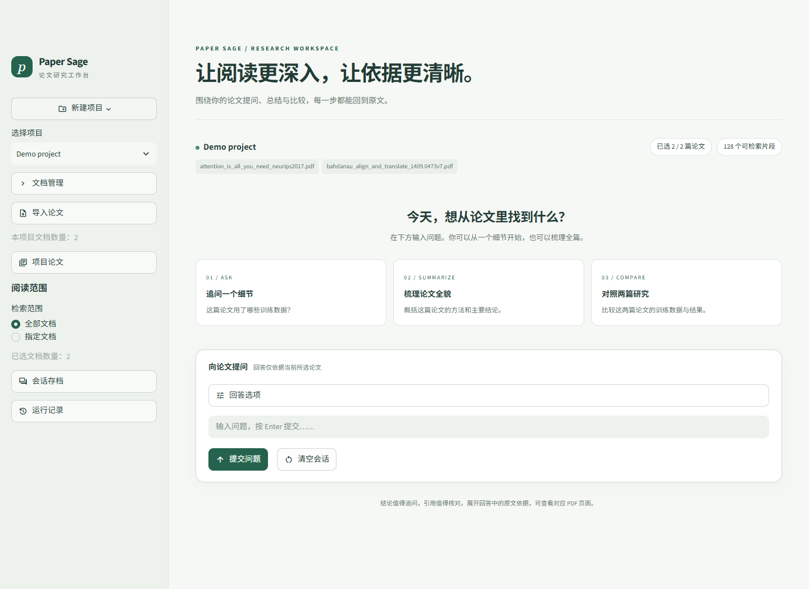

# Paper Sage

基于 **Streamlit + LangChain + LangGraph** 的本地论文工作台，用于学习 Agent 开发。按项目管理 PDF，限定检索文档，自动路由到问答、全文总结、双篇比较或澄清，并展示可追溯的原文和 PDF 页码。

**学习进度：42 / 42 个学习日已完成。** 已完成按功能分包和练习清理，迁移后 368 项测试全部通过。完整学习路径、每日任务状态与原始验收记录保存在 [学习日志](docs/learning_log.md)，后续每天继续追加。



界面采用浅色背景与深绿色强调色，侧栏按项目、论文、会话和运行记录分组；“提交问题”和“清空会话”并排位于输入框下方。“先检索，稍后生成回答”保留在“回答选项”中。另见 [手机宽度预览](docs/images/workspace-mobile.png)。

输入问题后按 Enter 或点击“提交问题”即可提交，输入框随即清空。处理期间显示运行状态，完成或暂停后给出明确提示，失败时显示错误提示；原问题保存在对应的聊天或运行记录中。

## 功能与边界

- PDF 导入查重、解析分块、索引保存、删除与失败清理，按项目和文档范围隔离会话。
- Dense + BM25 双路召回、RRF 融合、BGE Rerank 精排；各路最多 6 条，最终最多 3 条参考片段。
- 问答资料不足时最多检索两次；总结按全文文字分批处理；比较按两篇论文和指定维度独立检索。
- 模型返回结论及允许的来源标识，程序查回原文、文件和页码，可查看、下载 PDF 单页。
- JSON 会话存档、SQLite 图检查点、JSONL 调用日志；完整且通过结构检查的回复才进入聊天。

当前只处理 PDF 文字层，没有 OCR。检索可能漏掉答案，引用合法也不保证结论正确；比较需核对单位和评测条件。项目面向本地学习，未实现多用户权限与生产部署。

## 目录

```text
paper-sage/
├── app.py                      # Streamlit 启动入口
├── pyproject.toml              # 包元数据、构建方式与依赖声明
├── requirements.txt            # 当前环境的依赖版本快照
├── config.example.toml         # 本地模型缓存配置模板
├── .streamlit/                 # Streamlit 配置和密钥模板
├── src/paper_sage/             # 正式 Python 包
│   ├── projects/               # 项目元数据
│   ├── documents/              # PDF 读取、分块、导入、删除
│   ├── retrieval/              # 索引、范围、混合检索与工具
│   ├── llm/                    # DeepSeek 客户端配置
│   ├── agents/                 # 意图分类与 LangGraph 编排
│   ├── qa/                     # 回答、证据、引用、重试与复核
│   ├── summarization/          # 全文分批总结与汇总
│   ├── comparison/             # 双篇计划、检索、比较与复核
│   ├── sessions/               # 聊天会话与存档恢复
│   ├── workflows/             # 按轮执行、检查点、日志和续跑
│   ├── ui/                    # 页面与展示组件
│   └── evaluation/            # 检索指标、评估、演示和回归
├── scripts/                   # 命令入口
├── tests/                     # 单元测试与页面、流程集成测试
├── examples/                  # 4 个无需 API 的教学示例
├── docs/                      # 架构、学习日志、迁移记录
└── data/                      # PDF、项目、索引、评估、会话和检查点
```

设计理由、导入方法和新增功能的位置见 [Python 项目组织说明](docs/architecture.md)。旧文件到新路径的对应关系和清理清单见 [迁移记录](docs/layout_migration.json)。

## 本地运行

目前使用 Windows / Python 3.12。以下命令在项目根目录逐条执行，无需先激活虚拟环境。首次安装：

```powershell
py -3.12 -m venv .venv
.\.venv\Scripts\python.exe -m pip install "torch==2.14.1+cpu" --index-url https://download.pytorch.org/whl/cpu
.\.venv\Scripts\python.exe -m pip install -r requirements.txt
.\.venv\Scripts\python.exe -m pip install --no-deps -e .
.\.venv\Scripts\python.exe -m pip check
```

已有项目环境只需补充新增步骤：

```powershell
.\.venv\Scripts\python.exe -m pip install --no-deps -e .
```

`-e .` 把当前项目以可编辑方式安装到这个虚拟环境，修改 `src/` 后无需反复安装。`--no-deps` 适用于前面已经安装依赖的情况。`pyproject.toml` 从 `requirements.txt` 读取版本，避免维护两套清单；当前仍是环境快照，不是最小依赖或跨平台锁文件。

在编辑器中复制 `.streamlit/secrets.toml.example` 为 `.streamlit/secrets.toml`，填写自己的 `DEEPSEEK_API_KEY`。复制 `config.example.toml` 为 `config.local.toml`，设置精排模型缓存位置；本机使用 `E:/hf-cache/hub`。已有配置直接沿用，这两份本地配置不提交 Git。

第一次缺少精排模型时，单独准备缓存：

```powershell
.\.venv\Scripts\python.exe -c "from paper_sage.retrieval.reranker import load_reranker, get_rerank_cache_folder; load_reranker(cache_folder=get_rerank_cache_folder())"
```

页面只读取已有精排缓存，退出后不会自动删除缓存；向量模型与精排模型的缓存位置独立。启动：

```powershell
.\.venv\Scripts\python.exe -m streamlit run app.py
```

Git Bash 将解释器路径写成 `./.venv/Scripts/python.exe`，其余参数相同。使用项目环境的 `python -m streamlit` 可以避免误用外部 Python。项目关闭了文件监视，修改代码后请重启服务。

侧栏创建项目，上传文本型 PDF 并导入，然后选择文档范围。索引位于 `data/indexes/<项目>/<文档>/<版本>/`，不提交 Git。新克隆若沿用 Demo 登记却缺索引，按 [数据与索引说明](docs/architecture.md#数据与运行目录) 重建；重复上传已有文件会查重，不会重建索引。

命令以当前工作目录作为数据工作区，请在仓库根目录运行。代码迁移不改变 `data/`、密钥和缓存配置的位置。

## 检查与演示

```powershell
# 固定 14 项回归：受控模型，不请求 DeepSeek
.\.venv\Scripts\python.exe -X utf8 scripts/run_regression.py --run all

# 全部测试
.\.venv\Scripts\python.exe -X utf8 -m unittest discover -s tests -p "test_*.py"

# 只检查演示输入；增加 --real 才运行真实模型
.\.venv\Scripts\python.exe -X utf8 scripts/run_demo.py

# 检索评估输入检查，不加载模型
.\.venv\Scripts\python.exe -X utf8 scripts/evaluate_retrieval.py --check
```

回归、全套测试与真实演示请依次执行，避免工作区快照检查和并发文件写入冲突。旧演示的源码摘要属于旧布局，不能在新布局下强行重放；历史结果仍可阅读。

本次重组在现有 Python 3.12 环境中完成：368 项测试通过，可编辑安装、仓库外导入、wheel 构建和 4 个示例检查通过，原有 133 个数据文件摘要不变。详细结果见 [迁移验收记录](docs/layout_validation.json)。这些检查未请求 DeepSeek，不代表重新评价了模型回答质量，也未重新创建虚拟环境安装全部依赖。

后续界面调整已通过 14 项回归与 8 项针对清空、PDF 查看和会话恢复的检查，并在真实 Chrome 中检查了桌面与 390px 手机宽度、空提交和清空草稿；结果见 [界面检查记录](docs/ui_validation.json)。

其他实验入口：`scripts/compare_retrievers.py`、`scripts/compare_recall_limits.py`、`scripts/validate_recall_limits.py`。实际运行会加载本地模型；先查看源码或支持的帮助参数，确认输入和报告位置。

## 学习资料与维护

| 阶段 | 内容 | 状态 |
| --- | --- | --- |
| Day 01–07 | 模型调用、消息、JSON、异常与运行配置 | 已完成 |
| Day 08–14 | PDF、分块、向量索引、基础 RAG 与评估 | 已完成 |
| Day 15–21 | 项目、导入删除、范围与会话隔离 | 已完成 |
| Day 22–28 | BM25、RRF、精排、阶段记录与检索实验 | 已完成 |
| Day 29–35 | 工具调用、LangGraph、路由、总结、比较与重试 | 已完成 |
| Day 36–42 | 证据、复核、原页、恢复、日志、回归与复盘 | 已完成 |

保留的示例均无需密钥，可直接运行：

```powershell
.\.venv\Scripts\python.exe examples/langgraph_state.py
.\.venv\Scripts\python.exe examples/tool_call.py
.\.venv\Scripts\python.exe examples/memory_checkpoint.py
.\.venv\Scripts\python.exe examples/retry_decision.py
```

其余 76 个完成阶段的一次性练习已在备份后清理；正式代码和测试不导入它们，历史报告继续保留。

- [完整学习路径与每日记录](docs/learning_log.md)
- [架构与 Python 包组织方法](docs/architecture.md)
- [Day 42 验收与内容复盘](data/evaluations/day42_completion.json)

维护约定：README 保留当前启动方式与进度，每日细节追加到学习日志；正式逻辑进入相应功能包，命令脚本仅作入口。新练习优先整理为独立示例或有意义的测试，不再长期堆在根目录。

更新依赖快照时排除本项目，例如先运行 `python -m pip freeze --exclude paper-sage` 核对输出，再以 UTF-8 保存；不要把本项目的可编辑安装行写回它自己的依赖文件。
